# 【精翻】ICT原版无废话版一：流动性与市场结构转换

- 作者 耳朵数字观察
- 时长 43:35
- 来源 [https://www.bilibili.com/video/BV1rjbM6vEQk/](https://www.bilibili.com/video/BV1rjbM6vEQk/)
- 由 course2md 生成 · 22 张截图 / 150 段文字

---

## [00:00](https://www.bilibili.com/video/BV1rjbM6vEQk/?t=0)

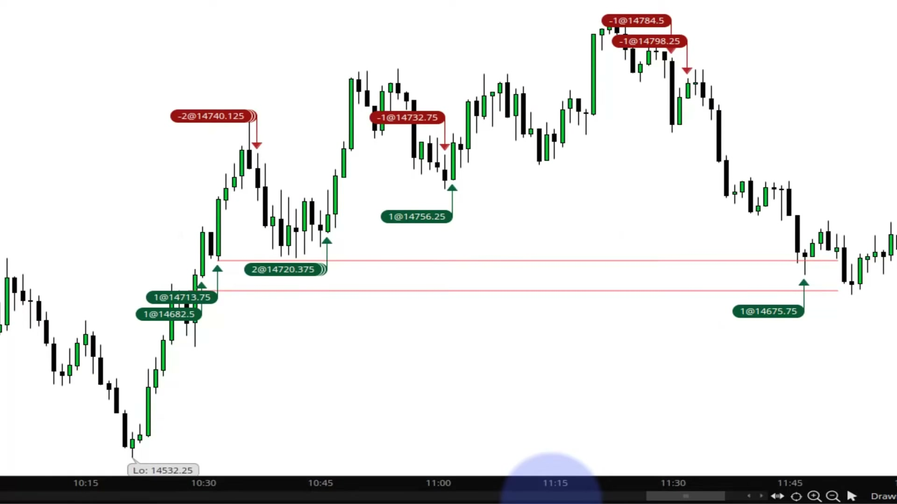

Alright, so coming out of the gate, I just want to let you know that this is predominantly going to be a futures index trading mentorship. Okay, the idea is going to be presented in the scope of paper trading on TradingView. com. But what you're looking at here, this is ThinkerSwim's live data. These are actual executions I made today.

And I want you to compare and contrast with what you see on YouTube and other educators, where they'll tout that they can do this and they can do that. But really, I want you to compare and contrast what you see here. All right. So we're looking at intraday price action for NASDAQ E-mini futures, and this is actually the the main.

Focus of this mentorship. I believe that this market is worth studying. I believe it is not just limited to Nasdaq, but I believe it's useful to learn as a trader that views obviously the E-mini S and P, the E-mini Dow Future, and the E-mini Nasdaq. Now, even the Nasdaq is a little bit faster, a little bit more aggressive, and even with that, you can still trade it. So, I want you to think about.

What it means to watch price action and understand what it's likely to do before it does it. Now, I'm not promising you're going to be able to do that right out of the gate. What I'm going to show you is the compare and contrast to how I can trade versus what I'm promising to teach you in this mentorship: how to find specific setups in your demo account. I'm not trying to entice you to trade with live funds.

The teachings will be predominantly through the scope of TradingView. com's paper trading module, or just hindsight data. What you're looking at here is actually live executions from today. Okay, and I want you to think about if you were able to trade a micro account and you were trading the Nasdaq and you were able to capture just one of these moves, which one would you like?

To learn how to find, I want you to think about which one really stands out off the entire chart. And this is a one-minute chart. Which one really stands out? I'll give you a moment. You can pause the video and unpause it when you're ready. Obviously, we can see how the market moves from here. Okay, two orders executed here. Whenever you see this.

This is actually a reversal. So, if there is a trade on long, it'll reverse and take you the other direction. Okay, and then this one here. This is a reversal as well. Then another close. And then another long entry. The exit. A short entry, and then the cover.

I'd like for you to consider what it would take for you to find consistency, and how many handles, how many full handle moves in an index futures contract that would satisfy you. When I say a handle, that's essentially four ticks, the minimum fluctuation in these markets. An example would be if you were trading the E-mini S&P, and you were trading, obviously, the four.

Four five zero level, and you went long. If it went to four four five one, that's a full handle, okay, or four ticks, or four times twelve dollars and fifty cents, or fifty dollars per handle. The NASDAQ is twenty dollars per handle, so it's slightly different, but it's faster. It moves a lot more, a lot more handles, a lot more aggression. Now, it doesn't always move faster. Sometimes we'll have.

A lethargic price action in this indice or another out of the three that would be the S and P, the Nasdaq, and the Dow. And these three markets have the luxury for you that may not have the capability to put up like seventeen thousand dollars margin if you were going to trade one full contract of the Nasdaq futures. Most brokers, unless you're using a discount broker, they're going to require you to have deep pockets and sense.

That you're going to have to about seventeen thousand dollars and about twelve thousand and a half for an E-mini S and P full futures contract. You take basically a fraction of that, and you can trade a micro on each one of these markets. But obviously, it reduces the number of the tick multiplier because you're trading with a lot less technically leverage. So I'm going to get into all that, but.

I just kind of like want to begin the conversation informally, but also just kind of like show you what it is that I do versus what other people do. So, if we look at the ebb and flow of all this here. Where the markets trade up and. Between here and here, it's.

Not a small number of handles. It's a pretty respectful amount of handles. It's not a couple. It's not a handful. And then up here, it's a reversal, and then it comes back down. And I buy it back here in reverse. So I'm selling short here. And I'm buying long here. Seven forty to seven twenty. That's twenty handles. Going long here at seven twenty. Getting out at. Seven thirty-two. Twelve handles. Then.

Going along here, seven fifty-six. And then getting out at seven eighty four and a half. Then going short at seven ninety eight. And covering at. Six seventy-five. So I'll ask you, which one of these trades do you think is the one that you want to learn? Again, putting all aside the idea that you probably want to do all these, but I'm not promising you that. Okay, I'm going to take you into.

How to find this setup here? Notice the number of handles. I'm not promising you to get this many handles, but the setups and the logic behind it will help you find these types of frameworks.

Framework is the foundation to a trading model. So you have to have an understanding of what it is you're looking for, and that's really the only thing I'm introducing tonight is the idea of what it is I'm promising to educate you with, so that way you can go in and find these setups on your own. Once you understand the rules and you go through the processes and things I'm going to teach you how to practice with, you will not need anything except for the chart itself.

So, if you look at this, this chart is clean, except for these little bubbles. Actually, show you the transactions. You don't really get any kind of distortion from your reading of price action. But the main takeaway here is: I want you to understand that I don't hunt for three to five handles and consider that legendary. Okay? Now, can you be profitable if you take high frequency?

Trades and you do those types of trades. Absolutely, that's what algos do—algorithms to do that. But I'm trying to show you, by contrast, that there is a way that you can find setups that are outside that parameter of very small little handles and doing lots of contracts. I'm gonna teach you skill sets that focus primarily on this.

## [05:32](https://www.bilibili.com/video/BV1rjbM6vEQk/?t=332)

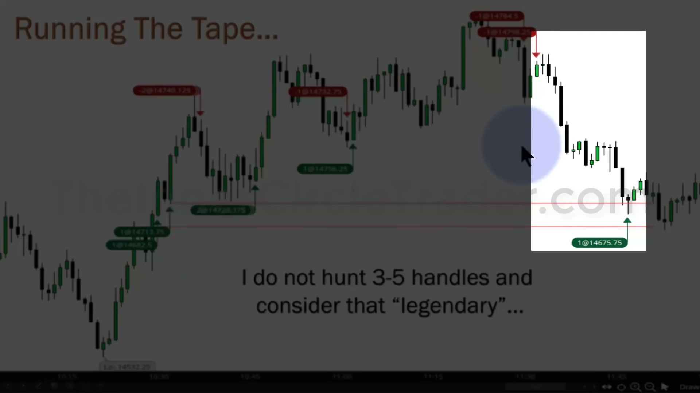

You want to find a nice price leg intraday. I'm

## [05:36](https://www.bilibili.com/video/BV1rjbM6vEQk/?t=336)

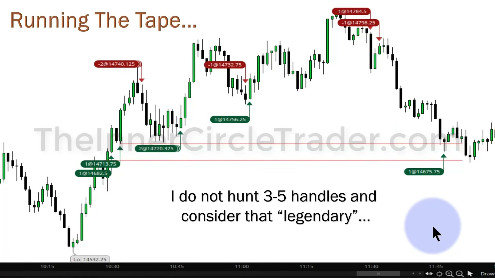

not promising you how to. Buy, sell short. Buy, sell short. Buy, sell short. That's that's mine. Okay, I'm not teaching that. That's why I set the stage in the first introduction video, so that way we know what it is I'm teaching you. If any one of you here don't want to learn how to take this type of trade, you're welcome to not continue and turn this video off and go watch

## [05:54](https://www.bilibili.com/video/BV1rjbM6vEQk/?t=354)

whoever. All right, folks. We're here. So technically, this is the first teaching. I gave you guys an introduction video. Obviously, if you haven't watched that one yet, go to the playlist on my YouTube channel, and please watch that one because it'll help at least establish the, in my opinion. The proper expectations. That way, you understand what you're getting involved with here.

And at least it gives me a chance to kind of break the ice and show you the contrast of what you may be expecting versus what I intend to deliver. Alright, so this first installment is going to be elements to a trade setup.

## [06:26](https://www.bilibili.com/video/BV1rjbM6vEQk/?t=386)

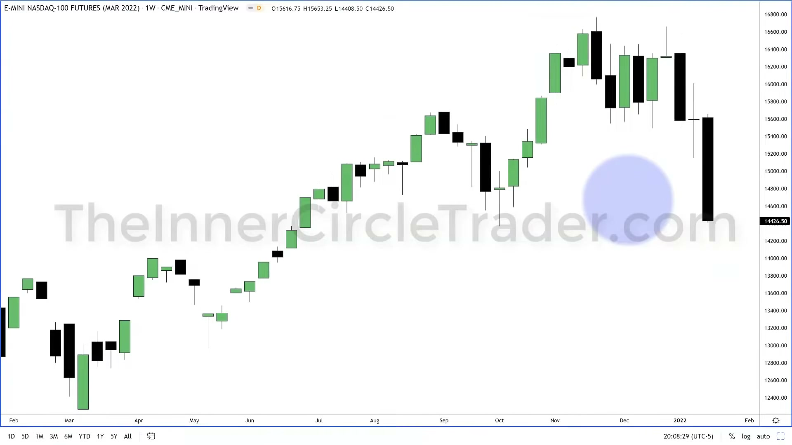

All right, so we're looking at the Nasdaq futures March delivery contract, and this is a TradingView chart, and this is a weekly chart. And I want you to think about each week before the new trading week begins, preferably on the weekend. The idea is you want to try to get a read on what you think that next weekly candle is going to do. Is it going to go higher or is it going to go lower? You're not trying to.

Predict the close of the weekly candle. That's important. You just want to see before this weekly candle opened up. All we had was this indecisive candle. Do you think that this candle that would have formed and opened here is more likely to go higher or lower?

And that's the component I want you to focus on with your analysis. What is the market likely to draw to? When I say draw to, think of it as price being a paperclip, and then you have this magnetic impulse that specific price levels and seasonality put on price. It'll cause price to gravitate towards certain levels, and the measure of.

Speed and magnitude that it moves to get to these levels—you learn that over experience. That's not something I can transfer. It's something you have to practice and see and study, and you get a rhythm for it. In the early stages of your development, you want to at least try to focus your attention on where that weekly candle is going to do. Now, here's the thing: it may start the first half of the week, or maybe just one day.

Expand lower, and if you get a setup in that, that's it. You're done. That's how you start working towards consistency. So the only thing you're looking for is a likely movement higher or lower based on the weekly candle. Okay, that's all you're doing. That sets your initial bias for the week. On the daily chart,

## [07:48](https://www.bilibili.com/video/BV1rjbM6vEQk/?t=468)

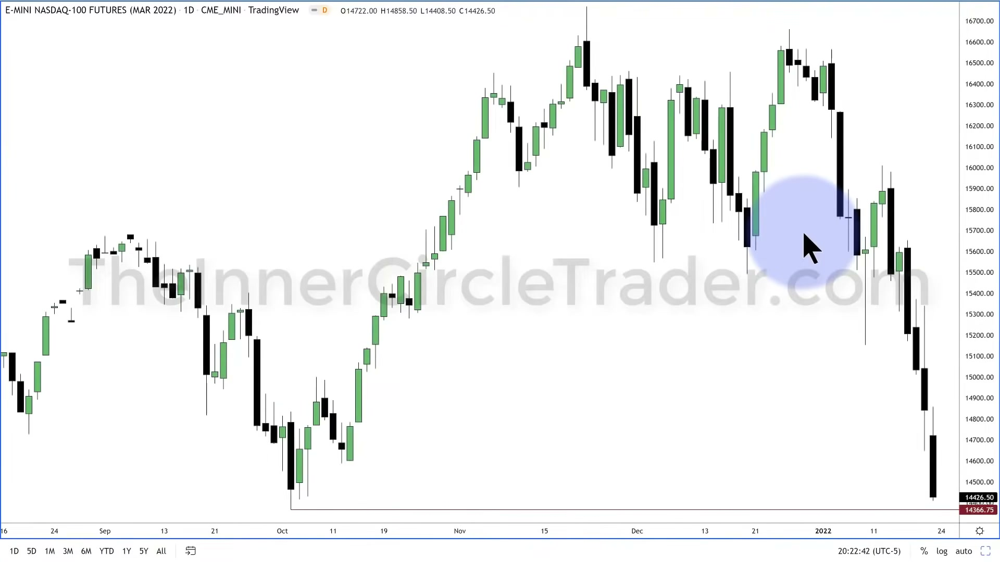

you're looking for swing highs and swing lows to get your liquidity. And majority of your trading and the draw on liquidity, what makes the market go higher or lower, it's predominantly found on this time frame. Okay, so majority of your analysis should really be linked to this time frame right here. You have to have an assumption whether you're going to be expecting that weekly candle to expand higher or lower.

That's your weekly bias, but then you have to go into the daily chart and figure out basically where you are in the grand scheme of things on that weekly range, expanding higher or lower. Because we're looking for lower prices and we're looking for weakness, the expectation is we want to see every short-term low. Like this would be a short-term low. This will be a short-term low, and underneath those lows is going to be sell stops.

Okay, that's liquidity. When I say learn to start looking for where the market's going to drawl to, it's drawing to one of two things. Okay, it's drawing to stops, which is liquidity, or it's running to an imbalance. Now, what does that mean? Above old highs, buy stops. Below old lows, sell stops. Imbalances is something like this over here.

Where you have one single candle pass higher, and the previous candle's high is here, and the next candle's low is here. So it only went up one candle. Nothing moved down. The overlap with that same delivery on that price candle there. So in other words, that's an imbalance. It's only going higher, and nothing else is here to offset that and efficiently deliver price on the opposite end.

We're looking for lower prices. We're looking for an expansion. We're looking at the daily chart. We're going to drop down into

## [09:06](https://www.bilibili.com/video/BV1rjbM6vEQk/?t=546)

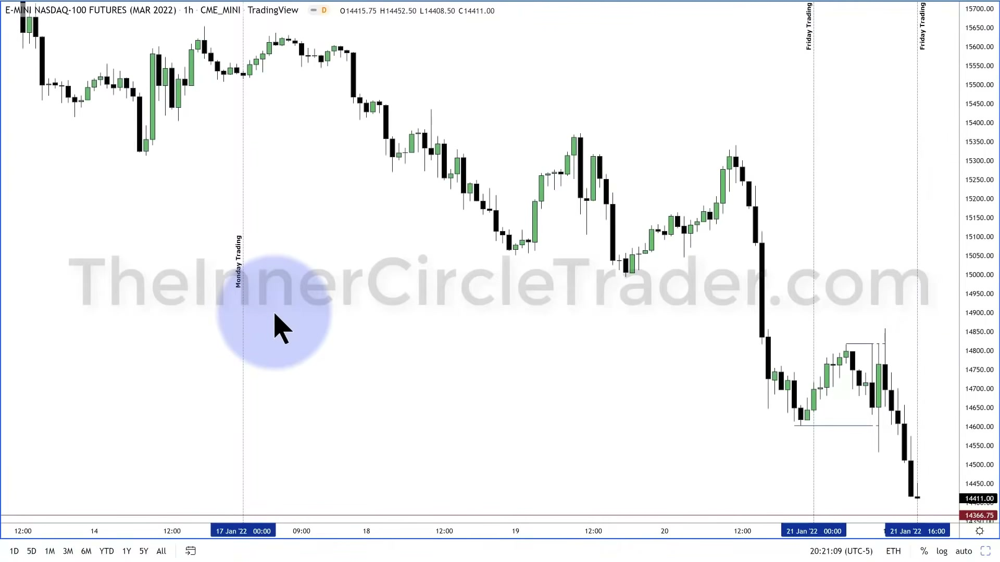

the hourly chart. Okay. Now, what I have here is a framework for looking at the weekly range on an hourly chart. So, all I did was beginning on midnight New York time Monday's candle, and then Friday's close, and then the beginning of Friday's trading at midnight. Now, what I'm delineating here.

Is the fact that we had a nice sell-off on Thursday and the market went into consolidation overnight? Notice what happens here on Friday. This is that old low on the daily chart. That's what we're thinking and we're assuming that it's going to draw to because that daily chart. There's lots of liquidity and large fund traders, large institutional traders, institutional mindset investors.

We'll be looking at these old lows and old highs, and liquidity providers will be looking to take business in around these same levels. So, if we know that this level down here.

Is the old daily low? And again, let me take it back up to the chart on the daily chart. That's this low right here. Okay, by dropping down into the hourly chart, that levels here. All I'm doing is transposing those daily levels right to this hourly chart. The entire week has been bearish. Okay, it's been going lower since the beginning. Then we had consolidation in here. The market creates this short-term high.

In this short-term low, what rests above that short-term high? If you've taken notes and been paying attention, it's buy stops. What's resting below this low here? Sell stops. Watch.

Closely, market trades down initially and takes out the sell stops. Why would it do that first? This is inducing shorts. Okay, so it engineers liquidity. Even if the idea is that they want to take the market down to this level, if it's been consolidating, I'd like to see them do this type of move here, where it drops down first.

It's kind of like a sucker play. Anybody that has a sell stop below here, they want to sell on weakness. They're going to get tricked into the marketplace. So now they're triggered in short, and then they start doing a run against those traders.

And against those that were already short from this high. So, what are they doing? The market's being driven higher, and the algorithm is going to attack that buy stop liquidity pool. Why would they want to do that? Number one, it's going to punish those individuals here that went short. When it drives it above this high here, it sends all those buy stops into market orders.

Flooding the marketplace that gives a huge influx of willing buyers at a high price, which is the perfect counterparty to smart money that wants to sell at a high price. Remember, the market wants to go down here. So when it dries up to here, those buy stops are the counterparty or the other side of a smart money trader that's wanting to go short.

Because they're going to sell short, they got to sell it to somebody who wants to buy at a high price. That's why the market does this. In your notes, you want to record any time a significant price move lower is expected. Always anticipate some measure of a stop hunt on buy stops or a short-term high being taken out. Obviously, it's reversed when you're looking for higher prices. Generally, you'll see a short-term low taken out.

And sell stops taken before you see a very pronounced rally higher. Don't take my word for it. Go through to your charts, and you'll see it's actually occurring almost on a daily basis. So we're going to drop down into a fifteen-minute

## [11:46](https://www.bilibili.com/video/BV1rjbM6vEQk/?t=706)

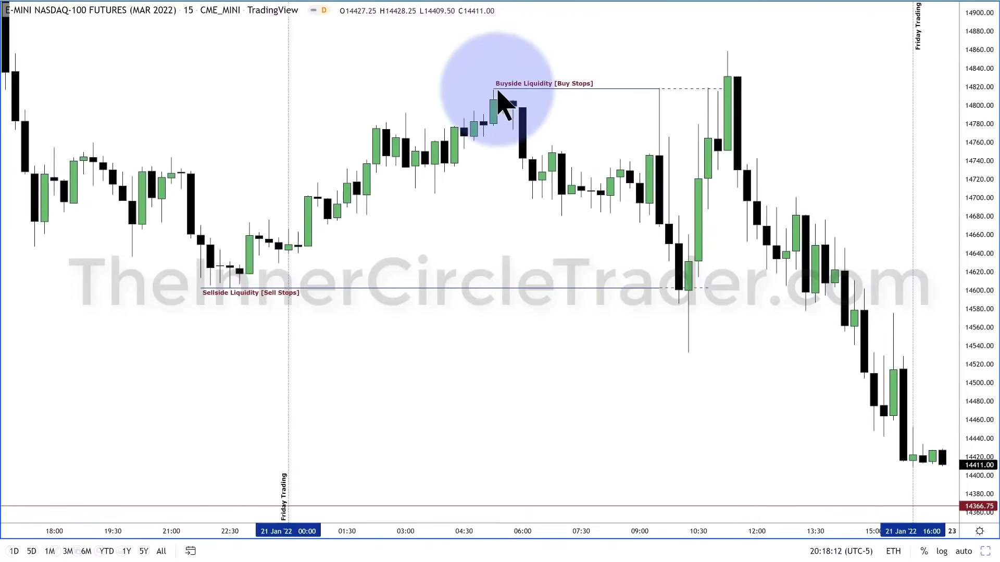

time frame. So that same old low level down here, and that high I just mentioned on the hourly chart, and the low on the hourly chart is now. Been defined with a small little line segment. Okay, so we have a trend line here and a trend line here.

That's the extent of a trend line. That's it. I only use them to highlight to my students. These levels are not on my chart. I'm watching a naked chart. You, while you're developing, you should have these levels drawn out on your chart because it helps you build and engrain the idea that this is where liquidity is. It keeps you focused on that because it's easy to look at all these candles forming if you have the luxury of watching it live and.

You can lose sight of where you are, and once you lose your bearings, it's really confusing. And this helps you keep those bearings in mind. And what do I mean by that? Well, I mentioned how the market dropped down initially, and that takes the sell stops out. So sell side liquidity has been attacked. Traders are now tripped in going short if they sold on a break, trying to be a breakout artist.

And then the algorithms go right back up to an area where it's been cleanly delivered. Relative equal highs. See how this high here, right before it dropped. Is basically the same high here. Notice that. So retail traders see this, and they trust it as what. Resistance. So the books always say. Put your buy stop if you're going to go short right above and clear level of resistance.

Well, these levels work for a short period of time. But majority of the time. You see this event right here, and this is how I teach my students to go in here and look for those types of events because.

What did I just tell you a moment ago about looking for significant price moves? Before there's a significant price move of any real magnitude or importance, generally there's going to be a stop hunt that takes place right before that price delivery occurs. So, what does it look like? You have relative equal highs. This high and this high. The market goes up when we're what?

We're expecting lower prices on that weekly chart. We're on the last day of the week. It's already been heavy. It's weak, and the only thing it's been doing is consolidating. And the first thing did was broke out to the downside. Tripping, what traders in a breakout to go short. So now they have. Traders caught on the wrong side, off side.

And now they want to take the market up here, where those buy stops are going to be resting. For those that were smart enough to sell short here or here and didn't get out below here, so the larger pool of liquidity is going to be resting here. Because it's in sync with the downtrend, and everybody that was short the day before, they seen this high form, and once it broke below this low here.

They all rushed and trailed their stop loss right above that. But this pool of liquidity, once this occurs. You want to drop down to your lower time frames and start looking for something specific. And let's go into these lower time frames and find out what that

## [14:08](https://www.bilibili.com/video/BV1rjbM6vEQk/?t=848)

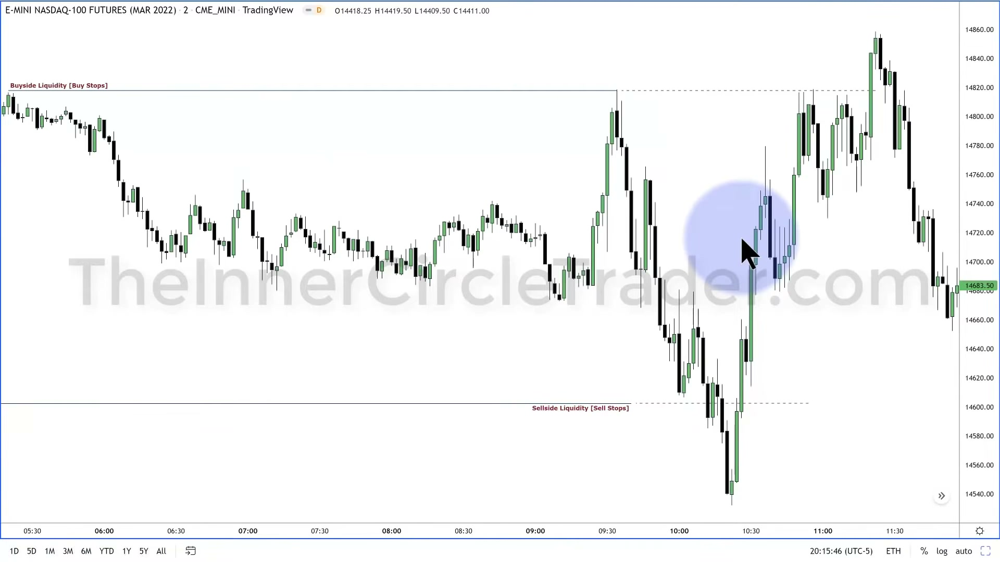

is. Okay, here's a two-minute chart. Why a two-minute chart? Well, two-minute, one-minute, or three-minute, or five. Five minutes still has a lot of room for imbalances to occur underneath that time frame, and what I mean by that, the one minute, two minute, three minute chart tends to be the best for finding the imbalances for indices.

Okay. Don't take my word for that. Okay, if you're looking for high frequency setups intraday. The one, two, or three-minute chart—they just offer a real good clarity. The reason why? Because the high-frequency trading algorithms are operating on nothing really higher than three minutes. But majority of the time, they're like seconds.

Fifteen second, thirty second, forty five second, sixty second intervals. Okay, and what they're looking for. Are these small little imbalances, and what does that look like? We had that run on the buy stops here. Okay, remember that. Old high here. The old high here. Old high here. It runs right on through that. Once this occurs on that higher time frame, fifty-minute time frame.

You want to drop down to the lower time frames, and I'm using the two minute chart because this is exactly what I was using to find that imbalance. The market creates a short term low here. And then it breaks below that. This is key. This is called a break in market structure. Now, the foundations and underlying framework is we're in a market that's what weakly.

Bearish. We are expecting that weekly candle to expand lower. It's been expanding all week. So we have momentum on our side. We have a consolidation that's occurred. And we had a pool liquidity engineered with these relative equal highs. And the market broke out to the downside first, and then they ran on. The highs. So once it went here. We don't rush in there and just go short because it went above old highs.

We're looking for some specific signature that tips its hand to you. Okay. And I promise you, when you start going through your charts, and it's going to be homework for you. You're going to see this occurring almost every single day, and if it's not doing it this way, it's doing it the opposite direction as a buy. It runs the stops.

Then we have a short-term low, and then it breaks below. So now we have a break in market structure. Once this low is broken. You're gonna look for this little area here. That's that imbalance I mentioned in the beginning, right? So what's happening is, is the market's going to go right up inside that area there. And that's where you want to sell. Now, if you don't sell there.

You can drop down to a lower time frame, one-minute chart. If this was a three-minute chart, you can go down to a one-minute chart. And look for that to occur. On that time frame, as well. And many times will form if you're looking at a lower time frame, like say this was a five-minute chart. And you looked at a one-minute chart. You'd find one down in here. It's a matter of scaling down in your time frames.

Because once you have an underlying premise to the market now likely to go lower, it becomes an easy thing to look for these types of things. So, in your chart, once you're developing this idea and learning it, you're gonna highlight this candle's low, this candle's high, and this right here is what I teach my students as a fair value gap. The idea is once it go up into that imbalance there.

And once it does that, as soon as it enters that area, the algorithm that delivers price. Once you see these patterns over and over and over again, it's very easy to execute on them.

This is what it looks like. This is what you're looking for. Okay, these are the fingerprints of that setup. So, if you know what they are and what those components are that make up this setup, you'll be able to find them. But focus on the imbalance after the market structure breaks. So, this big candle here—it breaks down. Look at the next candle. It opens.

And trades higher and stops right there. So, from this candle's low and this candle's high, when this candle starts trading. Soon as it opens and it runs right up into that, that's a short. You can go right in there, sell short, be done. Now, where's your stop gonna be? Well, you can put it above this high here, or you can put it above this candle's high. Whichever your risk parameters allow for.

Looking at this further. We're going to look at the logic in here, and I want you to think about after this forms, and you see that as your choice setup or entry. If it starts to move lower, you can still get in it.

There's no reason not to think that you you can't get in here or in here. It's close to or in close proximity to where that area is as an entry. Once we take out a low, though, once that occurs, then it becomes a matter of you're chasing price, and if you try to get in, especially if you like use a market order.

You may see it trade right to this low and say, "Okay, now I believe it's going to go down," and you put a market order to sell short, and then slippage gets you down here. That creates a larger area of risk that you have to assume. It's it's problematic. You want to learn to trust going short when the market's going higher, and that feels scary at first. But once you start seeing this pattern form.

It becomes easy to trust it, and in fact, you want to be doing that. You want to be selling short, expecting lower prices. Right when the candle's going up. If you're looking at this framework here, and we've taken the buy stops, we have our entry pattern here. What would you be looking for as a downside objective? Well, I'm going to teach you. The liquidity matrix. This here is your range.

This is the low of the day, and this is the high of the day thus far. So, if we take that range and split it from the low to the high to get the midpoint, all this can be determined by a simple fifty level on a Fibonacci. So you drag your Fib. From this high down to that lower, vice versa. And have your fifty level highlighted. Then, anything above that fifty level, this is referred to from an algorithmic stance.

As a premium market. It means it's expensive now. Markets can stay in a premium for a while and not go to a discount, which would be below the fifty point. Okay, fifty percent. Anything down here is a discount. If you're bearish, if you're going short, you want to look at the previous range. Where are you at inside that range? So when this formed here, that little.

Fair value gap. Once that formed, you're thinking, okay. We are in a premium. So algorithms will want to go to a discount. That's the opposing side of the marketplace. So if it's going short here. It's driving the market lower. What does that mean? The algorithm is going to start pricing lower. You can have all the buyers in the world come in.

If the algorithm is in a cell program and it's going lower, it does not matter. It's going to reprice lower and lower and lower, and then what will happen is those buyers that may come in with a huge influx of volume. They're gonna get crushed. So the market's moving from this premium high. This specific entry point to a level below the fifty of this range. This low. In this high. I want you to think about. What.

Below this level here, the fifty level, what is resting below here?

Sell stops. So now think about the idea of someone like you and I that would see this ideal entry as a short. We had to sell to get in that short. How do we get out of that short? We gotta buy it back or cover it by buying. Well, we're gonna find. Willing sellers at a low price relative to this point here. They're willing already, sitting down there with their cell stops. Right below that low. Now look closely.

What else resides right near that low? Right there. Is that imbalance I mentioned? Okay, it's only one single candle passing up, and the previous candle is high, and the next candle is low. That area right there is an imbalance. From this area here, it went down below the fifty level and attacked. The cell stops. And completely closed in this imbalance, so every point of this candle's high. So this candle's low.

That range with the candle only going up. That's a by-side imbalance. It has to have. In equal delivery. To be efficiently priced and booked by the algorithm. It goes down and completely closes it back in with down movement. Notice the candle on this here; it opens and then trades down, so it fulfills its role of balancing the buy side offering.

Now the sell side offering. So that is an efficiently delivered price move. Precision elements from the entry here. Down to here. I basically just handed you an ATM machine. This repeats. Every single week. Every single week, these are simple elements that repeat. What you're looking for is a run on liquidity. Buy stops or sell stops. If you're bearish, you're looking for buy stops to be ran.

Then a break in market structure, lower a short-term low being broken. That's what it looks like right here. Short-term swing low. We have candle high. I'm sorry, candle higher to the left with with its low here. Then you have the low of this candle, and the next candle is higher low than this one. So you have a swing low formed.

If you have that, and you have a break below that, if it happens, that creates a gap like this. That's what you're looking for. When it trades up into that, you can go short.或。If you want to use cell stops, you can use a cell stop in this candle here. And just let it trip you in, and then use the high of that candle as your stop. All right. So

## [22:06](https://www.bilibili.com/video/BV1rjbM6vEQk/?t=1326)

I'm going to give you some homework in closing. I want you to go through all of the E-mini futures contract charts, okay? Just like I showed you here. These time frames. Go back and look at the presentation and see what the time frames I gave you. Listen to what I gave you in terms of audio commentary using the logic I framed in this introduction lesson. Looking for breaking market structure. I also have lessons in this YouTube channel that talks about market structure breaks and things like that.

And then you're going to look for the imbalance in price, which is that fair value cap. Then you're gonna determine. Where an opposing high or low resides, then log and back test the number of handles you see in hindsight examples. In other words, how much did it offer? And you're gonna get a collection of doing that. The next lesson, I'm actually going to show you how to go back into the chart and look for them.

How to log them in your journal, and give you more insights about how you can find these setups that repeat every single week.

## [22:52](https://www.bilibili.com/video/BV1rjbM6vEQk/?t=1372)

All right, folks. Welcome back. This is the internal range liquidity and market structure shifts

## [22:58](https://www.bilibili.com/video/BV1rjbM6vEQk/?t=1378)

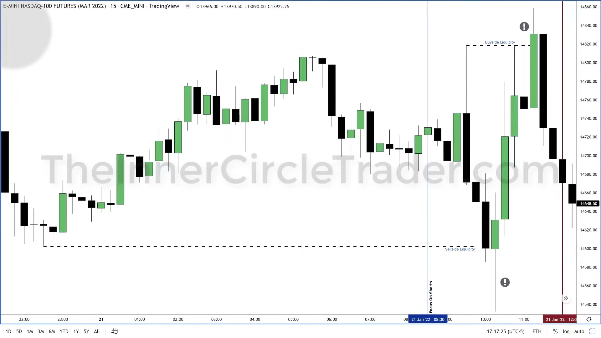

lecture. Again, fifteen minute time frame on the E mini. Nasdaq One Hundred futures contract for March delivery, twenty twenty two. And take your attention over here. Okay. This old low. And these relative equal highs. Old low below that is sell stops. And relative equal highs above that is buy stops. Now you could have used this high here. There's nothing inherently wrong about that, but whenever I see.

Equal highs like this, my, and if it's higher than an old high right here. I'm gonna use that. That way, it's a little bit of insight for you for your study journal. The sell side liquidity. You can see that the market trades down, hits that, runs through it. Then rallies all the way back up, clearing equal highs. So the by-stops have been taken here. So, at both of these price points here. And here. That's the.

I guess the point at which. You look for or anticipate a market structure shift. And you don't force it. Okay, I see a lot of people try to teach my concepts. It'll. Talk about market structure breaks or shifts, and we'll use that term interchangeably. For. Intraday, I want you to think about intraday market structure shifts because it's not necessarily a. Break in market structure that leads to prolonged. Multi-day.

Movement. What do I mean by that? If you see market structure that's. Bearish. And it's broken to the downside. Interday that may just lead to an interday price leg that may eventually see that high. Be taken out in the same day. So that's why I'm using the term. Market structure shift. Not market structure break. For our conversation here on this mentorship, just know that when I'm.

Gonna lean on that term: market structure break. It means a little bit more in context versus an intraday shift in market structure. Just means that there's likely. A downside. Draw. Or an upside draw intraday. By saying the term shift. Okay, so there's a little bit of. Semantics there. All right. So we have. Both of these areas. And here, where there would be a likelihood. Of a market structure shift. Up here.

We look for a fake. Run above here. So that fake run above. How do we know it's going to be a market structure shift that's bearish? Now, keep this price level in mind. So it's essentially fourteen thousand six hundred and fourteen thousand eight twenty, which is eyeballing it. Okay.

## [25:28](https://www.bilibili.com/video/BV1rjbM6vEQk/?t=1528)

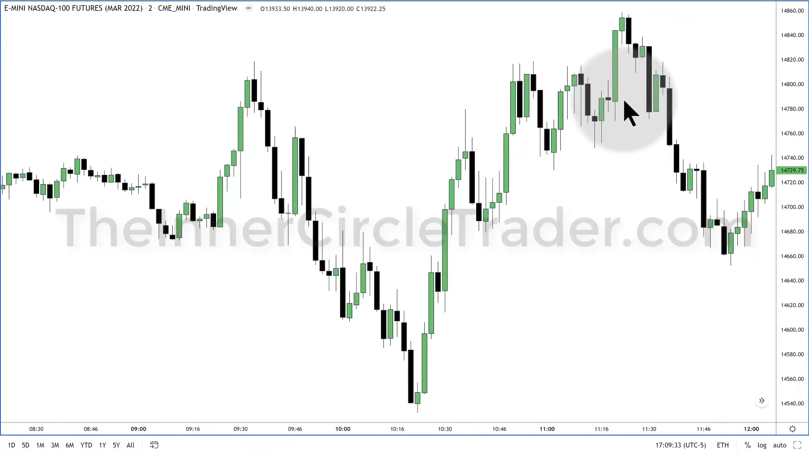

Now, dropping all the way down into a two-minute chart, this is that same particular day. Here's those relative equal highs, and this run down here. If you recall, fourteen six, and around that. Fourteen eight sixty or so. If you look at this market structure, without having the levels on your chart, it's easy to get lost. When we had this low formed, right before this low was formed, there's a swing high right there.

Now, in the first mentorship video I gave you, I mentioned that high-frequency trading algorithms will use market structure on a three-minute, two-minute, one-minute chart many times sub one minute. That would be like forty-five second, thirty-second, fifteen-second intervals. If you look at this short-term high here, right before this low formed, when this high is taken out right there on that candle, that's significant.

Only if this run down here has traded into sell stops, okay, below an old low of some kind. It could be a double bottom, it could be a single low, but it's got to be trading under some retail idea that would be viewed as support. Up here, the same thing. When this. Run above these relative equal highs. Happens right there. You're anticipating a market structure shift.

Let me go back to this for a second. We have this high on this candle. Then we have the candle right after that here, the highest one. And then the lower high of this candle here, so that's a swing high. Very simple little pattern. But it means a lot when it's in the proper context. When this high is. Broken with this particular candle, right there.

That is significant only on the basis that we have taken liquidity out of the marketplace. That's it. So when it broke this short-term high. This is more meaningful, and then the market will start to seek buy stops. Okay, or buy-side liquidity. That would rest about here. Here.

So here's those cell stops. So this little area here that's shaded in that's a area where cell stops would be residing below that fourteen six hundred level. Okay, on that fifty minute time frame. So the market dove into that liquidity, and you may or may not know that is a buy. You don't need to. You anticipate a. Shift in market structure.

When the market rallies above, when does that happen? On this candle right here, see that little light bulb. That's when you're thinking, okay. Now I have a condition in the marketplace. That I might see an opportunity intraday. Let's see if there's further evidence to that. Short-term highs taken. Here we traded above it. It does not need to close above that. Okay. Real important. Once that candle closes.

And this candle opens. You're going to monitor this candle, and you want to see as soon as this candle closes, does it create that fair value gap? If it creates a fair value gap. Again, that's a candle with a high. One single pass up. Next candle has a load. It doesn't completely overlap all this. That's a fair bag. Yeah, real simple.

This candle is where you would look to potentially trade at the earliest, because now there's a gap there. The market trades down into that. Boom. See these downclosed candles. That's all one. Continuous order block. What's it doing? It's inside that pool of liquidity. Sell stops. Where's the open on that? Series of downclosed candles right here. That's the price level extending out in time.

So inside this fairway gap. This opening price on the order block—that's your buy. Plus. Three pips or whatever were spread. And that's what you would use for a limit order. Well. Price starts to run where. Above the highs, where buyers' thoughts will be here. Above this high. And about this high here. So, buy starts. Above here, that was taken.

This swing low forms once this candle closes. So, this candle we're watching. Does it go below that short-term level? It does. So now we have a shift in architecture that is now bearish. Only because we've taken buy stops. Fair value gap forms. The market rallies up into that. You go short there. What are you looking for? Below here, sell stops. Below here, cell stops.

Below here, cells dots, and in this Faraday gap here. So, if you are in a position that has multiple contracts. You can take partials. Below here. I probably wouldn't do it there, but below here. Here. And then somebody's saying, "Why wouldn't you take him below their I C T?" Well, if you're trying to get short here, that's not really that much movement.

So, if you're going to take something off your trade below that low, why not just try to reach for that one? And you could get it there. Okay, and then. Although that low is nice as well. This is. Below the fifty. Level of this high. In that low, okay, so fifty percent level. That's what we targeting. This candle's low was the high end, or first objective. Inside this gap.

So that's your target. You're going to look for that. So you're looking for low-hanging fruit, the easiest target to get to. You're not trying to be perfect, and you grow into eventually holding to see if it will fill in that gap. Okay, this very big. I was going down to this candle's high. That's something that you strive for over time. If you understand what I just showed you here.

That's a very simple process of looking for number one liquidity, gauging what happens without having to know for certain, because you don't know. You're not going to know. Until the market shows its hand. This is it showing its hand.

Now let's go into a one-minute chart and see how that looks. A little bit different, but still has the same characteristics. Here's that same price

## [30:38](https://www.bilibili.com/video/BV1rjbM6vEQk/?t=1838)

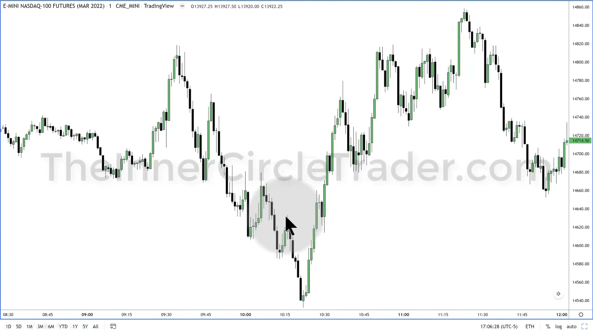

structure, just on a one-minute chart. The same logic still there, right? Swing high. Taken after liquidity's been. Traded into. This short-term high. Gets violated. Right when this trades down in here, what's actually occurring? Okay. Put this in your notes. High-frequency algorithms are hammering. They're. Just throwing orders in, buy, buy, buy, buy, buy. That is not okay. Here's the important thing.

That is not causing. The market to go higher. It's just volume that's coming in. The algorithms that deliver price, that offer price, that are constantly offering price. In the marketplace. That's what's beginning to spool and go higher. Okay and. Regardless of where you want to trade at, your limit orders they may not get filled. Where you're trying to buy with a market order.

You may think you're getting in at fourteen six sixty two. But by the time your order is executed and confirmed. You're in fourteen six sixty four. It's slippage. Okay, that's negative slippage. If you were trying to buy it at fourteen six sixty two. And it filled you at fourteen six sixty one. That's positive slippage. That's better than what you were expecting. So. When the price starts to rally.

All this is is a default to the algorithm constantly offering price a higher price. So we're looking at the swing low right here. Market breaks down. Trades break back up into this back up into this fair value gap here. And sells off. There's another fair value got right there. Tries up into that as well. This is a one-minute chart. So it's giving you multiple points of execution that you could trade on.

And then, dies. See these two candles here. That's one consecutive bearish order block. The opening price. Extending out in time. Why is this a good bear shoulder block? Cause it has that gap. And it's taken liquidity. And there's an market structure shift. There's your high frequency, high power, high probability bearish order block. What it is.

It's a change in the state of delivery. The market's being offered higher, higher, higher, higher in these two up close candles. How did this series of up close candles begin with this candle's opening? Right there, that opening. Once this candle trades below it, that changes the state. Of delivery, so you go back to that point of reference right there.

And that's why it's sensitive. The algorithm remembers that right there. Okay, that's all I'm going to give you on the free mentorship level. But that is your answer. Okay, that is what an order block is. It is a change in the state of delivery. Much in the same way, all of this movement down here, all these down close candles. The opening on that candle starts this series of delivery on the downside.

When that opening price gets violated here. It changes the state of delivery. Now it was offering. Cell side. When it goes above that opening. Now it's offering buy side. What will it? Be doing after that. It will be looking for. Buy that. Buy that. Bystops because it's offering buy-side liquidity. Same thing here. By side. Is being offered.

Until that opening price is violated, right there, then the change of state of delivery occurs. Now the market's going to be doing what? Offering sell-side liquidity. What's that mean? It's going to start going lower and attacking the sell stops. All the sell side liquidity—it's offering it to the marketplace. That's what's happening. That's what the algorithm is doing.

But the market goes down to that fifty percent level. Because it's going down to what I teach you. What did I say in the first video? It's going down from a premium. Market. Relative to this low and this high. Fifty percent is here. That's equilibrium. So it's going to go down to a discount, and that's that gap right in here. Does it doesn't look like a gap so much here? But if we go back up one more time.

That's that single.

## [34:06](https://www.bilibili.com/video/BV1rjbM6vEQk/?t=2046)

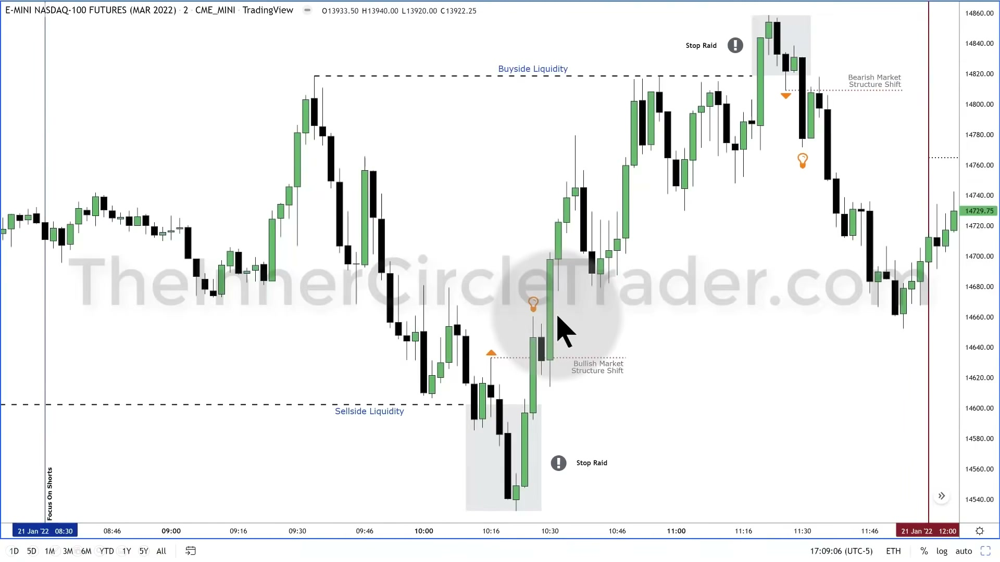

Opening right there. On a two-minute chart, but then on a. One minute chart.

## [34:10](https://www.bilibili.com/video/BV1rjbM6vEQk/?t=2050)

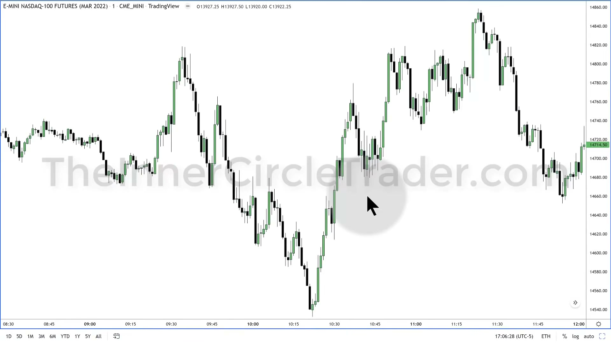

It's two candles that make that up, but. You're going to have to do is go through a progression of going from the three-minute, two-minute, and one-minute chart. And you'll get your market structure and your areas of where it wants to look for an imbalance or over, low, over, high, and it just makes it easy. And here's the lipstick on it on the one minute chart. Swing high. Is broken. Market structure is now bullish.

Rallies. Taking buy stops. Taking buy stops. Taking buy stops. This right here, these highs right here, it's just staying below that low. It's building up. More interest that this is what resistance. That is engineering liquidity. That way, when this runs above it. Those individuals that know what you're learning today, they know that that's a pool of liquidity for buyers coming in at a high price. Why is that useful?

Because smart money that bought down here, or here, or here, or here, or here—that's where they sell. To high-seeking buyers, real nice delivery here as well, filling that fair value gap. Changing the state of delivery now; it's offering sell side. What's that mean? It's going to match up sell stops. It's going to keep going below old lows. Into an imbalance. Until we get down to a discount. So, with that.

I want you to think about how this is useful. Number one, you're looking at London highs and lows a session for London open. Okay, for instance, like two o'clock in the morning to five o'clock in the morning. New York Times. Every every time I tell you, just always said it. With New York local time. Two o'clock to five o'clock in the morning. That's your London session. What's the highs and lows of that session?

That's important because the market's going to probably sweep above those highs or sweep below those lows. And create situations like this. Okay. And the New York session is seven o'clock in the morning to ten o'clock in the morning, New York local time. Okay, what's the session high and low for that? And do the same thing for Asia. Okay, seven p.m. to nine p.m.

And that's it. Those are the three times of the day that I'm looking for specific key highs and key lows, and any intraday high and low forming right before the equities open at nine thirty. Pretty easy, right? The hours of operation again are generally between eight thirty in the morning to eleven, but.

It can be extended all the way to New York. Launch noon. I do not tend to take trades after noon local time, New York. That hour is usually very problematic, and it's just it's better not to even look for any kind of setups.

Wait until one o'clock, preferably really one thirty to four o'clock. Then you got the afternoon trend. Typically, you'll see between two o'clock and three o'clock. There's a setup that usually forms in the afternoon trend or setup in the period, the time of the day that will also offer opportunities. But that's outside the scope of what I'm going to be teaching in this mentorship.

## [36:34](https://www.bilibili.com/video/BV1rjbM6vEQk/?t=2194)

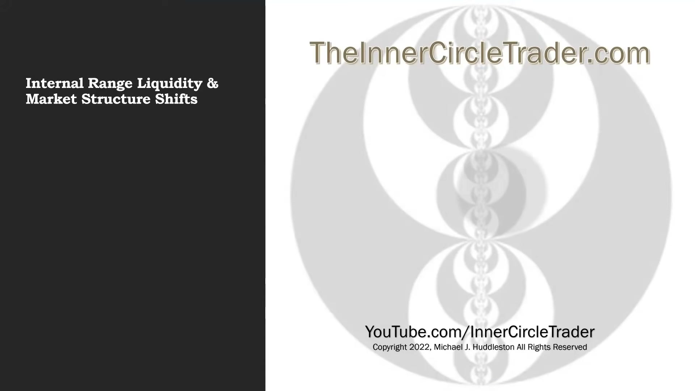

All right. So we talked about internal range liquidity, and internal range liquidity is looking for short-term lows or short-term highs inside a price leg that we're retracing back into. Okay, that's all it means: internal range. Liquidity is a short-term high or low. What stops above or below it, or an imbalance in that same range of price action.

And I taught you market structure shifts. Showed you exactly all that's necessary. That is all that you require, and the skill set of identifying pools of liquidity. That is going to be something you learn rather quickly, just by going through old data and looking at the times of the day I gave you in this lecture. All right, your homework. Is you're gonna go through your E-mini futures intraday charts.

And you'll be looking for stop hunts that lead to market structure shifts intraday. You're going to log your examples with your own annotations.

For your study journal, so what I showed with the break in the market going higher and lower above old highs or lower below an old low—that's running for stops. That's a stop hunt. Then you're looking for that signature for the market structure shift on the three, two, and or one-minute charts. Okay, if you look for that.

Between eight thirty in the morning to noon, New York local time, in the Emini markets, or if you're watching the micro markets, the same logic exists. Okay, but you're going to start going back from today and go back as far as the data will allow you.

And you annotate your fifteen-minute time frame for your buy-side liquidity pool and your sell-side liquidity pools, and then going down into the three-minute, two-minute, one-minute chart. So for every individual day that you're logging and you're back testing, back testing is just.

Dressing your chart up like I'm showing you here, and then studying it—not just do it till you count done. Really go into see how price moved and how it delivered.

## [38:04](https://www.bilibili.com/video/BV1rjbM6vEQk/?t=2284)

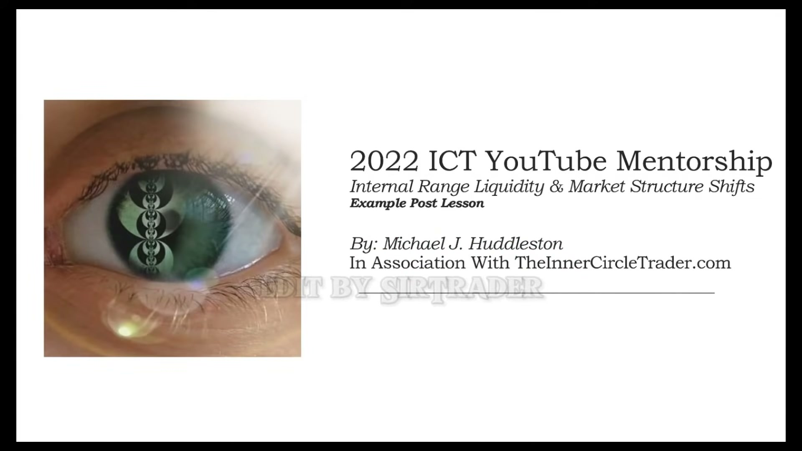

Alright, folks, welcome back. So this lesson is going to be a little bit shorter, more direct to the point. And we'll be looking at some examples. Since I showed you what we're looking for. On Tuesday night. So Wednesday's trading and Thursday's trading. We'll take a look at that.

## [38:20](https://www.bilibili.com/video/BV1rjbM6vEQk/?t=2300)

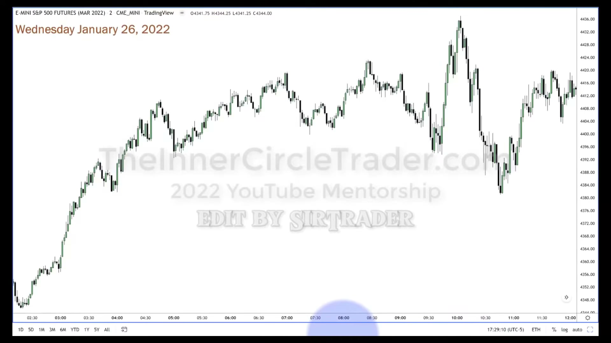

All right. First up is the E-mini S and P March delivery contract for. Twenty Twenty Two, Wednesday, January twenty sixth. Once you take a look at this low over here on Wednesday, the twenty sixth. And you'll see why I picked that low there because it's the low. Okay, and. This is the high. So we have this price run from this low. To this high—that's our range. So you want to drop your fib on that.

Now get your equilibrium price point. So as the highs. We ran through. We had that run up. The market gets pushed into a premium. It's really expensive, and then we want to wait to see does it break down below the old high. It does. But does it create a fair value gap in here? No.

Then it rallies one more time. Then breaks down again inside here. There's a break in market structure. We see it here. Then it runs back up into the fair value gap here, and then sells off. Reaching into this Olaf, which would be. Below. The equilibrium price point of this entire range. Or fifty percent level on the fib.

## [39:20](https://www.bilibili.com/video/BV1rjbM6vEQk/?t=2360)

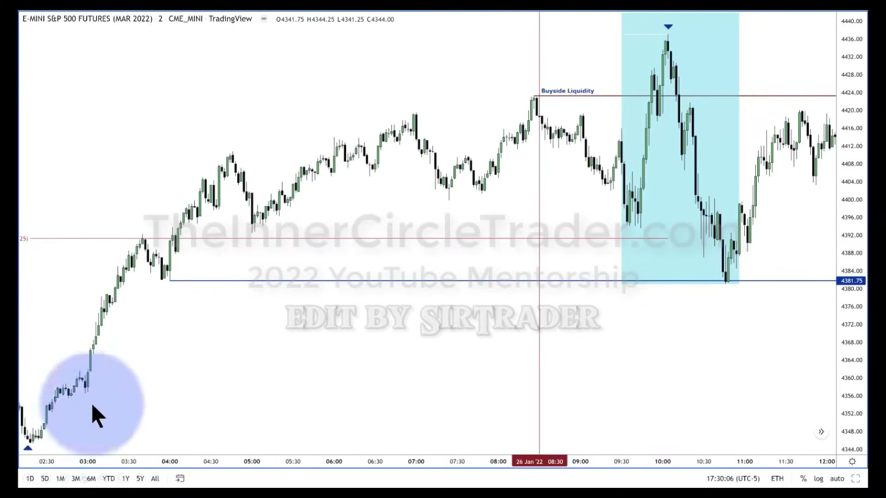

Okay. Put some lipstick on this again. Here's the low. And the high. Equilibrium, which is a fifty. Level in the Fibonacci, so we're looking for a low. Or an imbalance below this level. Okay, so we have a swing low here. We have an imbalance here. That could be a target. Notice how we hit it there. And came off of it. More pronounced low here. It draws down into that.

So, inside this shaded blue area, we're going to take a closer look at the details. Okay, we're zoomed in a little bit

## [39:50](https://www.bilibili.com/video/BV1rjbM6vEQk/?t=2390)

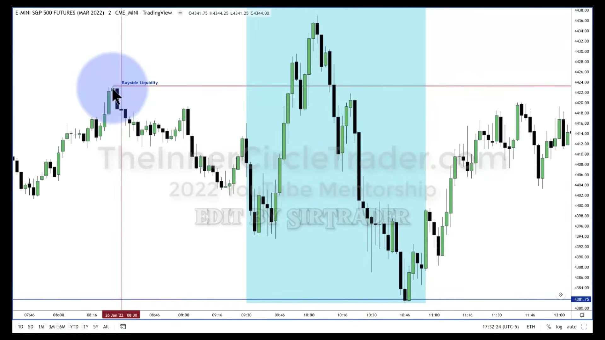

again. Still on a two-minute chart. Previous high. Short-term high. And eight thirty in the morning—that starts the hunt. Basically, that's what eight thirty in the morning is to me. So we're looking for an old high to be violated. It does so here. Then it breaks. There's a break in market structure. Swing low.

This candle here that sets the stage. Now you have a opportunity. Does price draw back up into the fair value gap after this candle breaks below here, and giving you a bearish market structure shift? Yes, it trades up in the Fairfield Bay Gap. You can go short there, and again, you could target this old low here, or. That low that was annotated before we zoomed in. And look at the beautiful delivery there.

So hypothetical short from here, and hypothetical cover here. You would log that in your study journal. Don't use my examples here alone. Go into your own charts and annotate them as well. So, shorting around, we'll say forty-four nineteen, and covering at, we'll say forty-three eighty-two. That's the opportunity. Of the range. But you don't have to have all of that.

Again, there's that fair value gap, and that's your candle that would be considered as a ideal entry, and the discount called low as a target right there. So your charts would look just like this. In any open space, like over here, you would just type in whatever important factors that you found insightful about this example. How long did it take? Okay, how long did it take from the market structure shift?

Occurring, how much time did it take to get up into the fair value gap? That's real important. How long did it take before it went from your entry down to your target? In time, how much heat or. Drawdown. Would you have weathered getting short? Now, if you used this candle's high as your entry point, you technically could have got filled here, but in here, I want to.

Teach you to look at the total range available, and in hindsight, okay, because it gives you. A framework to look for how these examples, while they're not exactly the same, they don't repeat exactly. Photocopy of every single previous instance of it. There's a lot of similarities that you'll find that are reoccurring. And that's the important factor: to train your eye to see it.

## [41:54](https://www.bilibili.com/video/BV1rjbM6vEQk/?t=2514)

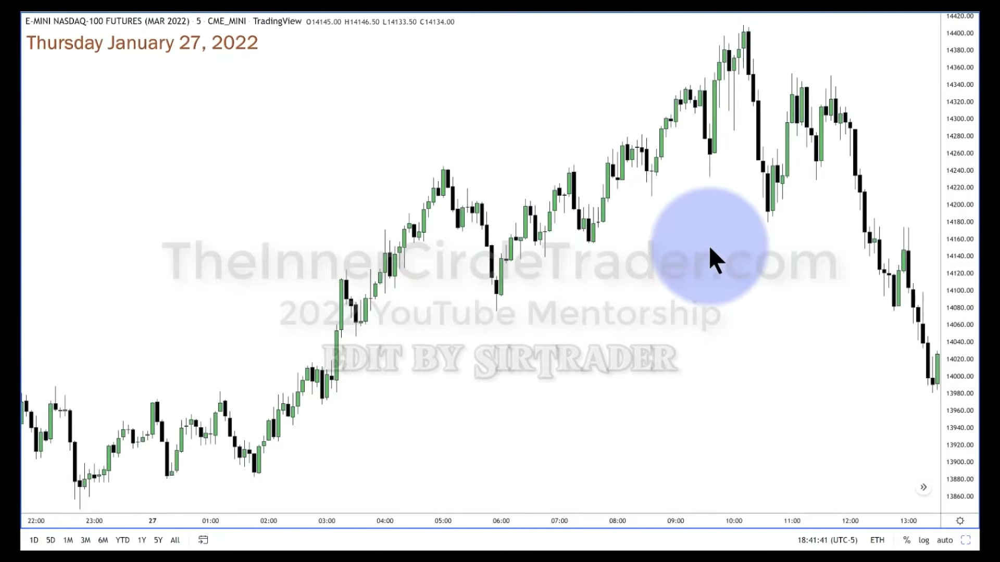

All right. We're looking at the E-mini Nasdaq futures. For Thursday, January twenty seventh, twenty twenty two. This is a five minute chart. This is the time frame you start with. And you work down. So, in the five minute, right away. We can see the low. To the high. And we're looking for a high, and go back in time in your chart, and you'll find what this is here. But you have these relatively equal highs as well.

So that could have been. A initial objective, looking for these relative equal highs, to be taken out. And does it break down and give you a fair value gap? No, it doesn't. So it wouldn't even meet the criteria there. I know some of you might be looking. It says, "Well, how do you know it doesn't?" Get you on a trade here. Listen to the rules I gave you. They're very specific.

And that's what I'm walking you through here. That way, you can see it's kind of allowing the market, or really. Forcing the market to show you its hand. Once it does that, then you can go in and act accordingly. But you have to. Wait for the setup. You can't force it. You can't think it's there. It's there or it's not.

So we have old high here, buy side liquidity resting above that, and we have a run above it. Once it goes above here, does it go above it? And break down, and then go down below that short-term low there. No, it goes higher. So we just keep waiting for a break lower. To get a shift in the market structure on an intraday basis. So we have a swing low here. It trades down through it on this candle here.

So, right away, at that moment, on this candle. As soon as this candle trades through it. You now have an opportunity. Then you go back into the high to that candle, slow, and do you see a fair value gap? It's right there. Okay, the market rallies back up, trades into it here. You could be a short seller there.

The market breaks down one more time, retrades back into it, and reaches below the equilibrium price point. Now you have a couple targets here. You could be here, here, or in the imbalance. And it hits all of them, and goes a little bit further lower.

