# 【精翻】ICT原版无废话版三：PO3、AMD、时间段

- 作者 耳朵数字观察
- 时长 40:39
- 来源 [https://www.bilibili.com/video/BV16JbM6YEGV/](https://www.bilibili.com/video/BV16JbM6YEGV/)
- 由 course2md 生成 · 33 张截图 / 153 段文字

---

## [00:00](https://www.bilibili.com/video/BV16JbM6YEGV/?t=0)

This is episode nine for the twenty twenty two ICT mentorship on YouTube. This lecture is going to be on Power Three, which is accumulation, manipulation, and distribution, and New York PM session opportunities.

## [00:10](https://www.bilibili.com/video/BV16JbM6YEGV/?t=10)

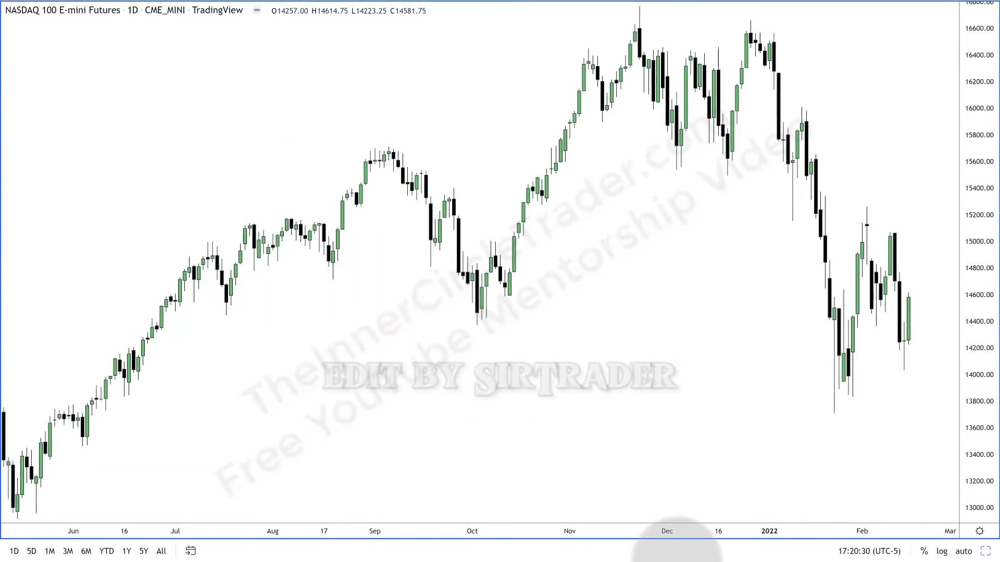

All right, so we're looking at the Nasdaq E-mini futures. This is the continuous chart on Trading View. So, if you look at. The daily range where we've been. We're inside this range here. Okay, so we have. This swing high, and this swing low. Now, why am I picking these two reference points? Well, namely, this is the low. Most recently. After taking out this short-term low. So we've dug into.

All the sell side liquidity resting below that low. We retraced back up inside of this high to that low. So. We went back up into. A premium. The range, high to low. Running a fib just to get the fifty percent level that gives us equilibrium. Anything below that. Is a discount. Notice how the market traded down. On Monday. Into a deep discount, but did not. Take out these loads over here.

But look how we closed on Monday. We have an indecisive candle. The body was basically at the open and close was essentially near the same thing. If we have that. And the market's trading down into a discount. Even though we might have a low down here that we're targeting, this may require a retracement. Now, notice at the close of Monday's trading, we had an imbalance from this low. In this high.

On Tuesday's trading overnight, the equities markets. Had he run up into this? Imbalance here. So, this fair bag got. Was retracted to in here. This low. In this high. We'll look at that in reference to the lower time frame. This lower level.

## [01:40](https://www.bilibili.com/video/BV16JbM6YEGV/?t=100)

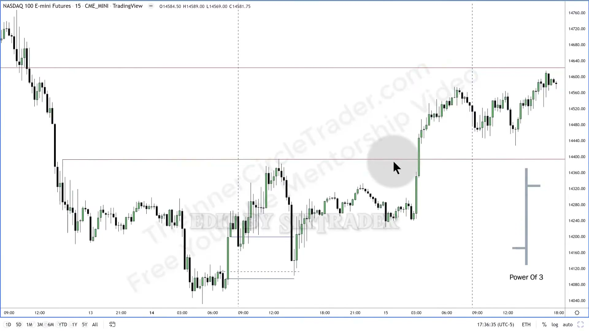

Is the low end of the fair value gap on a daily chart? In this level, here is the upper end of the fair value gap. I'm taking your attention to Monday's trading. And I want to talk a little bit about Power Three, which is accumulation. Distribution. And manipulation. Okay, so. Generally, my teachings are like this. If I'm bullish, I'm expecting the opening price.

To be near the low of the day or the session, then it trades lower, making some important low, and then rallies. Creeper, hi. And encloses near high today. Now, it's not important for you to try to predict the closing price. What I'm trying to train you to anticipate is the likelihood of the market making some kind of a fake move, like a Judas swing. Okay, Judas swing is. The false move.

Typically, in London and in New York session. There are. Fake runs on Monday. We had price drop down overnight, consolidated, and then we have a little bit of a rally. Ahead of the equities open. Okay, so in here. We have eight thirty in the morning. If you look. At eight thirty, what do we have? We have the highs over here. They're suspect because their relative equal highs there. But look what we left here.

Ahead of eight thirty. We had this huge imbalance. So, if we run these highs out after the open at nine thirty, it's likely to trade down into that and rebalance. But watch what it does. And we trade up into that level here, which creates the fair value gap's low end parameter. Remember, this is Monday's trading. It sells off, so this line isn't here on Monday.

It's it's not what we're looking at. We're looking at the likelihood. Of coming back down into this area here. After taking these highs out. If it does so. If it trades back into disimbalance. That's a good. Candidate. To go along. The imbalance in here. If you go to the left of it, you can see the down close candles. That's your bullish order block. The market trades down. Hits the order block.

And it's an afternoon trade, so it starts to rally, and then consolidations to close. Overnight, we create a wicked run last night. This was a it ran last night, and. Most of all, the move for today. Was done before we even got to the opening of the morning. Had a little bit of retracement.

After eight thirty, and at nine thirty, we consolidated. I'll talk a little bit about that as a market profile in a moment. But then we dropped down. Create an important low of the day, and then we rally. It got real close to the fair value gaps high end. Parameter. But didn't get to it. We don't need. It's just like I was mentioning here. You don't need to try to predict the closing price with Power Three, which is.

Accumulation. Manipulation. So, in other words, if you're bullish, it opens. Where you think it's going to trade higher, it's going to be most likely a small little move lower. That's the move you want to try to go in and hunt along. If you miss it, you want to try to get long real close to where the opening price is. Now, the question is going to be: Is where is the opening price?

I like eight thirty. Okay, you use the opening price here at eight thirty. Draw that out in time. Did we go below it? Yes. Did we go inside the imbalance? Yes. Did we take out a short-term low? Yes. There we had an order block. Yes. Was an optimal trade entry? Yes. Lots of factors here. Over here, same thing. Opening price here. Did we trade lower than that? Yes.

It'll go even lower than that later on in the afternoon. Yes. Then it rallied. Taking out the relative equal highs here. And again, gravitating towards that upper end of that fair value gap on the daily chart. Now I'm in

## [04:54](https://www.bilibili.com/video/BV16JbM6YEGV/?t=294)

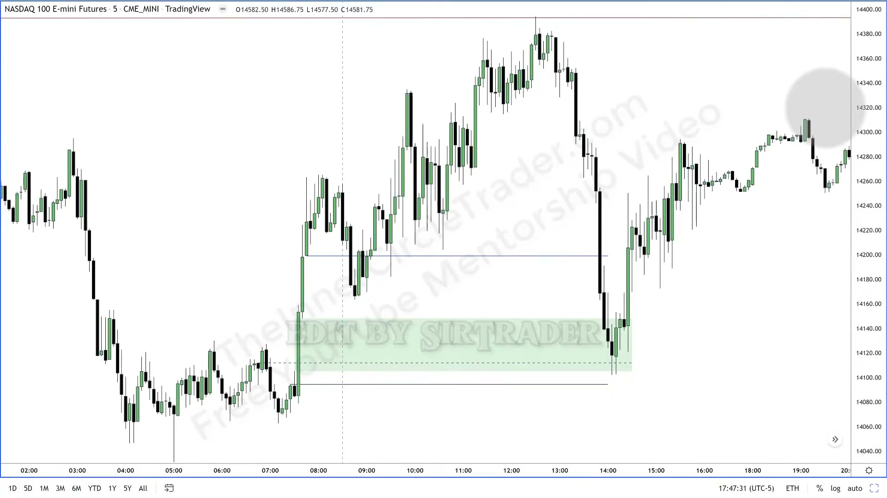

a five-minute chart on that same February fourteenth, and I want to take you closer. See what price is done here. That imbalance. The lowest portion of it here, with all the down-closed candles. Here now, this is anchored to the daily bullish order block. But you can see how we traded into it here. With one, two, three, four down, close candles. That is a complete order block on this time frame.

So, consecutive down close candles right before. A. Price surge that has an imbalance. That's how you find your order blocks. Okay, so a high probability order block. Would be. Your narrative or your bias is bullish. You're looking for displacement. That's this right here. Where the market runs real quick. Higher. And the down close candles, you want to mark that out. And anticipate a return back into that.

Now, again, this level is not there yet. We don't know this level until Monday's close. So, don't be tricked thinking that I had this level here and I knew it was going to go right to that level. I'm not suggesting that at all. What I'm suggesting is is watch what happens. When it creates that high, it breaks down. All this price action here. Gets overran. Into a retracement, back down into this imbalance here.

The low of this candle and the high of this candle—that right there. That's your fair value, got with an order block. And optimal trade ministry. Rallies. Even though it's sloppy, it's still continuously driving higher. This high at the close on this day here at say four thirty. Okay. Four thirty in the afternoon to me—that's like the close for me.

No, no. It trades a little bit later than that, and then closes for a little while. And it also technically closes when the bell rings at four o'clock. Local time in New York.

## [06:28](https://www.bilibili.com/video/BV16JbM6YEGV/?t=388)

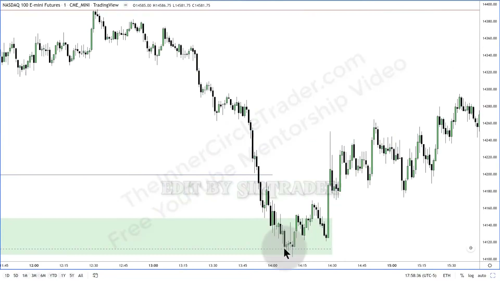

Here is that drop down here on a one-minute chart. It's digging into that. Quarter block, right here. If you look real close, let me go back up one slide. I want you to see what I'm showing you here.

## [06:38](https://www.bilibili.com/video/BV16JbM6YEGV/?t=398)

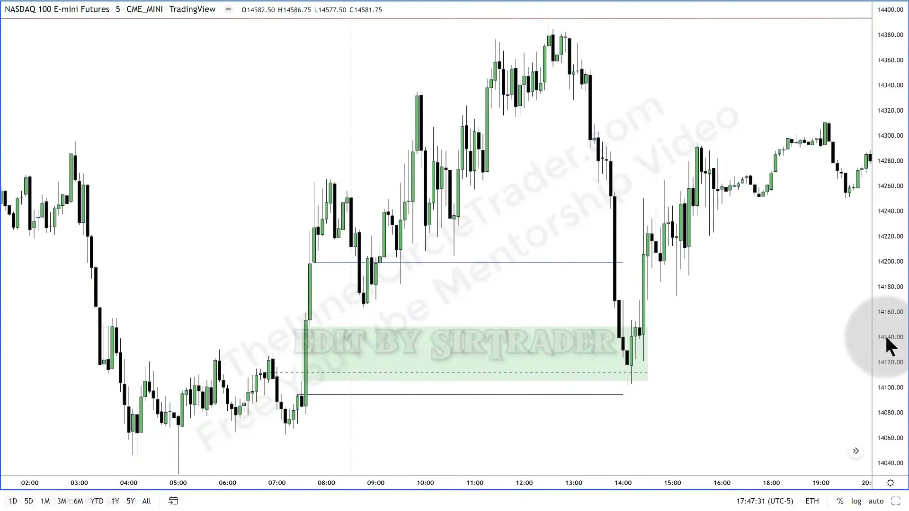

Right here, this price action. See. Fourteen one forty. Fourteen, one twenty. This little area right here, I'm looking at on a one-minute chart.

## [06:46](https://www.bilibili.com/video/BV16JbM6YEGV/?t=406)

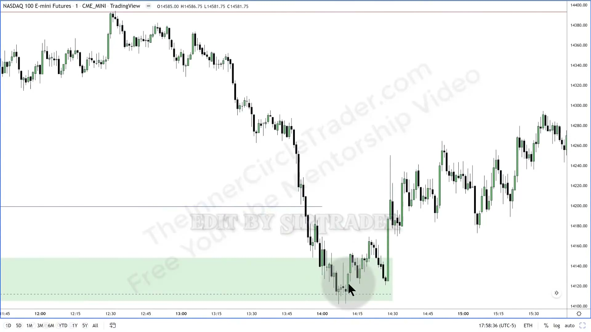

Fourteen, one forty. Fourteen, one twenty, that in that vicinity. See that small little gap right there.

See it swing high. We trade above it, create a fair value gap there. Trade down into it. This is an afternoon trade. This is two o'clock in the afternoon, local time in New York. Inside the order block, inside the fair value gap, inside a retracement of the fair value gap that sets the stage of a market run up into a higher retracement. Now we don't know if this is going to be.

The closing parameter for a daily fair value gap. We don't need to know that yet, but this is a likely scenario to go long. And we can look for a run back up into this range here, or run the buy stops above here, or maybe inside here. Sloppy run, but nonetheless, it's. It's still pressing higher.

## [07:26](https://www.bilibili.com/video/BV16JbM6YEGV/?t=446)

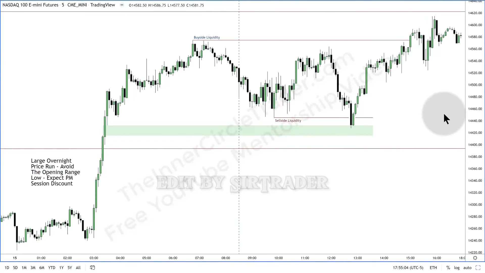

Now here's today on the fifteenth of February, twenty twenty-two. Notice what we had—we had this enormous price run overnight in technically the London session. Now I want you to think about when you have these overnight runs that were basically these big moves overnight. Before the session begins in New York overnight, what was the market doing? It was rallying.

So when we open up at eight thirty, do we go in here and start buying it just because it's gone up overnight? No, we don't chase it. We have to wait for more information. What information are we waiting for? Well, typically, whenever you see a big run up or a big run down.

There's a consolidation that takes place shortly after. Now, not always. Sometimes it just keeps on ripping higher or lower, and you'll either miss a move or. If you get lucky, maybe you can participate in it. But this is what I typically look for. So, if there's a lot of range movement overnight, which overnight, two o'clock in the morning to five o'clock in the morning.

If we get a big run like that, which is what we're seeing here, right away in my mind, I'm thinking: don't trade a lot, don't expect a lot of in and out, in and out, perfect, you know, perfect precision. Wait for a real significant price move. Otherwise, you're going to get chopped up. Now, what does that mean? Well, when we have it opening here at eight thirty, look to the left. What do we have? We have.

This high here. And we have the low over here. We can use this one because they're relative equal, but I like this one. Why? Why do I like this one? What's below it? Fair value gap. So it's likely to trade down after it creates this sloppy opening. Look at all this movement in here. Now, this is what we have for today. We start going lower first, so that's good. We create a pseudo Judda swing.

But did it create a nice low and turn away from it? Look at all this back and forth. And it created these suspect lows in here, relative equal lows. There's going to be sell side building up below that sell stops. When it starts to go higher, anyone that was long overnight, they're gonna jam their stop loss right underneath that. Okay. When this occurs, that's the very scenario I'm looking for.

Now, right away, in my mind, here's what I want you to understand. If there's a big move overnight for equities, this is not forex. Okay, this part is not forex. It's just for trading like Nasdaq, Dow. In E-mini S&P, if there's a big run overnight. Avoid the New York session. Don't even mess with the New York session. Wait until the other side of lunch at one o'clock in the afternoon, New York time.

And then anticipate the New York lunch lows taken out, or the New York morning session lows, which is what we have here. Notice how we rallied up. We didn't take out the relative equal highs here that was formed ahead of seven o'clock in the morning. Notice that. Now, this over here, we know this range up here is the high end of that fair value gap. Why do we know that? Because.

The fourteenth stopped trading, and it had that indecisive candle on the daily chart.

So it's likely that we might trade up into this range high, and this is that range low. So if we can draw down below that low, it was formed initially in the New York session. We have a fair value gap over here with sell side, while we have yet to take out the buy side liquidity here at around I don't know fourteen five seventy five, and then get up to that fair value gap high or the the boundary of it.

Okay, kind like the resistance level of it. So this is the draw on liquidity. And we have a minor draw in liquidity here with buy-side liquidity. Look what we have in terms of price action. The Nasdaq drops down, taking out the sell side, digging into that fair value gap. See that. Look at the bodies of the candles. Isn't that neat? How it just respects that level back here. Now that's not random.

Okay, these are algorithmic principles that are in play. And these markets are unbelievably precise when they are in better conditions. Right now. If you've been trading with live funds, or if you've been trying to follow price action, there's been a lot of. It makes a run, then it goes into this choppy sideways, and it's very frustrating if you're trying to get like sustained price moves.

Or if you don't know how to operate in these, like these sloppy little ranges, like this.

I personally don't think that this is high probability trading. You can get chopped up. You can get losing trades. You can draw your account down if you don't control yourself. You can blow your account in these types of conditions. How do you avoid that? How do you avoid running out your account and then scaling back if you're a high frequency type of a trader? How do you draw back on the frequency and look for the better setups?

What I'm showing you here. You wait. You don't chase the overnight run, and you wait for them to give you a low. That everybody overnight will want to put their stop loss right beneath that. After it starts to rally above it, it's even better when you don't have this high taken out yet. See how they took it up here, and it just went right down for them. That's engineering liquidity. What?

A retail trader's mindset would be. And the logic behind this. Okay, so the narrative with this day was: the stocks were trailed below these lows. The afternoon session again. Creates the low of the day. Takes the sell side liquidity out. Into a fair value gap. And in rallies. Now, in here. I'm going to teach you a little bit more about that watch. Notice we don't really

## [11:46](https://www.bilibili.com/video/BV16JbM6YEGV/?t=706)

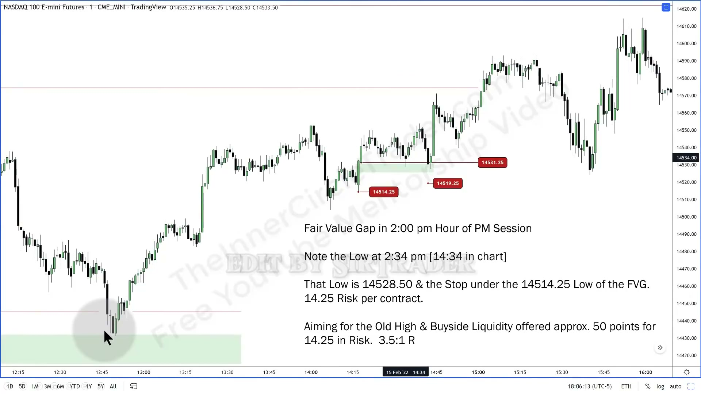

have a fair value yet down here, but it gives us the basis for expecting the price to start to rally into the afternoon. Now at two o'clock in the afternoon. Fourteen hundred on this trading view chart. That starts two o'clock in the afternoon New York local time. We have the market trading down into an imbalance over here. Liquidity resting below these relative equal lows is taken out.

So, what are we looking at? We've seen a price run that we don't think needs to come back down here, because the logic is. The overnight stops have been ran out down here. There's no reason for the market to want to come back down there, but we have this low. And these relative equal lows here, post New York lunch.

New York lunch is noon to one o'clock in the afternoon, New York local time. So the imbalance we trade down into that. What's the likelihood of it coming all the way through the imbalance, and then going after that level? Not likely. Not likely. Not after seeing this run here. They don't want to give these traders another chance to get back in. It got stopped out. So it's going to be a little bit more sneakier.

When they make these new setups to continue onto a higher run. So they take out the sell side below these relative equal lows. Take those stops out, and then it rallies and it drops back down. Now here, watch—we have a swing high. Right here, it breaks. It does it trade above that? Yes. Was it energetic? Yes. Does it have a fair value gap? Yes. So now the market trades down into it. Here, creates a short-term low.

You could be a buyer there. There's nothing wrong with that. But say you missed it. Say you just missed a one-minute chart. Say you missed it. And the market starts to run off like this. But then it gives you another opportunity: the fair value gap. Is even better. When you have the sell side liquidity resting below short-term low, and the drop down into it here. You can use that low as your entry, or minus one tick.

Okay. This short-term love forms at two thirty-four p.m. Now, if you look at the low figure up here. That value represents that candle right there. So that's why you see it highlighted here. And I took a screenshot. I'm holding underneath this candle, so that way the reference point's up here. Are directly related to this candle, so you can see the low is fourteen thousand five hundred twenty-eight and a half.

So you could be a buyer on a limit at fourteen thousand. Five hundred twenty-eight and a quarter. Or maybe, if you want to try to reach for the. Twenty, even number. Either way. That's a nice. Place to put a limit order in the short-term low down here after the fair value gap forms. That's where your stop loss is. That's the rules. So you have an entry point, your stop, and.

Between the two of them, it works out to be okay. Let's say you have fourteen and a quarter in terms of risk. Okay, so fourteen and a quarter points or handles of total risk. And let's assume that you were trading—I don't know—six contracts on the micro. You're essentially looking at. Buying and risking eighty-five dollars.

To make about three hundred dollars, so it's about three point five to one reward the risk thereabouts. I'm roughing. I don't have calculator in front of me, folks. Just you do the math. Now, here, this value is important because I want you to see in these conditions.

You can't expect it to be perfect. You can't be, you know, expecting to be in there at the lowest point, no drawdown, no heat on a position, and then it just goes in your favor. Don't think like that. You can see on this candle. If you would have bought here, you would have had nine points. Of heat. Okay, or basically fifty-four dollars.

If you are trading six micros, but overall, this is a nice little setup with the afternoon using the logic over here. Even it doesn't give us a fair value gap, the you know the setups that I am teaching you to use using the fair value gap afternoon, taking the stops, it provides the baseline. For. Bias for the afternoon.

## [15:06](https://www.bilibili.com/video/BV16JbM6YEGV/?t=906)

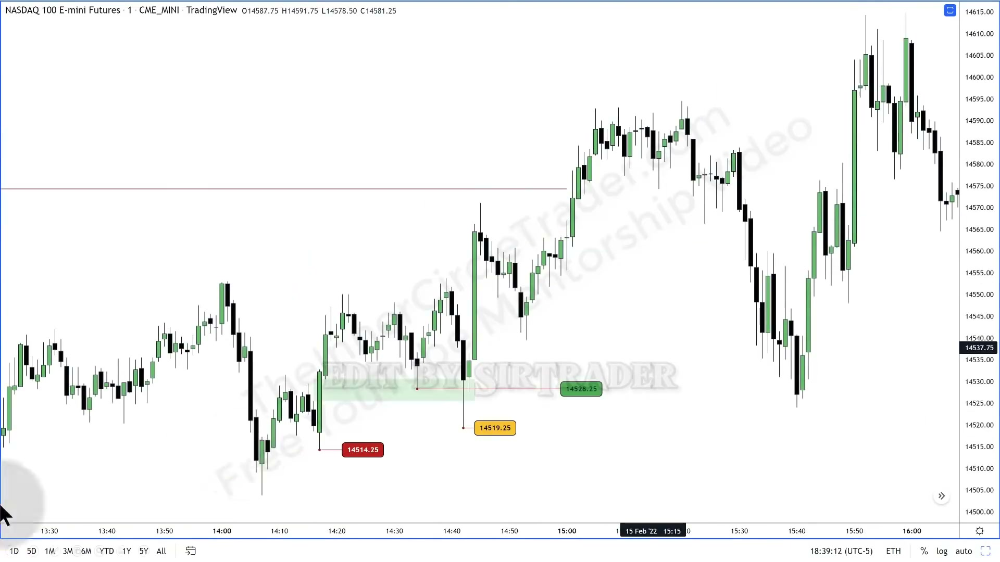

Last slide, and just to hammer this down, this is zoomed in on a one-minute chart. Swing high. Broken. Fair value cap, right there, and we have. That short-term low here, I've noted in here, so that's where you would be basically entering one. But that idea trading below that is where the sell stops are. It rallies here, takes off, and does not take out that. The bicarbonate resting above here.

Did not get taken here yet. And then we had this. Imbalance. And it trades down into it, and then hits what the order block. That's a buy, and you can if you miss this one. You can pick up this one based on the logic I teach on the YouTube channel, and then it runs for that liquidity there. So there's two setups there, folks. Welcome back. This is

## [15:42](https://www.bilibili.com/video/BV16JbM6YEGV/?t=942)

episode number ten. Of the twenty twenty two ICT mentorship for the YouTube channel. This lecture is going to be teaching implementing economic calendar events with the open.

## [15:52](https://www.bilibili.com/video/BV16JbM6YEGV/?t=952)

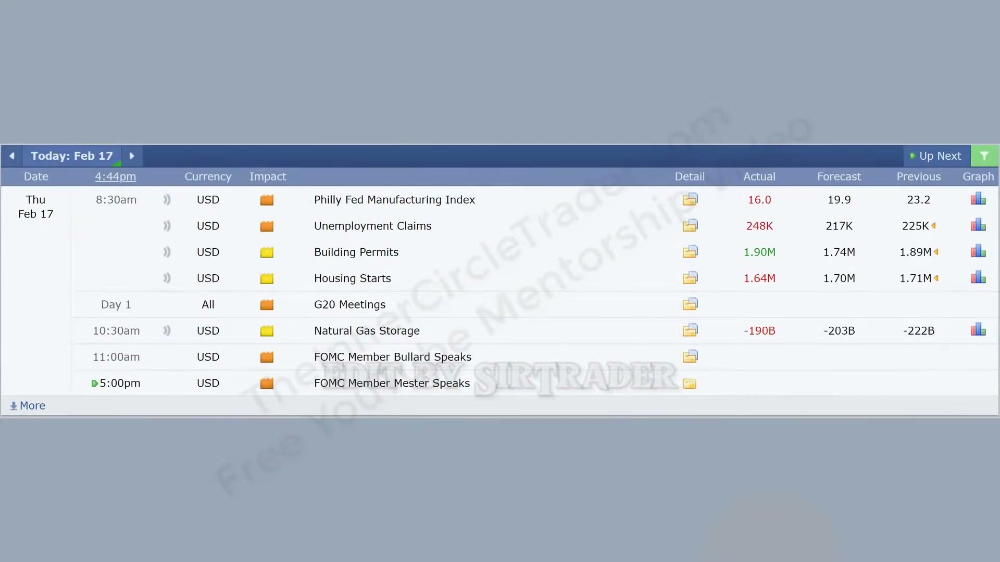

All right. So, the economic calendar. Many of you probably don't even consider looking at this, but it's important if you're going to be learning how to speculate, study these markets. Certainly, if you're ever going to consider putting live funds in, then. You really want to know what this calendar says for the day you're going to be trading. Otherwise, you could be surprised. Unfortunately, adversely.

With a sudden rush of volatility that you wouldn't otherwise expect. This is Thursday's economic calendar for Thursday, February seventeenth, and not all of these things are going to be heavy hitters for stock indices, but most of them are. And what I'm showing here is what I teach all my students. I go to ForexFactory.com. I use their economic calendar.

Here, the medium impact events are like orange. Low impact are yellow, and anything that's red, which is not being shown here, would be like a high impact news driver. So, when we look at these stock indices, the reason why I teach you eight thirty in the morning, like that's your beginning time to start looking at it, or crosshairs time.

The news embargo lifts at this time at eight thirty. Typically, there's a bunch of news events that are being ushered into the marketplace at that time now. Some of these reports, or speeches, or data points, they may be used as a smokescreen.

They may be used as a catalyst to have price go up or down at the time of their release. Other instances, like I'm going to teach tonight, usually there's going to be a build up or a dropping down in price right before the report comes out. And then the real move starts to ensue. Okay, so it'll make more sense as I get into the actual teachings.

## [17:14](https://www.bilibili.com/video/BV16JbM6YEGV/?t=1034)

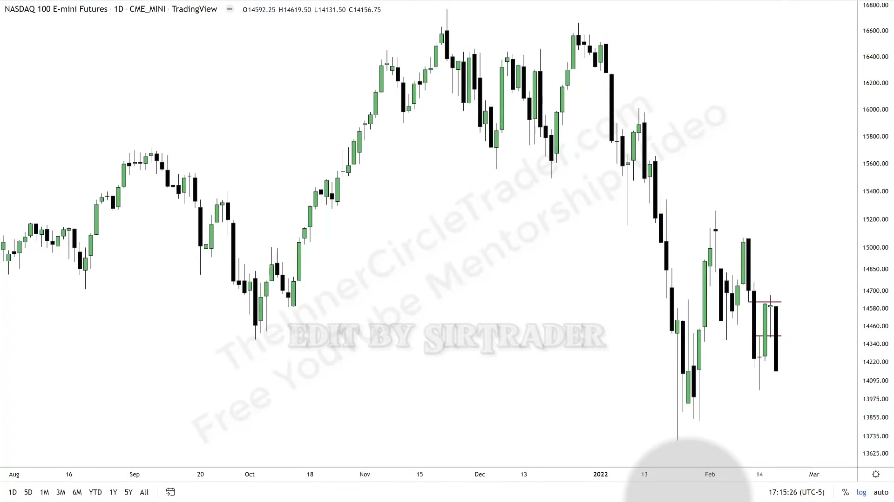

So right away, we're looking at the daily chart. And as I mentioned in the previous episode, I outlined this high here and this low, and that was the range we were within. And the fifty level was equilibrium. So again, above equilibrium is what. The premium market and below fifty percent.

Is a discount market, so we traded back up into the top end of the range between this low and this high, and between these two levels here. Remember, I gave you this low and this high. That's a imbalance. Okay, it's a fair value gap. So it's likely to do what? Go back up and rebalance this before going back down. So if we look at the reference. Points of it being in a premium market or a discount market.

But then we have this imbalance, and we have a bias that, and it's likely to go down and take out these lows. What do we said here? In short.

The market's been going lower. Yes, we took out some sell stops below this low, with the sell side liquidity being taken out here. Then a natural retracement, which is reasonable. Then we start the decline. Then we come back up one more time. Failure swing doesn't go above that high.

And it breaks down, and it creates an imbalance when it takes out this short-term low. Now, what's the framework here? We rallied, broke below a short-term low.

With the model suggesting that these lows may be taken out, so any rally or up close candle or candles should be viewed as a potential shorting candidate. Now, ring in the imbalance. We traded up into the imbalance one more day. We swept above it, not by much. Then the next day, we open, we rally just a little bit, and then plunge.

We took out the previous day's low and the day before its low, so both of these daily lows have been cleaned out. Now this one is the next one. Then down here, so.

When I talk about Power Three, I'm specifically dealing with this time frame, the daily chart. If you consider where the market opens, say this is the opening price in a daily range. If you're expecting it to go down, or maybe you weren't expecting it to go down, you were just looking at the price in your chart, and you see that the opening was here. It rallied a little bit, and it went down, and then closed near the low. Now, that's a rather simplistic.

Overview. This is the market right here. If you understand this, and you can study a daily chart, daily bias will become easier for you if you start implementing it with this mindset. So, if we're bearish, okay, if we're bearish on a market, we're going to anticipate the daily ranges or each one of these candles doing this very thing here: open a rally, not much of a rally, but it can make a large wick.

It doesn't make a difference, but the general premise is: it goes up. Just to go down, and it closes down near its low. When it's bearish.

Obviously, this would be reversed, where the open would be down here near the low, and the close would be near the high of the daily candle if it's bullish. But not every single candle in a series of the entire price swing is going to be all up close candles when you're bullish. Conversely, not every candle is going to be a down close candle when you're bearish. This function of power three. Is how I teach the bias.

And I also teach how to submit to the daily range. You have to learn how to hold to the close. If you're going to just day trade, and you're not really participating in the sustained moves that's made available in these daily ranges, like today, I mean, look at this move here. That's nice. It's already traded to the top end of that fair value gap. And it's likely to go lower now.

Taking out this cell side and attacking the cell side over here. All right. Let's drop

## [20:12](https://www.bilibili.com/video/BV16JbM6YEGV/?t=1212)

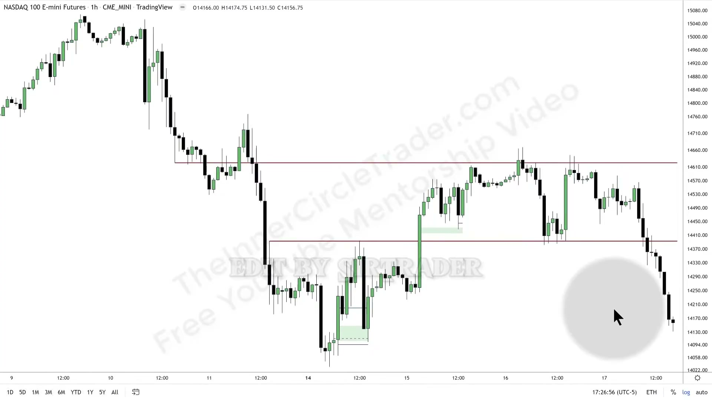

down to an hourly chart. And that fair value gap. The high and the low levels. That's what's being shown here. Right there. So watch what happens. The market trades down, finds some support at the low end of the fair value gap, then rallies back up to the high end of the fair value gap. And then breaks right before midnight on the seventeenth.

And then we consolidate, trade back up into what? What is this? What's this right here? It's a fair bet. Got price goes up, rebalances that there, and it's doing it. What time of day? Not New York. It's overnight, European, London session. London Open. If you know what you're doing with a daily bias, you can catch enormous moves. But sometimes you're gonna have to weigh out. A lot of.

Give and take back and forth, kind of like today. Where the market rebalanced here, and then consolidated and waited for a little bit of a push higher. Then the news came out. Okay, so I'm kind of. Hopefully, clear that up for you now. All right, 15-minute

## [21:02](https://www.bilibili.com/video/BV16JbM6YEGV/?t=1262)

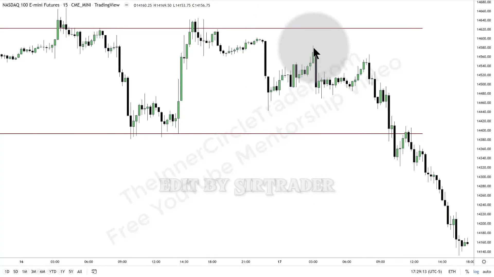

timeframe. I'm taking a look at this. Imbalance here. We rode up into that, rebalancing all this movement down. Same thing over here. We have the market drop down. Creates a fair value gap here, doesn't it? Take out some lows over here. Yes. There's displacement. And then you can have an order to get in short here. But then, watch what happens. This little pump up.

That might be scary. It could have stopped you if it went higher. That's the risk in this, folks. I'm not gonna. Give you a silver bullet that removes losing trades. I lose trades too.

All right, so we have the morning session starting before 8:30. We have a rally up, and then it breaks lower in this area here. We're going to drop down to a lower time frame, but before I do, I want to give you a little bit more details. Think about what

## [21:40](https://www.bilibili.com/video/BV16JbM6YEGV/?t=1300)

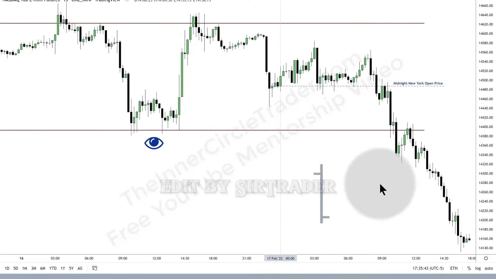

I've taught you so far in this teaching for Power Three: the accumulation, manipulation, and distribution cycle of the daily range. If we are trading near the high end of that fair value gap on a daily chart, that's what that level is. Okay, when we just drop down to a lower time frame chart. So, with this fifteen-minute time frame chart, the idea is we're expecting this Power Three formation where it's open.

Rally create the high of the day. Sell off and close near the low. That's what we're looking for. Why would that bias be expected on this day? Because we worked. The upper end of that fair value gap on the daily chart. Then we had multiple. Shifts in market structure bearishly, when we already have a bearish bias on the daily chart, anyway.

So it gives you a high probability that this day is going to be a down close day. So this level here. It's dash. That's the midnight New York opening price. This is what I'm referring to when I'm looking at the opening for Power Three on a daily chart. That price, right there, at midnight.

Look what's occurring. That right there is equivalent to this little tick on this diagram here. It opens. It trades above the opening. Just like that candle does on a daily chart. It opens and goes higher. You want to be selling short here. Why would you want to go short here? Well, it went back up in there and redelivered the down stroke on that paintbrush or or roller on the wall. Well, now it's going back up.

When it's going up like that, it feels unnatural to go short. Like you don't want to sell short. It's like this thing's going up. Why would I want to go in there and go short? That's the benefit of studying old data and then. Reading price, studying it real time, without taking any demo trades, without trying to pick the you know the targets. Forget all that.

You want to practice for months, reading the tape, studying price action, watching it. Even if you have to watch it with. Trading views market replay function. There's nothing inherently wrong with it. If that's all you have, you can't watch it live. But it is altogether something different, and much more beneficial if you can watch the actual live data. All right, so. We're looking at the opening price here.

And then we're expecting a cell deform. Here's that fair baga. It rallies up into that, isn't it? I sell above the opening price. Yep. Sure is. From that opening price to that high, that's the highest high. Take that range and subtract it from the opening price. That's about in this vicinity here. Okay, right in there.

So, what's occurring? Well, we have this cell here. Then we have this cell here at the open at the equities opening. And then we have this imbalance. In here. So, from this range high to that low, multiply that by two as a projection upwards. Whatever that low is to that high, that much lower. You'll expect to see us short. And it forms right here, so. With this continued teaching here.

Right below here, what's that? That's sell side liquidity. Relative equal lows. The setups are forming here above the opening price, right here near the opening price. See that and. Inside of the range, from the high. To the opening, projected down, it's in that vicinity there. So it's giving you another opportunity. So here's seven

## [24:26](https://www.bilibili.com/video/BV16JbM6YEGV/?t=1466)

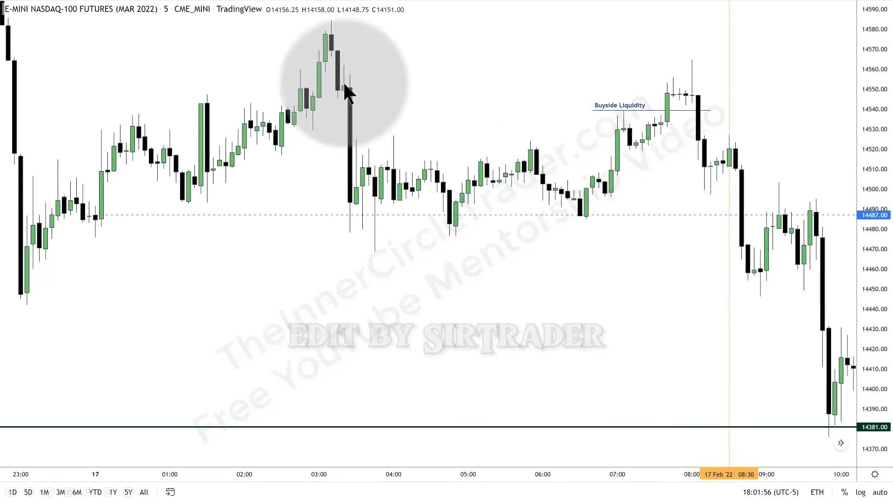

o'clock in the morning. It rallies above these relative equal highs. And cleans up the imbalance here. And look at that right there. Remember, I told you, if there's two fair value gaps, try to trade it in here, but anticipate and use the money management to allow for your stop to weather a run up into that.

And we got it right there. Now strip it down to what I taught you for the structure of the trade or the framework. Swing high. Broken to the upside, taking out buy stops. So buy side liquidity is taken. Then we have a swing low. It's broken. Did these candles come down lethargically? Was it like a slow meander decline? It was sudden. It was a lot of momentum. It was energetic.

You can't miss those down closed candles right there. That's obvious. They stand out, right? So that's how you know you have a shift in market structure in this area here. It doesn't have a fair value gap. That's okay. This is only a five-minute chart. This is where we start doing a top-down strip of five minutes. Four minute, three minute, two minute, one minute.

The first fair value gap we come to, if we find one on a four-minute. You don't need to go down to a three. You don't need to go down to a two. You don't need to go down to a one. If you go down to a four, you don't see one. You go down to a three. If you find one there, you don't go any lower. Okay. If you don't find one on the five.

The four or the three, and you go down to the two minute, and you find it there. That's it. You don't go down to the one minute. If you don't find it in a two-minute. You do find it on the one minute. Then that's how you trade it. But what if you don't have one on the one minute chart? You don't have a trade. How's that for logic? So we have. The continuation lower off of a retracement in here. Now this candle.

The high of it here. I wish I would have used a lighter. Color, but this candle's high is right there. It actually goes just above. That one right there. Not by much, but it does. But we don't need that. We don't need that.

## [26:08](https://www.bilibili.com/video/BV16JbM6YEGV/?t=1568)

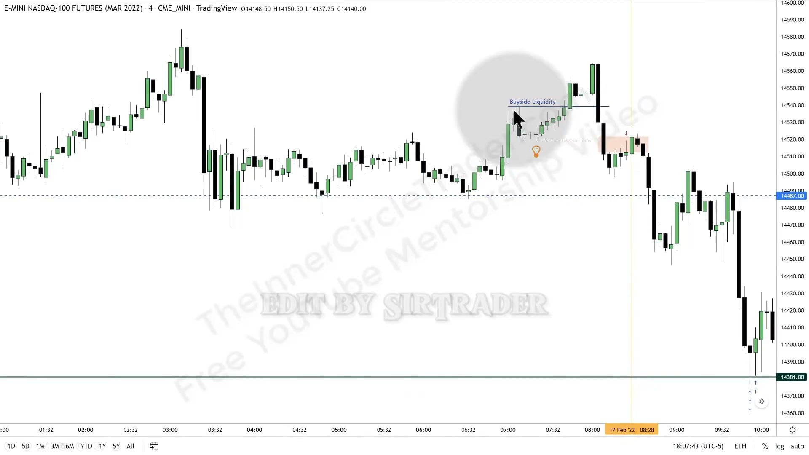

Watch what happens. Here's the four-minute chart. We have buy-side liquidity here. The candles are a little bit more beefier. When we were looking at the previous slide, look at this one. Look at the candles. Look.

Wonky, don't they? That's what we're looking for. We're looking for clean price action where we can see the nice candlestick formations, where we're seeing the even distribution of the price going higher or lower. In this case, going lower, but we're seeing that little break where there's not an even distribution of price. That's the fair thing. So we have that run above asset liquidity. After rebalancing her ear.

It goes above it, and it breaks down. So we have an idea. Okay. We could potentially see a trade short here. I like this fair value gap, but we also have a little bit of imbalance in here. So I want to trade in here, but my money management has to permit me to weather a run up into this area too. Remember that. That's part of the rules.

But in here, we're going a little bit deeper. In my YouTube channel, I teach a breaker pattern. Okay, and that is a high.

A low and a higher high. That's what this pattern is here, and we're seeing that return here. So, if I see a breaker like this, yes, I think the market could potentially trade up into here. But I'm going to use the breaker's candle and just above that for my stop. So I'm not going to go way up here or way up in here.

Because my foundation to teaching the ICT breaker is the market's going to mostly stay in the lower half of the breaker candle, which is the down close candle, right for the big move up higher, taking out a short-term high. So here's the fair value. Got range from the low and the high end. But it's specifically this candle's low and this candle's high, right there. Extend it out in time. Look what happens.

At eight twenty-eight, the candle's showing eight twenty-eight here because it's a four-minute chart. But once we're trading inside here, all I need to do is trade above this candle's high. I want to be short. Then I'm going to be aiming for those relative equal lows. That's. Fourteen thousand three hundred eighty-one.

Remember that relative equal lows. I said I wish I would have put a line on it. This is the time frame I added the line. It's the four-minute chart. So, hopefully. This has helped clear up the idea of bias. And power three. And I will be repeating. These themes, when it's applicable, in the newer videos that coming out, and examples I'm going to teach with. But for now. Notice

## [28:14](https://www.bilibili.com/video/BV16JbM6YEGV/?t=1694)

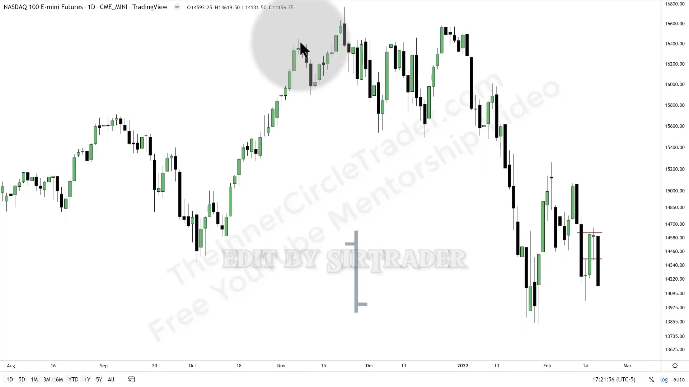

something. From this low up to this high. It's bullish. We're expecting bullish prices. This is how you back test. You tell yourself in your annotations. I was expecting you're you're basically lying to yourself in the in the comments of your chart when you're back testing. But what you're doing is is you're teaching yourself pseudo experience. It's training your subconscious to see this stuff. Like you saw it, life.

And when you record it on the chart in your own imitations. And you log it, and you keep it in your journal. And on the weekend, you go back and look at your Monday, Tuesday, Wednesday, Thursday, Friday, and you look at the previous week. And you start looking at these patterns and how it repeats over and over again. When it's bullish.

You're trying to stay with the opposite of this: open near the low, close near the high, but expansion to the upside. So, accumulate longs, manipulate, get people thinking it's going to go lower, and then ram it up higher. Distribute the longs. Near the close. That's what you're looking for here. If we're bullish here.

Okay, we're expecting each candle to expand higher. So, in other words, to close be higher than the opening. On each individual candle. My up candles are green. How many? Black or down close candles? Do you see in this price run? How about this price move here? It's going lower, right? Going down for the south side here. You're bearish, but what happens, ICT, if it goes?

You'll probably lose money, but let's count how many up close candles we have. One, two, three, four, five. Look how much range it moved. If you can't have a model that weather's, say you got a losing trade each one of those days. If that blows your account, you're not managing your risk properly. You're overleveraging or overtrading.

## [29:42](https://www.bilibili.com/video/BV16JbM6YEGV/?t=1782)

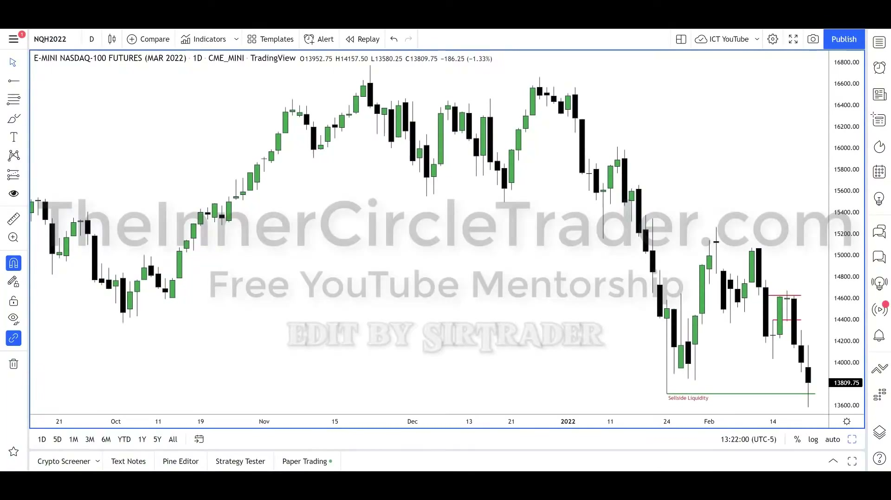

All right. So we're looking at the S&P Nasdaq futures contract for the March delivery. If you remember, I was outlining this imbalance in here. Okay, and I gave you the high of this candle, the low of that candle, which it should be sitting right on that.

So with this imbalance, we traded down to a discount, back up to a premium. Again, measure the high to the low, and I'll do that for you. All right. So here's fifty percent as equilibrium inside this dealing range, high and low. So we traded from these lows up into a premium. Above fifty percent, below fifty percent is a discount. Here, we tried to rally up above this high, failed.

Broke back down below fifty percent, and created a gap. Okay, so it comes up. Back into a premium market above fifty percent, and fills in the gap. I mentioned how this type of retracement can lull traders into likely thinking it's going to go higher, but we're thinking down here. Okay, the liquidity resting below here is what they're going to attack.

So all of this consolidation just sets up another selling opportunity to run down there. All right. So it needs to rebalance this. First. And it spends three days in that range. Then it releases to the downside, attacks the sell side here. And trades into the cell cytosol, resting below here. So let's go into a lower time frame, hourly chart, and ferret out some more information and details.

## [30:50](https://www.bilibili.com/video/BV16JbM6YEGV/?t=1850)

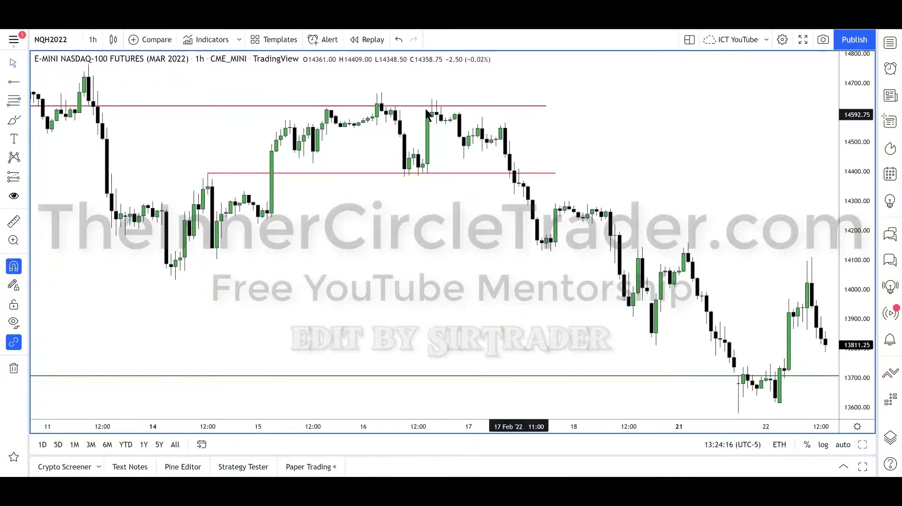

Alright, so here is the hourly chart, and you can see that high end of the fair value gap and the low end of the fair value gap, which ended up into that, sold off, consolidated, sold off once more. So I want to go into what I used, what I saw, and then obviously I'll show you in the account where the details were. Okay, alright, so.

The market started trading, rallied up, took out a short-term high on Friday. See that? Then started to break down. Now, overnight, I was watching this, but I was hoping that it didn't take out that low before the morning. I wanted to see it. Trade up here, take that high out, and then consolidate after running below that short-term low.

I didn't want it to be in a hurry before the New York session in the morning, because that would have set up a nice short up here, where I could have taken a run under this low and then see if I can capture a re-entry, which is the entry you'll actually see me do, and then the drop down in here. Now on Monday it was a bank holiday, and trading stops at one o'clock in the afternoon on holidays generally.

And when we stopped here, we had already moved aggressively lower and stopped right there. So I felt very strongly that we were going to gap down below it. And it gave just a beautiful gap lower and run immediately. But I was looking at the thirteen five ninety thirteen five eighty six level real time, and I couldn't get to my screen fast enough.

To to close it out there, and I didn't want to put a limit order in because if it got really far down below and started running, you know, really lower with a lot of speed and such.

I didn't want to limit my profitable exit with having a limit order in, so I just left it open-ended, and I wanted to see how far it would reach down in there. By the time I closed the trade, it closed me at thirteen thousand six twelve and a quarter. So my entry was thirteen thousand eight fifty-eight and a quarter. The exit was thirteen thousand six twelve and a quarter. I'm going to drop down

## [32:24](https://www.bilibili.com/video/BV16JbM6YEGV/?t=1944)

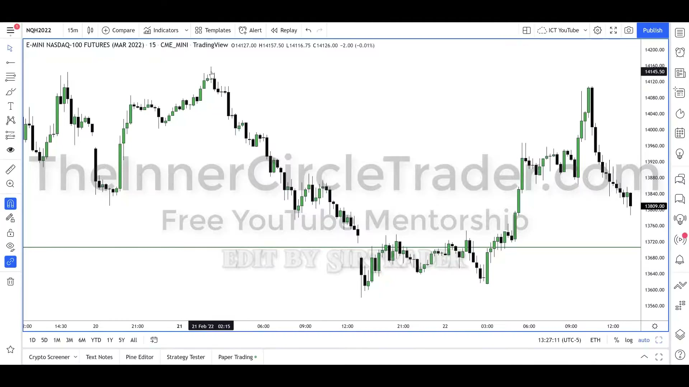

into a fifteen-minute time frame. All right, so we had that run on Friday's high. Here, side of the breakdown, and at ten thirty in the morning, ten thirty three was the actual fill. So it's right in that candle, right in here. I'm trading in that candle going short. So we're going to go into the details and look at why that was the case. So we're going to go into a five-minute chart. Start going down.

Into the details here. A bit taller, so you. Appreciate the imbalances.

## [32:48](https://www.bilibili.com/video/BV16JbM6YEGV/?t=1968)

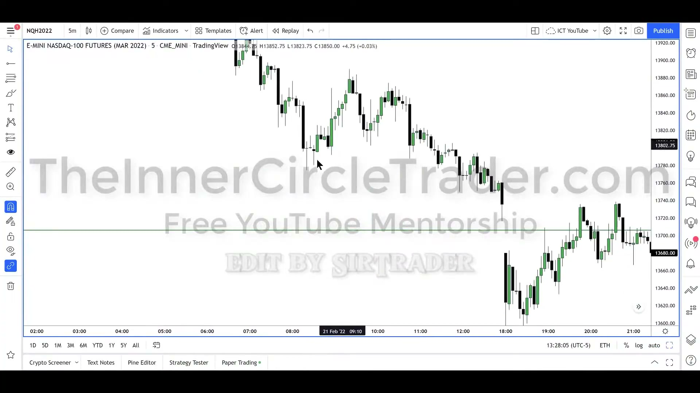

Alright, so we had this rally up. Which, in my mind, was acting like a Judas swing in the morning. Okay, so here's eight thirty. Starts to run higher. So I want to be in going short at this candle's opening, and you can see that.

## [33:02](https://www.bilibili.com/video/BV16JbM6YEGV/?t=1982)

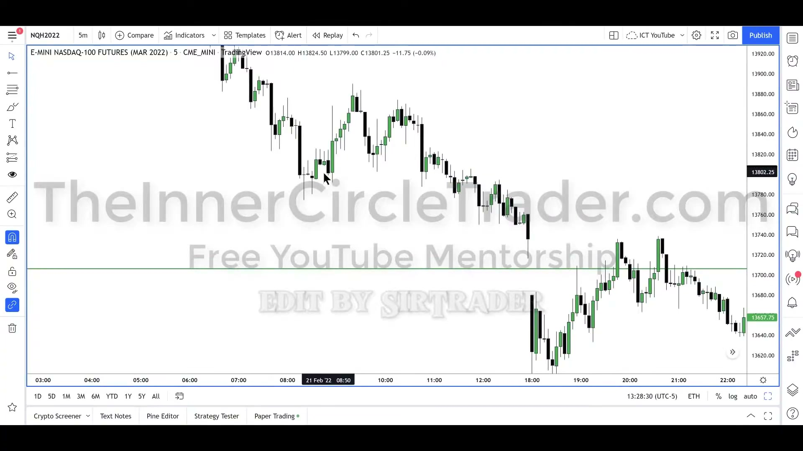

Well, maybe you can't see it. The opening price over here. Okay, here is eight thirty's candle right there. The opening at thirteen seven ninety eight and a half.

So I want to be preferably going short something above that price. Okay, so I'm anticipating further weakness. And before I go any further in this one, I got several people, probably about half a dozen or so, mentioning their confusion with why I mentioned the opening price at New York at midnight and then the opening price at eight thirty in the morning. There's two reference points being specifically dealt with there.

If you're looking at the entire daily range, you're going to use the opening price at midnight. But if you're going to be looking at the morning session, you're going to be looking at the eight thirty in the morning opening price. Okay, so hope that's made a distinction there. So eight thirty in the morning, that opening price. I'm bearish. I'm thinking we're going to go down below that green level there. That's the old daily low. So on this candle here at eight thirty, I'm expecting all this being a fake rally.

It's something to lull in. Traders to chase it going higher. The retracement. People that don't really understand order blocks, they're going to say, "Look at that! It's a down close candle. I'm going to buy that." And then when it starts to go up like that, they feel, "Wow, this is really easy. Every down close candle after a run up is a bullish order block." It's not.

In here is the real context. Okay, we have an imbalance there, and that's what I'm looking at. I'm looking at this imbalance, right?

There, so I'm trying to operate inside that range for a short. Now I know because of the volatility, it can color outside the lines, and it's okay. The bodies of the candles are kind of supporting the idea what I'm looking for, but the wicks I could care less about because I want to get in when it's ideal, and I'm going to show you what that looks looking like for me at the time. So we're going to drop down into a four-minute chart.

Okay, so.

## [34:30](https://www.bilibili.com/video/BV16JbM6YEGV/?t=2070)

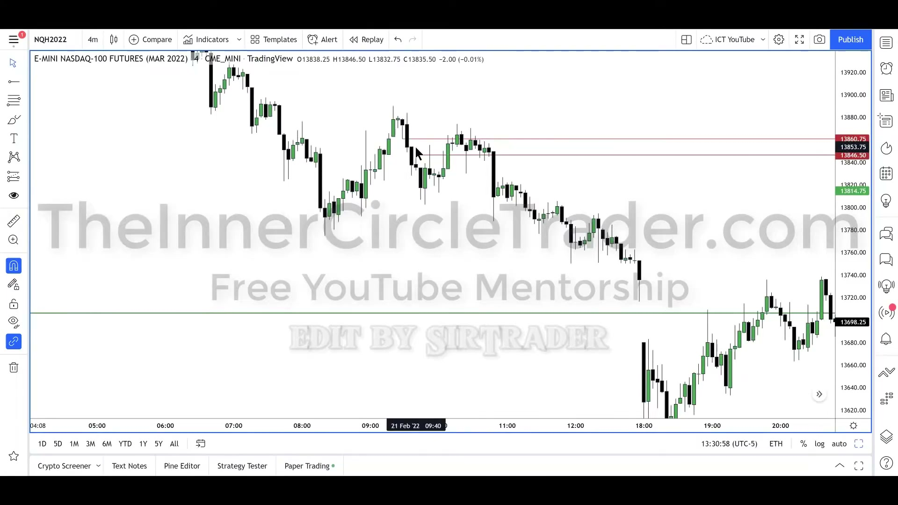

Here is that imbalance and fair value gap on the five-minute chart, but now it's a little skewed because it takes up two candles to show that range. The market trades up, and right in that candle, that one right there is that's where I'm going short. I got in at ten thirty-three. Okay, that was my short. Dropping down into a three-minute chart. Okay, the market

## [34:46](https://www.bilibili.com/video/BV16JbM6YEGV/?t=2086)

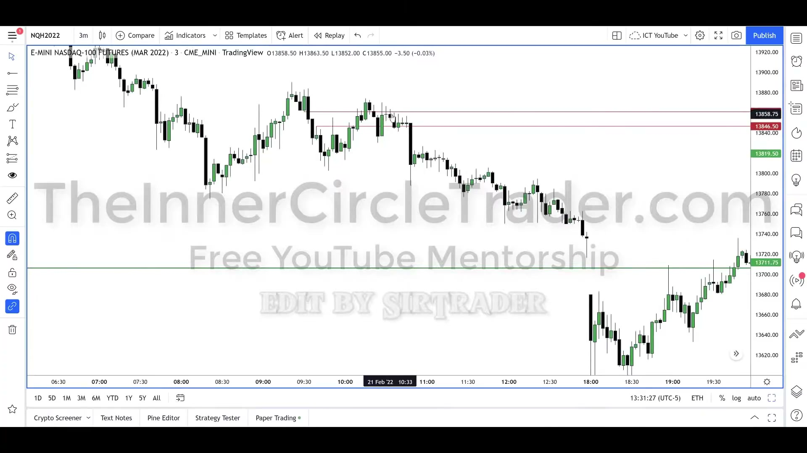

trades up, works inside that imbalance, and right there, ten thirty-three. That candle, when it's starting to bump up against the top end of that fair value gap. Right there, as it hits that and starts to move away, I'm in there. I'm going short right there. The reason why I'm trusting that and not thinking it's going to go higher is because we have this high here. And then we have this high here.

Which high's higher, this one or that one? Obviously, this one. Now this candle's high. Watch what happens. From this high, we have a short-term swing high next to it here, and then we have one here. So this one makes a intermediate-term high.

So we have a long-term intraday on a three-minute chart, which sounds like an oxymoron now. But long-term high, intermediate-term high, because this high is lower than that one. But we have a swing high here and here that are lower, both being lower than this one. Then we have the same context right here. We have a high with a lower high.

On either side of it, so I have market structure behind me, showing that this is. Number one, it's a bearish market because my drawdown liquidity is down here. It hasn't traded down there yet. Okay, so it's going to act like a big magnet. So all these fluctuations in here, without understanding what I'm showing you. It's gonna feel like it's just noise. It's chop. It's not.

It's actually telling you exactly what it's going to do. So the swing high here is an intermediate term swing high. So I want to be going short real close to this high because it's likely to break like it does here. So at ten thirty three, when it hits the upper end of that fair value gap.

I have it now. At this moment, go back one candle. We have this high, a higher high, and a lower high. So we have high with a lower high on either side of it. That's a swing high. That is lower than this one. That is lower than that one.

So it's far more than just oh he's just looking at lower lows, lower highs. So what you're doing is is you're looking at all the swing highs, and every time you see a swing high, and a swing high is simply a high.

That has a lower high candle to the left of it and a lower high candle to the right of it, and the one in the middle—that's your swing high. Note that. Okay, in the old days, whenever we saw a swing high or swing low, we would just put a little ring above it, little circle. Okay, like a little halo, and that would be a short-term high.

Now, I would do a double circle or double halo for an intermediate term high, and then three halos for a long term swing high. So that way, when I'm looking at price, it allows me to classify the level of high that it is forming. So it's not just lower low, lower high. No, you got to look at the nesting effect of the highs and lows. The candle I'm trying to get in at.

And I execute on with all the understanding of this outline. There, I want to see displacement. We get it here now. If I didn't take this trade here, I could trade with the return back to this right here. Why is that possible? We have a swing high. It's broken to the upside. This low is taken out here. This candle's high here. If it touches that again, I can be short there.

Just using the imbalance and the fair value gap entry technique I'm teaching you, so. I can go there. And get short, or I want to get up here as close as I can to that important high that I've already outlined here. So I want to be in that.

And wait for that initial move, because then when this occurs, when you're that high up in the well, the session high. So at eight thirty, right there, this run up. I'm real close to this high by entering there. Notice that I'm not waiting for a breakout below that low. So I'm getting up in there where. It's an optimal entry. I don't need to get the highest high. You don't need to get the highest high.

But you need to understand why it should be trading away from the levels you're trying to enter at. But the displacement comes, which is what I was waiting for, and it gives you a confirmation. When this occurs, it's just almost like okay. Just sit back and just relax, and just let it do its thing. Now Monday again was a holiday, so I knew I had abbreviated.

Session hours. So it's going to close at one o'clock. So that's right in here, and then next candle obviously would be. One o'clock, and it's not trading. So it closed, but it closed here ahead of one o'clock, and then. The holiday session closing at one p.m. in New York local time, and the low that green level there. Remember, go back to the daily chart.

At the beginning of the video, and what we were referring to last week, the liquidity, the sell stops below this green line. That's where it was going to attack, and

## [38:28](https://www.bilibili.com/video/BV16JbM6YEGV/?t=2308)

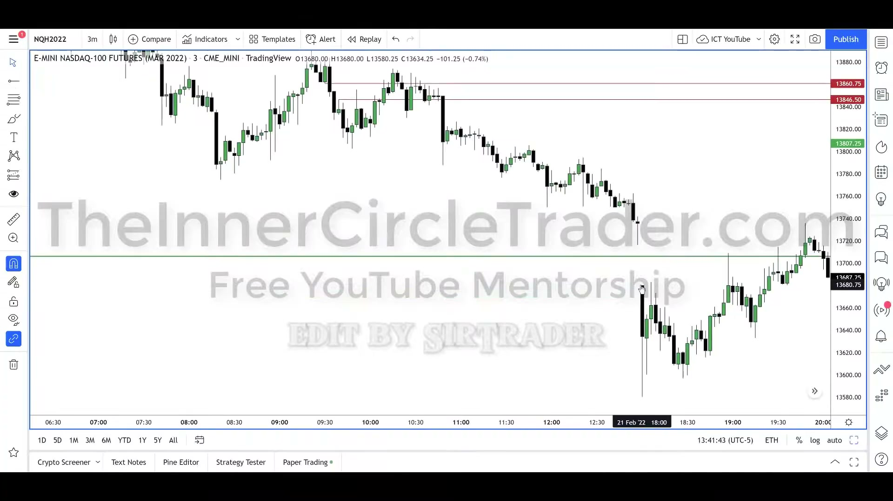

it came in. And did so. It opened up. Six o'clock in New York time opened up and then slammed down, accelerating lower. That is the move. That you want to see being short up here and covering down below here. Once it does that and it runs in low deep. That's it. Take your profits and move to the sidelines, and then wait because you have a big gap here.

It's likely to come back and rebalance that and fill it in, and it does. And then, ultimately. Trades. Around that old low. And eventually, pumps up. Into the afternoon. Consolidates.

## [39:02](https://www.bilibili.com/video/BV16JbM6YEGV/?t=2342)

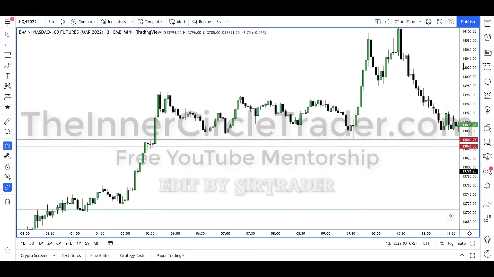

Then goes into the early morning, afternoon hours. And I showed.

## [39:10](https://www.bilibili.com/video/BV16JbM6YEGV/?t=2350)

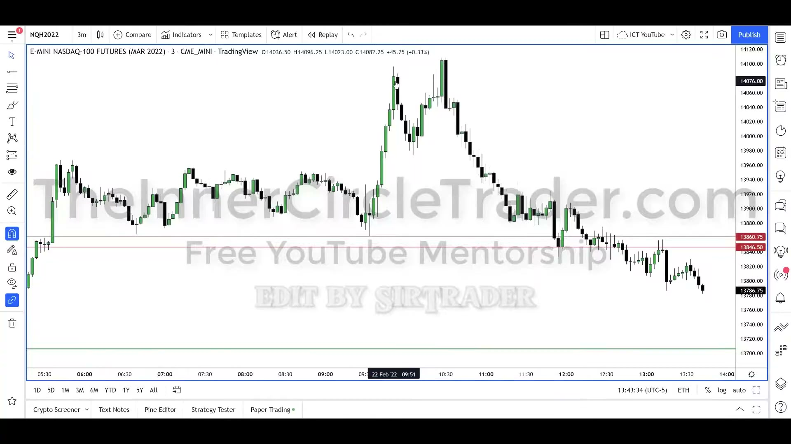

How this set up? Because after a big move, you don't want to trade in the morning session. Just don't do it. So when I have a nice winning day. As you'll see, it was a nice little win. I'm not in a hurry to go back in. And then you have these days here where it can trip you up. You don't know what's going on. You don't know what's likely to occur. So. This morning, after nine thirty, again. What's the bias?平时。

That has not changed, even though we had this run-up. It hasn't changed. So at nine thirty, equities open after consolidation. It runs up. Creates a high, and then runs up again. Takes out the high. That right there is your. Run on stops. Wait to see if it wants to break down. So we're going to look at that.

And but ultimately, right in here, we have a nice little selling opportunity, and you can attack the fair value gap in here between the low and the high. Right there, it would be. And if you want to trade with the longer-term bias, you could attack this sell-side liquidity resting below here and here. Because they're relative equal lobes. And then you would have got a nice fill there as well. So over here, you can see

## [40:04](https://www.bilibili.com/video/BV16JbM6YEGV/?t=2404)

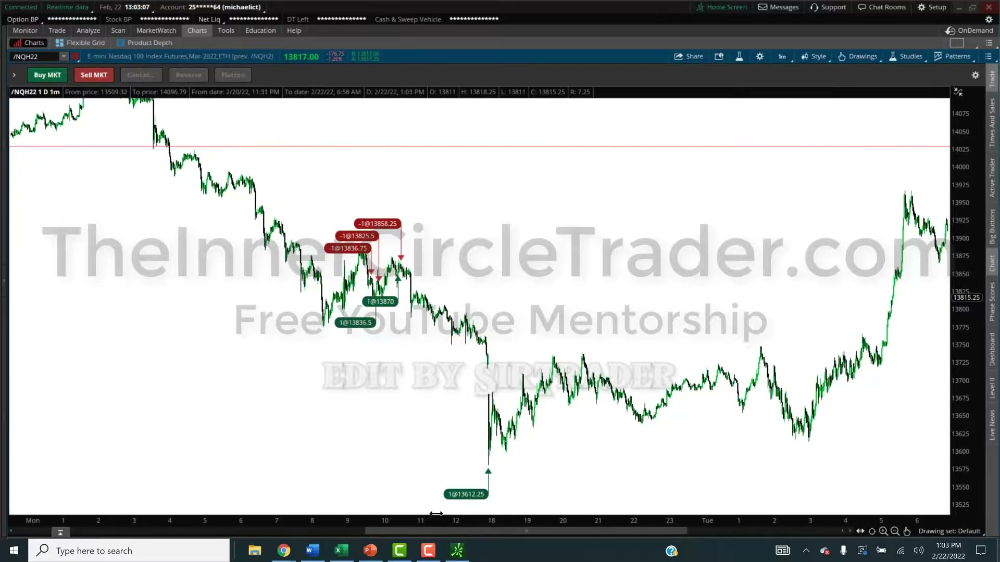

the execution yesterday. I had a scratch where I got in a little too early. And the second one, I wasn't sure. It was going to go higher or lower. And just to appease my curiosity. Short end just. See what we get snapped against

## [40:16](https://www.bilibili.com/video/BV16JbM6YEGV/?t=2416)

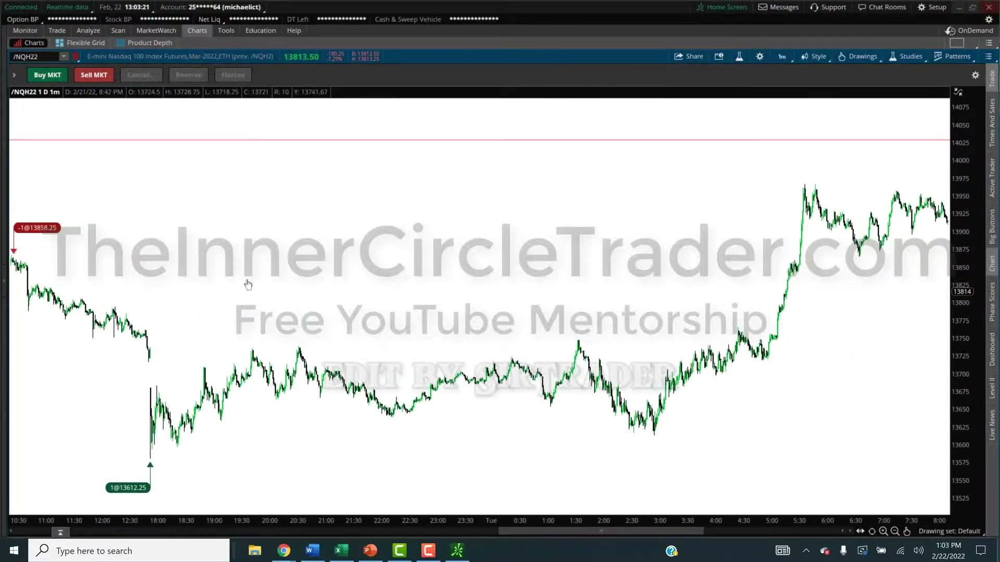

me a little bit. Not not much, but still enough to get my attention, and I knew what I

## [40:20](https://www.bilibili.com/video/BV16JbM6YEGV/?t=2420)

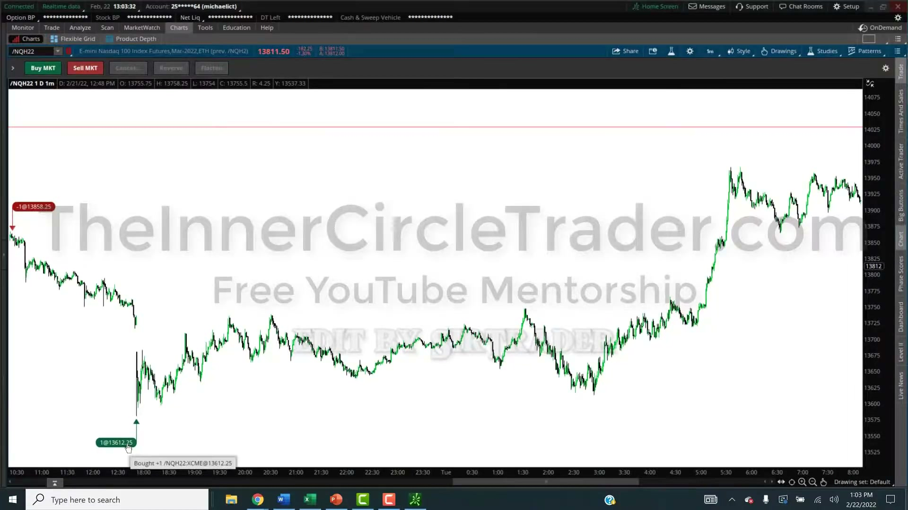

was looking for. So there's the short I just outlined in the previous portion of this video. Wrote all that down. Held for the gap. Opening after reopen at six o'clock and. Nice little dandy. Four thousand nine hundred twenty dollars fixes

## [40:34](https://www.bilibili.com/video/BV16JbM6YEGV/?t=2434)

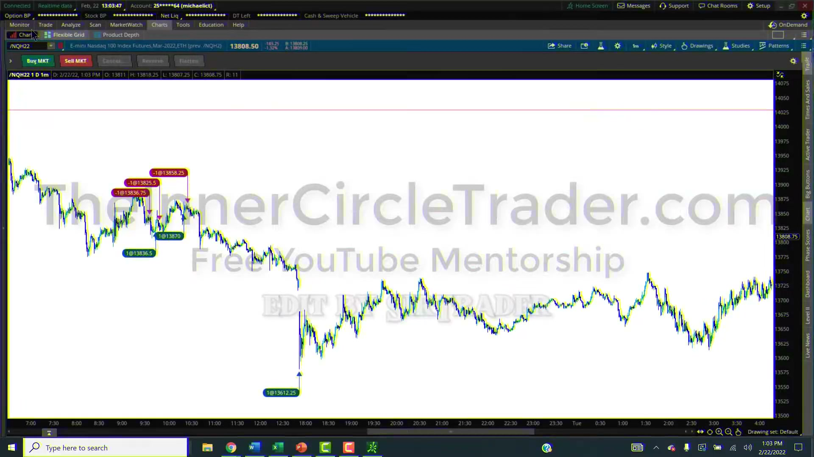

the little pinch that took the one trade clear today. The one scratch was nothing; it was covering costs.

