# 【精翻】ICT原版无废话版七：时段画像与复盘

- 作者 耳朵数字观察
- 时长 40:45
- 来源 [https://www.bilibili.com/video/BV1WgbM6zEv3/](https://www.bilibili.com/video/BV1WgbM6zEv3/)
- 由 course2md 生成 · 82 张截图 / 175 段文字

---

## [00:00](https://www.bilibili.com/video/BV1WgbM6zEv3/?t=0)

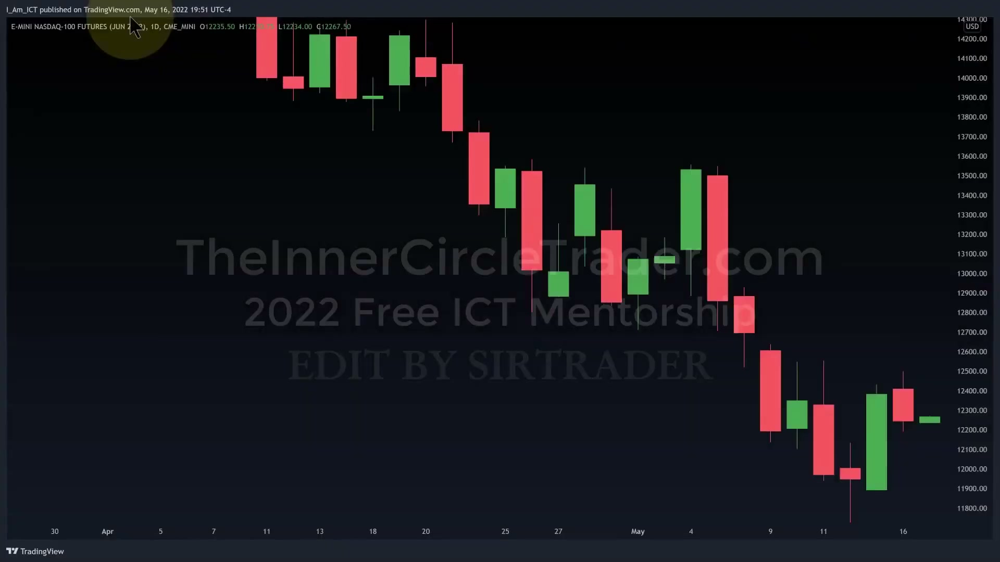

Twenty-nine. I'm gonna be doing a brief review of what took place today. I kind of like want to bring your attention back to that twelve thousand five hundred fifty-three and a quarter level, which is the relative equal highs here on Nasdaq. So that was kind of like the basis for why I went into the market today, Monday, the sixteenth of May, two thousand twenty-two, with a bullish bias.

I was looking for this drawdown liquidity for Nasdaq. I originally went in looking for a

## [00:22](https://www.bilibili.com/video/BV1WgbM6zEv3/?t=22)

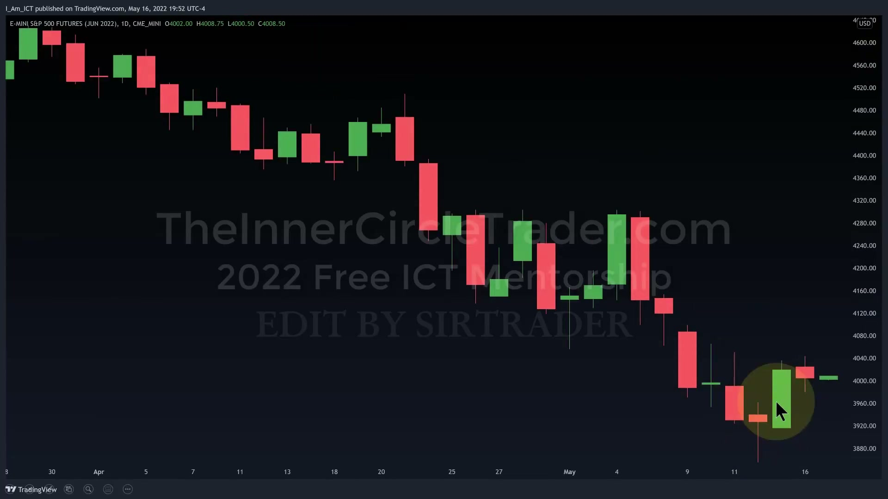

trade in Nasdaq, but all right, and S and P, much like the Nasdaq, had a daily swing low. And while we didn't have relative equal highs here for S and P, the bias was, in my opinion, warranted for at least the beginning of the week, looking for continuation on the upside.

## [00:36](https://www.bilibili.com/video/BV1WgbM6zEv3/?t=36)

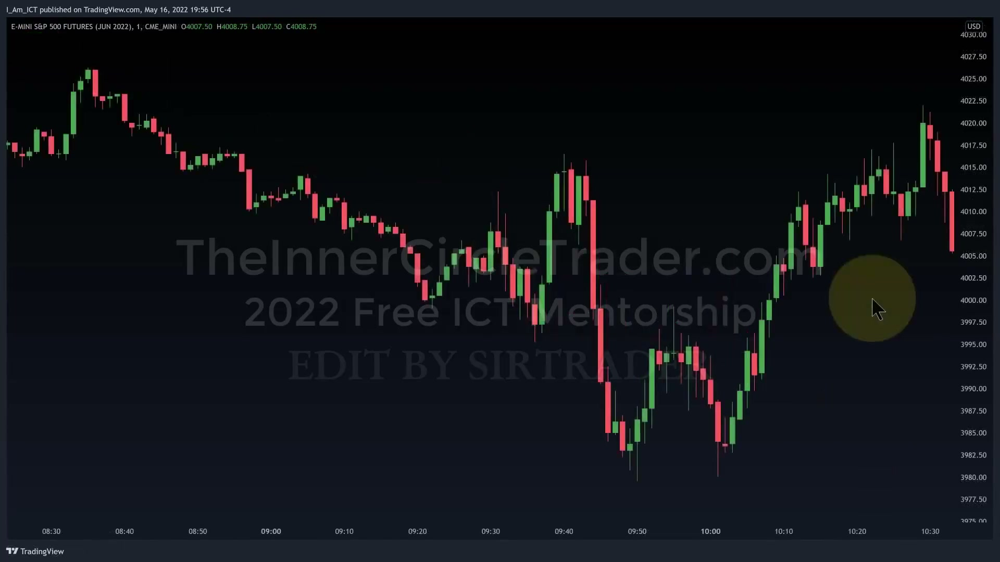

All right, so we have the one minute chart. I went right into the one minute chart because we're starting with the bullish bias. And at nine thirty, we see the market does, in fact, take out a short term high. It declines. I'm not interested in going short. It does not give me a pattern anyway. Notice that there's no fair value gap revisited. The market creates this relative equal low.

Starts to rally, trades up into the afternoon. In here, I want to see it create a buying opportunity. Now, the logic behind all

## [01:00](https://www.bilibili.com/video/BV1WgbM6zEv3/?t=60)

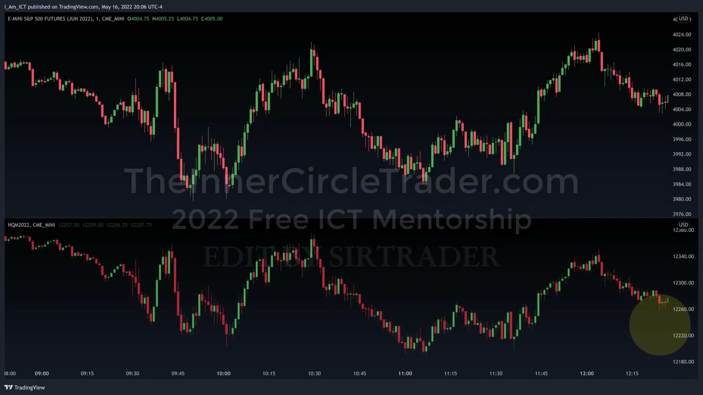

this is we're in a day before Fed Chair speaks, so there's going to be very low volatility as a result of that. So it's going to be a small range day. Doesn't mean you can't trade it, obviously, but it takes a little bit more experience. Now, I'm not saying that you should trade.

Ahead of Fed Chair Powell speaking, or any future Fed Chairman, because it's going to be a very quiet day, usually like this. Okay, and it's important to know when the volatility is likely to occur, and when also the volatility is likely to shrink up and get kind of like lethargic. If you look at the S and P at the top, see the drop down relative equal lows.

And then we have the same similar pattern here. But look what Nasdaq was doing. See that. Lower low. When S and P was saying, "I don't want to go that low," so it was resisting going lower. Then we retraced higher. Just like this, Nasdaq did.

But that Nasdaq made a lower low than that of ten o'clock in the morning. While at the same time, the S and P said, "No, once again, I'm not going lower than the low I made at ten o'clock." So we had a divergence here. And here, the importance of that is, I already had a bias that's bullish. There was no short trades that were lined up with this model today. So we're in the

## [02:00](https://www.bilibili.com/video/BV1WgbM6zEv3/?t=120)

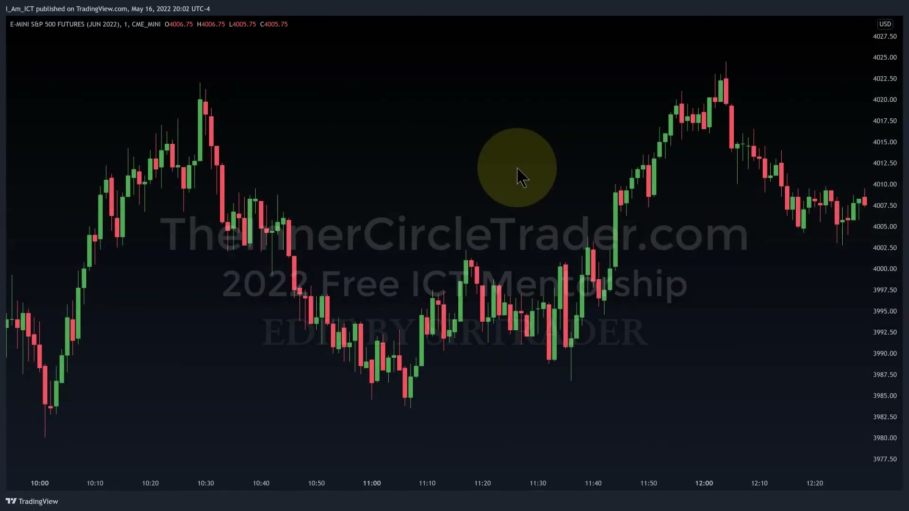

one-minute chart here, and I want you to take a look at what we have framework-wise. Looking at price action like this, yes, you can see there is a rally up. It breaks the short-term low, a fair value gap. It trades up into it and breaks down. Big deal.

This doesn't fit the criteria because the displacement leg here would require us to see a fairway gap above fifty percent of the high and the low of the displacement leg,

## [02:18](https://www.bilibili.com/video/BV1WgbM6zEv3/?t=138)

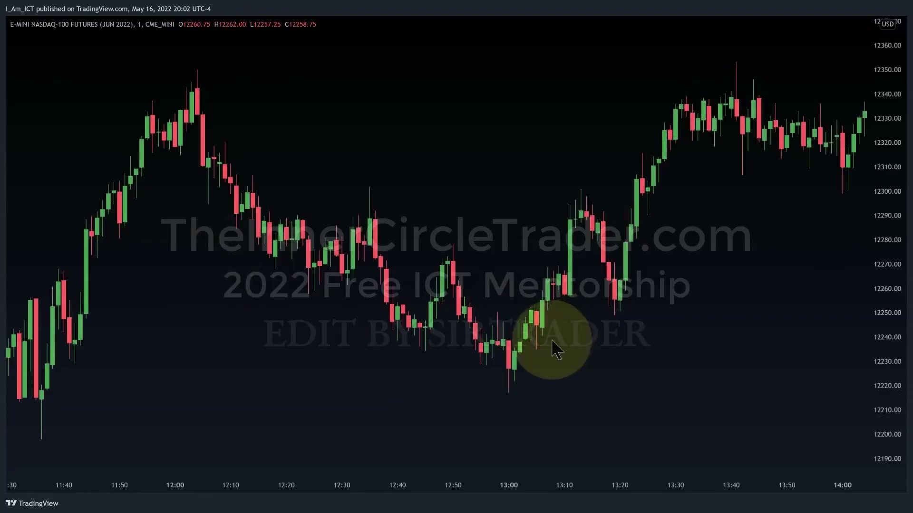

and we don't have that. We'll look at the relationship between the Nasdaq, which was a little bit sloppier in here, versus. The S

## [02:24](https://www.bilibili.com/video/BV1WgbM6zEv3/?t=144)

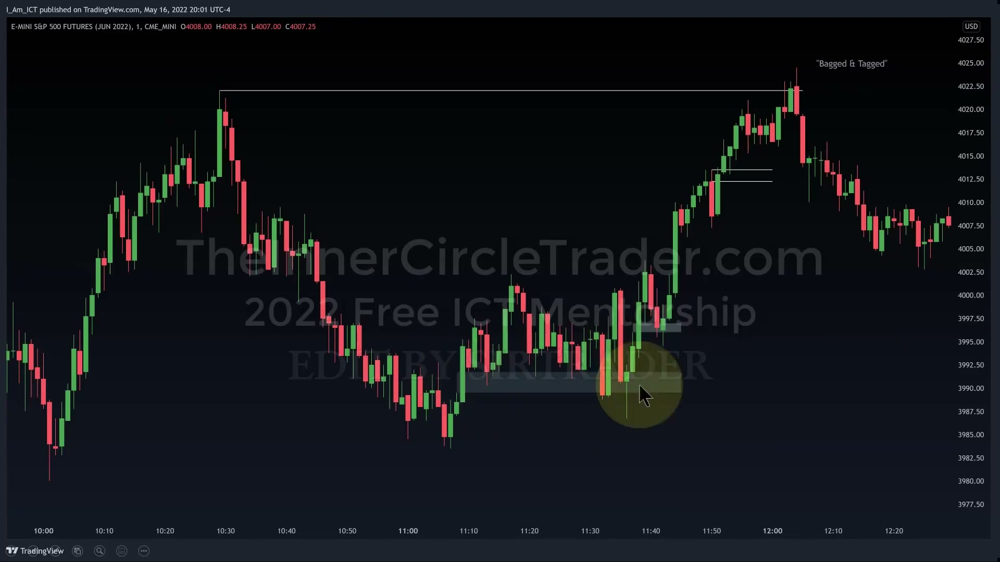

and P a little bit more structured here. So the fair value gap in here, this candle in here, it wicks down into it, and I want to get close to this fair value gap without it running too far away. So I kind of like want to touch a little bit tonight with close proximity entries. That means you might not get so precise with your entries. You might fumble with your order entry. What do you do in that situation if you miss the ideal entry?

Well, as long as you're getting in there really close, or like I'm suggesting here, a close proximity entry, I don't think there's anything wrong with it. So, if we are looking for entry patterns, the idea is we want to get into where our model is suggesting it. So we're seeing the market trade lower, lower, lower. It's failing to make a lower low like Nasdaq, and we have this low that's probably not going to be taken out because we're bullish.

The market rallies up. We have a short-term shift in market structure. Then it trades back down into the fair value gap. Look at the opportunities it gave to go long. Eight candles. It gave an opportunity to get in this area here, either inside the fair value gap or in close proximity to it. Now, when the market starts to rally, I have one more indication that the market structure has shifted again, bullish, with these highs taken out.

Here, all right, we're over here on Trading

## [03:22](https://www.bilibili.com/video/BV1WgbM6zEv3/?t=202)

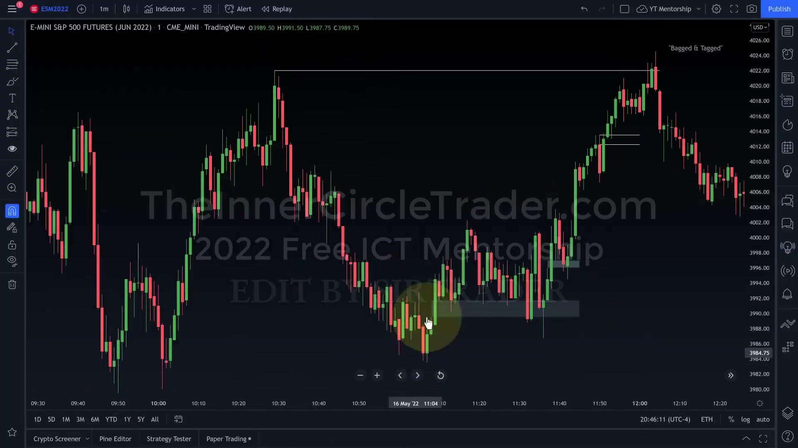

View. The market trades lower, creates that short-term run. Here, rallies break in market structure to the upside. Trades in the fair value gap and the secondary fair value gap, and it runs up into the liquidity above here. We had

## [03:34](https://www.bilibili.com/video/BV1WgbM6zEv3/?t=214)

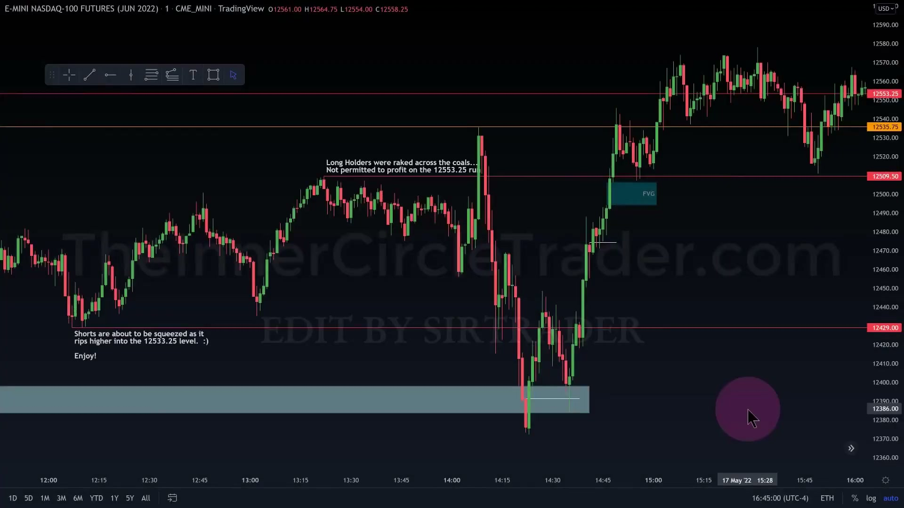

the chairman speaking at two o'clock in the afternoon. You can see that here. Now I'm gonna kind of work backward today, and I'm

## [03:40](https://www.bilibili.com/video/BV1WgbM6zEv3/?t=220)

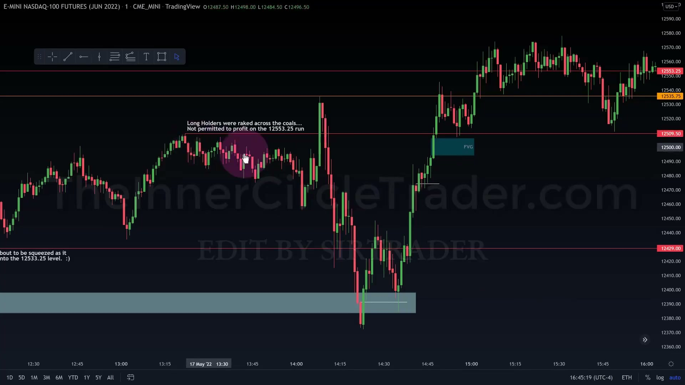

gonna talk about the minute chart, work our way back out to a higher time frame. So it's kind of like a bottom-up analysis ahead of the two o'clock in the afternoon. Fed Chairman jawboning session. We've seen this little juice swing here, and notice that it just fell short of the morning high, and the high comes here at twelve thousand five thirty-five and a half, and over here in morning session.

## [04:02](https://www.bilibili.com/video/BV1WgbM6zEv3/?t=242)

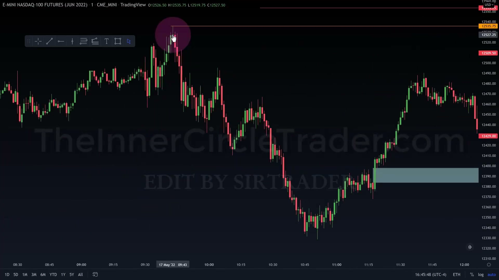

Twelve thousand five thirty-five and three quarters. So it fell one quarter of a point, or one tick,

## [04:08](https://www.bilibili.com/video/BV1WgbM6zEv3/?t=248)

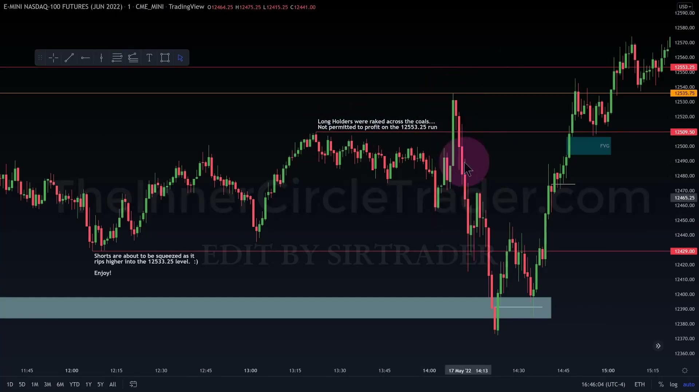

short of that high. So it runs up after clearing relative equal highs, then breaks lower. No model short in here. Then the market drops once more below relative equal lows. Now, what are these lows here? These are the lows in lunch hour, New York lunch. Here's noon to one.

And I taught you in the mentorship that many times when there's an afternoon continuation to the upside, you'll see that the lows at lunchtime will get swept. And we're seeing that here now. It dug down deeper into an area which is below the relative

## [04:36](https://www.bilibili.com/video/BV1WgbM6zEv3/?t=276)

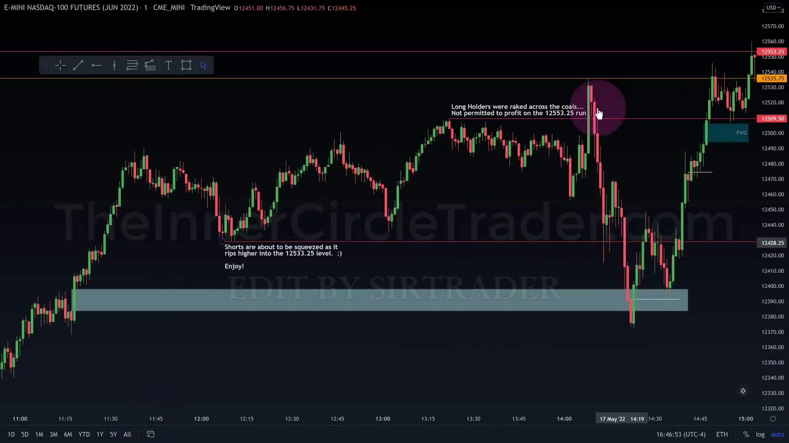

equal lows, and the market drops down below that. And then all of this right here was manipulation, and there was lots of manipulation initially. The market rallies up, so it starts off like it's going to go up to that level we were looking for, and falls short of it and breaks down. So what's actually happening is is.

Buy stops are being triggered, so anyone that wants to go long on like bull flag patterns and things like that, they're buying and then they're getting taken against their long with drawdown until they either stop out.

Or if they don't have stop losses, they get squeezed out, so they can't take it anymore. They just bail out below the relative equal lows. Any long holders from the morning—they have trailed their stop losses below here, so they take them out. Why? Because they don't want them being able to profit to the real move. What was the real move? I hinted at twelve thousand five hundred three and a quarter. That was a drawdown liquidity. So we took out the New York lunch lows.

Here and what I was suggesting here is shorts are about to be squeezed as it rips higher into twelve thousand five hundred. As I was watching, I was watching it run up. Then it broke down. I was like, "Okay, they're going to take the liquidity out below here and dig into this imbalance, pick up some more orders, and then all of a sudden it starts running up. And then in here we have order blocking trades into that multiple times, rallies up."

Fair value gap. I outlined that it didn't get into it, but I was allowing for that type of movement. And then at three o'clock, the algorithms will start to spool price in the direction of the liquidity, which was that twelve thousand

## [05:50](https://www.bilibili.com/video/BV1WgbM6zEv3/?t=350)

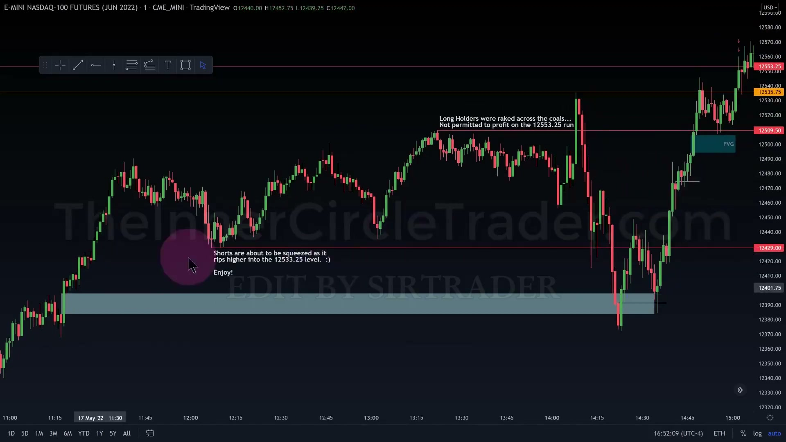

five five three and a quarter level, which it hammers there. Let's go and take some of this off, okay? And I'm going to take you to a five-minute chart.

## [05:58](https://www.bilibili.com/video/BV1WgbM6zEv3/?t=358)

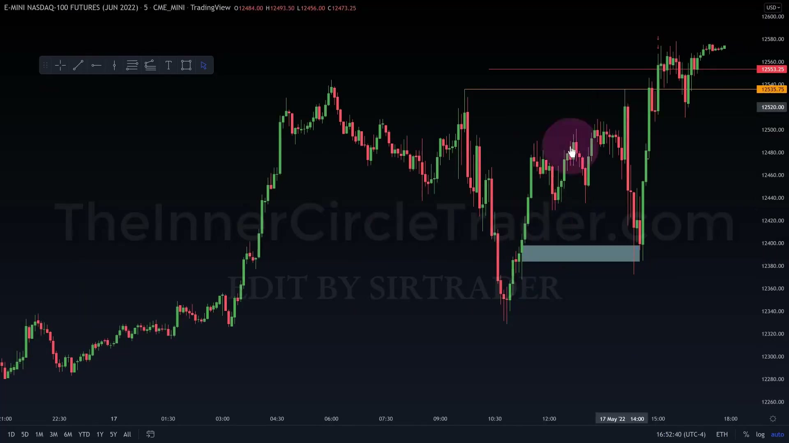

Okay, now it doesn't look so obvious in here as to what may be available, but we just bumped below that high early on in the morning, then broke down, and all the liquidity resting above here.

Was treating the retail market like, "Hey, you can trust us. This is resistance; it's not going to go up there." And then when it starts to sell off like this, notice that my model did not give a setup this morning, or not this morning, but this afternoon. It didn't give the setup in here, even though it did run by side. It did sell off. It did not give a setup. Notice that. It's important to notice

## [06:28](https://www.bilibili.com/video/BV1WgbM6zEv3/?t=388)

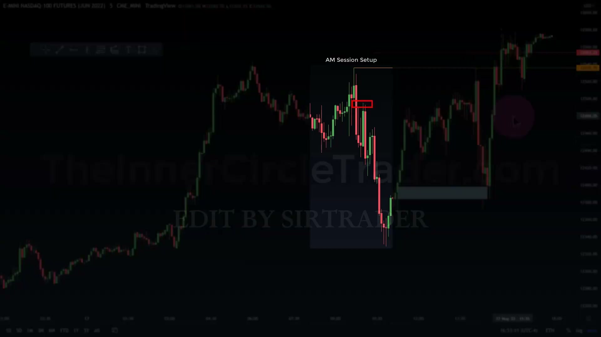

that. So, some of you are fearful. What happens if I take a trade and it's wrong? Hopefully,

## [06:32](https://www.bilibili.com/video/BV1WgbM6zEv3/?t=392)

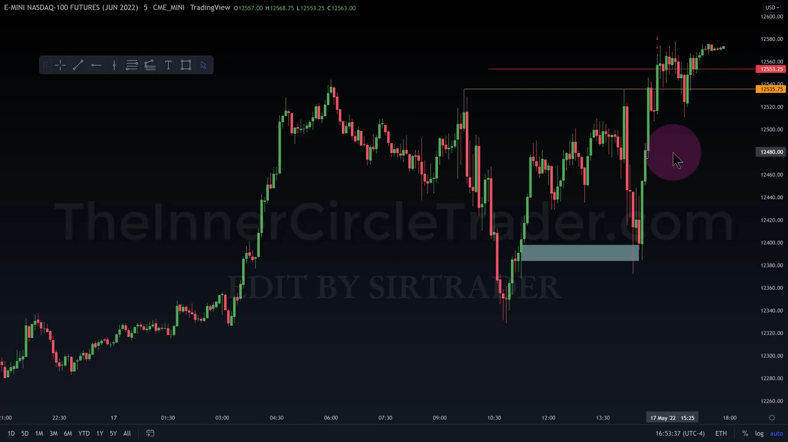

you see that like this all the time. But you'll find that when the market's really in sync, these algorithmic principles will not appear in markets that are not likely to deliver as I'm showing you. So, hopefully, you can see that there are times when the market does sell off, but it doesn't give us a setup.

But then it creates the real move the other direction, where you can find my setups and the formations of the Fibonacci gap and such. So obviously, you can see that the market did, in fact, trade down into the imbalance on that one minute chart, and it rallies from there. Into the twelve thousand five hundred fifty-three level, and I'm going to go out to a fifteen-minute

## [07:04](https://www.bilibili.com/video/BV1WgbM6zEv3/?t=424)

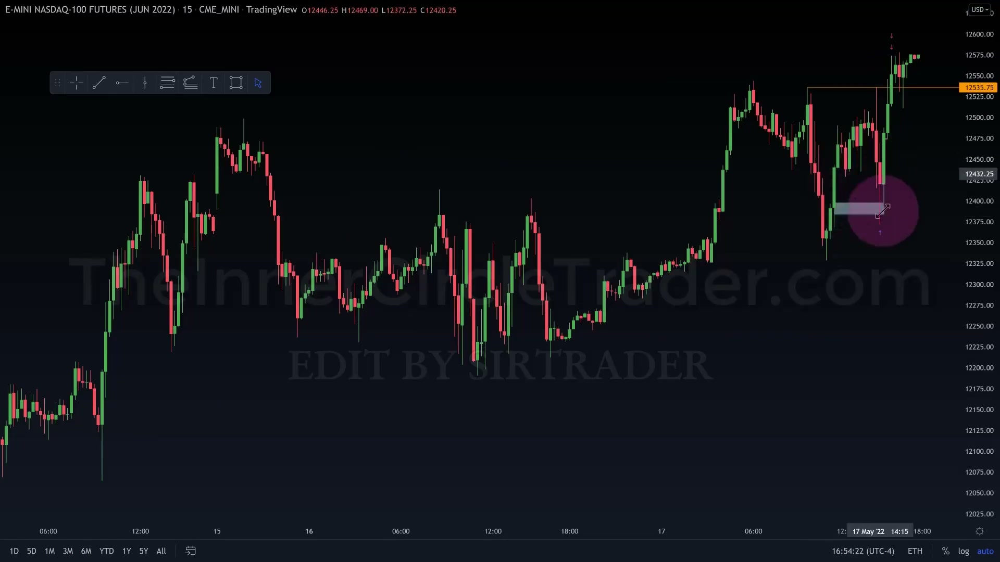

time frame. We had an imbalance in here. It trades down into that as well on the fifteen-minute time frame. Optimal trade entry here. And realize up for the most liquidity again, aiming for that twelve thousand five five three and a quarter, and we'll look at a

## [07:18](https://www.bilibili.com/video/BV1WgbM6zEv3/?t=438)

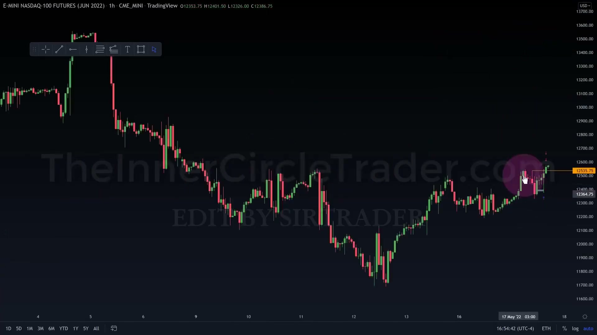

sixteen inch term. Okay, and the market trades back down into all of this here. And rallies up, and this was that area I was telling you about a week or so ago. That this is what we're looking for, and we have now just pressed up into that area. So let's go over here and do this.

And I think we'll use this one as the higher one. You can see we did in fact clear that out. That's where that twelve five hundred and fifty three level and a quarter other came from. I'm not suggesting that we're making a high here to go lower. The next area on the upside, it's really sloppy over here. I would look for this one here next. What is that high? Twelve six twenty four even.

And if we start to really run, we could revisit this area here. But I'm not going so far as to say that for right now. But just look for this one here. That's that's a nice one to look for. The next upside right there. I think that's a fair one to to anticipate and

## [08:02](https://www.bilibili.com/video/BV1WgbM6zEv3/?t=482)

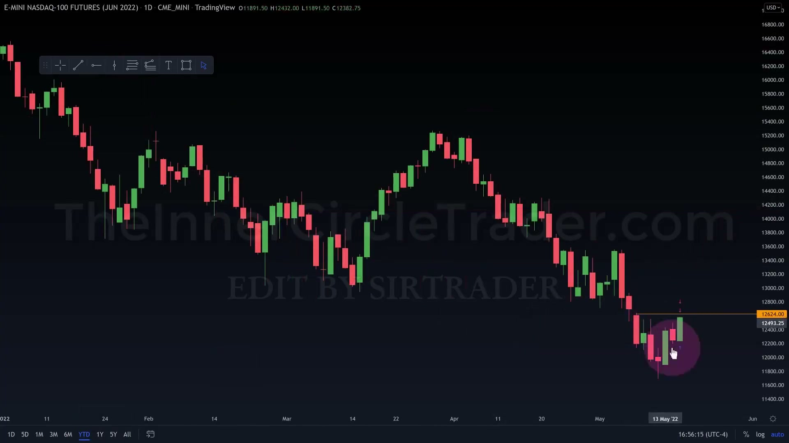

study the daily chart. There we go. Relative equal highs in here. We ran up into that. So that's that whole business based on the daily chart. As I was talking about in. I don't know what episode was recently in the mentorship on YouTube. So hopefully, you guys can see that that is, in fact, what we were working with for daily bias. Yes, you know the market did, in fact, create you know a big run.

## [08:22](https://www.bilibili.com/video/BV1WgbM6zEv3/?t=502)

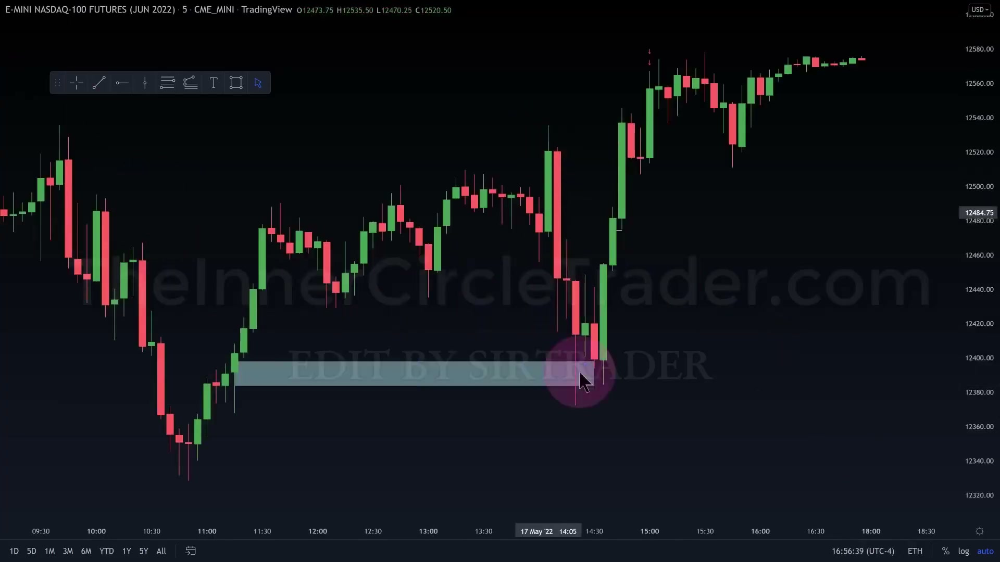

Lower and then create another run lower here, but that wasn't my setup. I was drawing everyone's attention up to that twelve thousand five five three level, and this was the run that I liked. And it's a little bit of an advanced idea, but I did teach about the general factors that go behind PM or afternoon session trading. If you're bullish and it consolidates in lunch, find the lunch lows.

Wait for it to run that out, and then they'll resume. And it's right out of the teachings and this mentorship

## [08:46](https://www.bilibili.com/video/BV1WgbM6zEv3/?t=526)

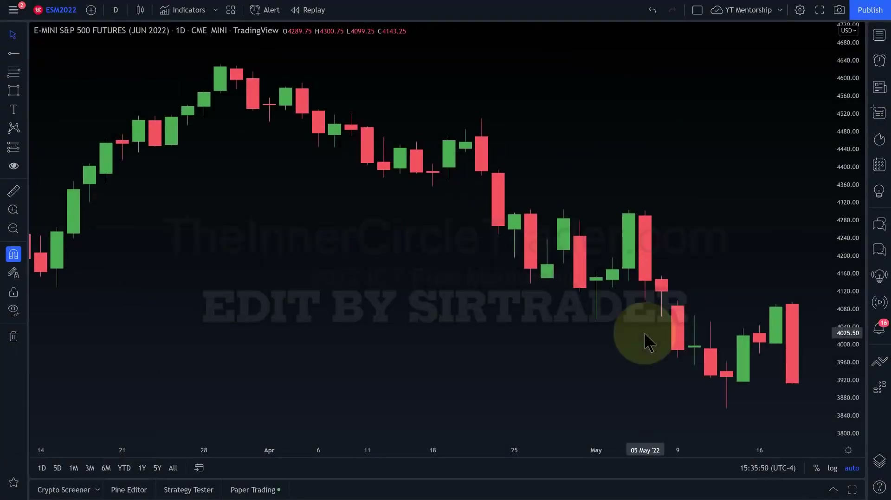

on this YouTube channel. A short little video on the S and P five hundred June contract, two thousand and twenty-two. It's our daily chart. We're gonna look at this day here. And before we get into it, I'm gonna bring your attention to the sixteenth of May on that low. So this morning, what I did was I drew everyone's attention to the low on the sixteenth of May, two thousand and twenty-two.

Now, if the market is above, let's go into a lower time frame chart. If we're in the

## [09:04](https://www.bilibili.com/video/BV1WgbM6zEv3/?t=544)

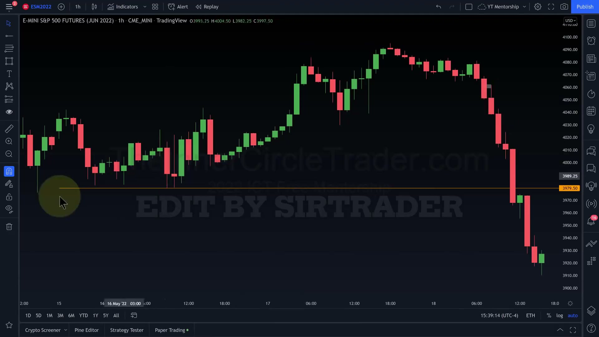

market and we're up here, and I'm suggesting to everyone, think about this low over here on the sixteenth.

What do you think I'm drawing your attention to while we're up here? And I'm drawing your attention to this specific area, the lows of May sixteen, two thousand and twenty-two. Do you think I'm referring to it as it should not come back down here? No, we're aiming for liquidity. So if it's up here and I'm pointing down here and taking your attention down there, I'm acting like a scalper. All right, so here's where I entered.

Aiming for the sixteenth low, I didn't have a whole lot of time to babysit in this thing. And late afternoon, this could have easily whipped up, did some kind of retracement without any kind of stop loss trail down, and it may have moved lower. So just to make it easy, short and sweet, to the point, your attention was drawn to the sixteenth, the low on the sixteenth of May. Let's go into a fifteen-minute time frame.

All right,

## [09:46](https://www.bilibili.com/video/BV1WgbM6zEv3/?t=586)

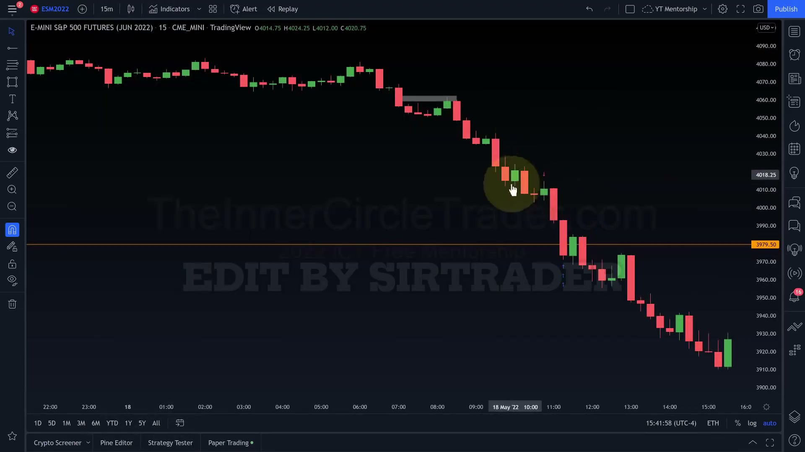

so you can see up close candle. What do you think that is? Right before we start to go lower, it's a bearish order block. Draw that out in time. It hits that order block on this candle here, dropping into a five-minute chart. What is this? Doesn't look like a bear guy yet until you zoom in, huh?

## [10:00](https://www.bilibili.com/video/BV1WgbM6zEv3/?t=600)

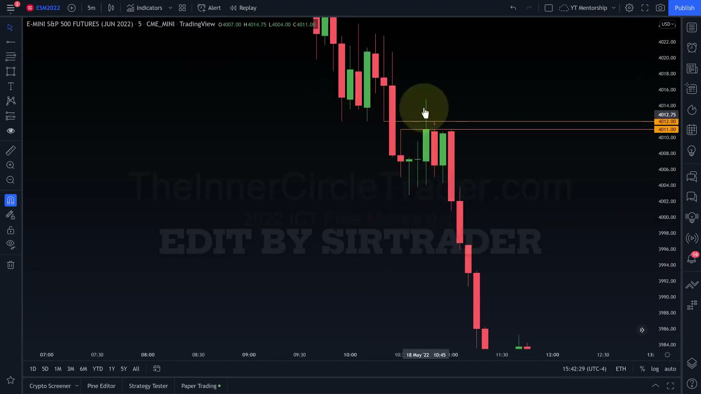

So right in here, it's hitting. It overshoots it. Granted, but there's a lot of volatility right now. This candle's high. Your stop would be above there. Hold on to the position until it starts to break lower. If you want to fine tune it, okay. So what

## [10:12](https://www.bilibili.com/video/BV1WgbM6zEv3/?t=612)

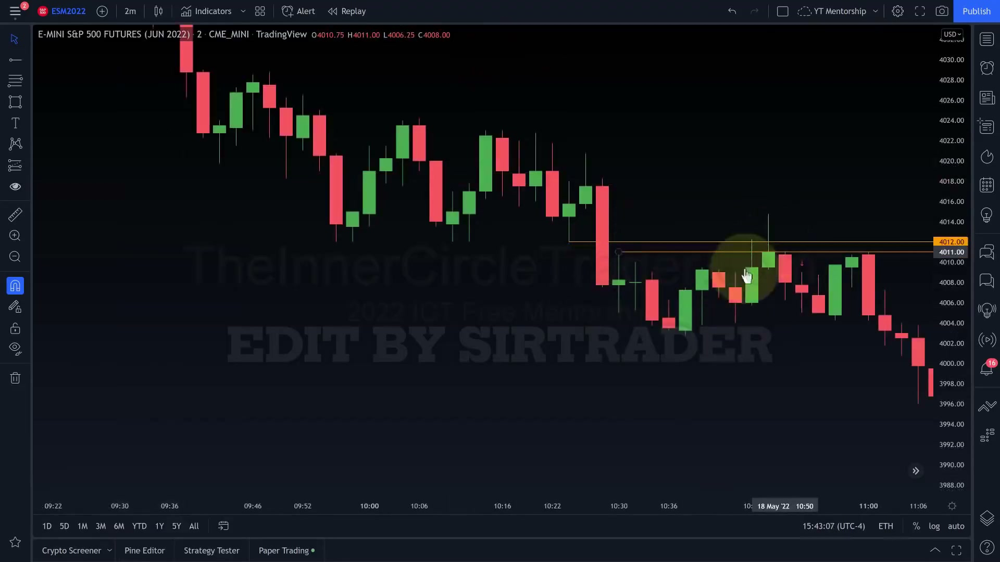

I saw was this fairway gap here. It hit it. Created what? What is this?

What's this pattern here? What's these three candles here? It's a swing high. So as soon as this candle closed here, I'm going to go right here at this candle and just get in and go short, trusting the fact that we've already had a fair value gap. We've already went through it. We had a swing high and it's bearish. I'm looking for what? What am I looking for?

## [10:30](https://www.bilibili.com/video/BV1WgbM6zEv3/?t=630)

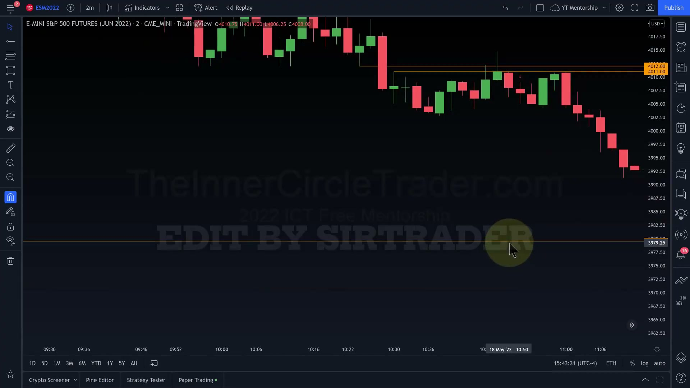

I'm looking for a run below this old low, which is May sixteenth, two thousand twenty-two's low. So entering here. And I'm writing it out with a stop

## [10:36](https://www.bilibili.com/video/BV1WgbM6zEv3/?t=636)

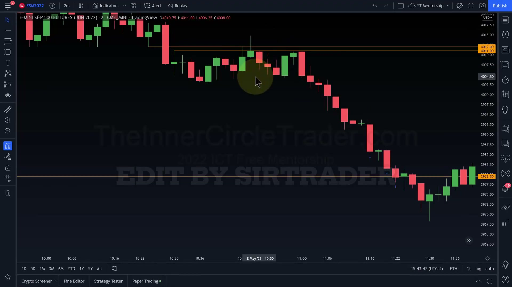

here. Everything is reduced in terms of risk. As soon as we started to break lower here and started moving my favor aggressively, I moved my stop only because the volatility is so high right now. I just don't want to see it come back and and knock me out. That's not fear. That's just sound money management. I'm not trying to take a losing

## [10:50](https://www.bilibili.com/video/BV1WgbM6zEv3/?t=650)

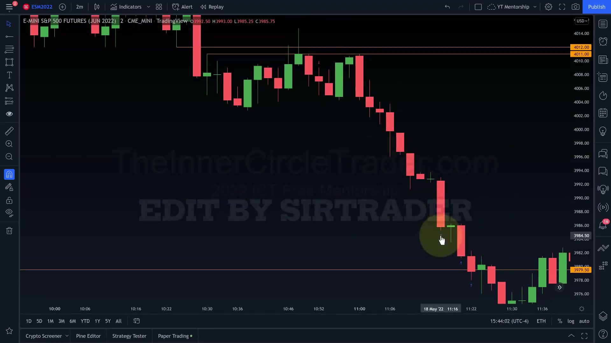

trade. So here is the entry again. It delivers on the downside. I took my first partial here. One off here, and in the limit order, you watch that fill on the little recording, the vignette that I shared on Twitter.

## [11:00](https://www.bilibili.com/video/BV1WgbM6zEv3/?t=660)

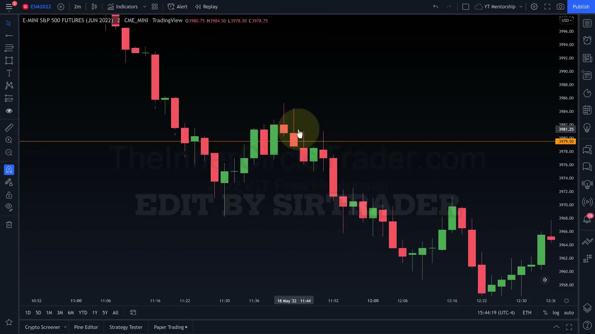

Ultimately, we started going a little bit sideways, going into the beginning of lunch. In New York. Here's your typical lunchtime consolidation.

## [11:08](https://www.bilibili.com/video/BV1WgbM6zEv3/?t=668)

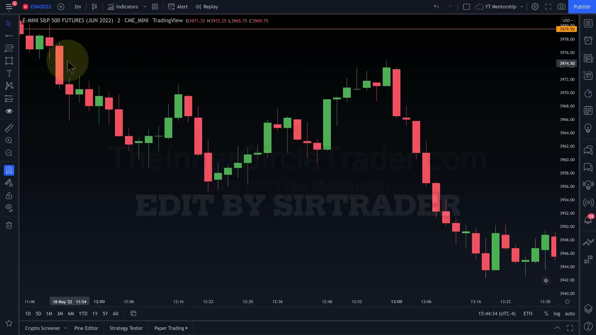

And then. What's this? Stops ahead of lunch. Bear die gap breaks lower. Consolidation again. Trades lower. Consolidation bumps to stops here. What's this? Hits it. Sells off. S'ellside here. Consolidates one more time and trades and meets the low of the day. Today, big down close day. An outside day is a day that's higher than the previous

## [11:36](https://www.bilibili.com/video/BV1WgbM6zEv3/?t=696)

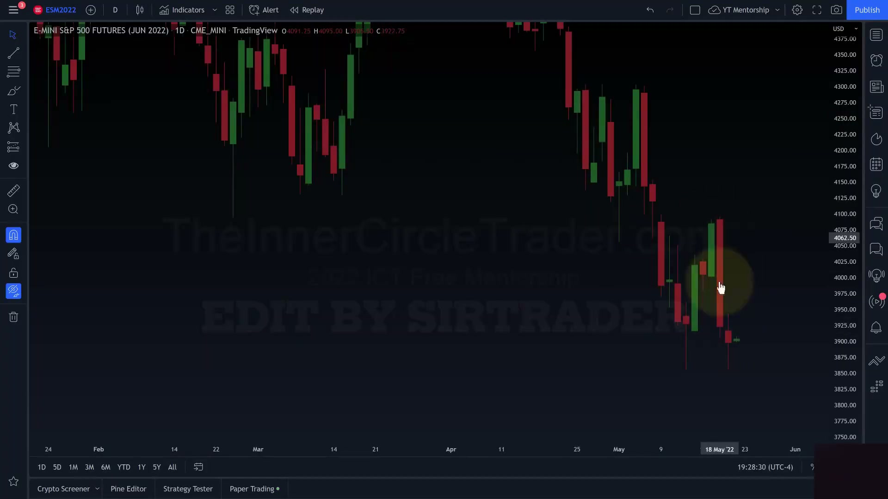

day and lower than the previous day's low. So, here's previous day's high. It went higher. Here's previous day's low. It went lower, so all of this range is outside of the previous day's range, and it closed down. When this happens, there's typically this type of price action formation, but it's really included with the odds in your favor if you're trading down to an all low, but.

Fall short of it. Okay, this is usually where that double bottom idea comes in, and it feels safe to, if you're trading like me, look for a run through that old low. But if they stop at short, it tends to be a choppy day. So let's go into an hourly chart. All right, so here's the

## [12:10](https://www.bilibili.com/video/BV1WgbM6zEv3/?t=730)

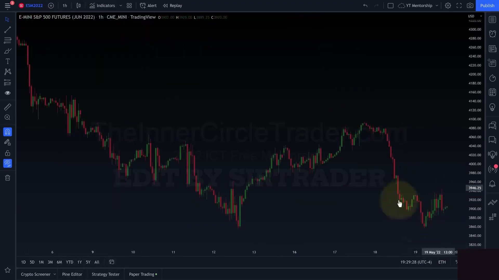

price action for today. We're going to look inside this little tiny little fractal

## [12:14](https://www.bilibili.com/video/BV1WgbM6zEv3/?t=734)

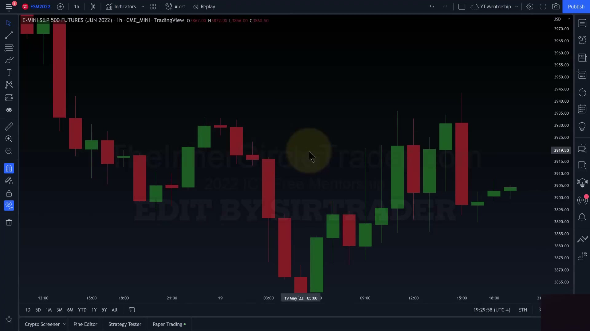

right here. So we have old highs in here.

If you look at the high here, comes in at thirty-nine, thirty-three and a quarter, and built the idea that looking at price, studying in the way that I teach it, it would be very easy to fall victim in this type of trading day, where it's choppy, it's listless trading back and forth, and how to anticipate it, what to look for, and I want to go into the five-minute chart real quick. So

## [12:34](https://www.bilibili.com/video/BV1WgbM6zEv3/?t=754)

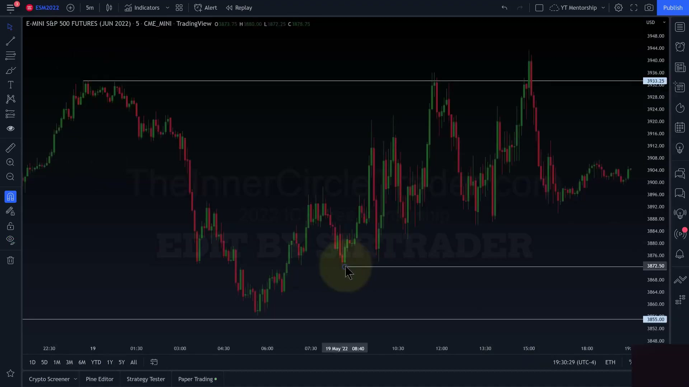

here is the thirty-nine.

Thirty-three and a quarter level. This is the low at thirty-seven twenty-one quarter, and the old low on the daily chart that did not get traded through is at thirty-eight fifty-five. And notice we just fell short of reaching that at thirty-eight fifty-six. So we went one handle short of that. Started trading higher, and I mentioned how the market many times can present opportunities that look like.

It's likely to form a setup, but it really doesn't really come to fruition. And if you look at this fair value gap right there, okay, how we traded up into it, started working lower, create a small little fair value gap in here, bumped into that, traded lower. Nothing really in here to work with in terms of the model. So nothing here is a short. We were talking about all that this morning. So as the market was trading.

Around in this area, I mentioned how it was likely to be a fifty-fifty probability. That means it's likely to go higher just as well as it is likely to trade lower. Okay, so what's the benefit in that? Obviously, anybody can come into it with a fifty-fifty expectation, but it really statistically moves to fifty-fifty when we start trading back into the middle of the range. Okay, so this imbalance.

Here, the fair value gap. It should have offered a little bit more movement lower. Why wouldn't it go down and take out this short-term low? It went below this short-term low here, and then started rallying, working towards the relative equal highs over here. But we have to take every single trade idea based on its current dealing ranges. And what's a dealing range? Well, dealing range would be like from this high down to that low, and we measure those.

Yes, it trades up into that imbalance and trades down to a short-term low. That's a tradable opportunity there, but it's not very clear after that. It just goes back and forth, chopping. Short-term lows are taken. High, high is taken here. We trade back and forth. All of this is really ugly type of price action. And I mentioned that we would go to thirty-nine, thirty-three and a quarter back here, and it ran right up into it.

Clear those relative equal highs broke down, traded back down into the range, and I started talking about how the real setup that would be formed by my content, by the things that make sense in the algorithm, would deliver a specific framework today. Take a vertical line and add it to three o'clock New York local time.

And four o'clock, and that would be the setup that forms to take us back down into the middle of the range. And I tell everyone the tweets to study the middle of the daily range. Okay, so what does that mean? If you look at what the high was and the low. Okay, reading here. That's the middle of the range. We ran above.

## [14:42](https://www.bilibili.com/video/BV1WgbM6zEv3/?t=882)

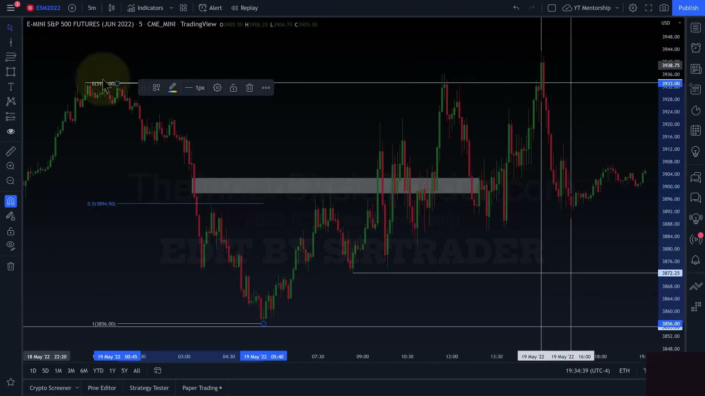

The short-term high, so we have relative equal highs here and relative equal highs here. So there's buy-side resting here. I outlined how the market would use the running up to take out the buy stops, to squeeze anybody that was short and trail their stop loss down, and also to induce people into thinking it's going to go higher. So that way, it builds up liquidity below these lows. What kind of liquidity?

Sell side liquidity because they're going to protect

## [15:02](https://www.bilibili.com/video/BV1WgbM6zEv3/?t=902)

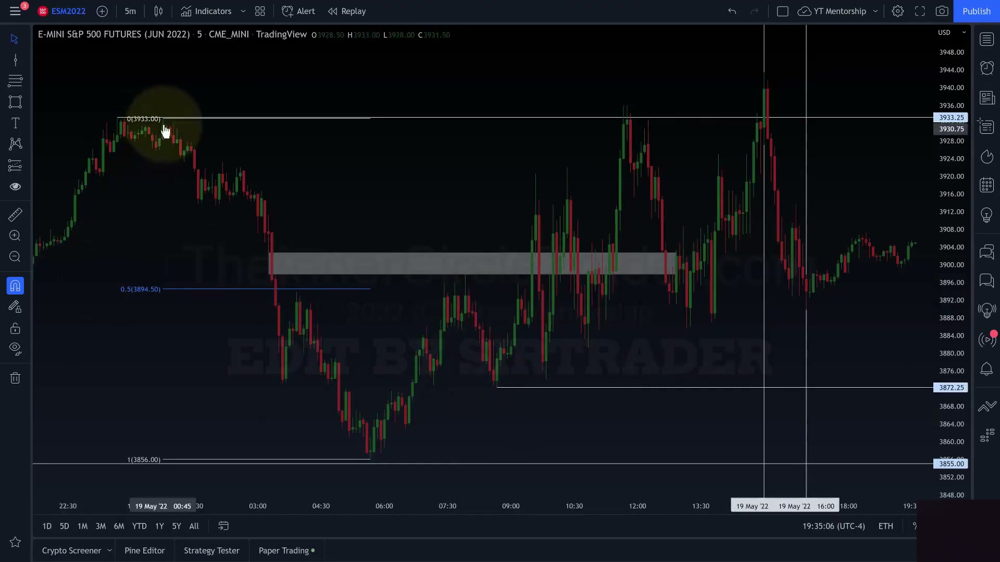

their what long positions. But the main thing was focusing on the middle middle of the range here. So if we're looking for setups that are going to be based on a run above for buy side and pull back into the range, it needs to be specific in terms of time. I gave a very specific window between three o'clock and four o'clock in the afternoon. So we go into an out. I'm sorry, not an hour chart. We're going to go into

## [15:18](https://www.bilibili.com/video/BV1WgbM6zEv3/?t=918)

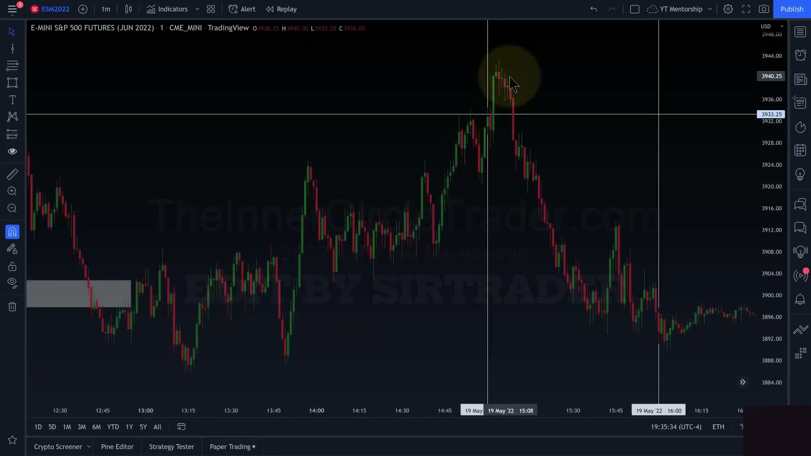

a minute chart and see here. The market rallies above, bumps into the buy-side liquidity. Smart money uses that to go short. Here is the breakdown. Here, let me take this. Move it a little bit. Is this a swing low? Yes. Is this a fair value gap? Yes. Does it trade back up into that range? Yes. It works lower.

Back into the middle of the range. On days like this, this is called a consolidation day, and what happens is this.

## [15:42](https://www.bilibili.com/video/BV1WgbM6zEv3/?t=942)

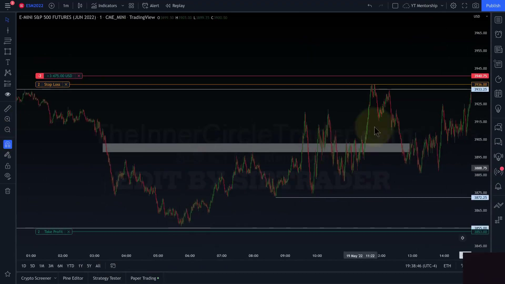

The market starts trading, creates an initial range, and then stays in that range until the afternoon. At three

## [15:48](https://www.bilibili.com/video/BV1WgbM6zEv3/?t=948)

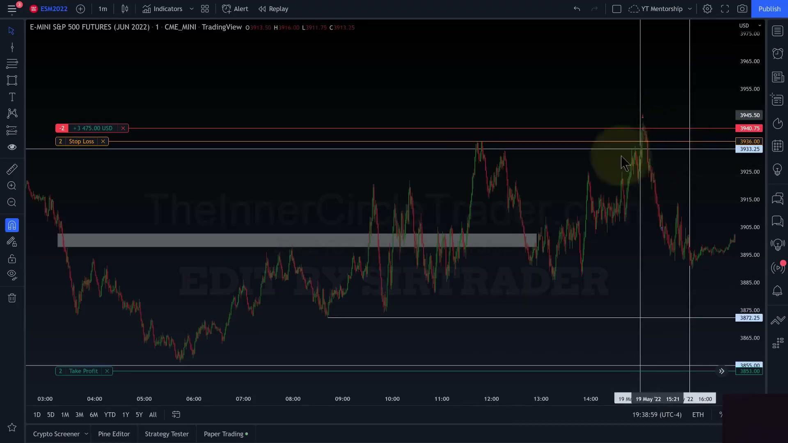

o'clock. It used to be the bond close that started this whole thing, but now it's just three o'clock to four o'clock when equities close the closing bell. That.

Sets the tone for on close orders. So, what that means is, what was going on prior to three o'clock? The market was rallying up. What did it go up for? The buy side liquidity. But traders gonna look at that as a breakout to go higher, and they're gonna pair that with the market participants that are considered smart

## [16:12](https://www.bilibili.com/video/BV1WgbM6zEv3/?t=972)

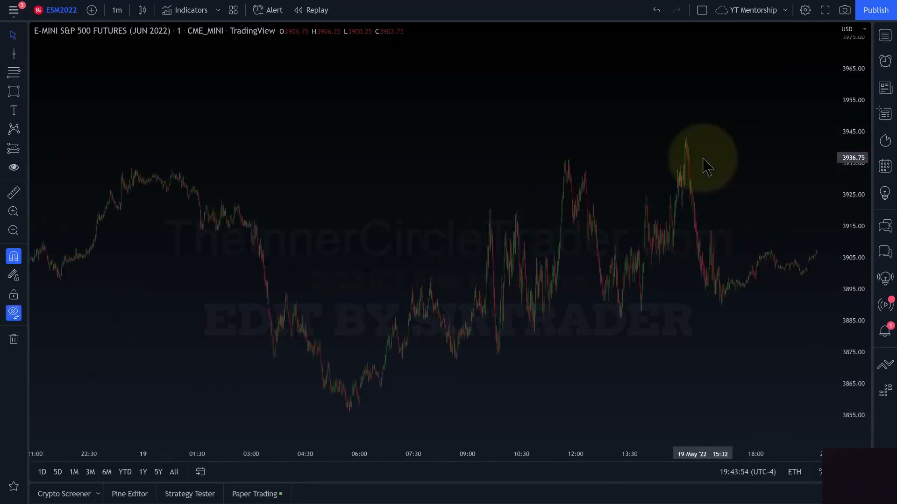

money. The logic I was teaching was that would be utilized for smart money at the close.

Between three o'clock and four o'clock, so they ram it up there. All the buy orders that were resting above here are here in the form of protecting short stops, or not short stops, short positions acting as their stop loss order. When the market trades above that, those buy stops that are protective in nature, they become a rushing liquidity wave, okay, of willing buyers at the market. So, willing buyers at the market.

At three o'clock on a day like this, where it's consolidated. It's going to want to go back to the middle range. So when you look at that type of event, it's going to range-bound trade between here's the 9:30 or so right there. Okay, so the low of the day there and the high of the day there. So split that in the middle. There's your midpoint, and it's going to want to gravitate back to that. So when you look at

Price action days like this, and if you're caught up in it, you don't know what you're doing, or you feel like it's just being chopped up. Wait until three o'clock, because many times at three o'clock to four, the algorithm will do something where it goes outside the bounds of the daily range, like it did here. Okay.

Trades up into it and then rams it down, and nobody's really allowed to make any money. Anyone that was long breaking out here gets raped across the coals. Anyone that's short gets knocked out with a stop loss and a losing position. Run below

## [17:22](https://www.bilibili.com/video/BV1WgbM6zEv3/?t=1042)

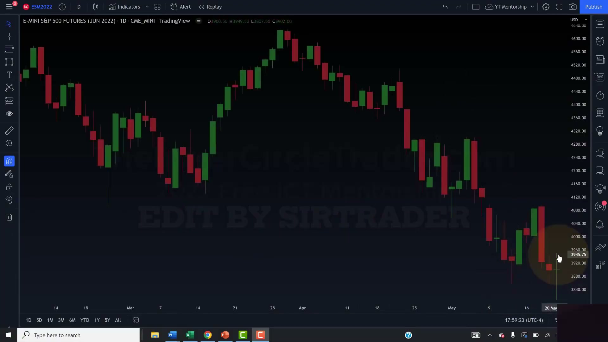

that May twelfth, twenty twenty-two low here. And I want to take your attention into the hourly chart.

## [17:28](https://www.bilibili.com/video/BV1WgbM6zEv3/?t=1048)

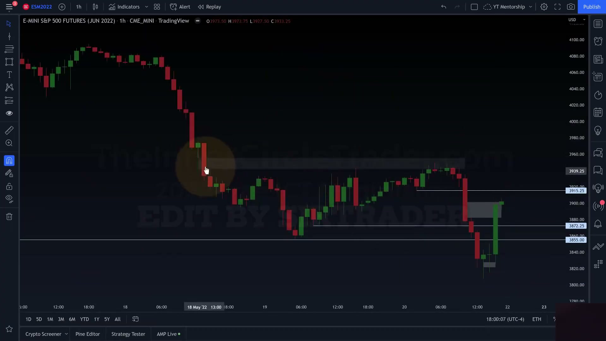

Here's the trading day for Friday. Right, so we consolidated, market ran up, we moved up into a deeper fair value gap, creating the high of the day. We broke down below the thirty-nine fifteen and a quarter level. Now, for me, this was the turning point that.

I required, like I didn't want to do anything prior to this run here. And today, I was utilizing that swing low there, so I wanted to see that break. Market trades below the short-term low here, took some sell side out there, and then ultimately taking out the thirty-eight fifty-five level rather handsomely. And we'll look at all this business when we drop down the timeframes. Let's look at the fifteen-minute time frame.

## [18:02](https://www.bilibili.com/video/BV1WgbM6zEv3/?t=1082)

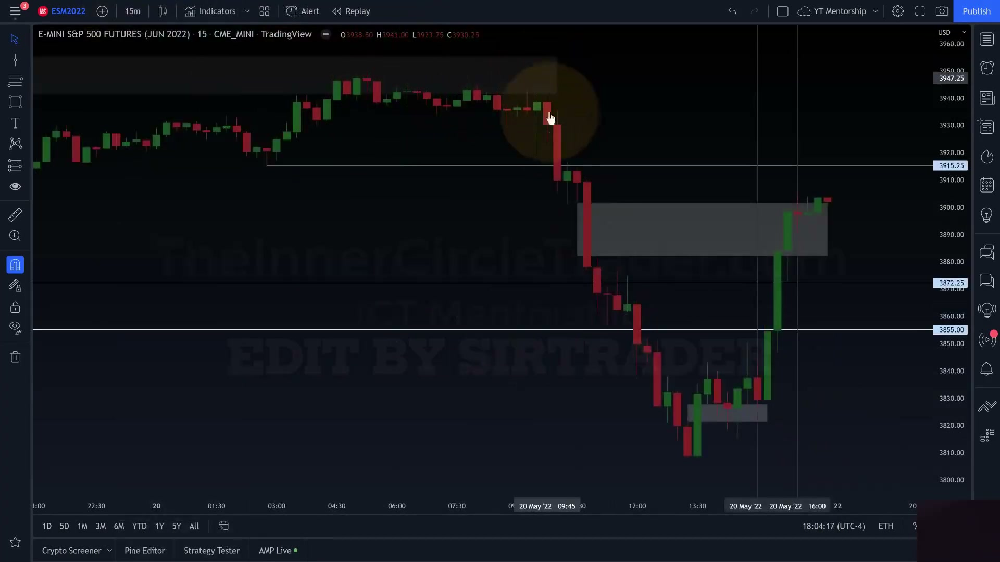

Right, so here's that fear value gap it worked up into. I wasn't interested in all this business back and forth, chopping around. Finally, with the thirty nine fifteen and a quarter level, it broke through it, and then we had a gap in here, which we'll see on the lower time frames. That was, in my opinion, the better trade. So anyway, it runs through thirty seventy two and a quarter.

Creates another opportunity in here, and you can actually see the fair value gap there. Trades up. That's another short. Worked lower, finally creating the short-term low. And at one thirty, that's when we start watching the afternoon PM session. It rallies up, creates short-term high in here. Fair value gap. The last hour of trading rallies back up into a fair value gap here.

So, if you look at the range from here to here, it goes back to a premium. I taught you that. So that's a target. This imbalance. Fairway got reversal on Friday's trading up into an open balance there. Okay, so. My son participated in shorts in here. He took two shorts and went long in here all throughout this. We go into a five-minute chart. Here is that same

## [18:58](https://www.bilibili.com/video/BV1WgbM6zEv3/?t=1138)

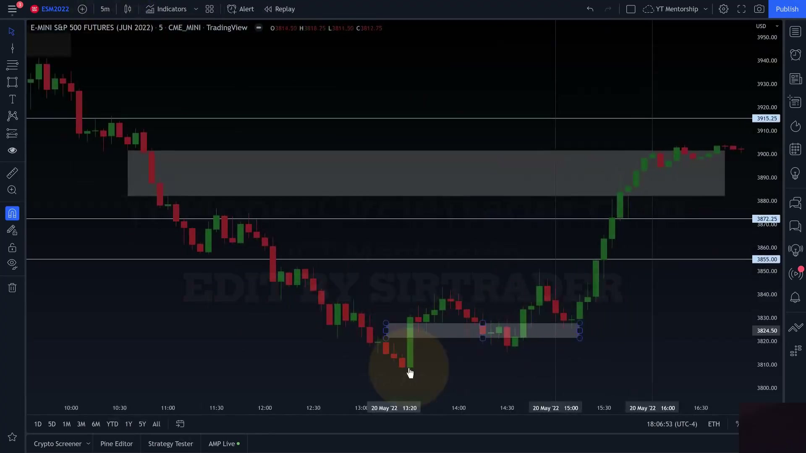

idea where it went, created a low one thirty. It starts doing its business. What's it reaching for? I'm gonna go back into the middle of the range into a premium. This is the array above. Half the move from here to here.

Is fifty percent equilibrium, and this is the premium level. So it goes down, small little drop down in here into the fair value gap after three o'clock, and then the market starts sending it into an algorithmic spool, where all this price action starts running aggressively into the close, up into a completely random level that was shown on the hourly chart.

And here we have the market trading right up into that area, and then just consolidating, going into the close. Now, let me go into this little area right

## [19:36](https://www.bilibili.com/video/BV1WgbM6zEv3/?t=1176)

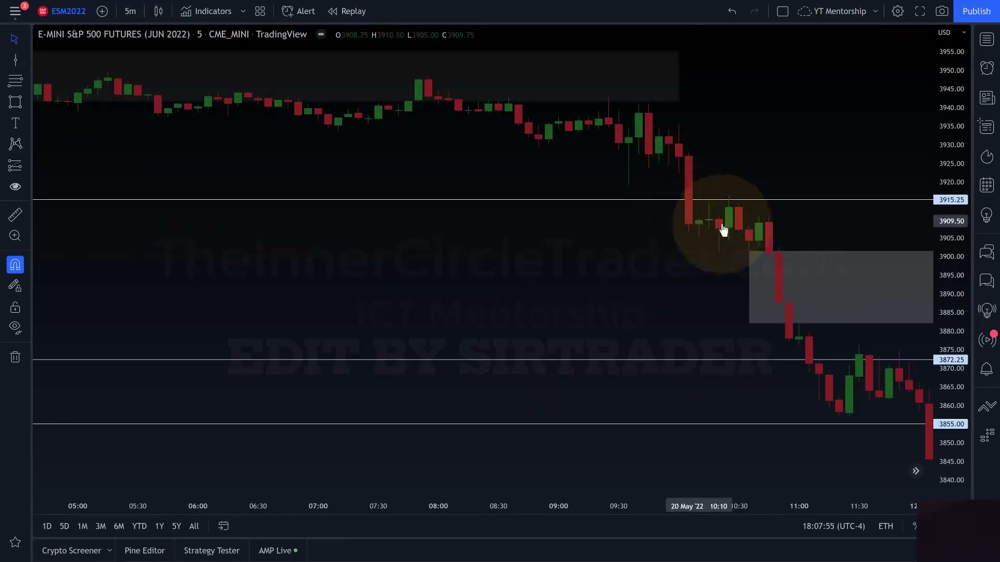

in here. Here's that fairway gap. There, it rallies up into it. There and there, then breaks lower. In here, there's a

## [19:42](https://www.bilibili.com/video/BV1WgbM6zEv3/?t=1182)

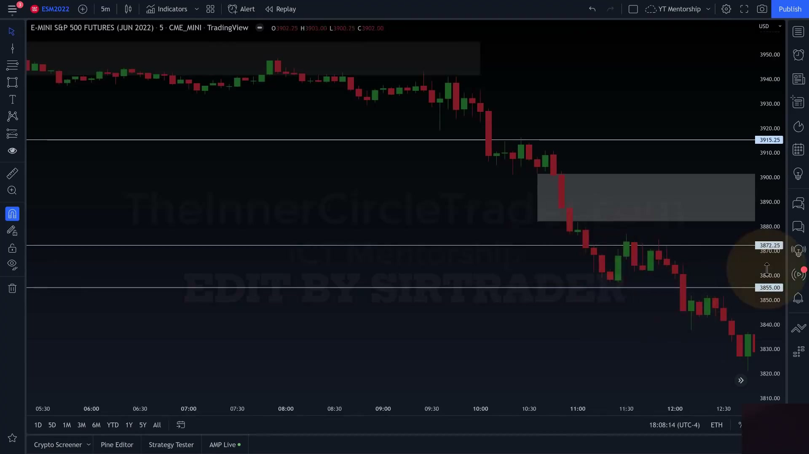

fairway gap. It trades up into it. There and sells off. Notice that it's occurring at the levels.

That I have here on the chart, those old lows where sell side would be resting. So we're using the fair value gap after a run below. In other words, think of it like support broken, return back into the fair value gap. Not listen, folks. Listen, not go back to the old low broken and act as resistance. Okay, that's not how I look at it. If the fair value gap doesn't exist.

I don't trust that level as an old support, broken-term resistance. That's why I try to tell everybody that comes to me, "Well, he's just trading break and retest, or he's trading support and resistance." I'm not because I classify specific levels beforehand, looking at them with the logic that the market's going to create these patterns around them. Same thing here: old low, the fair value gap, it trades up into it.

Why didn't it just stop at the thirty seventy two and a quarter level? Because it's going into the imbalance here. Then the livers going lower. So the two shorts were in here and here. The longs were in here, here, and then riding up into the

## [20:36](https://www.bilibili.com/video/BV1WgbM6zEv3/?t=1236)

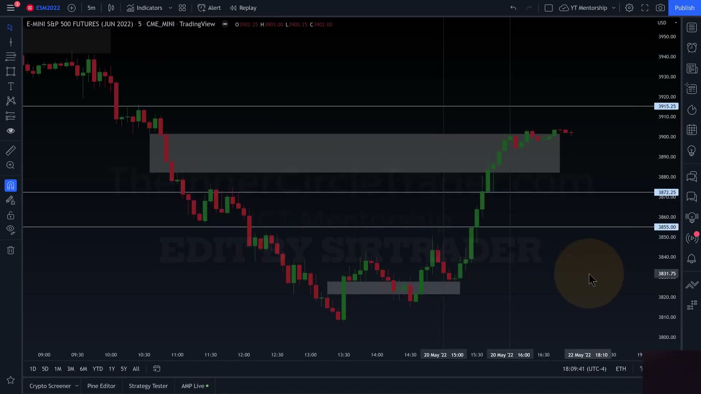

imbalance today. I just wanted you to understand what it was and why I was not willing to take a trade yet because. I wanted

## [20:42](https://www.bilibili.com/video/BV1WgbM6zEv3/?t=1242)

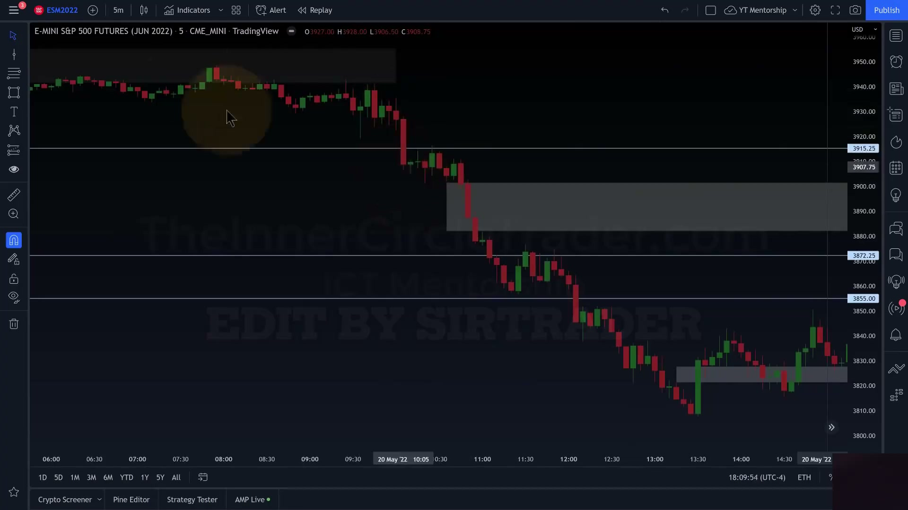

this level, the thirty-nine fifteen and a quarter level, to be broken. I wanted that to happen first, and to do that, because on the fifteen-minute time frame, that gives me that break. Whereas all up here, it's just it's consolidated. I don't want to catch a break below a short-term low and then them run relative equal highs. So let's go one time back into the lower time frame. Okay.

## [21:00](https://www.bilibili.com/video/BV1WgbM6zEv3/?t=1260)

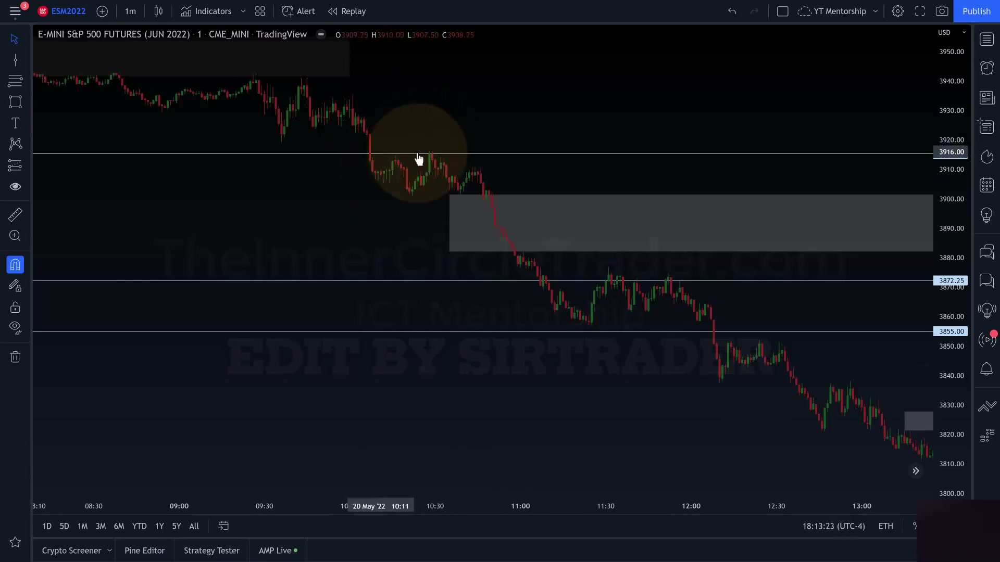

So here is that return into fair value gap here. So when it does this, I'm looking for it to move quickly away and start gravitating towards the other pool of liquidity down here. If you're looking at it from the relationship of short-term dealing range, this swing high, that swing low, we have our fair value gap here, trades up into it there, and that level thirty-nine fifteen and a.

Quarter, so it's a confluence of several things. But the level itself dishighlights where the liquidity would be. The imbalance is what I'm keying off of and what I'm focusing on. So equilibrium or above is what premium. That's

## [21:32](https://www.bilibili.com/video/BV1WgbM6zEv3/?t=1292)

what this is here. All right. So today we went through the process of watching and analyzing the opening price on ES, and I mentioned on Twitter.

That I was interested in this old high back here. That's largely linked to the fact that we had a gap when the session started again last night, my local time, about six o'clock. We got down, and then it just drifted lower. Had a small little rally in here, SMT divergence. I'll show you that in a moment. But in here, we have market creating relative equal highs. It broke down. I gave you the.

Fair value gap live this morning on the live stream. Walk you through the whole business of running out the sell side and the opening gap on Sunday, which is over here. All right, so

## [22:08](https://www.bilibili.com/video/BV1WgbM6zEv3/?t=1328)

the market trades down below the sell side here and into the Sunday gap opening. We traded through it all the way down to.

## [22:18](https://www.bilibili.com/video/BV1WgbM6zEv3/?t=1338)

Fairway gap hits that there comes back up, runs back up into the opening range, drops once more into an order block, rallies, takes a short-term high, retraces back down into

## [22:26](https://www.bilibili.com/video/BV1WgbM6zEv3/?t=1346)

another order block, and. We worked off this order block. This order block, which you'll see when we get into the five-minute chart, looks a little bit cleaner. Here. And here, and rallying up into the levels mentioning on Twitter this morning. So I'm gonna drop into a five-minute chart. There's the fair value gap I gave you

## [22:40](https://www.bilibili.com/video/BV1WgbM6zEv3/?t=1360)

live. Beautiful delivery. Look at the low on this candle right here, right up here. Look at this value right here: thirty-nine twenty-six and three quarters. This candle trades right back up to what value? The high now on this candle: thirty-nine twenty-six and three quarters. Folks, that is absolutely perfect. So when we hit this fair value

## [22:54](https://www.bilibili.com/video/BV1WgbM6zEv3/?t=1374)

gap, it broke lower and then once more returned back up into it. Oh, not into the fair value gap, but up into that range here, and then broke. And I gave you a small little imbalance here. We'll look at in a moment. We traded down into the Sunday gap. I mentioned the lower end would be this time the level to watch. And said if we went down below it, come back up, it'll act as.

What resistance it does show here. We'll look at it in lower timeframe. Drops lower once more, hits the old Ferreti gap I showed you before. We drop into the five minute little consolidation ahead of lunch. Typical retracement during the lunch hour, all the way back up to the opening range. Broke lower. Small little.

Swing low, broken back to a rebound, and also look what it's doing here, folks. It's going back up into that old gap opening on Sunday. Trades up into it, exits what resistance? Trades lower down into an order block. Big down candle there. That's the one. Over here, hits it. Starts to accumulate. Rallies up back above. Price goes above the opening gap, or gap opening, rather, from Sunday.

Then trades back down into it. See that hits it rallies. Falls short of what the relative equal highs over here retraces. Where does it trade down into that gap opening again? Now we're at the discount low.

## [24:02](https://www.bilibili.com/video/BV1WgbM6zEv3/?t=1442)

In rallies. Comes back down in. Here we go. You got. Trades into that. This is a fifteen-minute order block. Rallies, and what's it go to?

## [24:16](https://www.bilibili.com/video/BV1WgbM6zEv3/?t=1456)

The thirty-nine fifty-two and three-quarters level hammers it beautiful in the afternoon. It became a lot better in the morning. It was sloppy, so when I say things are sloppy, it just means that

## [24:26](https://www.bilibili.com/video/BV1WgbM6zEv3/?t=1466)

it's not really giving you a whole lot to work with. I mean, you have very few options, and you have to know exactly what you're looking for. I.e., what I was giving you this morning.

And this area here, watch how to stay open, and it stayed open. Basically, the whole thing. This is sloppy, even though it's a nice delivery. It's not giving you all of the mechanics of entry, like this one here, this one here, this one here, and then run into the objective. I was drawing your attention to today. So the morning, while yet

## [24:52](https://www.bilibili.com/video/BV1WgbM6zEv3/?t=1492)

it was still potentially profitable, and I was able to call it for you live, that really wasn't my choice session because it was just I didn't have a real clear view on what I wanted to see. But I taught you today with this

## [25:02](https://www.bilibili.com/video/BV1WgbM6zEv3/?t=1502)

lesson, using that Sunday gap opening and just extending it through the entire week. Sometimes the the week will just run away from it and won't really come back to it. But in weeks.

Whether it's consolidation, like FOMC, we have that to deal with for this calendar week, and those types of events create these choppy, range-bound markets that don't give you the real clean take-off, one-way directional move. You have to know how to trade in these environments. I want to go back up to the fifteen-minute time frame and talk a little bit about this area up here. That gap, I

## [25:28](https://www.bilibili.com/video/BV1WgbM6zEv3/?t=1528)

think, that is where we're going to be. Drawn up into because this is, in my opinion. Not going to be left open, okay. So they're they're going to want to trade back up into that. There's missing data here, okay. There's an actual gap.

So it'll want to draw up into that, and to what price level? I'd like the low on that candle. Okay, so if it was going to be a perfect delivery, it would go right to that candle's low. But I'm not expecting perfect. I'm not suggesting that at all. But if we go above this area, that means we're probably going to go into a deeper

## [25:54](https://www.bilibili.com/video/BV1WgbM6zEv3/?t=1554)

run on the daily. So. We're likely to run this high here, and we have a little block there. So the low at four thousand. So that's something to consider and watch going forward for the rest of the week. I may be wrong, you know, but it's just something for you to go into your charts and start studying and

## [26:06](https://www.bilibili.com/video/BV1WgbM6zEv3/?t=1566)

looking for. So here we have the Emini S and P daily chart. And you can see we have nice delivery to the upside. Initial draw was inside this area, in here, up into the bearish order block. Now, notice that we traded up into this up close candle. With today's range.

Didn't quite take out this high. I think that's the next area to look for. But in here, when we're looking at a candle that we're using for like an order block, the low, the open, in the middle of the range, those are the three sensitive areas that you're watching for. If the market trades up into the middle point of that candle, this is what I call the mean threshold.

Mean threshold was taken today, and that to me bodes well for a continuation to take out this short-term high. All right, here's the fifty-minute

## [26:44](https://www.bilibili.com/video/BV1WgbM6zEv3/?t=1604)

time frame. Here's yesterday's trading. Traded up into that small little area down here, into that low. I mentioned that was going to be a likely candidate for upside relatively equal highs as well. Reach over back down into a fair value gap.

Optimal trade entry rallies up, takes out buy-side liquidity above the short-term high back here, which I don't unfortunately have in my chart, but you can see that on your own fifty-minute time frame. And then we consolidated ahead of today, and then during the crossover into New York midnight, a small little J to swing where it drops down, creates the low of the day, rallies, Lee's relative equal highs in here, and this high.

Intact, it drops down. Rallies once more, small little retracement, and then it does a shallow run above four thousand on this past area here in this small little area on a lower time frame.

I used this little retracement to highlight a run to four thousand. So I gave you guys four thousand was my objective. It hit it, and then we pressed deeper into the order block on the daily chart, which creates this whole run here. Now I'm going to go into the details about that here, but for now, just know that we were trading up to this level. Failed to go to that same level.

Consolidated right below that daily bearish order block. That's the low of the candle that creates that daily bearish order block, and then the opening when that candle's a little bit higher. I think it's four thousand two. So we had a small little pass above four thousand, retraces back down in. We'll look at the lower time frames and all

## [27:58](https://www.bilibili.com/video/BV1WgbM6zEv3/?t=1678)

of this price action now into the five-minute candle. This round here. The year, this price leg. Is part of this price, like. Okay. Notice how this candle's high. To this candle's low, that range has one single pass, whereas this one has one. Two. Notice that. Hello. Hi, small door chasmant.

And then a second level of running because it had two stages to this delivery. I want to use this most recent one, and this is my dealing range: the short-term low, the short-term high. Alright, so. This dealing range. Here. I measured the low to the high. Fifty percent is equilibrium. I'm going to see it drop down into.

Discount this small little area down here, fair value gap. We want to look at that on the lower time frame. The market

## [28:42](https://www.bilibili.com/video/BV1WgbM6zEv3/?t=1722)

rallies. In here. Drops down in. To the fair value gap there once more above the four thousand level, and then going into here's eight thirty. By the way, this is the eight thirty candle. And you can watch when it trades right into that fair value gap. It rallies again, drops back down in, and then at nine thirty, this candle here explodes the upside.

Takes off and starts digging deeper into that. Almost the four thousand seventy four level looks like almost. So. We'll be looking for continuation the upside. Four thousand ninety-five, forty-one hundred is next consideration. But I want to take you into the price action down in here and give you more details. This is the why I was willing to take something a

## [29:20](https://www.bilibili.com/video/BV1WgbM6zEv3/?t=1760)

little bit earlier today. Okay, if you plot the Nasdaq June contract for two thousand and twenty-two and on the compare chart on TradingView, as you can see, the Nasdaq went lower here, whereas the E S P. Failed to go lower. That's an S M T divergence. Okay.

SMT Smart Money Technique. It's accumulating in here, whereas the Nasdaq is taking liquidity out. So it's a cracking correlation between the two. Usually they move in tandem, but at certain times—what times? Eight thirty, nine thirty—at news events being released, they'll create this divergence. And if you have a bias, it's helpful. But if you don't know where it's going.

You're gonna many times encounter what would look like SMT divergence. And then it disappears as they start moving in concert with one another. So you have to be careful with that. That's why I'm teaching. That's why I always teach.

Know what it's reaching for. Okay, the bias has been bullish, and for my framework, for my setup, because I gave you four thousand and I had very little time to work with anything this morning. I just hurried out and saw the chart. I missed the actual ideal entry. I just used a close proximity entry with an overblock, and there you go. So, if you look at the relationship of that fair value gap.

Dropping back down in higher low than that of eight hundred and thirty versus the lower low made in Nasdaq. This is a stop out. This is accumulation of longs. This is going to be the telltale sign that it's going to go higher. If you look at what we did on eight hundred and thirty, it already snapped down into this gap. And it's not likely to go lower than that. There's no need to.

Okay, so it's being compressed, basically like a spring. It's like waiting, and then all of a sudden, it explodes. It's waiting just below that daily bear shoulder block, and it's digging up into that thing at range on that up close candle on the daily chart. So it's climbing up, up, up, up, and we watch to see if it gets to the mean threshold, which is half of that bear

## [30:58](https://www.bilibili.com/video/BV1WgbM6zEv3/?t=1858)

shoulder block, right? So again, we can see zoomed in price breaks back down into the fair value gap after trading through the order block. Here, this is a fifteen-minute time frame waterfall, by the way, and then it rallies inside this little area. Here, there's one small little pullback into a fear vacuum on one-minute chart. I'll leave that for you to go into and study. And here

## [31:14](https://www.bilibili.com/video/BV1WgbM6zEv3/?t=1874)

is the hourly chart. I want to kind of give you like a market structure perspective. Here's where it's likely to be drawing to next. All of this movement down here, we completely rebalanced all that. Here is the fair value gap I had drawn on the lower time frame chart. We have consolidated here ahead of running all the way up into this area here. So notice what was happening. We had a low.

Retrace down into this low to high. Discount Fairway Gap. Rallies, dealing range low, dealing range high, retraces down into. Discount. Rallies, dealing range low, dealing range high, discount. Fairway Gap Order Block. Right. Consolidate. We rally, come back down into the small or time frame. Fiervega S N T divergences. And rallies and keeps pressing

## [31:56](https://www.bilibili.com/video/BV1WgbM6zEv3/?t=1916)

higher and higher and higher because it was setting up this trade here because it gave nice run here earlier. Before seven o'clock in the morning.

## [32:02](https://www.bilibili.com/video/BV1WgbM6zEv3/?t=1922)

That means we're probably going to have a deep retracement and look for an ideal scenario, like we outlined with the SMT divergence. So SMT usually will occur around a nine thirty time period when there has already been a nice early run before seven o'clock or at seven o'clock. All right, folks, welcome back.

## [32:20](https://www.bilibili.com/video/BV1WgbM6zEv3/?t=1940)

All right, so hourly chart. Obviously, we are looking at a swing low here. To swing high. Getting our range. Here's equilibrium. So the market did, in fact, drop down into. A discount and a pair of leg up. So we have a market that is in what an oversold condition. Do we need an indicator to plot that or determine that? Nope.

Absolutely not. The rectangles there just to draw special attention for you, the viewer. The fib is just to highlight exactly where equal agreement is. Anything above that level would be considered premium. Anything below it, discount. So we've moved from this high down. Into a fair value gap and below equilibrium, so we're

## [32:56](https://www.bilibili.com/video/BV1WgbM6zEv3/?t=1976)

in a discount. All right, here's the five-minute chart, and notice that we had this run up in here. I'm highlighting the idea that this was likely to go higher, and it needed to go for a premium relative to this high and that low. So we moved up into a premium, then we slid aggressively, taking out relative equal lows.

So below this low here, and here is what sell side liquidity. It was quick to do that. Rate the opening at nine thirty. Short little bounce, then one more time below the low here, taking out sell side. For anyone that wanted to catch it along here, they knocked them out. We had a shift in market structure, and then rolled up even higher, rebalancing all of this. Drop back down into an area here where we have a five minute.

Fair value trades down into it. I mentioned on Twitter that we would likely trade higher and take out the short-term high here and here. So I mentioned the morning high that's this here that was going to be the draw in liquidity, and we saw that ultimately up into a fair value gap here for a really, really deep premium from low to high. Straight up into that, and then pull back inside the range between

## [33:48](https://www.bilibili.com/video/BV1WgbM6zEv3/?t=2028)

this low and the high. So, on a one-minute chart, we're zoomed in here, and you can see I mentioned that we would run this high right here because we've taken out the sell stops here after running higher. So we had a shift in market structure back here earlier, and then we basically consolidated and dropped down to take out.

The cell stops. So anyone that was lucky enough to go long here and rode it up to here, the algorithm drops back down, clears the board, taking out the cell stops below here. I'm buying those cell stops. Had a little bit of heat here. We rallied, and I mentioned that we would start going higher now because we've cleared out the cell stops

## [34:16](https://www.bilibili.com/video/BV1WgbM6zEv3/?t=2056)

and going over into the one minute chart with a little bit more detail. Here's the initial drop. Now here's what I want to bring to your attention. We had. Short-term little shift in market structure here, and I know some of you see this, and then you see this one here. Which one's the shift in market structure? Well, I'm playing the.

Run up here to a premium. So, if this is a range I'm working within, the shift in market structure occurs here when it takes out that high, drops down into a fair value gap, which is what I bought. I didn't believe we were going to take out the lows here because we should have done it at 8:30 news. It didn't do it. So, this is a deep retracement, and then sent it higher to go into a premium right before 9:30 a.m., and then they sank it down. Notice there's no model entry.

That's telling. Okay, it's tipping its hand to you because there's no real setup, and it's a rush to get down here. It's clearing out sells out liquidity. Going down, rallying, sucking in longs, trying to pick the bottom, knocking those individuals out. Now they are not allowed to be long; their stops taken. Nobody in retail usually will take a re-entry after something like that. They're afraid. It rallies up.

comes down to a fair value gap. Shift in market structure. Rallies, relative equal highs. Strohs back down in Ferbey. Got order block. Rallies once more. Goes into the imbalance here. Consolidates. Bumps up just above the short-term high here, then drops one more time. Clearing the liquidity out here.

## [35:24](https://www.bilibili.com/video/BV1WgbM6zEv3/?t=2124)

## [35:30](https://www.bilibili.com/video/BV1WgbM6zEv3/?t=2130)

For the E-mini S&P June contract for twenty twenty, and you can see we have worked inside this fair value gap. This is also a breaker. Okay, breakers are low. Hi.

Lower low, find the high in between. Extend it out in time. The market trades down into that. It's also coming down in to fill in this fair value gap. So we came down, fill that in, and now we're starting to rally. Next buy side liquidity is this short term high here, and then if we can get some acceleration on the upside, we have relative equal highs up here in that fair value gap. Okay, so.

For the students here that are looking for a little bit more meat on the bone for bias, okay, when the market is moved from a low like this and starts to trade higher and creates a swing low, it's easy to assume that it might want to come back up to this high here. So notice how each day, with the exception of this one single day here, each day was bullish.

Okay, so the bias would be expected to be bullish until we take out this high. It does that here. Then we have a day or two of retracement, which is logical because we created a fair value gap here. It trades down, fills it in once more, tests it, and rallies. So we're looking for tomorrow, which is Friday. Nonfarm payroll is a day I do not advise anyone to.

Actually, try to speculate on. So bias is going to be derived from this chart here because we're likely to run this short-term high. That's what I'm thinking. I'm expecting that it could happen overnight. There's nothing saying it's going to wait until tomorrow at eight thirty when nonfarm payroll comes out. But if it doesn't run out this high tonight at eight thirty.

If we're above the fair value gap high here, in other words, the candlestick low here. If we're above that level at eight thirty, and we have not taken out that high. I would expect price to try to make an attempt to get to that level. It doesn't need to go through it, but the bias would be: I would expect that to be.

Attempted, okay. Now, does that mean go out and try to trade nonfarm payroll tomorrow? No, a lot can happen from the time of this recording, which is a little bit before nine o'clock Eastern time in the United States. So, I'm not trying to trade nonfarm payroll, but I do believe that you should study it, try to determine what side of liquidity is going to reach for before eight thirty news release.

And when that volatility hits the marketplace, watch and see what it does on like a one and five minute chart. So the reason why I tell everyone to avoid like big days like FOMC and non-Franc payroll weeks is because you don't have the experience and you can get hurt very quickly not knowing what you're doing. So be mindful of these levels here: the two blue lines here and that red line here.

It's a little bit lighter than these. You won't see these on a lower time frame. But this here is that short-term high here, and the two blue lines here are respective to that fair value gap on the daily chart. All right,

## [37:54](https://www.bilibili.com/video/BV1WgbM6zEv3/?t=2274)

hourly chart, E-mini S and P market trades down to the discount low with a fair value gap. And again, these levels here. Are not drawn because the basis of support resistance on an hourly chart. Okay. These are the same levels that I drew on the daily.

So the market trade down on Wednesday hits the Fairbank Gap low. Then we consolidate, and then we drop one more time to it here. Then we make a mad dash to take out the short-term high here. It was shift in market structure that's bullish. We take out this short-term high here and relative equal highs, and now we're gravitating towards what looks like a run on the buy side here. Now it does not need to do that tomorrow. I could be wrong about that.

I'm just saying that I think that this is the next drawdown liquidity. So study that. That's all. Now we do have a small little fair value gap in here. Be mindful that it might want to drop down into that before going up there. That's certainly

## [38:38](https://www.bilibili.com/video/BV1WgbM6zEv3/?t=2318)

something to study. Also, all right on the fifteen minute time frame, you can see here this is the mark up for the short term high here on Wednesday's trading. We hit the fair value gap low on the daily chart. Went back. Hung around in consolidation. Rallied up. I want you to take a look at the way this day formed before I get into any more discussion about it. We opened here, consolidated, rallied up.

And then dropped down into the Fairway Gap low on the daily chart, and bounced there. Rallied up, took out the short-term high here. And kept on rallying and enclosed here. This formation of price action is what I dub my ICT Power Three, where it's accumulating, manipulating, distributing. So it's opening.

Create the low of the day and then rally. Now, if you see this pattern on a daily chart, it's easy to understand. But when you look at the lower time frames, it's easy to get lost in all the candlesticks and all the volatility and the movement.

And the quick fluctuations on these one-minute and five-minute charts. That's why the uninitiated would look at and say it's noise. It's it's not noise. Okay, it's doing what it does on the daily chart, just being represented on.

A smaller interval, like a one or five-minute chart. So, if you lose the context of, like, for instance, the levels here and here, you won't understand that it's dropping down to that higher time frame key level, which is the fair value cap low. Then the market can rally higher. The afternoon that setup—I want to go into that a little bit.

## [39:58](https://www.bilibili.com/video/BV1WgbM6zEv3/?t=2398)

So my expectation was we were here, and we were likely to draw up into that in the PM session. So in other words, as we're going into lunch and on the other side of lunch, we could have easily traded up into this area as an upside objective. And then I didn't mention it, but you obviously know. If we get above that, we'll be the next logical draw on liquidity. We'll get above this high here. Okay, so. All right.

## [40:18](https://www.bilibili.com/video/BV1WgbM6zEv3/?t=2418)

So this is a two-minute chart. Now, notice what we have here. We have a short-term low here during the New York lunch hour. We're consolidating. The market drops back down. And takes out that short-term low. We have unfinished business above that old high here. This is a stop run here, and it just slowly drifts up. And takes that old high out. The afternoon session, or after the low is formed.

Notice there's no model entry for what I've taught you so far, but we have a nice fair value gap with the continuation of the upside, with a fair value gap I was pointing out.

