# 【中配】ICT扫盲一：流动性、FVG、PO3 与订单块

- 作者 耳朵数字观察
- 时长 17:18
- 来源 [https://www.bilibili.com/video/BV1BMYf6mE7G/](https://www.bilibili.com/video/BV1BMYf6mE7G/)
- 由 course2md 生成 · 59 张截图 / 59 段文字

---

## [00:12](https://www.bilibili.com/video/BV1BMYf6mE7G/?t=12)

I C T Inner Circle Trader概念很强大，但说实话，大多数交易者都很难理解。流动性FVG公允价值缺口订单快。这些概念往往被讲得很复杂，甚至让人无从下手。在这段视频中，你终于能用简单的方式理解聪明钱交易的核心。你会弄清流动性到底是什么。以及机构如何利用它对付散户交易者，你会了解FVG背后的秘密。以及如何有信心地交易它。

## [00:28](https://www.bilibili.com/video/BV1BMYf6mE7G/?t=28)

还会认识三段式PU三。看懂聪明钱如何在大行情启动前布置陷阱，以及如何像专业交易者一样识别和交易有效订单块。最重要的是，我们会结合真实图表，一步一步运用这些概念。

## [00:40](https://www.bilibili.com/video/BV1BMYf6mE7G/?t=40)

看完这段视频，你将能够识别流动性陷阱，避免止损被扫，并交易FVG。和订单块还能识别三段式这类聪明钱形态。依据真实的机构活动寻找入场，

## [00:52](https://www.bilibili.com/video/BV1BMYf6mE7G/?t=52)

而不是靠猜测。如果你准备好不再跟随人群交易，开始像聪明钱一样思考，请点赞并订阅，再打开通知，这样就不会错过任何策略解析。我们开始吧，

## [01:04](https://www.bilibili.com/video/BV1BMYf6mE7G/?t=64)

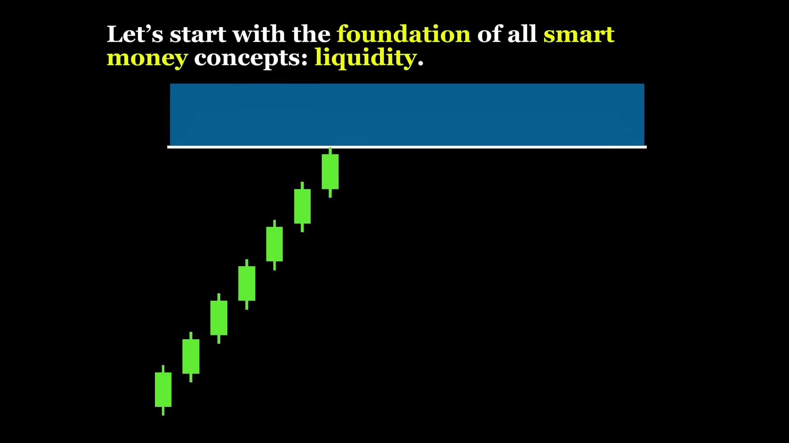

先从所有聪明钱概念的基础——流动性讲起。

## [01:08](https://www.bilibili.com/video/BV1BMYf6mE7G/?t=68)

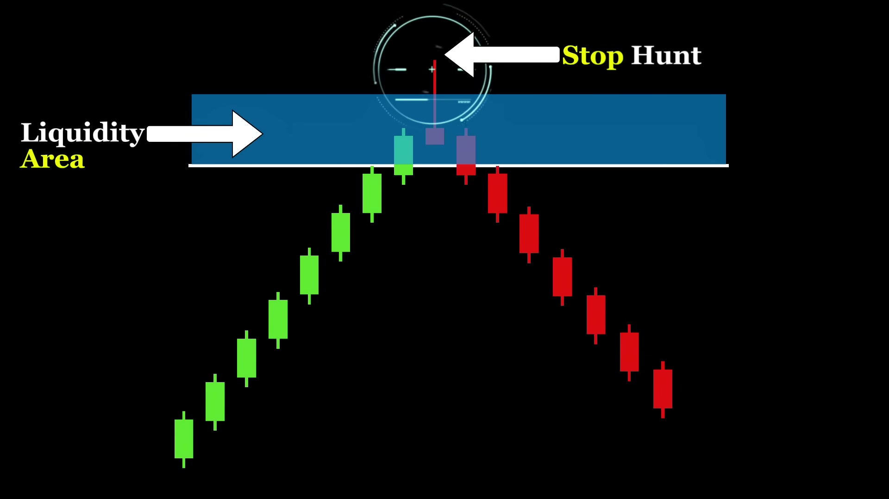

流动性指图表上聚集着大量待成交订单的区域，其中主要是止损单。这些区域就像吸引聪明钱的磁铁。他们非常清楚，大多数散户把止损藏在哪里，目标就是收割这些止损。

## [01:22](https://www.bilibili.com/video/BV1BMYf6mE7G/?t=82)

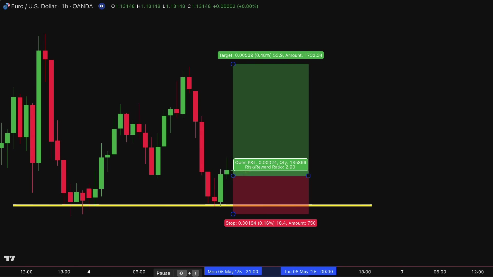

具体过程是这样的：你在支撑位买入，对吧？然后把止损放在支撑位下方。市场向下一探，扫掉你的止损，

## [01:32](https://www.bilibili.com/video/BV1BMYf6mE7G/?t=92)

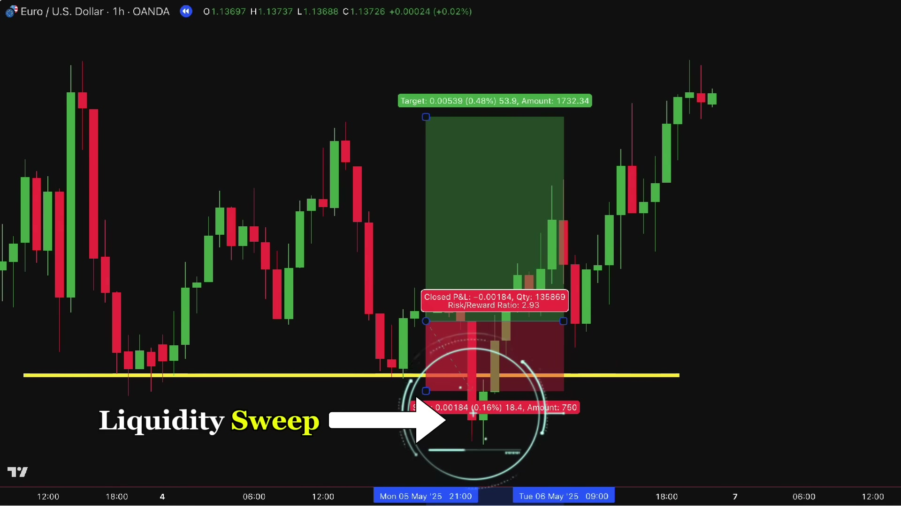

接着却一飞冲天，是不是很熟悉？这并非巧合，而是一次流动性猎杀。价格是这样被设计出来的，并非随机波动。

## [01:40](https://www.bilibili.com/video/BV1BMYf6mE7G/?t=100)

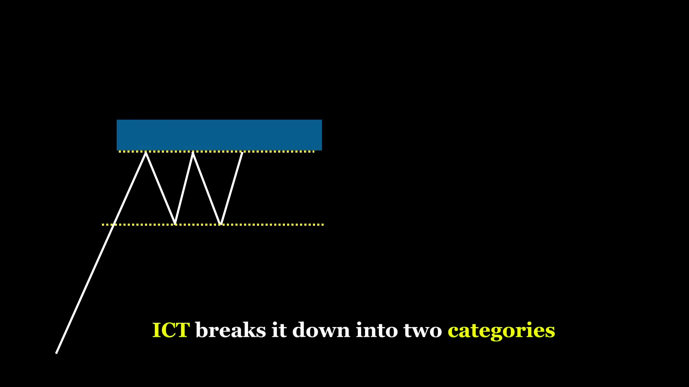

要像聪明钱一样交易，就要找出流动性聚集的位置。ICT将流动性分为两类。第一类是买侧流动性，买侧流动性指买入止损单，它们通常位于价格上方，比如前高、周线或日线高点，

## [01:56](https://www.bilibili.com/video/BV1BMYf6mE7G/?t=116)

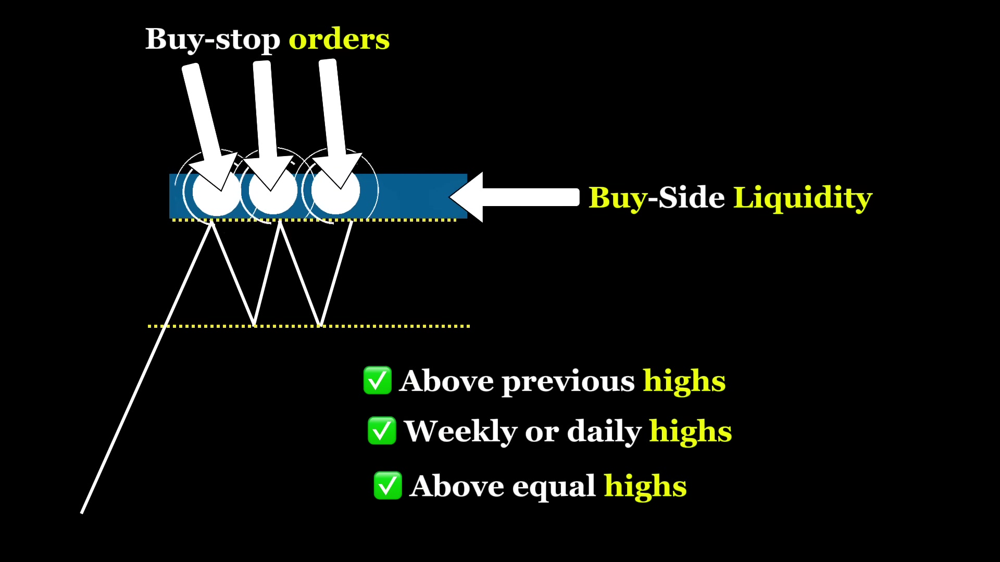

以及等高上方。为什么这些订单会在那里？

## [02:02](https://www.bilibili.com/video/BV1BMYf6mE7G/?t=122)

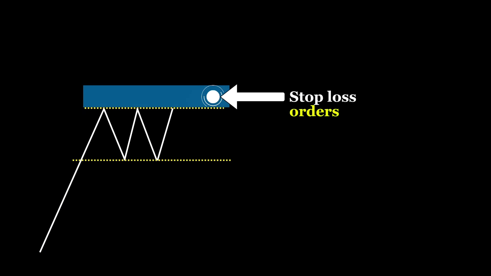

因为持有空头仓位的交易者想保护自己的仓位，他们会把止损放在摆动高点上方。突破交易者也会放置买入止损单，希望抓住向上的突破。聪明钱知道这一点，所以会把价格推到这些高点上方一点，触发止损，并建立自己的卖出仓位，利用需求激增时的买单成交，再令市场反转。这就叫买侧流动性扫取。现在反过来看。卖侧流动性来自卖出止损单，它们位于价格下方，也就是前低下方，比如周线或日线低点以及等低下方。多头交易者会把止损放在关键支撑位下方。突破交易者会放置卖出止损单来抓向下突破，聪明钱同样看得见。那么他们会怎么做？把价格推到支撑位下方，触发止损，利用蜂拥而出的卖单建立买入仓位，再推动市场向上反转。这就是卖侧流动性扫取的本质。理解流动性的运作方式后，

## [03:02](https://www.bilibili.com/video/BV1BMYf6mE7G/?t=182)

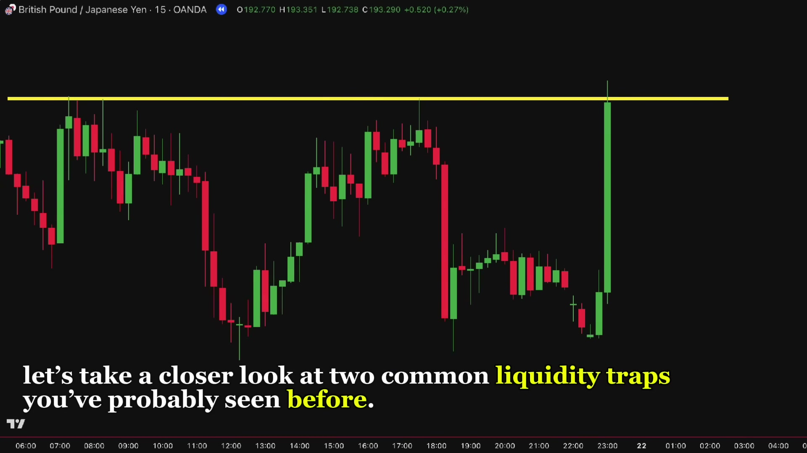

我们来仔细看两种你很可能见过的常见流动性陷阱。先看买侧流动性陷阱。看看这个图表。市场正处于区间盘整。你看到一条清晰的阻力位。

## [03:12](https://www.bilibili.com/video/BV1BMYf6mE7G/?t=192)

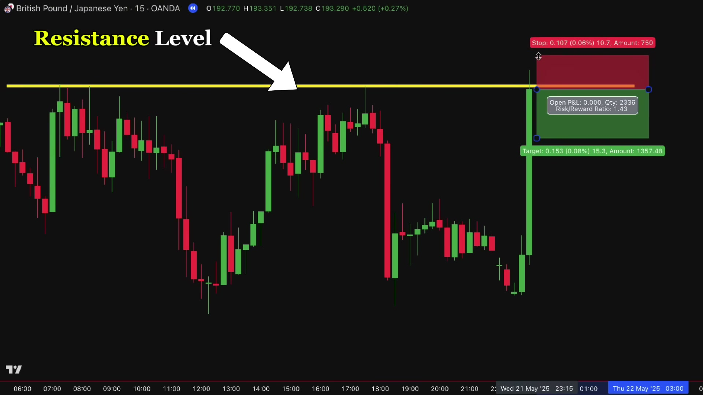

觉得这里正适合做空。于是，进场做空。把止损放在阻力位上方。与此同时，突破做多者也在同一位置上方堆积买入止损单，期待向上突破。

## [03:26](https://www.bilibili.com/video/BV1BMYf6mE7G/?t=206)

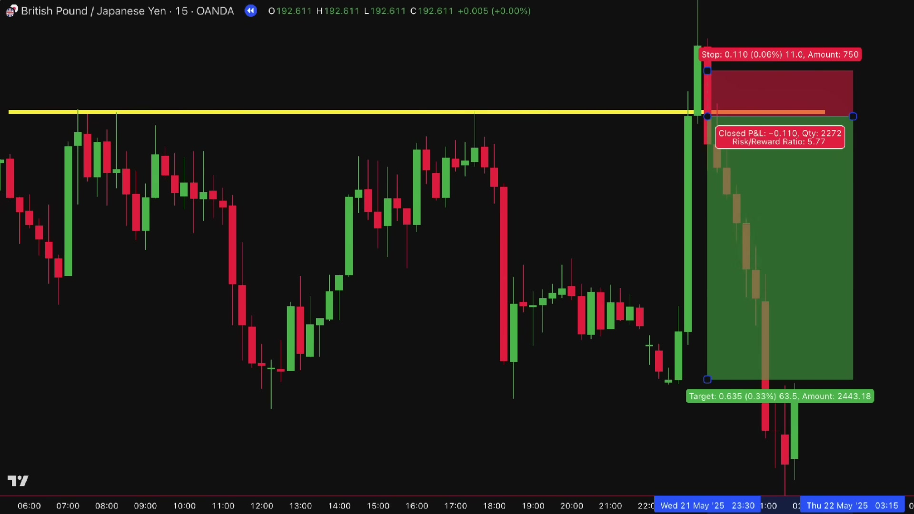

但接下来发生了什么？价格突然刺破阻力位，扫掉卖方止损，同时触发突破买单，随后迅速回到区间内部。多空双方都被清洗出局，整段波动不过是一次流动性扫取。这是盘整市场中典型的买侧止损猎杀。下面再拆解卖侧流动性陷阱。

## [03:40](https://www.bilibili.com/video/BV1BMYf6mE7G/?t=220)

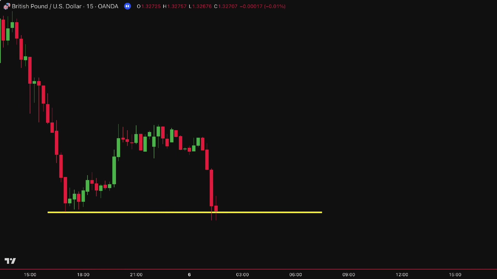

它是这样的：市场正在下跌，你发现一处坚实的支撑位，于是做多，期待价格反弹。止损当然放在支撑位下方，同时突破，交易者也在那里堆积卖出止损单，压住向下突破，价格跌破支撑，触发两类订单，随后向上反转。

## [04:12](https://www.bilibili.com/video/BV1BMYf6mE7G/?t=252)

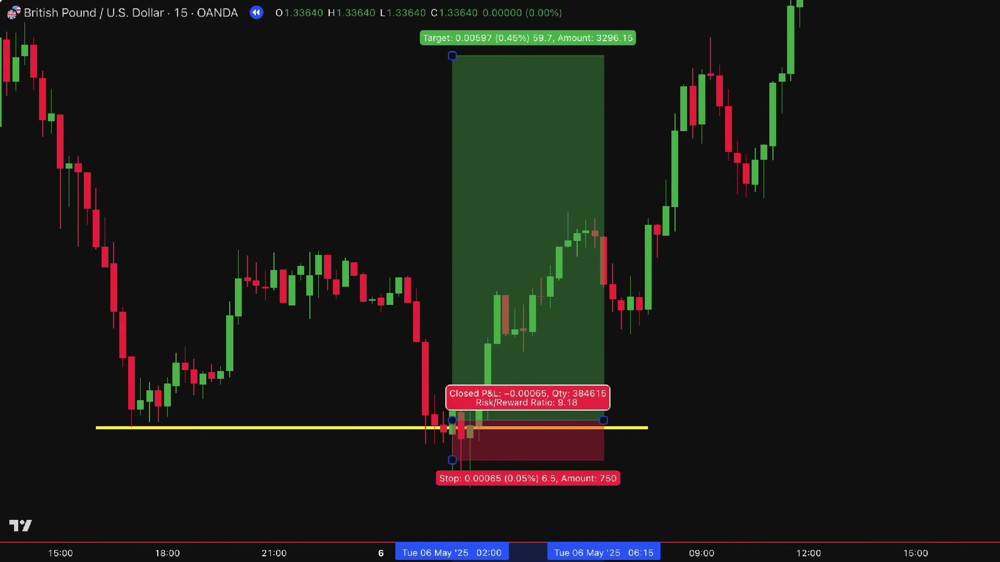

两组交易者再次被困。真正的行情会在流动性被清除后才开始。下面进入一个关键概念。

## [04:22](https://www.bilibili.com/video/BV1BMYf6mE7G/?t=262)

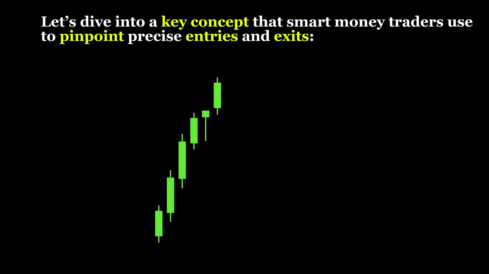

聪明钱交易者用它精确寻找入场位置和出场位置，也就是FVG。那么，FVG到底是什么？当市场迅速而猛烈地朝一个方向运动时，就会产生价格失衡，速度快到K线之间留下一段尚未成交的空白。这段缺口代表价格没有充分停留和成交的区域。因此，它往往像磁铁一样把价格吸引回来，重新测试。交易者利用这些缺口寻找高胜算的入场区，运用得当时，它能带来狙击手般的精度。识别FVG时，先寻找连续三根K线。

## [04:56](https://www.bilibili.com/video/BV1BMYf6mE7G/?t=296)

中间应是一根明显朝单一方向强势运动的大K线。两侧各有一根较小的K线。关键在于，第一根K线的高点与第三根K线的低点不能和中间K线重叠，这样才会形成缺口。第一根的高点与第三根的低点之间那段空间，就是FVG。找到以后，在图表上用矩形框住这个区域。这里就是你的关注区，两个方向都适用。看涨形态中，价格向上推进时形成缺口；看跌形态中，价格快速下跌时形成缺口。记住。如果第一根和第三根K线之间没有缺口，就不存在有效的FVG。无论中间那根K线有多大。

## [05:38](https://www.bilibili.com/video/BV1BMYf6mE7G/?t=338)

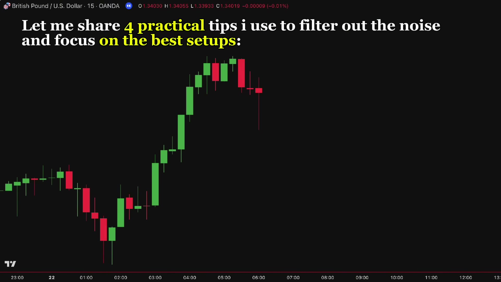

都不算。下面分享四个实用技巧，帮你过滤噪声，只关注最好的形态。第一，只使用尚未回补的缺口，最好的FVG。都是新鲜的。也就是价格还没有回来测试过。价格一旦返回并触及缺口，

## [05:54](https://www.bilibili.com/video/BV1BMYf6mE7G/?t=354)

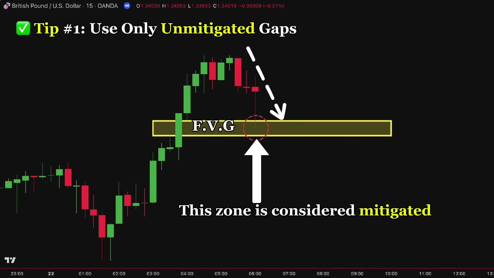

这个区域就被视为已经回补，它的优势会减弱。所以，已经重新测试过的FVG最好跳过，同时还要警惕回撤过深。

## [06:04](https://www.bilibili.com/video/BV1BMYf6mE7G/?t=364)

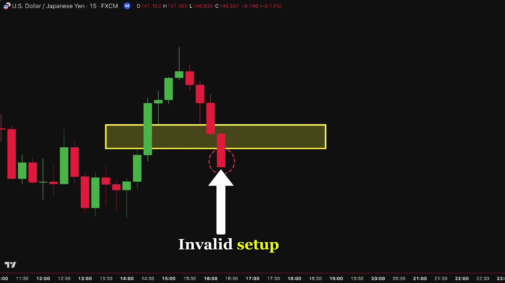

如果价格收在缺口内部或下方，形态就失效了。理想情况是价格轻触缺口，尊重这个区域。然后反弹，第二大小很重要。较大的FVG。通常能形成更强的交易机会。

## [06:20](https://www.bilibili.com/video/BV1BMYf6mE7G/?t=380)

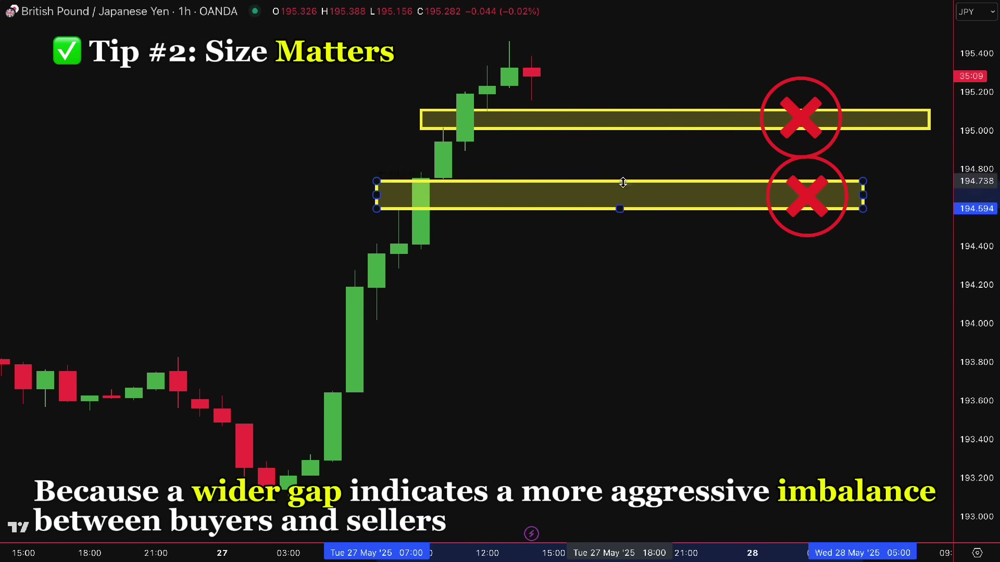

为什么？因为缺口越宽，说明买方和卖方之间的失衡越剧烈。价格也就越可能重返。该图表测出反应，同一张图上有多个FVG时，应优先关注较大的缺口。

## [06:32](https://www.bilibili.com/video/BV1BMYf6mE7G/?t=392)

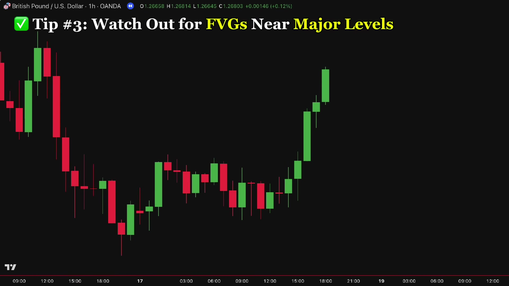

第三。留意重要位置附近的FVG。这是一个常见陷阱。

## [06:38](https://www.bilibili.com/video/BV1BMYf6mE7G/?t=398)

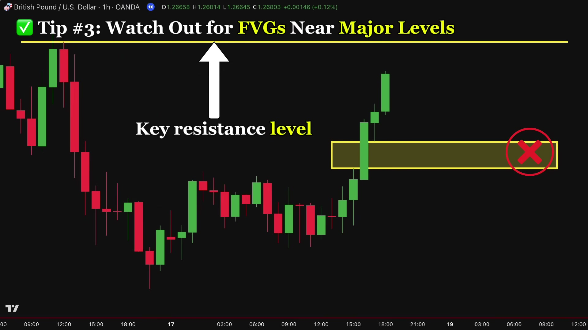

你发现一个很漂亮的FVG。但它正好形成在主要阻力位下方。这是危险信号。因为价格可能触及阻力后遭到强烈拒绝，使你的FVG失效。始终要查看周围环境。避免距离支撑这类明显障碍过近的FVG。以及阻力。第四。

## [07:00](https://www.bilibili.com/video/BV1BMYf6mE7G/?t=420)

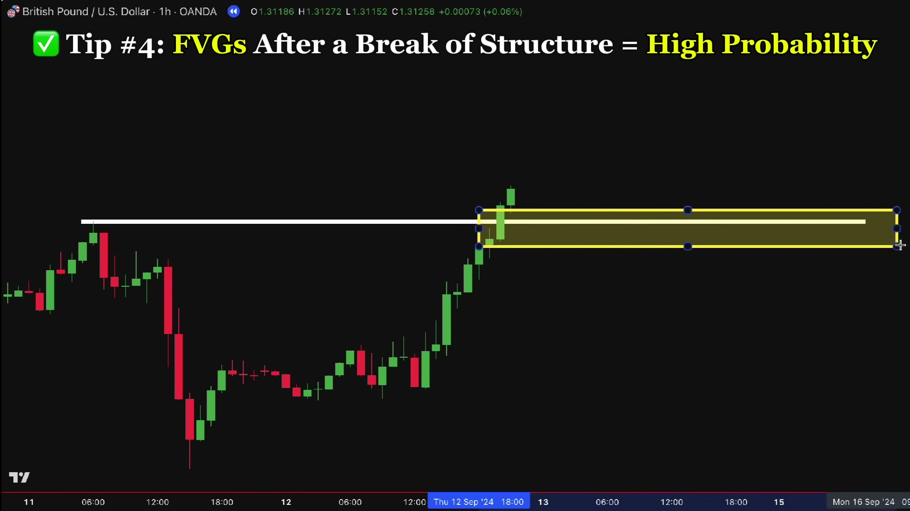

重点关注结构突破后立即形成的FVG。一些最可靠的FVG就出现在结构突破之后。当价格突破关键水平，并马上留下FVG时。这个区域变成为聪明钱再次入场的高胜算位置。价格第一次回测这个FVG，往往会引发强烈反应。

## [07:22](https://www.bilibili.com/video/BV1BMYf6mE7G/?t=442)

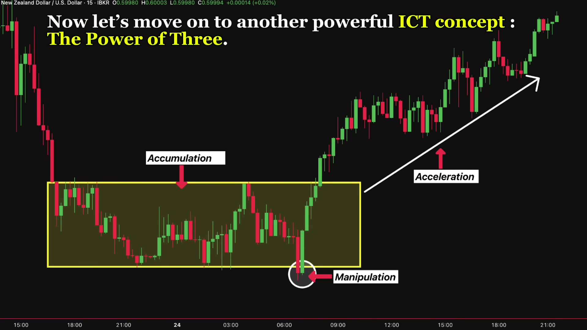

下面来看另一个强大的ICT概念——三段式PO三。三段式是一种聪明钱交易形态。把价格行为分成三个关键阶段：吸筹、操纵和派发。

## [07:34](https://www.bilibili.com/video/BV1BMYf6mE7G/?t=454)

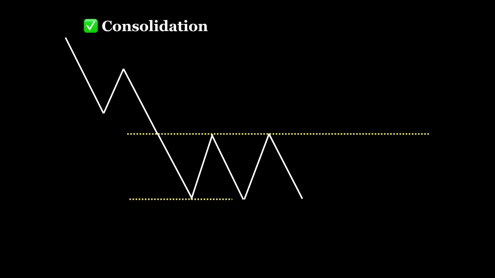

先看第一阶段吸筹。吸筹阶段中，价格在狭窄区间横向运动。聪明钱开始悄悄建立仓位。

## [07:44](https://www.bilibili.com/video/BV1BMYf6mE7G/?t=464)

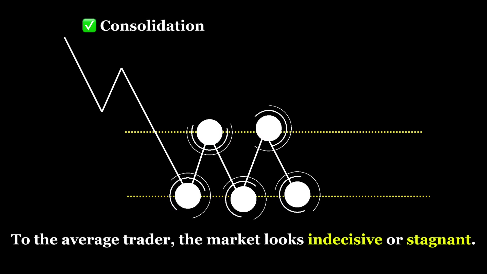

普通交易者会觉得市场犹豫不决，甚至毫无动静。但这一阶段其实至关重要，它为下一轮大行情奠定基础。这就是通常所说的三段式第一阶段。接着是操纵阶段，市场会向下或向上制造假突破。这样做是为了触发止损，困住散户交易者，并吸引突破交易者进场。这是典型的流动性扫取。

## [08:12](https://www.bilibili.com/video/BV1BMYf6mE7G/?t=492)

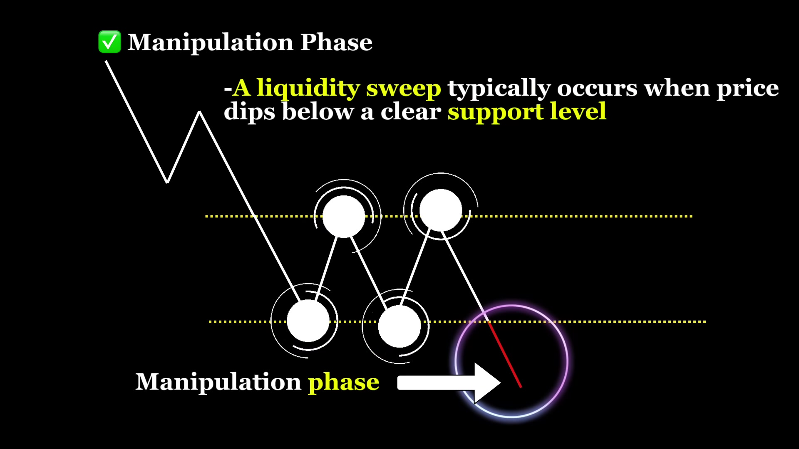

目的是收集毫无防备者的订单。流动性扫取通常表现为价格跌破明确的支撑位，然后迅速回到区间。这个假突破不代表趋势真正改变，而是聪明钱在真正行情启动前收集流动性的手段。收集到足够的流动性后，聪明钱会迅速把价格推向相反方向。这个急速运动就是派发阶段中的加速行情。到了最后阶段，动能开始启动，而你可以在陷阱形成后跟随机构进场，抓住这段加速，你就不再追赶行情。而是在乘势而行，这就是三段式的看涨版本。

## [08:48](https://www.bilibili.com/video/BV1BMYf6mE7G/?t=528)

再看它的看跌版本。这种形态出现在上涨趋势末端，为向下动能做准备。过程是这样的：第一阶段是派发，价格盘整并形成狭窄区间。但在幕后。聪明钱正趁强势卖出多头仓位。而散户买家还在不断涌。接着是操纵阶段，价格突然突破区间上沿，触发突破入场单，以及空头卖方的止损。散户以为上涨会延续，实际并非如此，这又是陷阱。价格很快回到区间，暴露出它其实是流动性扫取。最后进入向下派发阶段，聪明钱已经退出，流动性也已被扫清。

## [09:38](https://www.bilibili.com/video/BV1BMYf6mE7G/?t=578)

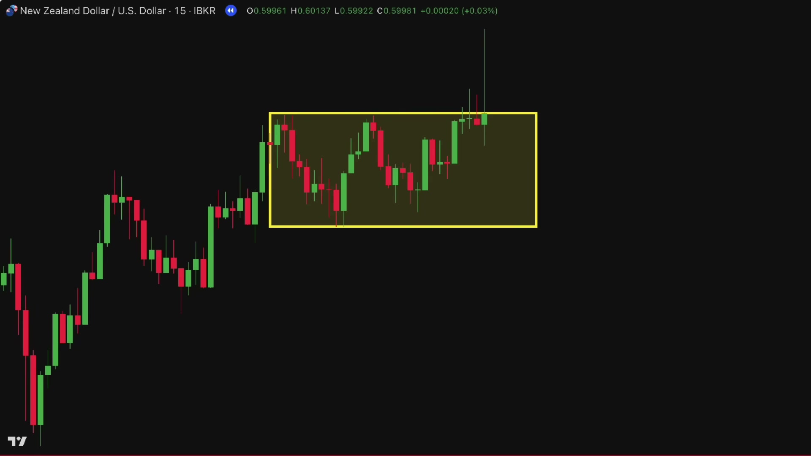

下方只剩没有阻挡的空间，这正是你从趋势顶部抓住行情的时机。跟随聪明钱刚刚创造的动能向下运行。现在说说如何实际交易三段式，包括看涨和看跌形态识别。以后下一步是把握入场、管理风险，并设定出场目标。市场处于上涨趋势时。聪明钱最终会开始获利了结。首先，等待派发。价格在一轮强劲上涨后，开始区间盘整。聪明钱在这里逐步卖出仓位，随后进入操纵阶段。价格突破阻力位，触发突破买单和卖方止损。仔细观察。如果突破后，价格又收回区间内部。这就是信号。它是流动性扫取，不是真突破。

## [10:18](https://www.bilibili.com/video/BV1BMYf6mE7G/?t=618)

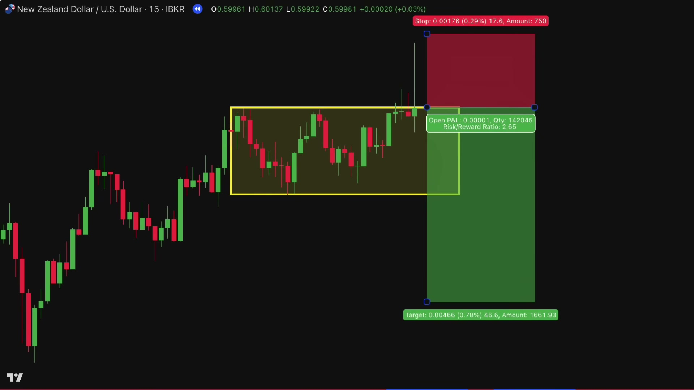

在重新收回区间的那根K线收盘时进场，把止损放在突破K线的高点上方。目标设在下一个主要支撑位，这个形态让你抓住向下派发，也就是聪明钱困住散户后的向下加速阶段。

## [10:46](https://www.bilibili.com/video/BV1BMYf6mE7G/?t=646)

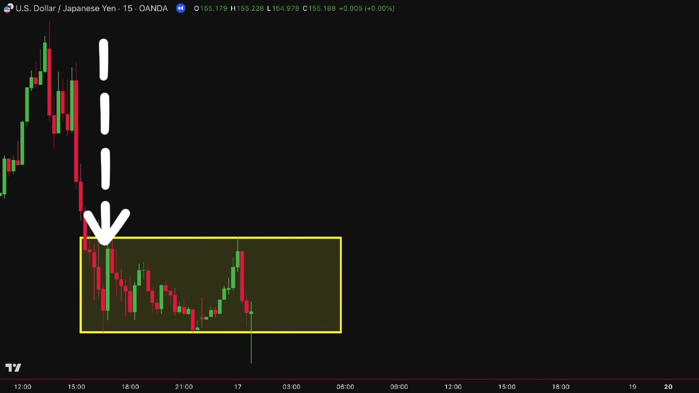

市场处于下跌趋势时，聪明钱最终会寻找开始买入的位置，可以这样识别反转。观察吸筹阶段，价格在一轮强劲下跌后，开始区间盘整。接着发生流动性扫取，价格跌破支撑，触发卖出止损单，并吸引突破做空者进场。如果下一根K线收回区间，这就是入场信号。陷阱已经布好，

## [11:10](https://www.bilibili.com/video/BV1BMYf6mE7G/?t=670)

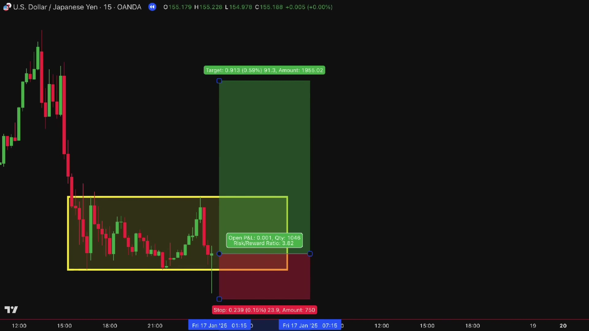

聪明钱正在大量建仓。在那根K线收盘时进场，把止损放在最近摆动低点下方。目标设为下一个重要阻力位，你由此有机会抓住向上派发，也就是机构动能推动的爆发式上涨。

## [11:24](https://www.bilibili.com/video/BV1BMYf6mE7G/?t=684)

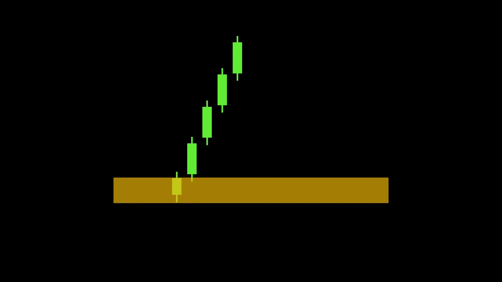

下面进入另一个关键的聪明钱概念。订单快。我们用简单有力的方式来拆解它：订单块是价格图表上的一片区域。银行、

## [11:34](https://www.bilibili.com/video/BV1BMYf6mE7G/?t=694)

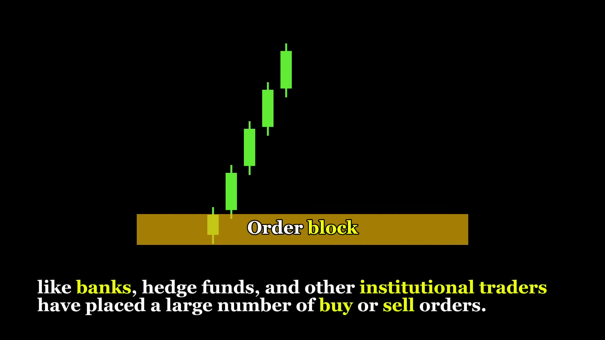

对冲基金等市场大户和其他机构交易者曾在这里放置大量买单或卖单。他们不是普通交易者。而是掌握数百万乃至数十亿美元资金的机构。因此，他们进入市场时，影响会清楚地反映在价格上。

## [11:48](https://www.bilibili.com/video/BV1BMYf6mE7G/?t=708)

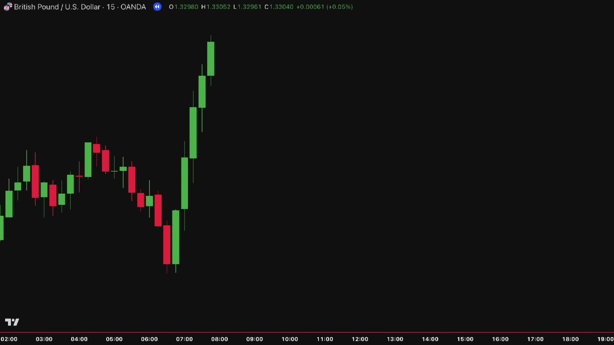

你是否见过价格从某个特定水平突然强劲上涨或急剧下跌？这种突发运动通常不是随机的，而是聪明钱留下的足迹。行情启动的区域就是订单块。

## [12:00](https://www.bilibili.com/video/BV1BMYf6mE7G/?t=720)

订单块主要有两类：机构投入大量买单，推动价格上涨时，会形成看涨订单块。机构抛出大量卖出仓位，导致价格下跌时，会形成看跌订单块。这些区域形成后，就会成为关注区。为什么？因为价格经常会回来重访。

## [12:20](https://www.bilibili.com/video/BV1BMYf6mE7G/?t=740)

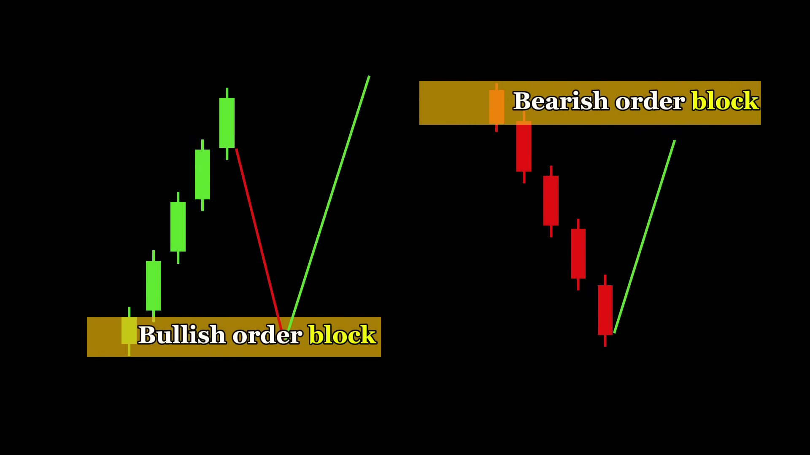

仿佛市场想测试那些大户是否仍愿意守住自己的仓位。对我们来说，这次回测可以带来高胜算的入场机会。

## [12:28](https://www.bilibili.com/video/BV1BMYf6mE7G/?t=748)

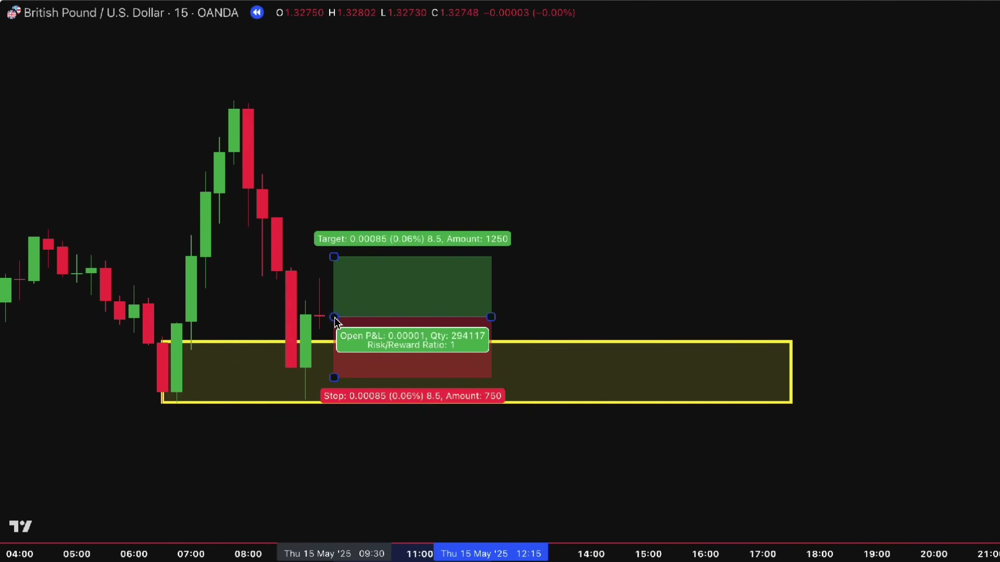

例如，价格回到看涨订单块，并显露强势时，从这个区域做多，可能带来可观利润。因为你的入场位置与专业交易者先前介入的水平。

## [12:42](https://www.bilibili.com/video/BV1BMYf6mE7G/?t=762)

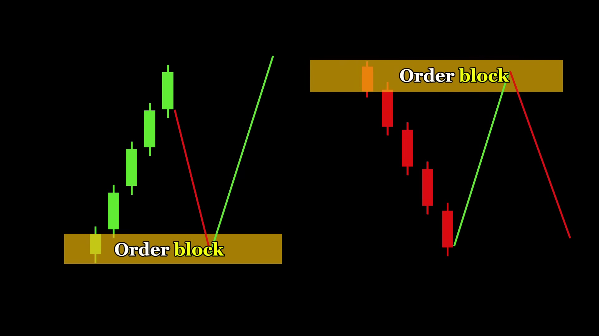

一致订单块，乍看可能很像支撑和阻力。但两者有巨大差别。具体来说，订单块乍看很像常见的支撑和阻力位，毕竟两者都会标出价格做出反应的区域。但理解运作方式后，你会发现它们完全不同。

## [13:02](https://www.bilibili.com/video/BV1BMYf6mE7G/?t=782)

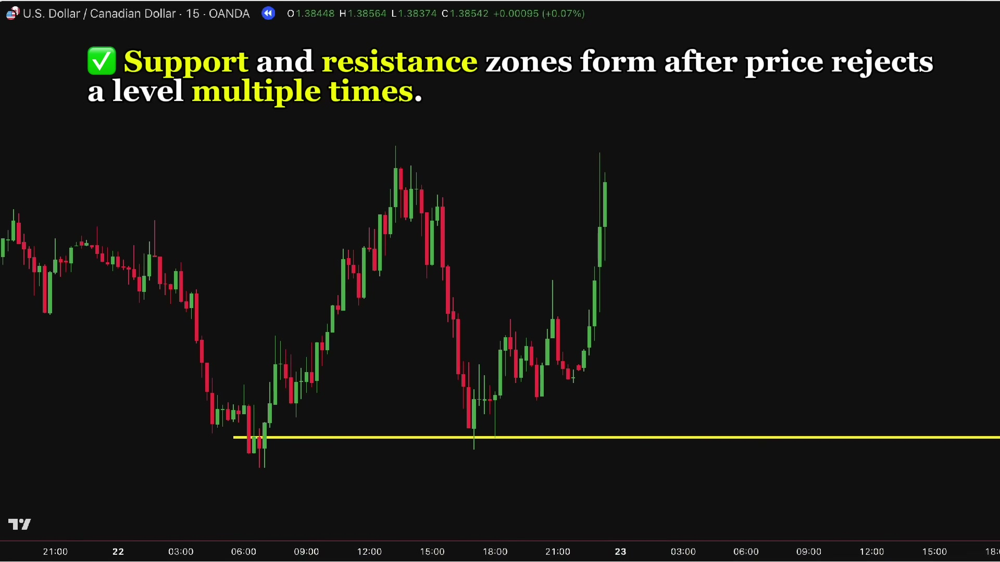

下面看区分两者的三个关键差异。

## [13:06](https://www.bilibili.com/video/BV1BMYf6mE7G/?t=786)

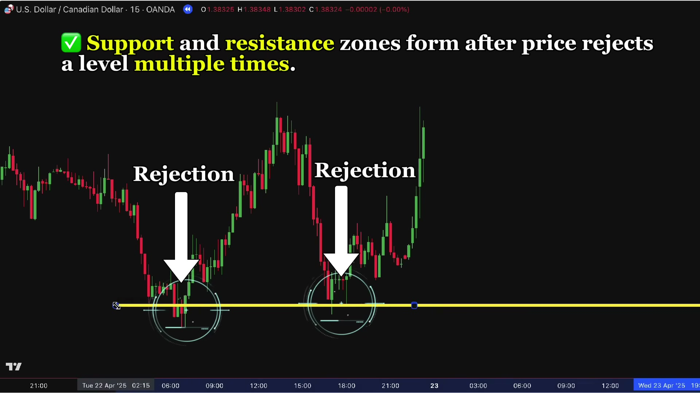

支撑和阻力区域是在价格多次拒绝某个水平后形成的，例如。价格先从一个水平反弹，后来再次反弹，这种反复拒绝让我们有理由画出支撑线或阻力线。但订单块不是以价格拒绝为依据。

## [13:16](https://www.bilibili.com/video/BV1BMYf6mE7G/?t=796)

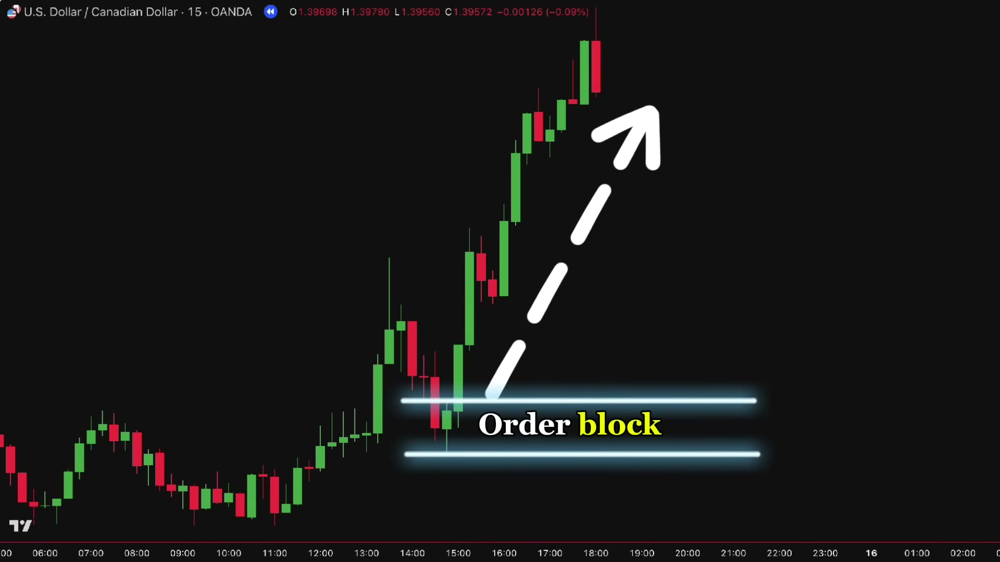

它源自市场大户制造的猛烈行情。看到价格以强劲的推动走势离开某个水平，就是线索。这个区域会成为订单块。

## [13:32](https://www.bilibili.com/video/BV1BMYf6mE7G/?t=812)

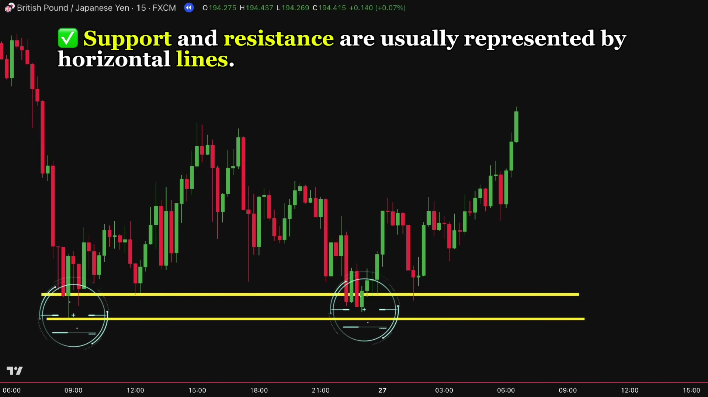

因为聪明钱很可能曾在那里进场支撑和阻力，通常用水平线表示。有时交易者会把它们扩展为狭窄区域。但仍然比较薄，

## [13:40](https://www.bilibili.com/video/BV1BMYf6mE7G/?t=820)

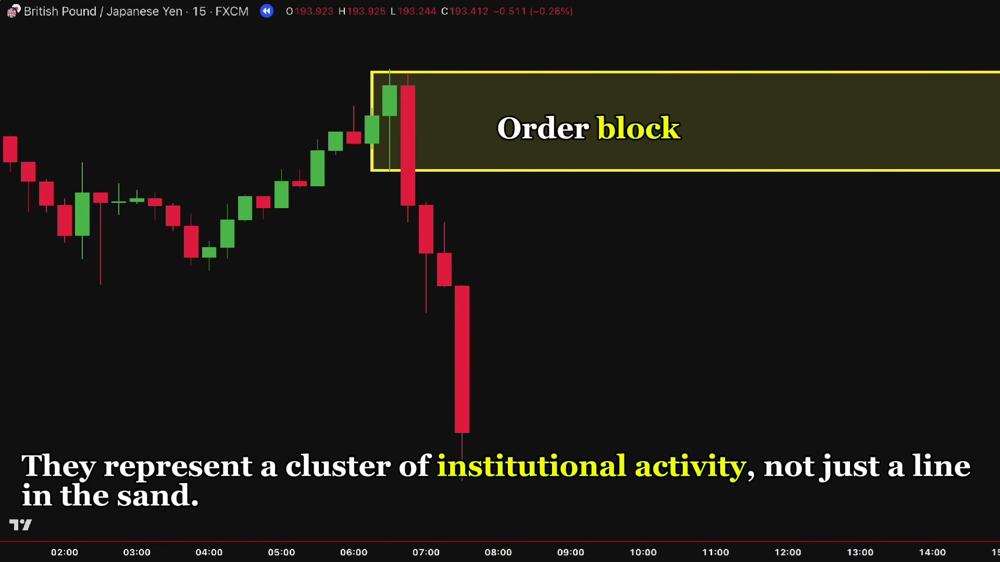

订单块则会标为较宽的区域。它代表一组密集的机构活动，而不只是一条界限。这个较宽的范围反映订单集中堆积的位置，而不是价格仅仅触及并反弹的位置。

## [13:52](https://www.bilibili.com/video/BV1BMYf6mE7G/?t=832)

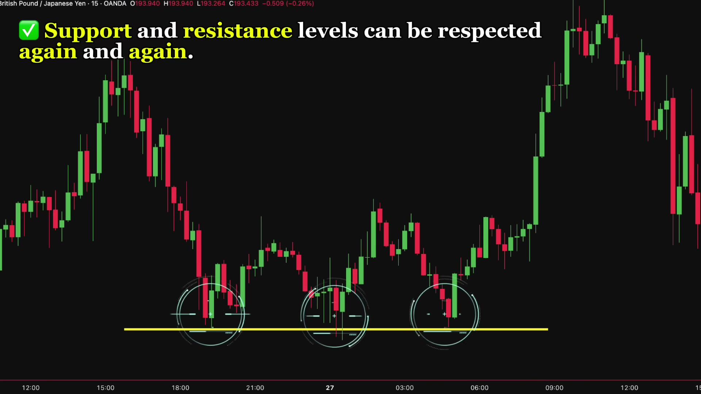

支撑和阻力位可以一次又一次地发挥作用。几周内，价格可能从一处强支撑反弹五次。订单快不是这样。

## [14:00](https://www.bilibili.com/video/BV1BMYf6mE7G/?t=840)

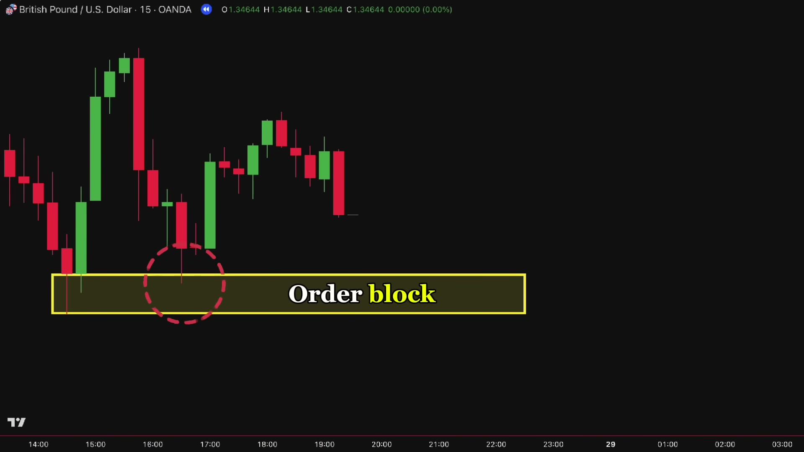

它更像只有一次的机会窗口。价格一旦回访订单快，并做出反应，这个区域通常就会失去效力，因为最初推动行情的订单很可能已经成交。

## [14:12](https://www.bilibili.com/video/BV1BMYf6mE7G/?t=852)

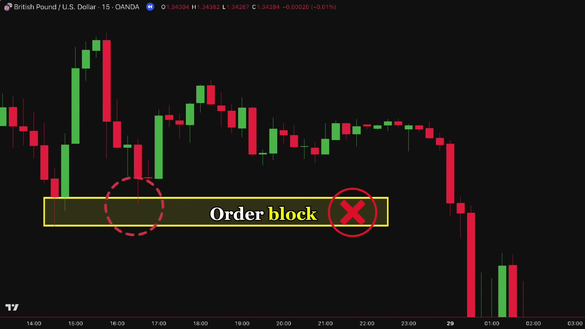

聪明钱完成了任务，

## [14:16](https://www.bilibili.com/video/BV1BMYf6mE7G/?t=856)

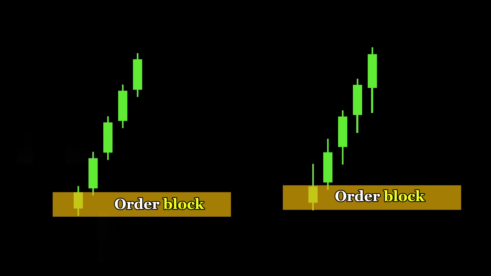

也就离开了。在把订单块用于交易策略前。你要先学会识别正确的订单块。下面讲定义有效订单块的三条必要规则。这些规则缺一不可，是策略的骨架。第一，

## [14:30](https://www.bilibili.com/video/BV1BMYf6mE7G/?t=870)

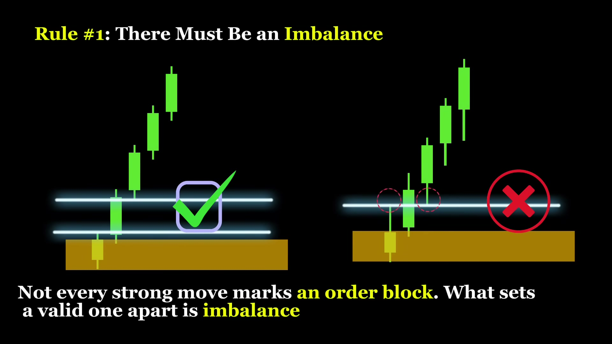

必须存在失衡，也叫缺口或低效区，并非每一次强劲运动都会形成订单块。有效订单块的区别在于失衡，也就是市场没有足够时间或流动性进行充分成交的一段价格区间。通常可以从K线影线之间的缺口看出来。具体来说，

## [14:46](https://www.bilibili.com/video/BV1BMYf6mE7G/?t=886)

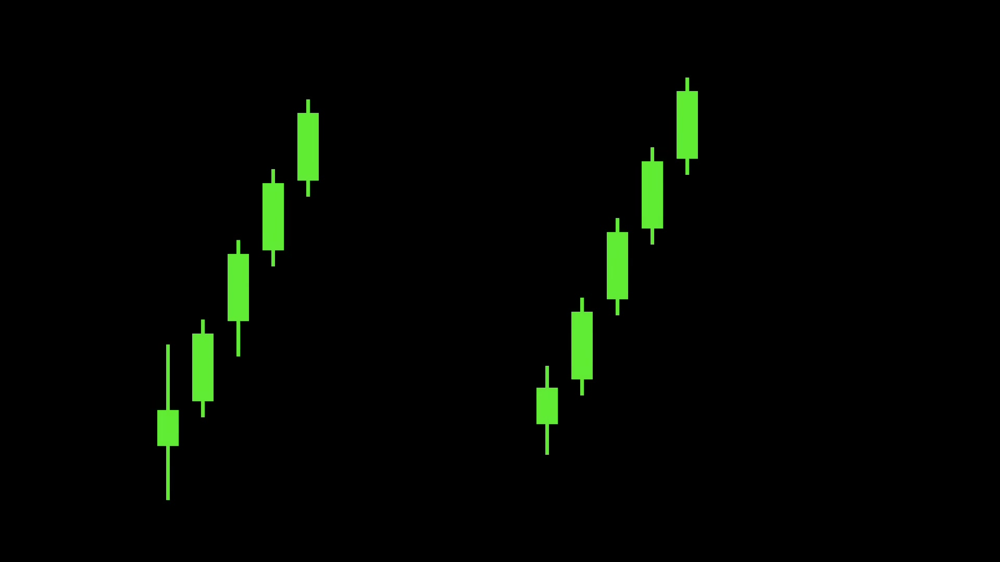

想象两段几乎一模一样的价格运动。两者都强劲上涨，但其中一段在某根K线高点与后面几根K线的低点之间留出了清晰空间。

## [14:54](https://www.bilibili.com/video/BV1BMYf6mE7G/?t=894)

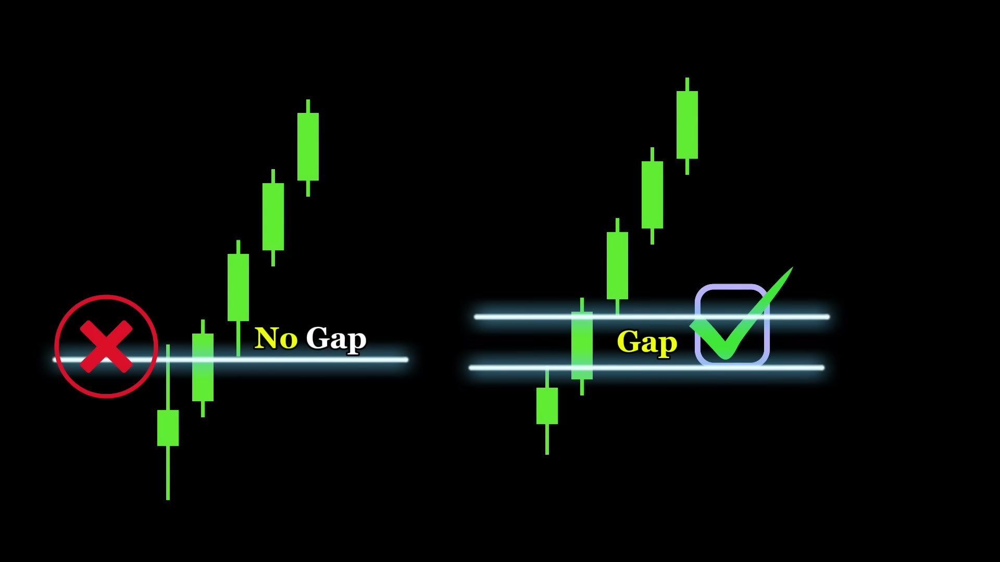

这个缺口就是低效区，说明市场运动太快，订单未能充分匹配。只有带有这种失衡的运动，才可以用来判断订单快化的时候。找到失衡出现前的最后一根K线，从影线高点到影线低点画一个矩形，这就是订单块区域。

## [15:14](https://www.bilibili.com/video/BV1BMYf6mE7G/?t=914)

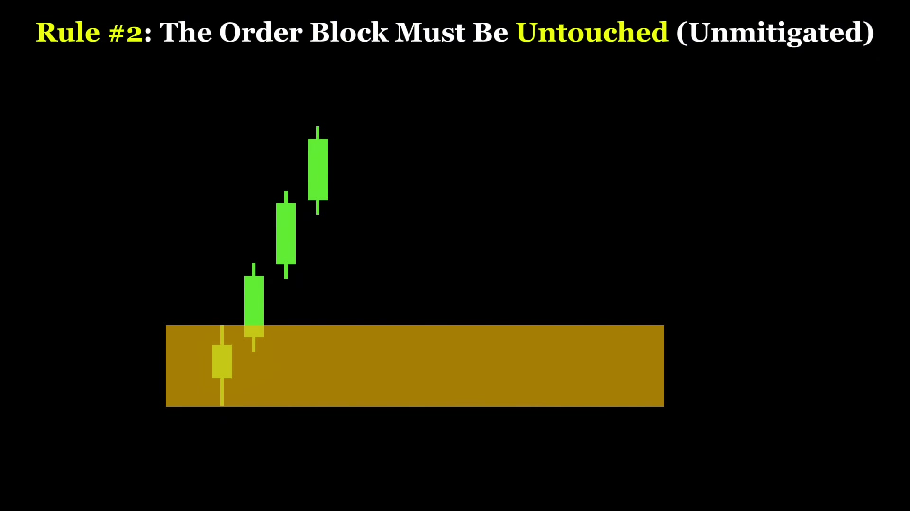

第二，订单块必须没有被触及。换句话说，他必须尚未被回补。订单快不会永远有效。它通常是一次性机会。如果价格返回该区域，哪怕只有一根影线轻触订单块，也不再有效。它已经被回补，为什么？因为原先留在那里的订单很可能已经成交。聪明钱已经采取行动，所以画出订单块后，要持续观察。价格一触及，就把它视为已经使用，然后转向下一个形态。

## [15:46](https://www.bilibili.com/video/BV1BMYf6mE7G/?t=946)

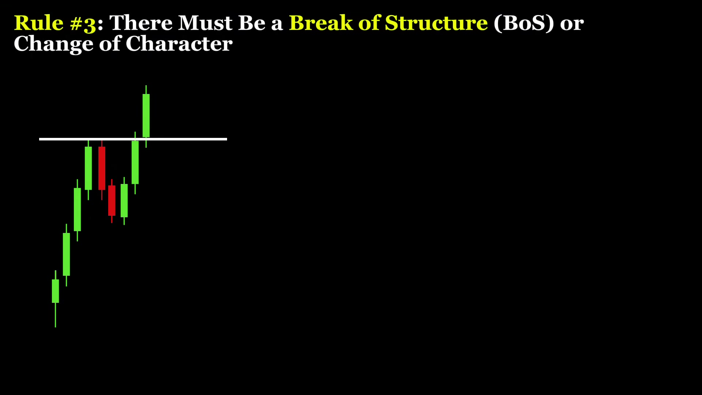

第三，必须通过结构突破或性格转变确认订单快，这是最重要的一点。没有确认，一切都只是猜测。有效订单快，必须引发市场结构转变。趋势向上时，价格应突破前高。趋势向下时，价格应跌破前低。如果趋势彻底反转，

## [16:08](https://www.bilibili.com/video/BV1BMYf6mE7G/?t=968)

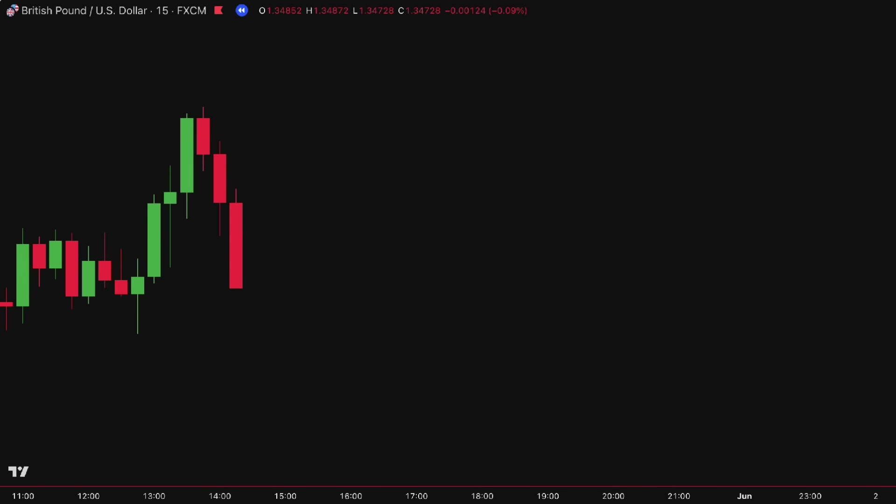

则应出现性格转变。来看一个例子，市场出现强劲下跌，而且可以清楚看到一处失衡，所以这里看上去像潜在订单块。但要确认它有效。还需要结构突破。具体来说。就是跌破此前的支撑位。接着，市场确实跌破该支撑。

## [16:30](https://www.bilibili.com/video/BV1BMYf6mE7G/?t=990)

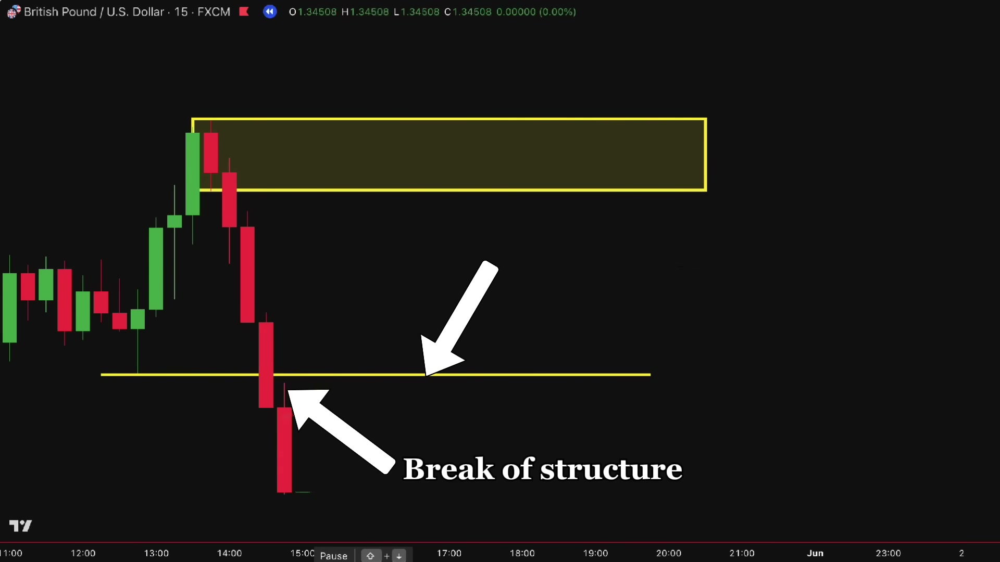

由此确认订单快有效。价格回撤，进入订单块后遭到拒绝，并继续下跌。

## [16:38](https://www.bilibili.com/video/BV1BMYf6mE7G/?t=998)

再看另一个例子。这次市场上涨，并突破市场结构。这里先出现第一处失衡。所以，我们画出第一个订单块，随后在更高的位置又形成一处失衡，于是标出第二个订单块。重要的是。

## [16:54](https://www.bilibili.com/video/BV1BMYf6mE7G/?t=1014)

第二个订单块。与此前的阻力位重合，形成共振，提高了出现强烈反应的概率。看看接下来发生什么。市场回撤到订单块后遭到拒绝，随后继续上涨。这证明订单快有效，而且此前的阻力现在已经转为支撑，为它提供支持。

