# 【中配】ICT精讲二：FVG

- 作者 耳朵数字观察
- 时长 09:56
- 来源 [https://www.bilibili.com/video/BV12Net6GEKr/](https://www.bilibili.com/video/BV12Net6GEKr/)
- 由 course2md 生成 · 29 张截图 / 29 段文字

---

## [00:00](https://www.bilibili.com/video/BV12Net6GEKr/?t=0)

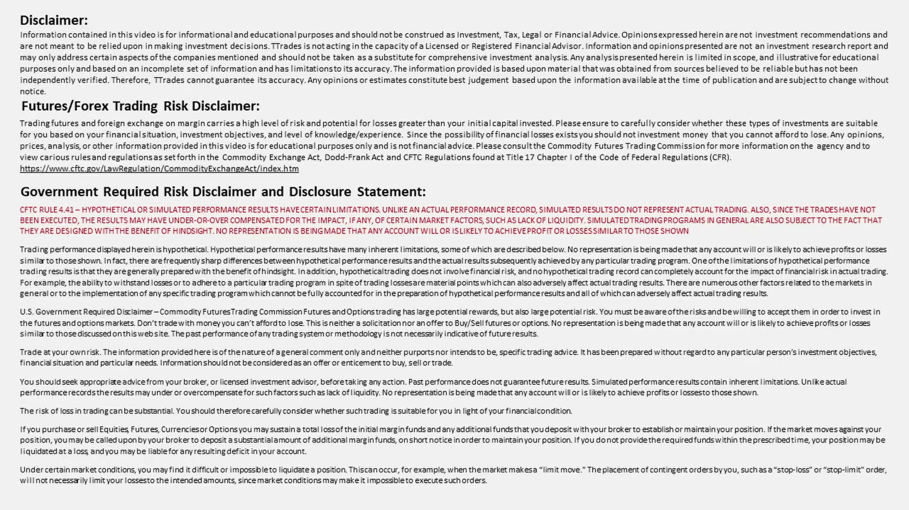

## [00:08](https://www.bilibili.com/video/BV12Net6GEKr/?t=8)

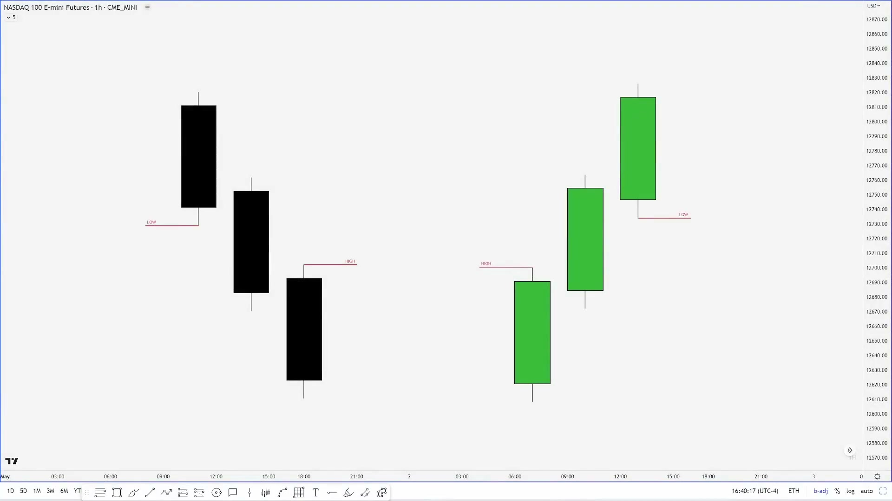

大家好。本期视频来讲公允价值缺口（FVG）。什么是公允价值缺口？什么是BISISIBIFVG中直线和反向FVG？我们还会讲清FVG。成交量失衡。和跳空缺口的区别。先看什么是FVG。它是一种由三根蜡烛组成的形态。第一根蜡烛的低点。与第三根的高点不重叠。或者第一根的高点与第三根的低点不重叠。

## [00:44](https://www.bilibili.com/video/BV12Net6GEKr/?t=44)

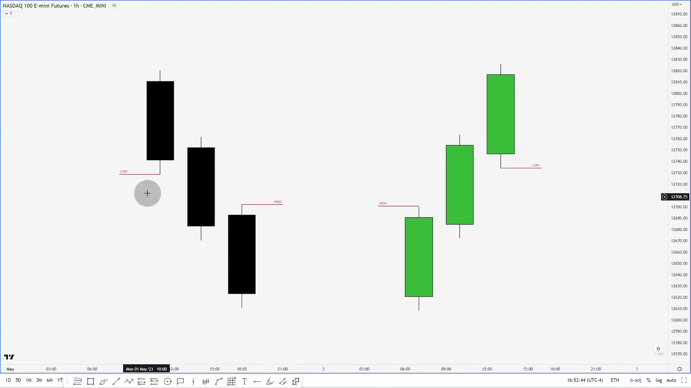

我们深入看一下。把这根蜡烛的低点向右延伸。再把另一根蜡烛的高点向右延伸。高点与低点没有重叠。所以，这里形成了F B G。再看这个例子。这根蜡烛的高点。与另一根蜡烛的低点不重叠。所以，这里也是FVG。看完它是什么样，再来看看什么情况。不算FVG。假如把这根蜡烛的低点下移到这里。把另一根的高点上移到这里，再向右延伸。看看是否还有缺口，延伸后可以看到二者重叠了。第一根蜡烛的低点。低于第三根蜡烛的高点。所以这里没有缺口，也就不是FVG。同样。看这边。把这个高点向上移。再把这个低点向下移。就能看到第一根的高点与第三根的低点重叠。因此，这里没有FVG。总结一下。第一根蜡烛的低点与第三根蜡烛的高点之间存在缺口。或者，第一根的高点与第三根的低点之间存在缺口，才会形成FVG。

## [02:06](https://www.bilibili.com/video/BV12Net6GEKr/?t=126)

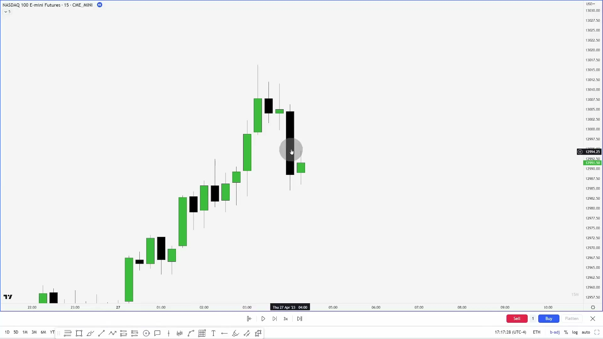

下面看几个识别实例，看这里。先把第一根蜡烛的低点向右延伸。再把第三根的高点向右延伸。这根蜡烛的低点与另一根的高点之间有缺口，因此形成FVG。

## [02:22](https://www.bilibili.com/video/BV12Net6GEKr/?t=142)

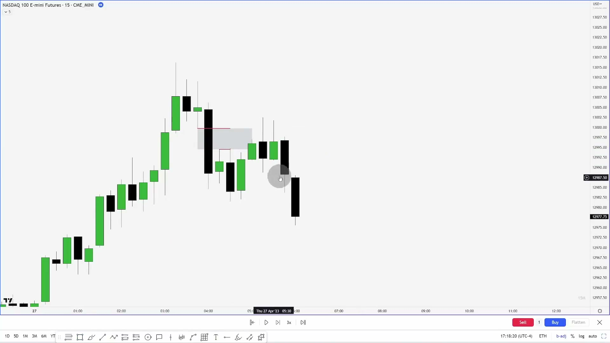

注意。这里还有一个吗？因为这根蜡烛的低点与另一根的高点没有重叠。接着，价格向反方向猛烈移动。看这里的蜡烛。

## [02:34](https://www.bilibili.com/video/BV12Net6GEKr/?t=154)

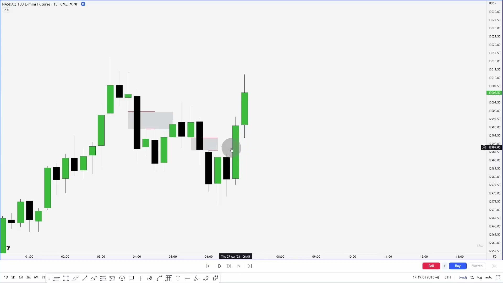

三。第一根的高点与第三根的低点不重叠。于是，又形成一个。FVG.

## [02:46](https://www.bilibili.com/video/BV12Net6GEKr/?t=166)

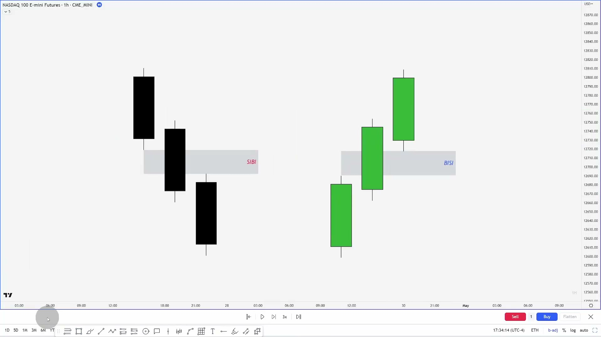

接下来讲s i b i和b i s i。SIBI的全称是卖方失衡，买方低效，也就是市场提供了卖方报价，却没有提供买方报价。因而，效率不足。简单说，就是看跌FEG，E赛的全称是买方失衡，卖方低效。也就是市场提供了买房报价。却没有提供卖方报价，

## [03:14](https://www.bilibili.com/video/BV12Net6GEKr/?t=194)

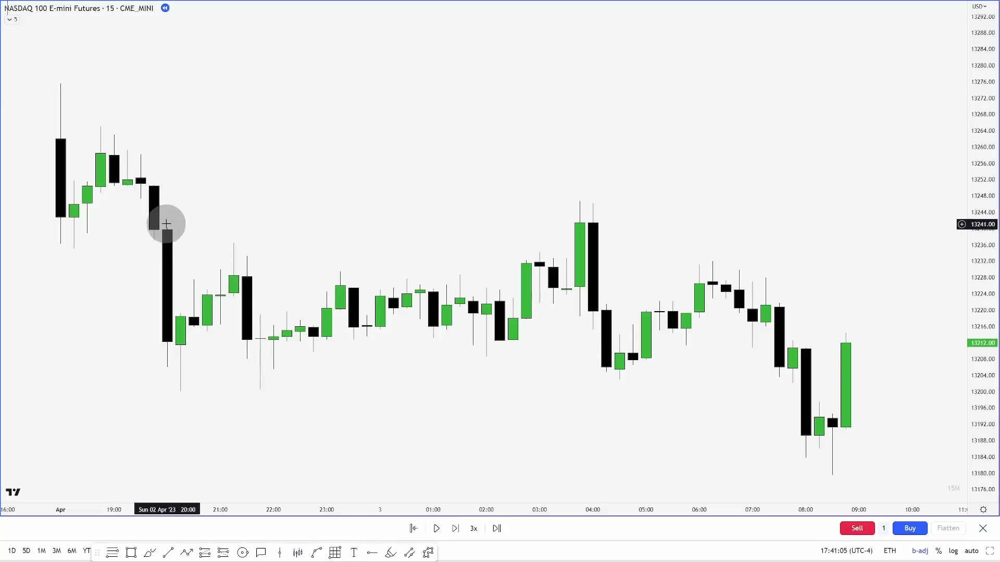

因而效率不足，也就是看涨FVG。来看这里的价格走势。这里有一个看跌FVG。市场提供了卖方报价。但买方效率不足。所以形成s i b

## [03:28](https://www.bilibili.com/video/BV12Net6GEKr/?t=208)

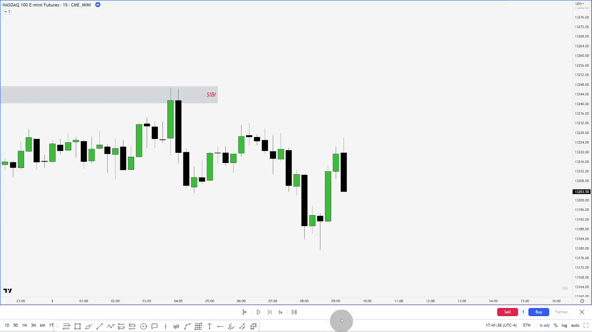

i，把画面移到这里。让行情继续走。可以看到，价格形成了看涨FVG。也就是BISI，因为市场提供了买方报价，却没有提供卖方报价。这就是SEBI和BISI的实力。希望能帮你理解。

## [03:50](https://www.bilibili.com/video/BV12Net6GEKr/?t=230)

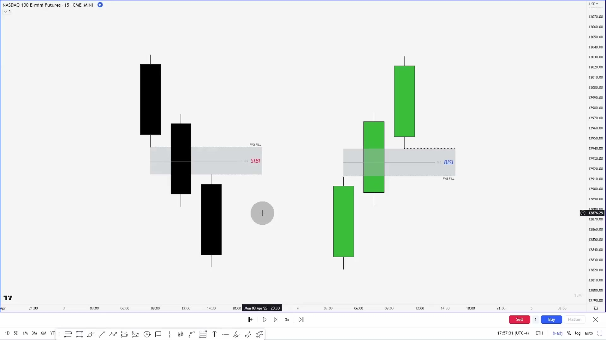

观察FEG时，我会看三个位置。第一是FVG的起点，第二是中直线CE，也就是FVG的百分之五十位置。最后是价格完全填补FVG的位置。当价格回到FVG时。我会关注几种情况。第一种。价格可以向上进入这个FVG。然后收在外面，并继续下跌。它也可以向上触及这个F一G的中值线。到这里后，我希望蜡烛收在F一G外。但只要价格尊重中轴线。我对此可以比较灵活，价格也可以向上触及后。形成一个FVG。这种情况下。我更希望价格收在该FVG的中值线之外。判断FVG失效时，我重点看收盘。一旦价格开始收在中值线之上。或者收到fvgy，就说明价格不再尊重它。很多时候也不会再反转向下。回到前面的例子，

## [04:54](https://www.bilibili.com/video/BV12Net6GEKr/?t=294)

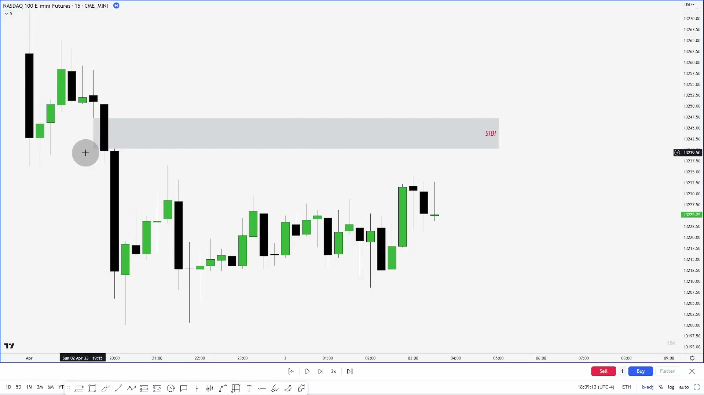

这里有一个s i b i。标出它的中垂线。看看接下来会发生什么？

## [05:00](https://www.bilibili.com/video/BV12Net6GEKr/?t=300)

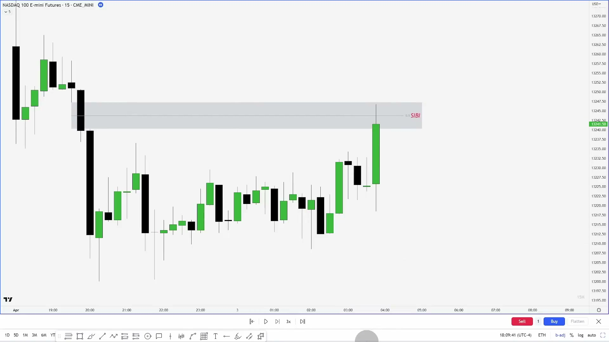

可以看到。价格向上进入这个FVG后。并没有收在中直线上方。再看这里的S I B I。我们先标出它的中直线。可以看到。

## [05:14](https://www.bilibili.com/video/BV12Net6GEKr/?t=314)

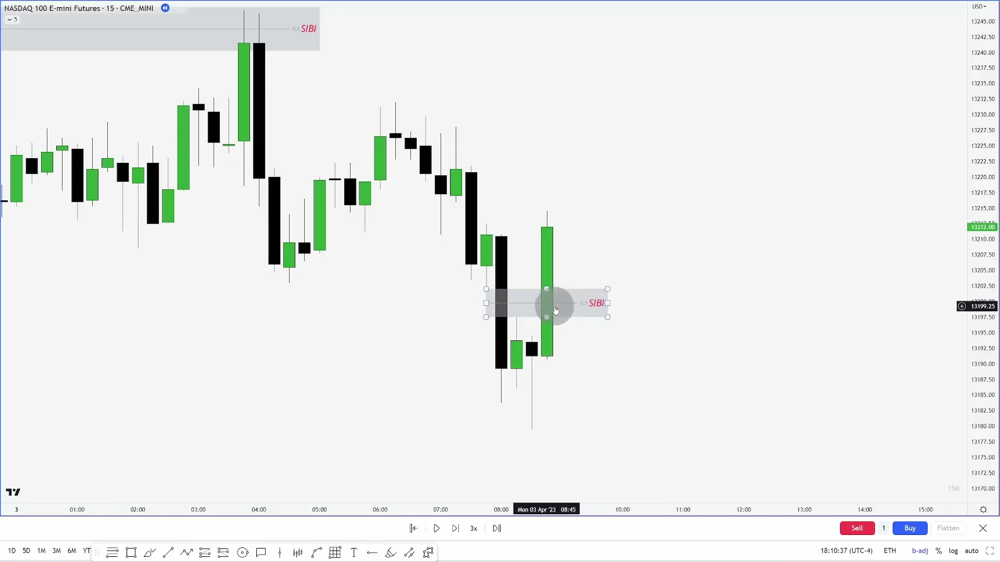

价格完全没有尊重这个SIBI。而是直接收盘，穿过。因此，我会判定这个FVG失效。

## [05:24](https://www.bilibili.com/video/BV12Net6GEKr/?t=324)

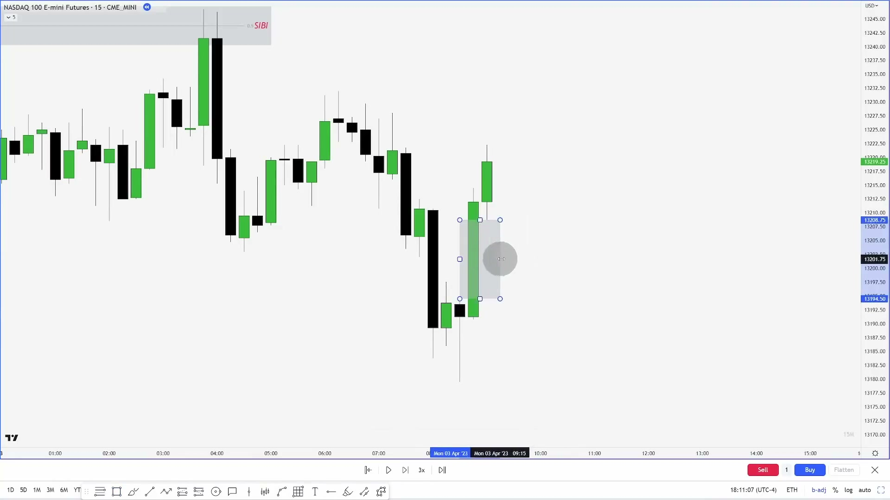

因为价格并不尊重它。接下来看看这里的B I S I。标出它的中直线。

## [05:32](https://www.bilibili.com/video/BV12Net6GEKr/?t=332)

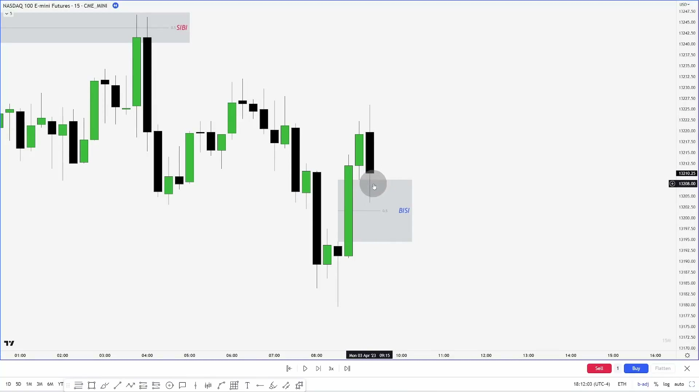

看看会发生什么。价格进入了这个FVG，随后收在外面。所以，目前仍然尊重他。不过，如果考虑这段区间的折价区和溢价区，我希望价格再低一些，进入这段区间的折价区。

## [05:48](https://www.bilibili.com/video/BV12Net6GEKr/?t=348)

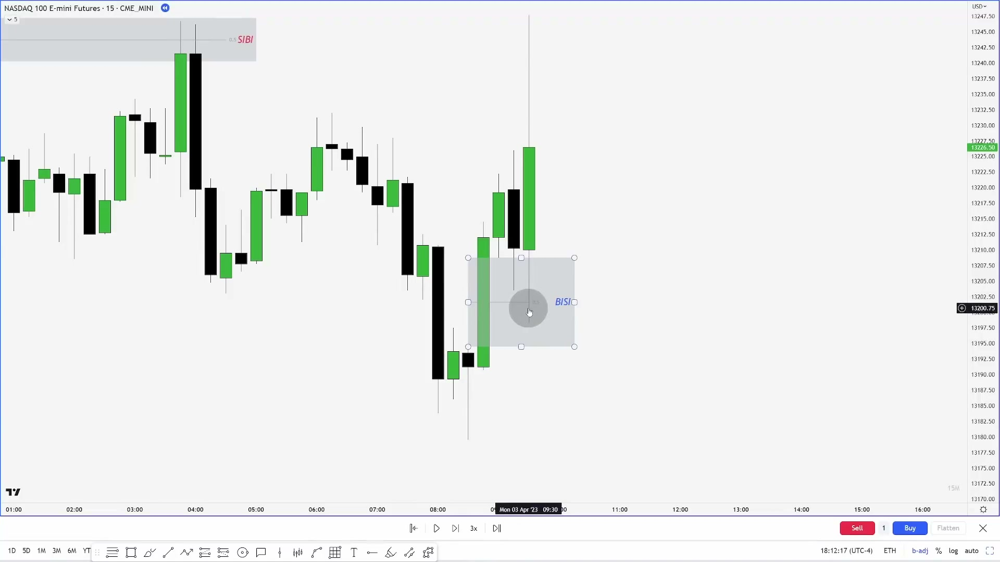

看这里。价格触及中值线后，收在外面。随后，继续上涨。

## [05:56](https://www.bilibili.com/video/BV12Net6GEKr/?t=356)

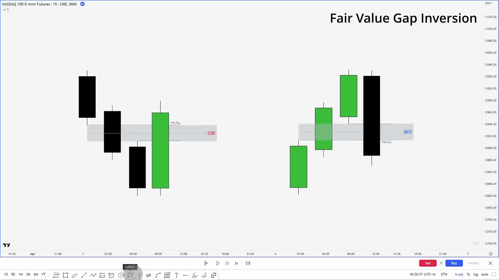

接下来讲反向公允价值缺口。当一个FVG失效。也就是价格收盘穿过它时，这个FVG随后可以转化为支撑或阻力。所以。如果价格回到原来的SIBI。价格若回到原SIBI。我预期他把这里当作支撑后反弹。若回到原BISI，则把它当作阻力后下跌，这种转换不必紧接着发生。两个FVG也不必互相重叠。它可以在更晚的时候出现，比如在一段盘整之后。

## [06:34](https://www.bilibili.com/video/BV12Net6GEKr/?t=394)

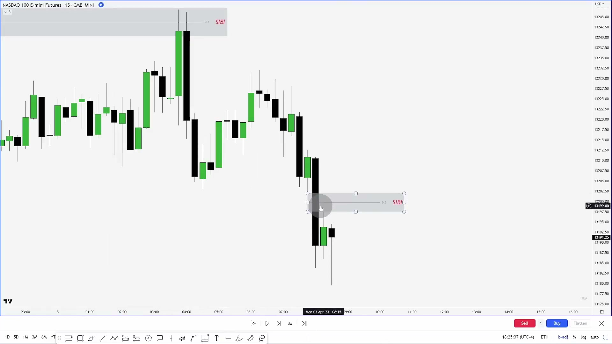

回到前面的例子，这里有一个s i b i。价格收盘穿过它。接下来，我可以观察这个SIBI是否会支撑价格。它确实提供了支撑，随后价格上涨。

## [06:52](https://www.bilibili.com/video/BV12Net6GEKr/?t=412)

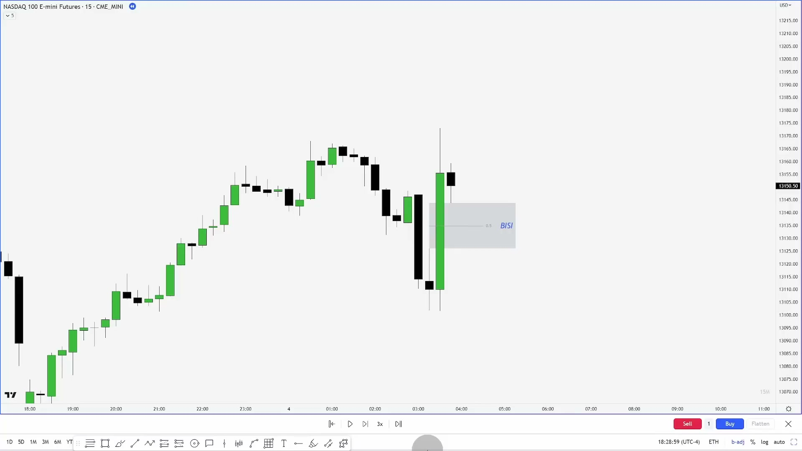

下面这个例子能说明为什么我说反向公允价值缺口不需要紧接着发生。随着行情展开，我们看到的第一个线索是。价格收在中轴线下方。随后出现一段向外的位移，触及这里的引线后，又回来了。接着看。价格能否收在这个F一G下方？就在这里，

## [07:20](https://www.bilibili.com/video/BV12Net6GEKr/?t=440)

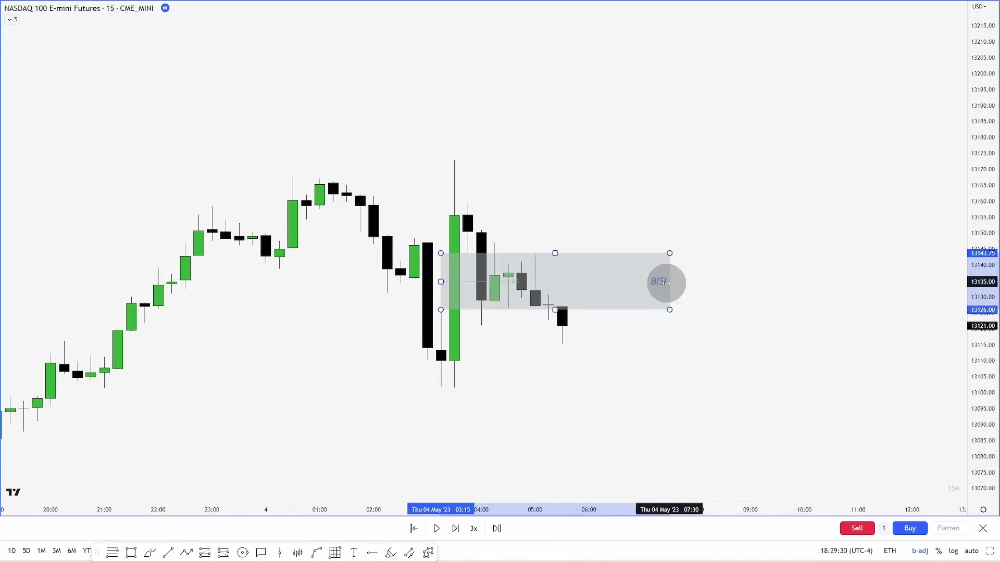

价格收到了FVG下方。把它向右延伸。看看价格回来时会发生什么。可以看到。价格回到原来的BISI。把它当做阻力。然后继续下跌。

## [07:38](https://www.bilibili.com/video/BV12Net6GEKr/?t=458)

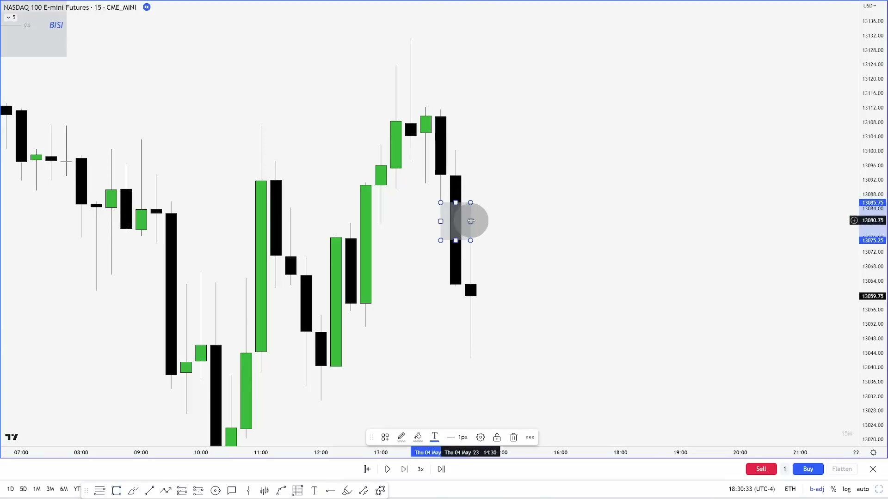

下一个例子中，这里有一个s i b i。看看价格会如何反应。可以看到。价格填补了这个FVG。随后，收在外面。

## [07:50](https://www.bilibili.com/video/BV12Net6GEKr/?t=470)

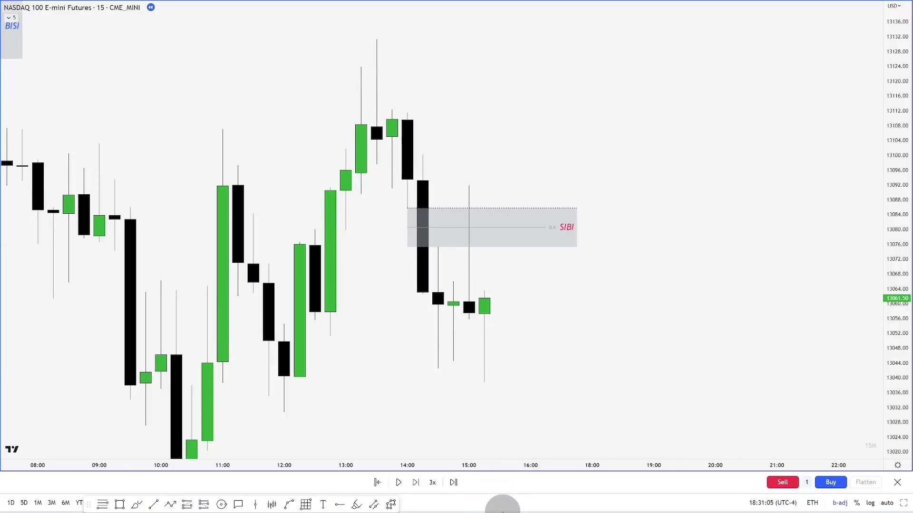

所以，目前仍然尊重他。价格扫掉卖方流动性后反弹，并收在SIBI外面。说明仍然尊重他。

## [08:00](https://www.bilibili.com/video/BV12Net6GEKr/?t=480)

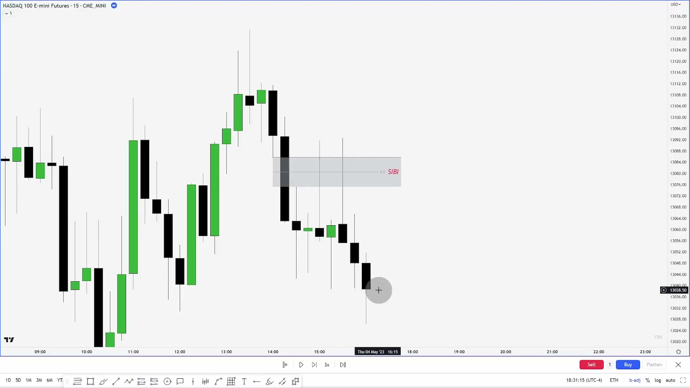

价格再次扫掉卖方流动性，然后反弹。仍然尊重这个SIBI。开盘后，价格在这里收到了SMA上方。

## [08:14](https://www.bilibili.com/video/BV12Net6GEKr/?t=494)

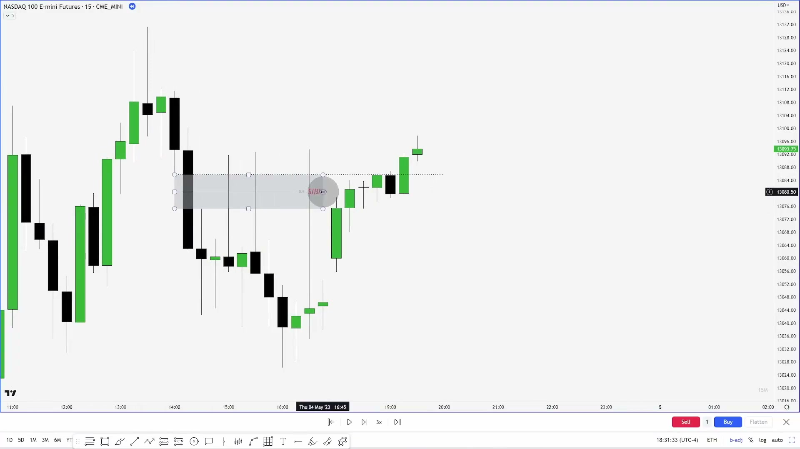

把它向右延伸。看看价格回来时会发生什么。

可以看到。中直线在这里转化成了支撑。再往后看。

## [08:32](https://www.bilibili.com/video/BV12Net6GEKr/?t=512)

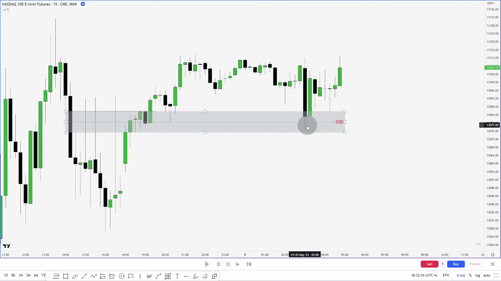

价格再次进入原来的SIBI。把它当做支撑。并以位移行情向外离开。

## [08:40](https://www.bilibili.com/video/BV12Net6GEKr/?t=520)

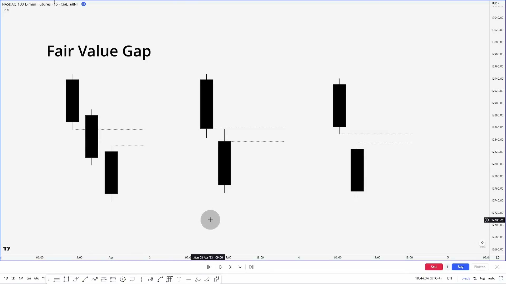

最后。我们来区分FVG成交量失衡和跳空缺口。FVG已经讲过，下面看成交量失衡和跳空缺口。成交量失衡。是两根蜡烛的收盘价。与开盘价之间存在空隙。二者的区别在于。跳空缺口意味着。两根蜡烛之间完全没有交易。而成交量失衡，仍有交易。

## [09:12](https://www.bilibili.com/video/BV12Net6GEKr/?t=552)

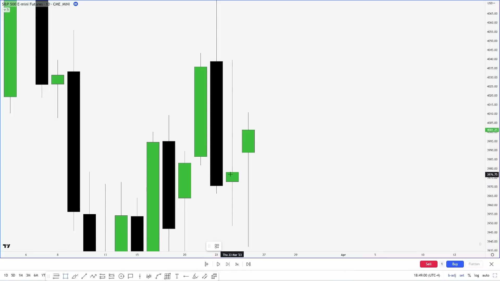

也就是两根蜡烛的高低区间重叠。举个简单例子。从这根蜡烛的收盘价到下一根的开盘价之间存在空隙，但价格确实在这些区域成交过，所以这是成交量失衡，而不是跳空缺口。因此。当价格回到这里时，从这个区域出现了很好的反应。

## [09:32](https://www.bilibili.com/video/BV12Net6GEKr/?t=572)

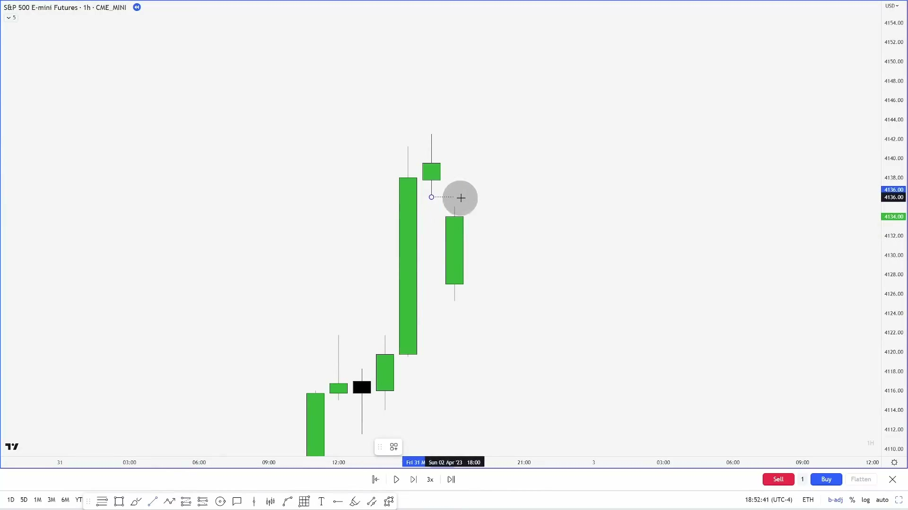

这里则是跳空缺口的例子。两根蜡烛之间完全没有发生交易。希望这期视频对你有帮助。如果觉得不错，请考虑点赞并订阅。

## [09:46](https://www.bilibili.com/video/BV12Net6GEKr/?t=586)

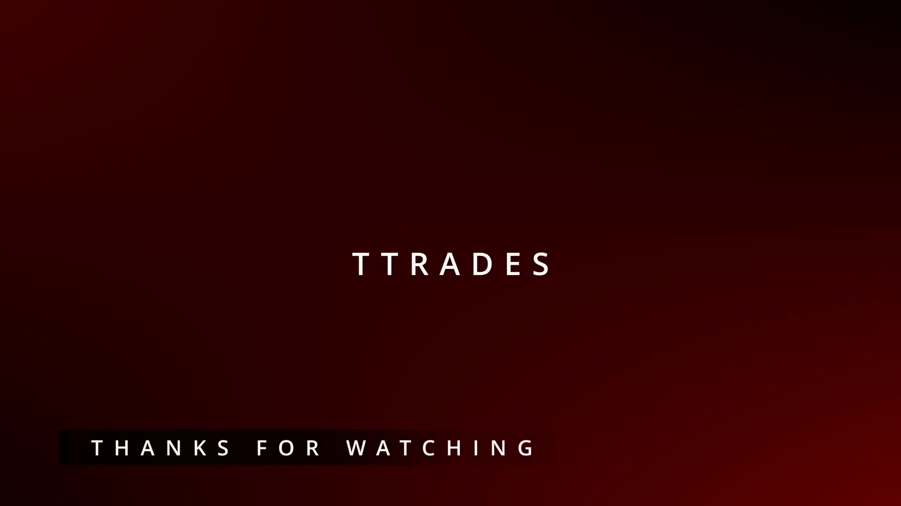

也祝你今天接下来的时间过得愉快。再见。

