# 【中配】ICT精讲四：A+入场模型

- 作者 耳朵数字观察
- 时长 10:58
- 来源 [https://www.bilibili.com/video/BV1N1hE6VEU9/](https://www.bilibili.com/video/BV1N1hE6VEU9/)
- 由 course2md 生成 · 33 张截图 / 40 段文字

---

## [00:00](https://www.bilibili.com/video/BV1N1hE6VEU9/?t=0)

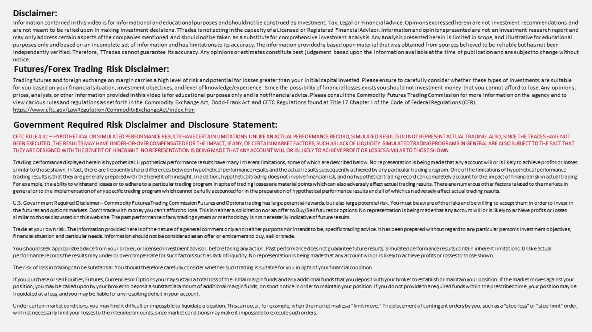

## [00:08](https://www.bilibili.com/video/BV1N1hE6VEU9/?t=8)

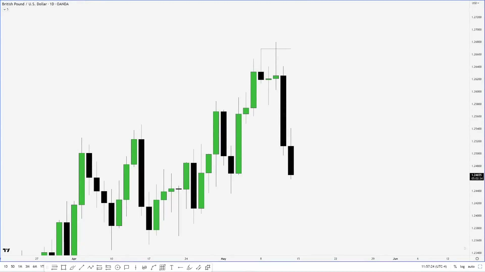

大家好，这期视频讲我的A加ICT。内权交易者体系入场检查清单。确定日线偏向或方向后，我会用这份清单确认所有条件都满足，再进场。我们先看清单，

## [00:22](https://www.bilibili.com/video/BV1N1hE6VEU9/?t=22)

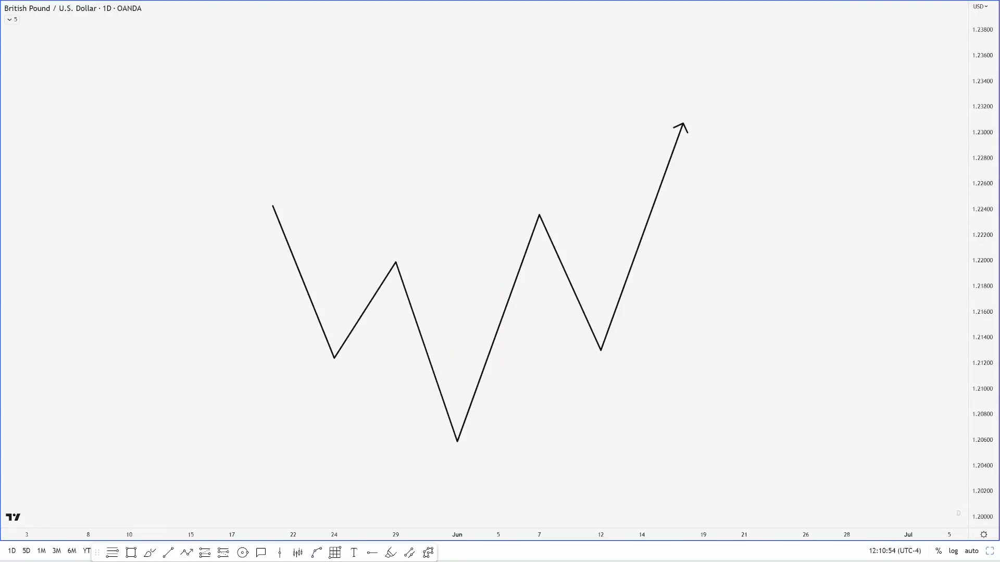

再看几个例子。这份清单主要关注几件事。我们按顺序来看。第一项是扫损。也就是先形成低点。随后，这个低点被扫过或跌破。下一项是市场结构转变。或出现位移。这意味着价格强势突破前高，下一项稍有弹性。通常，我希望价格回到这个区间的折价区。接着要找某种P/D阵列溢价与折价阵列。我通常更喜欢公允价值缺口，也可以是订单块这个区域里的O

## [01:02](https://www.bilibili.com/video/BV1N1hE6VEU9/?t=62)

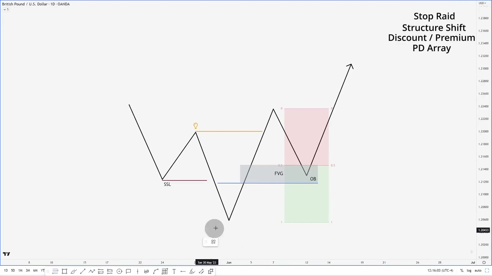

T E最佳交易入场区和破坏块。我也会使用。我知道画面有点乱，我把它展开，逐个展示。这些概念，

## [01:14](https://www.bilibili.com/video/BV1N1hE6VEU9/?t=74)

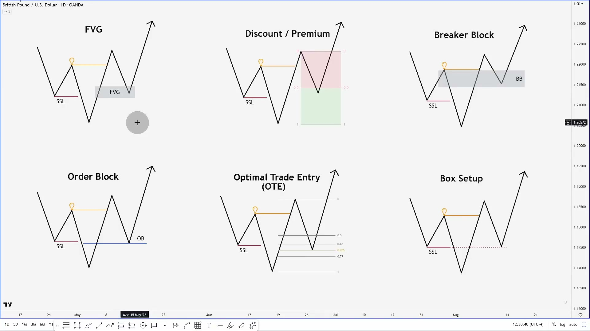

每一个都能单独作为入场模型。但在我的策略中。我喜欢把其中一到三个概念结合起来，例如，我会找OT E内的公允价值缺口，或者OT E内的箱体形态。

这些概念有很多种组合方式。我只选最吸引我注意的。下面看几个例子。展示他们单独使用。或组合使用的方式。第一个例子，

## [01:42](https://www.bilibili.com/video/BV1N1hE6VEU9/?t=102)

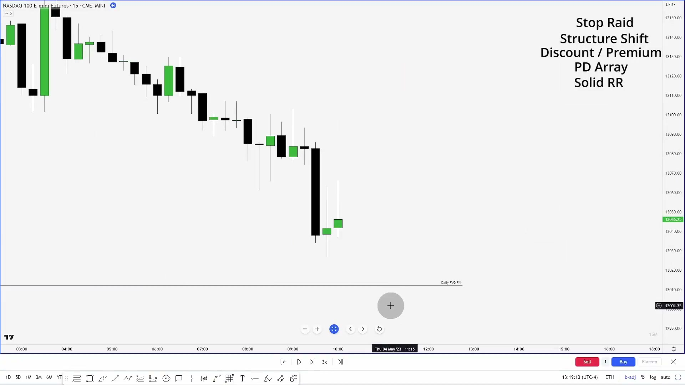

看纳斯达克十五分钟图，观察价格触及下方日线。公允价值缺口回补为市的走势。随着行情展开，首先注意这里聚集着卖方流动性。价格进入该位置后，反应不错。但结构转变了吗？还没有。

到下一根蜡烛，

## [02:08](https://www.bilibili.com/video/BV1N1hE6VEU9/?t=128)

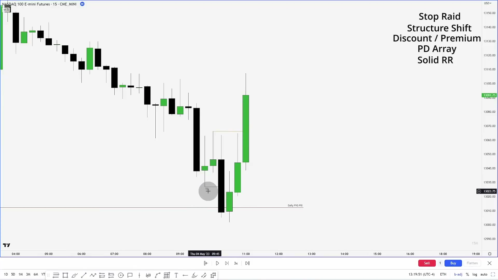

结构已经转变。这样，卖方流动性扫损和结构转变就都有了。现在开始找入场模型柱香来看。第一项是折价区与溢价区。

对于这段位移区间，理想情况下，我不会在零点五上方做多。我想在下方绿色区域做多。再用OTE细化。就能看到，上方是我不想做多的溢价区。并把折价范围缩小到这里的O T。接着可以找公允价值缺口，这里有一个很小的缺口，还有一个订单块。订单块是这里的收跌蜡烛，破坏块则是扫过流动性之前这些收涨蜡烛。

最后，对于箱体形态，我会等价格进入这个区域。

## [03:08](https://www.bilibili.com/video/BV1N1hE6VEU9/?t=188)

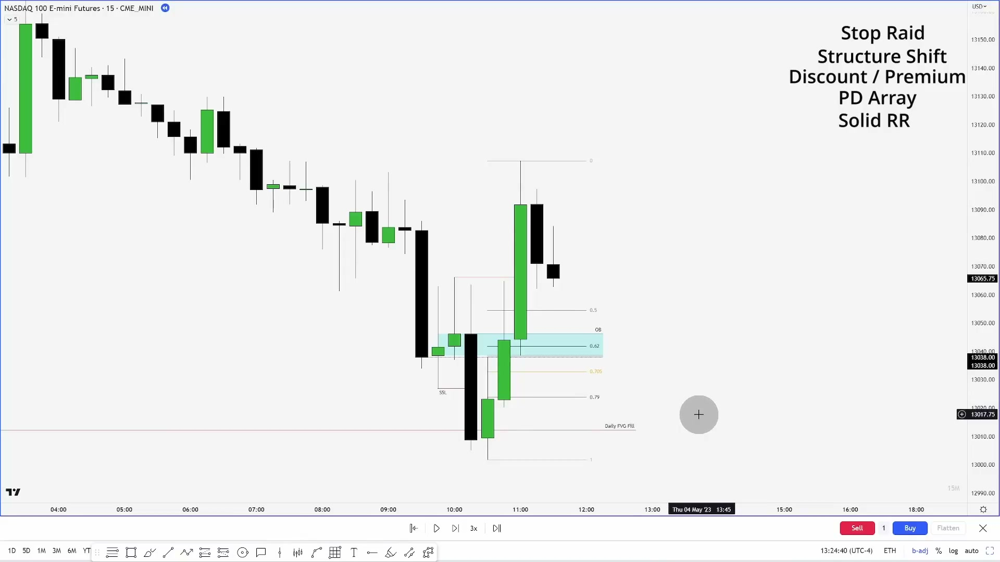

可以看到，这些概念全都出现了。那我该选择哪里进场？这取决于盈亏比和哪个位置最吸引我。

## [03:18](https://www.bilibili.com/video/BV1N1hE6VEU9/?t=198)

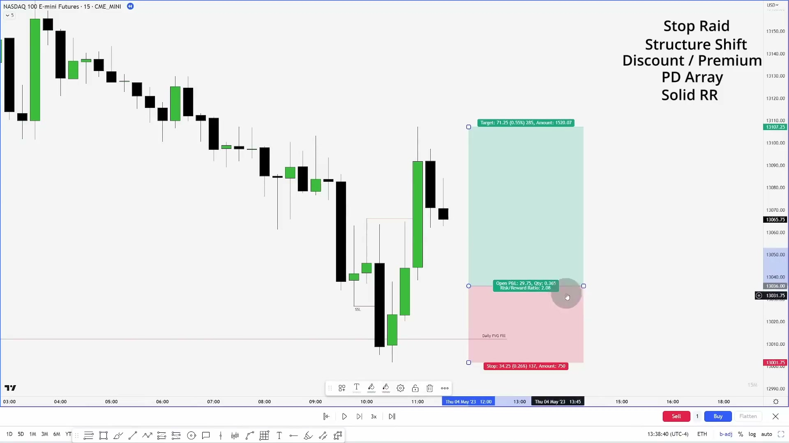

入场点越靠近止损，盈亏比就越高，但入场点放得越远。这笔交易也越可能无法成交。所以，我会在盈亏比。直观吸引力。和能够成交之间找平衡。如果是我看这笔交易。会怎么做？首先标出O T E。然后，在这附近寻找P D阵列。这里能看到什么？这里有一个公允价值缺口，而且嵌套在这个订单块里面。它也与箱体形态重合。所以，我个人会选择在这里进场。

止损放在这个低点，第一次分批止盈放在这里。再看向上方的买方流动性。让行情继续展开。这里。就是我的分皮止盈位。

## [04:14](https://www.bilibili.com/video/BV1N1hE6VEU9/?t=254)

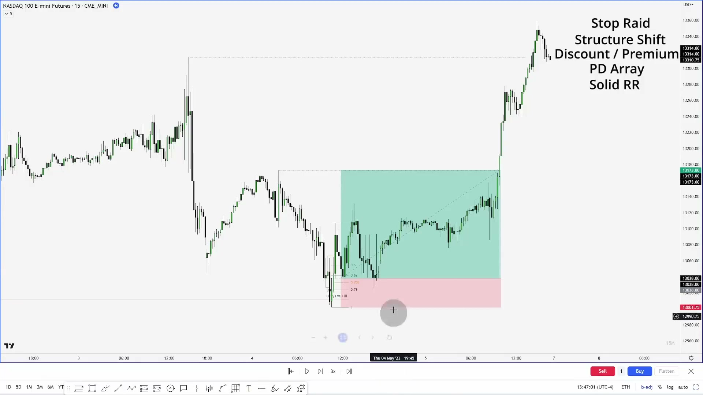

之后要看我是否把止损移到保本位，价格最终触及了这里的买方流动性。

## [04:20](https://www.bilibili.com/video/BV1N1hE6VEU9/?t=260)

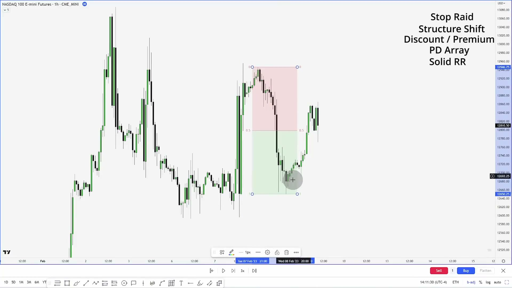

下一个例子，看这个区间。这里既处于该区间的溢价区，也处于向下位移区间的溢价区，下方聚集着这些相等低点。我们深入看看，现在是五分钟图。

## [04:34](https://www.bilibili.com/video/BV1N1hE6VEU9/?t=274)

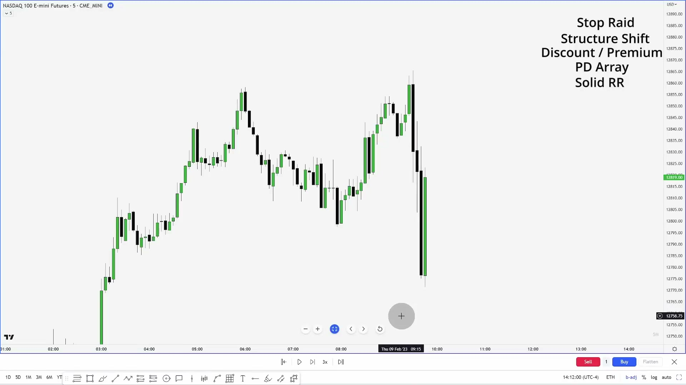

你可以暂停一下。先看看自己能发现什么。我首先注意到，这里的买方流动性已被扫过。价格先上冲，随后强势离开。

观察这个结构，可以看到高点。低点和更高的高点。我注意到这里有一个破坏块。接着看破坏块内部。这里正好有一个供应价值缺口。我希望价格回到这个破坏块，最深进入这个供应价值缺口。如果只按破坏块进场，大概会是这样。

但如果把范围缩小到公允价值缺口，就会是这样。让行情继续展开。如果我要分批止盈，并把前面提到的那些低点当做目标，大概会是这样。

## [05:32](https://www.bilibili.com/video/BV1N1hE6VEU9/?t=332)

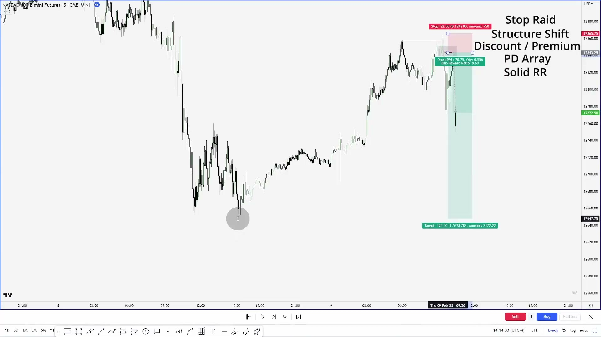

可以看到。价格最终触及了那些低点。

## [05:40](https://www.bilibili.com/video/BV1N1hE6VEU9/?t=340)

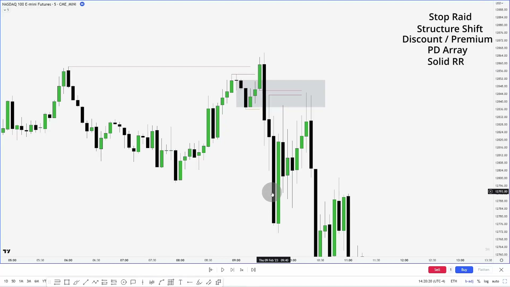

回顾清单。这里有扫损和市场结构转变。随后，价格回到带有P

## [05:50](https://www.bilibili.com/video/BV1N1hE6VEU9/?t=350)

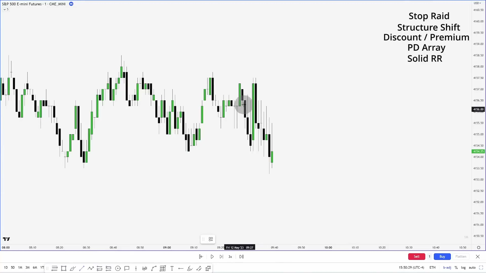

D阵列的溢价区，再离开。下一个例子，看E S标普五百期货一分钟图。注意。这里有一个高点。

## [06:00](https://www.bilibili.com/video/BV1N1hE6VEU9/?t=360)

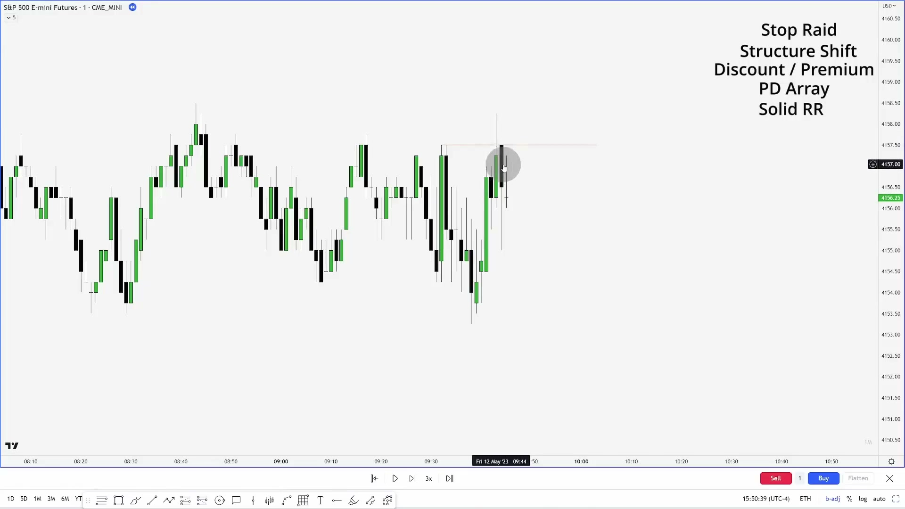

可以看到。价格突破高点后，又收回。目前，蜡烛实体守住了这个位置。

## [06:12](https://www.bilibili.com/video/BV1N1hE6VEU9/?t=372)

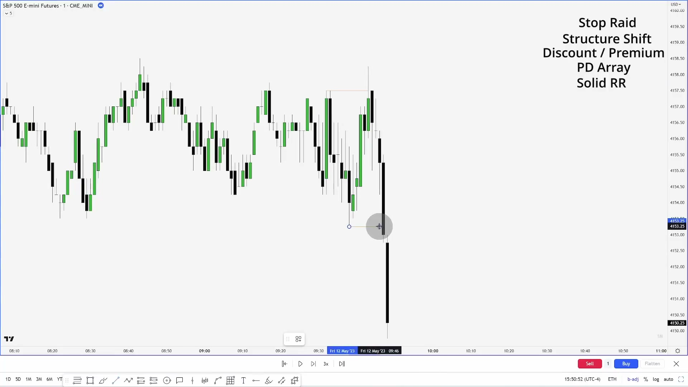

这里是扫损，这里是结构转变。现在我要找什么？等这个低点形成后，我会在O T E或溢价区里寻找P D阵列。

## [06:24](https://www.bilibili.com/video/BV1N1hE6VEU9/?t=384)

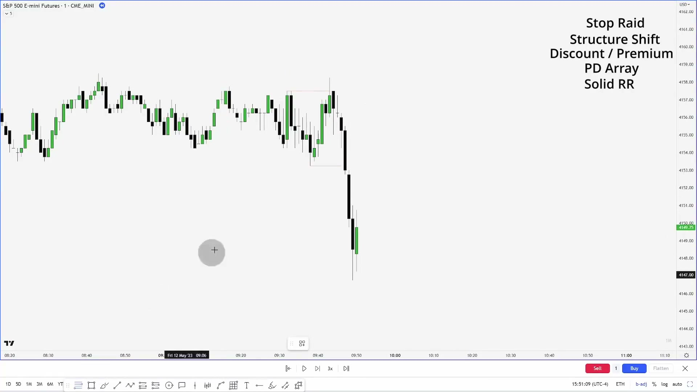

如果那就是低点，我会标出斐波那契区间。这个区域里有什么？这里有一个破坏块和一个公允价值缺口。让行情继续展开。价格向上，回补公允。价值缺口，并进入OTE。

## [06:46](https://www.bilibili.com/video/BV1N1hE6VEU9/?t=406)

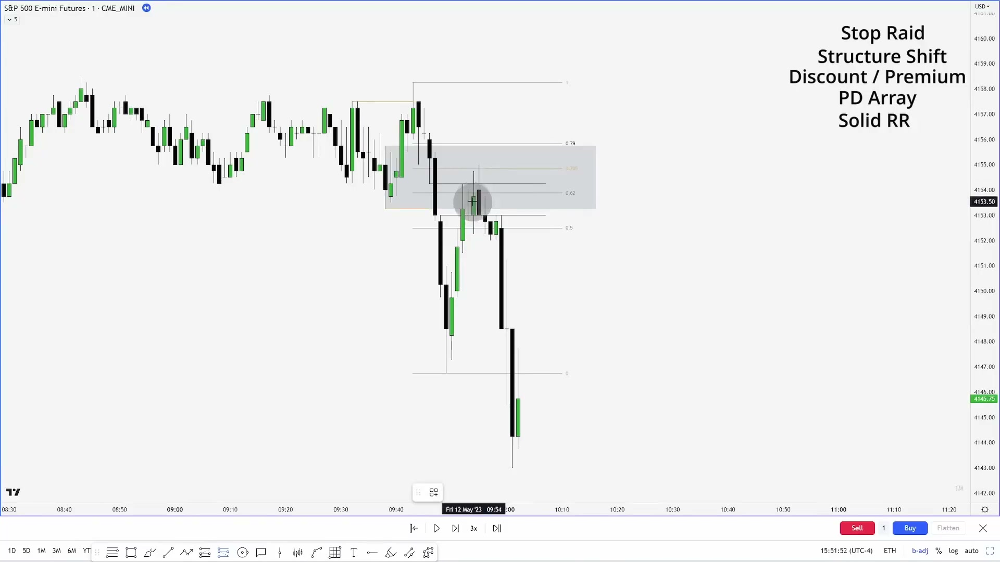

随后，继续下跌。我的风险设置大概会是这样。

## [06:52](https://www.bilibili.com/video/BV1N1hE6VEU9/?t=412)

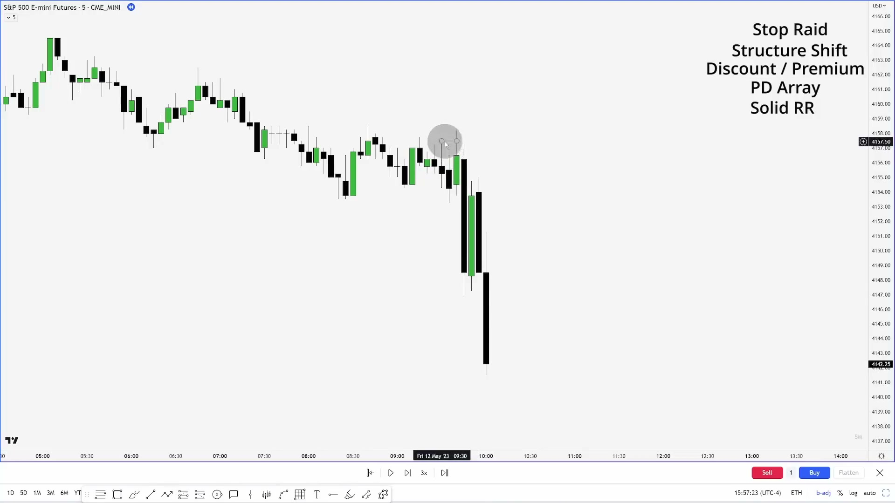

现在切到五分钟，图看同一个例子。形态相同，但看起来略有不同。注意，这里上冲行情扫过了这个高点。也可以看作这个高点。最后出现强势向下位移，这就是结构转变。标出O T E后，价格回升，进入O T E。这个区域里有什么P D阵列？这里有一个订单块，我会在这个订单块进场。目标是新低。止损放在订单块高点。

## [07:24](https://www.bilibili.com/video/BV1N1hE6VEU9/?t=444)

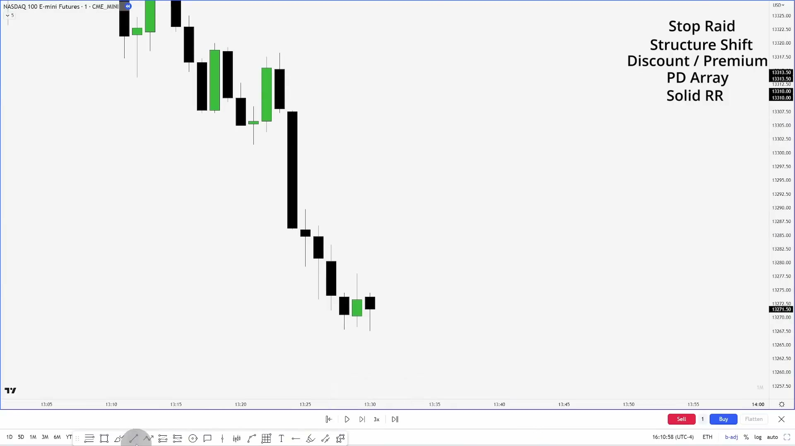

下一个例子是。纳斯达克，一分钟。都。

注意。价格确实比这个低点低了一个最小跳动，但我个人不算。随后，向上位移。符合条件吗？不符合。我要求位移前现有扫损，所以不把这次上行算作有效位移。价格似乎在这里受到支撑。随后，继续下跌。所以，我现在标出这个低点。接下来发生什么？价格先跌破区间，再回到区间内，强势下跌，又强势上涨。

## [08:04](https://www.bilibili.com/video/BV1N1hE6VEU9/?t=484)

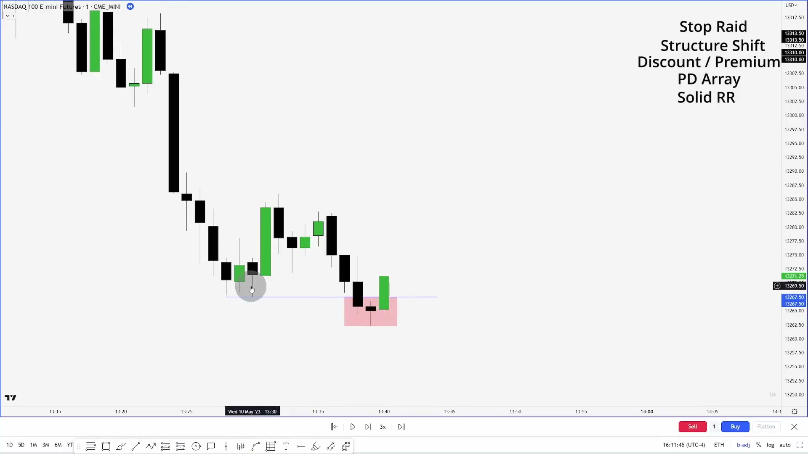

这就是区间偏离。先是吸筹，再是操纵。接下来，我想看到派发。理想情况下，我在等价格回测这段操作。然后，先触及这里的另一侧，再继续上涨。

我们看看接下来会怎样。

## [08:28](https://www.bilibili.com/video/BV1N1hE6VEU9/?t=508)

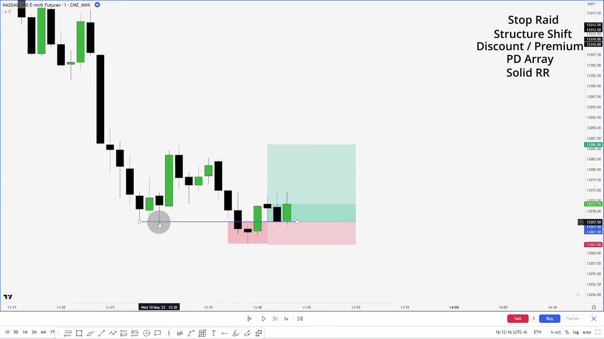

注意。这些蜡烛都没有烧在钱堤下方。价格向上运行，可以分批止盈。

## [08:38](https://www.bilibili.com/video/BV1N1hE6VEU9/?t=518)

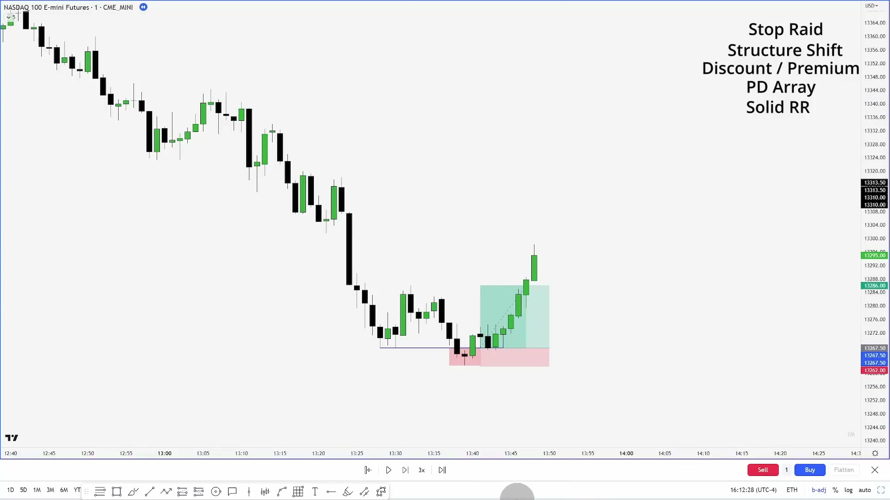

再看后续。上方聚集着大量流动性。价格到达目标，

## [08:46](https://www.bilibili.com/video/BV1N1hE6VEU9/?t=526)

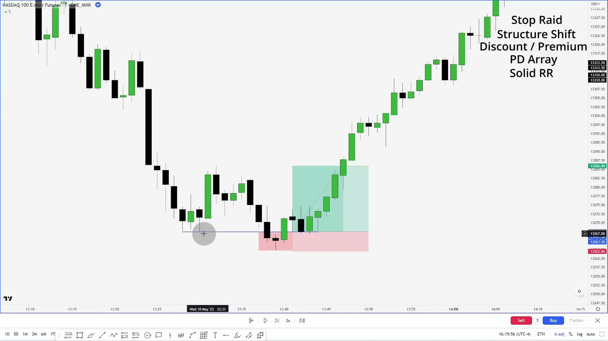

虽然进场前没有发生结构转变，但这是一次箱体形态入场。我加入这个例子是想说明：如果行情启动前没有低时间框架流动性扫损，我就没兴趣。

## [08:58](https://www.bilibili.com/video/BV1N1hE6VEU9/?t=538)

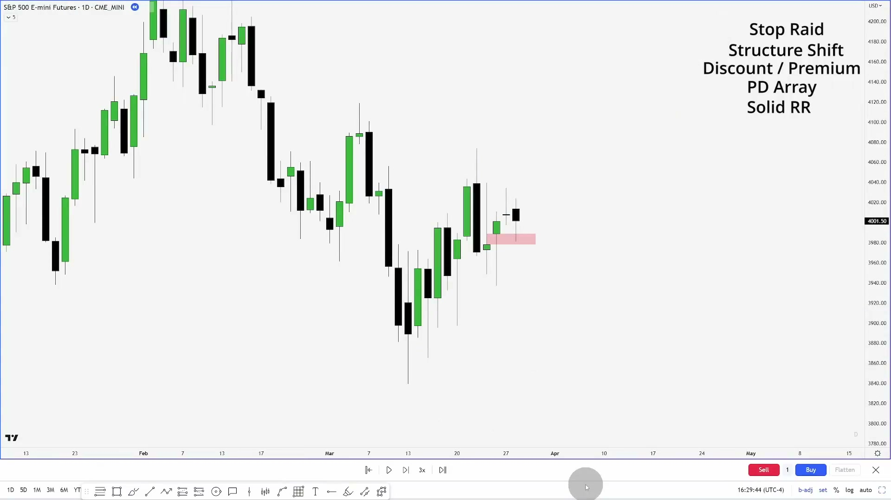

最后一个例子，我会从日线图一直看到五分钟图。

这里的关注点是E S上的成交量失衡。

## [09:08](https://www.bilibili.com/video/BV1N1hE6VEU9/?t=548)

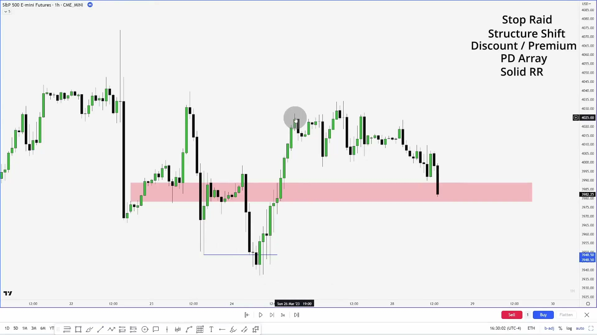

切到小时图，可以看到这里发生过扫损。最后出现向上位移，用斐波那契标出这段位移后，可以看到价格正回到小时图的平衡位，切到十五分钟图，

## [09:22](https://www.bilibili.com/video/BV1N1hE6VEU9/?t=562)

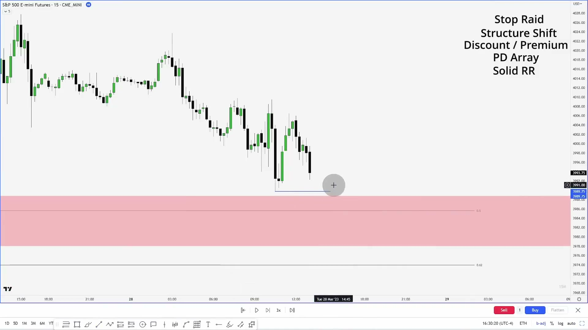

这里是平衡位，这里是卖方流动性。看看接下来会怎样。价格强势跌破。卖方流动性。进入关注区域。最后，出现向上位移。注意，这里确实有一个公允价值缺口。但它满足我的全部条件吗？不满足，因为它位于区间的一价区。

## [09:44](https://www.bilibili.com/video/BV1N1hE6VEU9/?t=584)

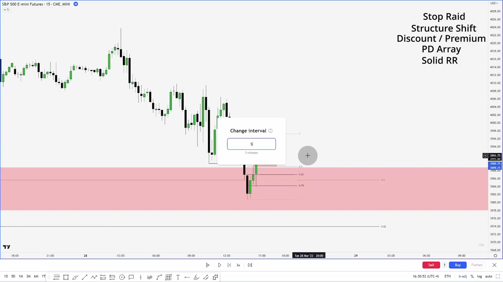

## [09:48](https://www.bilibili.com/video/BV1N1hE6VEU9/?t=588)

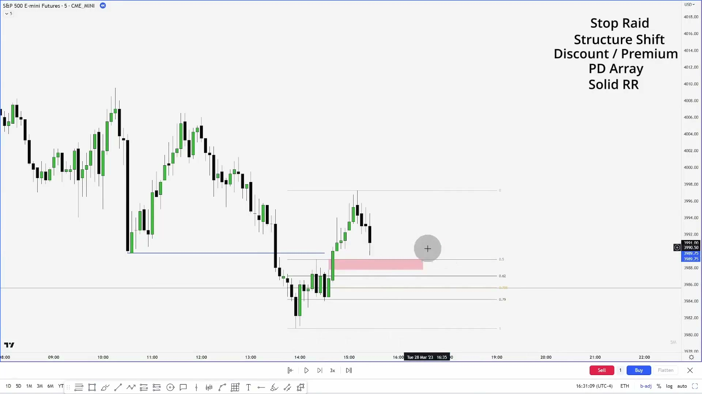

所以我切到五分钟图，并去掉关注区域，方便观察。这里有一个供应价值缺口。如果去掉处于溢价区的部分。就会是这样。

## [10:00](https://www.bilibili.com/video/BV1N1hE6VEU9/?t=600)

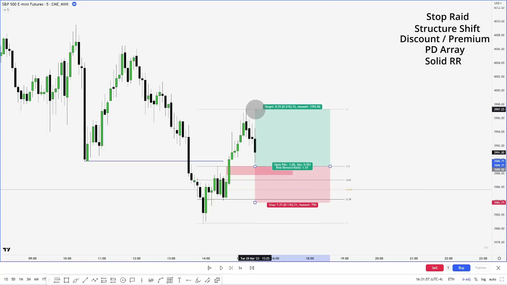

这里有订单块和公允价值缺口。所以，我会考虑在这里进场。止损放在订单块低点之后。分批止盈，或把止损移到保本位目标。是早盘最初形成的高点。之后，让鱼仓继续运行。现在，让行情展开。这里触发进场，入场位得到尊重。

## [10:26](https://www.bilibili.com/video/BV1N1hE6VEU9/?t=626)

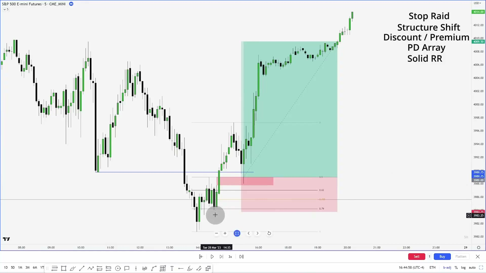

随后，价格向上位移。最后回顾。我要找扫损。结构转变。以及价格回到平衡位或OTE，再找一个吸引我的PD阵列，并管理风险，确保盈亏比合理。希望这期视频对你有帮助。如果有，请考虑点赞并订阅。祝你今天接下来一切顺利。再见。

## [10:48](https://www.bilibili.com/video/BV1N1hE6VEU9/?t=648)

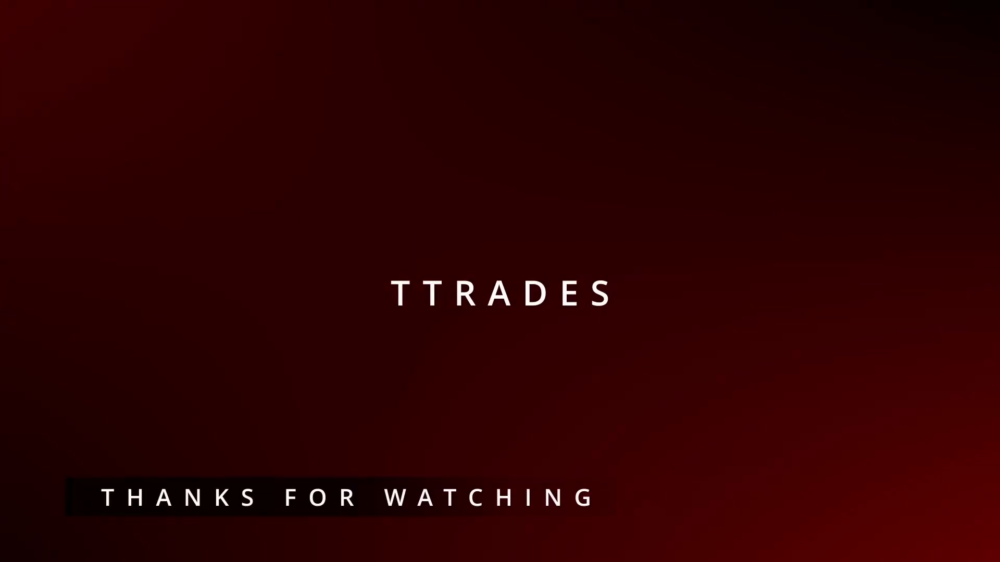

