# 【中配】ICT进阶三：ICT 如何判断日内偏向

- 作者 耳朵数字观察
- 时长 15:03
- 来源 [https://www.bilibili.com/video/BV1haaV66EFs/](https://www.bilibili.com/video/BV1haaV66EFs/)
- 由 course2md 生成 · 55 张截图 / 85 段文字

---

## [00:00](https://www.bilibili.com/video/BV1haaV66EFs/?t=0)

我掌握I C T的daily bias日线偏向之后，不到四个月就靠交易赚了二百五十万美元。接下来，我会把整套流程完全摊开，让你也能轻松判断市场方向。在我做出这套找

## [00:12](https://www.bilibili.com/video/BV1haaV66EFs/?t=12)

daily bias 的两步法之前，我每笔交易都想太多，也很难保持稳定。可一旦学会这个方法，我马上就开始稳定盈利。你们也看到了，单次出金就有二百五十万美元，证据在这里。但真正重要的是，你怎么复制我的流程，少走几年亏钱和挫败的弯路。

## [00:30](https://www.bilibili.com/video/BV1haaV66EFs/?t=30)

这就是这期视频的目标，把我刚入门时最希望有人教我的那套系统教给你们。

## [00:36](https://www.bilibili.com/video/BV1haaV66EFs/?t=36)

我花了十年才开始稳定赚钱。有了这些内容，我的目标是让你们一年内做到，甚至更快。所以第一步是把 daily bias 简化到连纯新手都弄不砸。那我们直接开始。

## [00:48](https://www.bilibili.com/video/BV1haaV66EFs/?t=48)

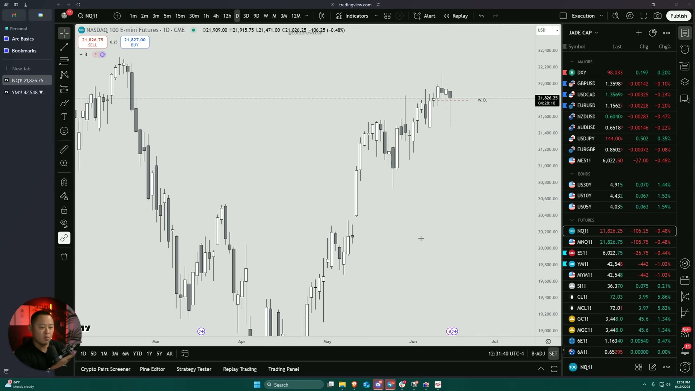

这是我交易生涯里最强的一次突破。你们可以想象一下，如果已经知道大方向，交易会是什么样？进场模型其实并不难，难的是知道该做哪些，该避开哪些。如果你知道怎么找到最好的交易，你还会不赚钱吗？你们一直卡着，很大原因是被那些自己都不交易的大神带偏了。只要 daily bias，其实只要两步。别把自己搞复杂。我们看的是溢价、折价以及 Power of Three。

## [01:22](https://www.bilibili.com/video/BV1haaV66EFs/?t=82)

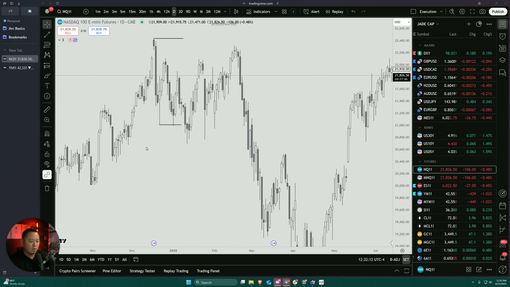

那什么是溢价折价？我很快带你们看一下纳斯达克的日线周期，把日线摆动点标出来。

## [01:28](https://www.bilibili.com/video/BV1haaV66EFs/?t=88)

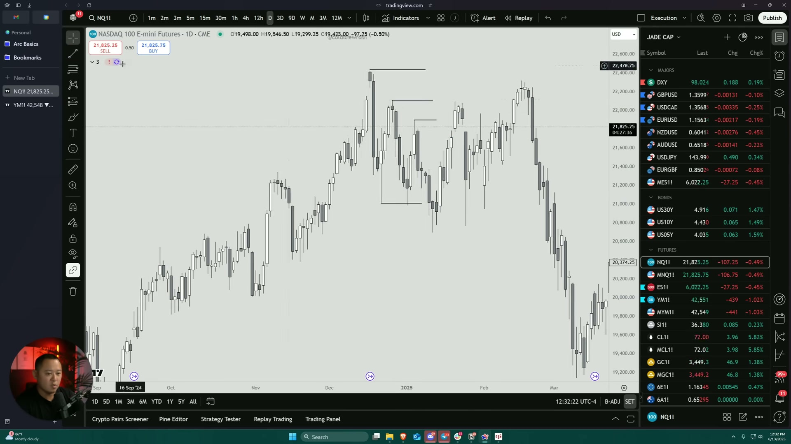

找市场里的摆动点时。摆动点是由三根K线构成的形态。

## [01:40](https://www.bilibili.com/video/BV1haaV66EFs/?t=100)

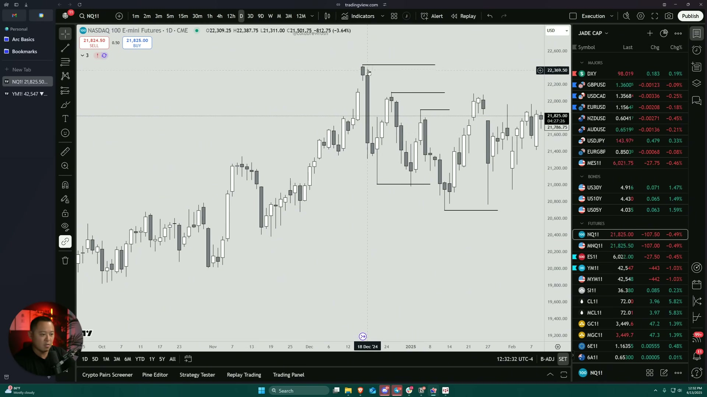

先看摆动高点。两边都是更低的高点，中间就形成摆动高点。摆动低点，

## [01:48](https://www.bilibili.com/video/BV1haaV66EFs/?t=108)

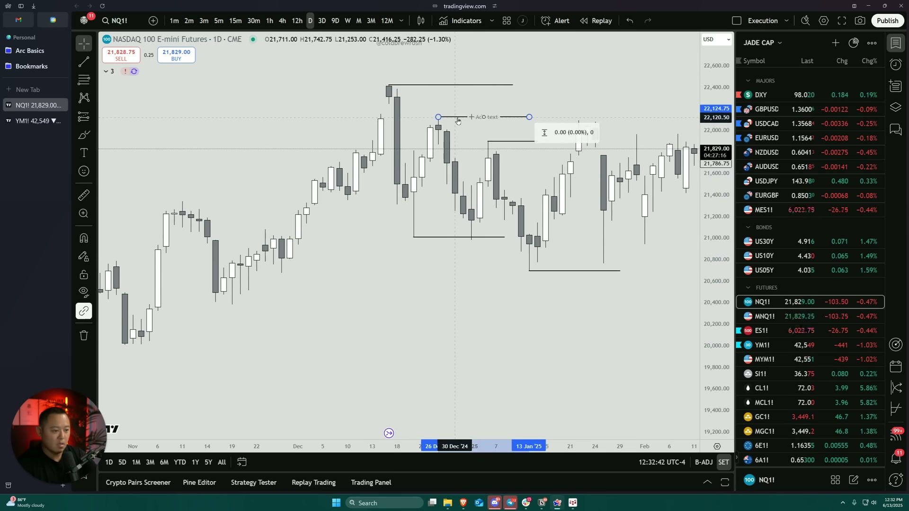

则是两边都是更高的低点。好，然后直到这里才会再出现下一个摆动点。摆动点标好之后，区间就很清楚了。

## [02:00](https://www.bilibili.com/video/BV1haaV66EFs/?t=120)

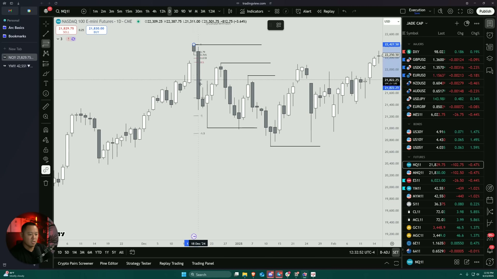

接下来用斐波那契回撤工具把它画出来。

把斐波那契从摆动高点锚到摆动低点。

## [02:12](https://www.bilibili.com/video/BV1haaV66EFs/?t=132)

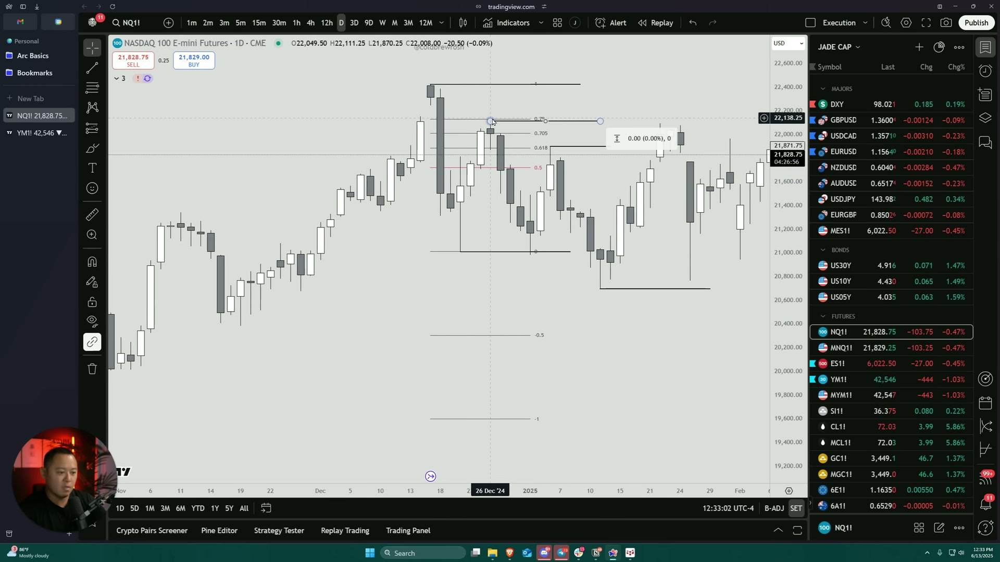

如果市场倾向于走低，百分之五十以上就是溢价区，百分之五十以下就是折价区。交易思路判断整体偏向时，我们用摆动点，

## [02:24](https://www.bilibili.com/video/BV1haaV66EFs/?t=144)

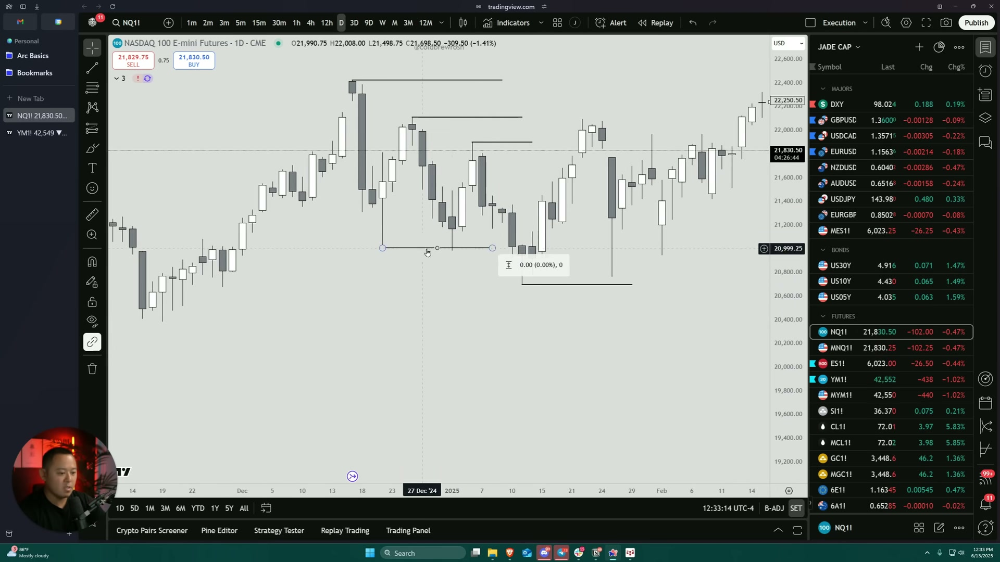

再加上溢价对折价，让自己站在未来最可能的那一边。

好，标出具体摆动点之后，

## [02:38](https://www.bilibili.com/video/BV1haaV66EFs/?t=158)

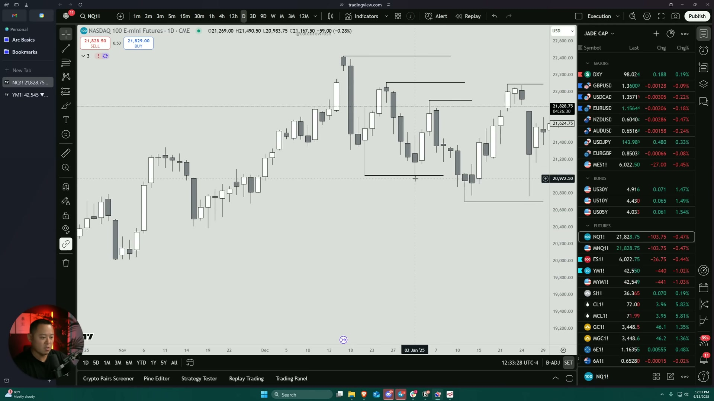

也许价格扫过某个摆动点，却没能收盘穿越。接着出现摆动低点，给第二天的看涨走势提供条件。这就是你们可以拿去复盘的例子。

## [02:50](https://www.bilibili.com/video/BV1haaV66EFs/?t=170)

进去量这些K线。

甚至直接在日线K线上用斐波那契回撤。

## [02:58](https://www.bilibili.com/video/BV1haaV66EFs/?t=178)

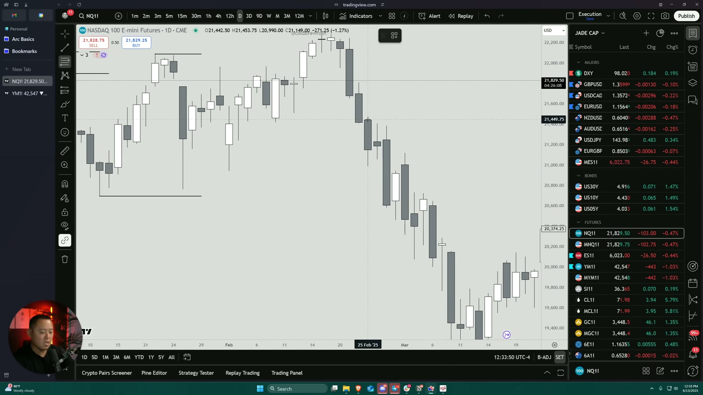

我们就拿单根日线来说。画出前一日的高点和低点。如果我们预期看跌，你们就能看到影线里的反应。

## [03:10](https://www.bilibili.com/video/BV1haaV66EFs/?t=190)

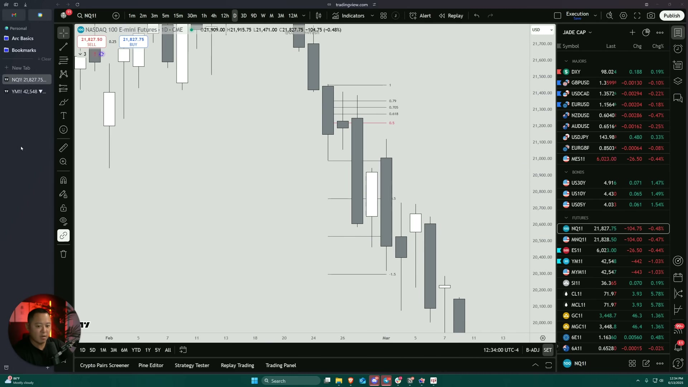

看这个K线，把日线高点锚到日线低点，把它当成交易区间。

这样就能分出溢价区和折价区。

## [03:30](https://www.bilibili.com/video/BV1haaV66EFs/?t=210)

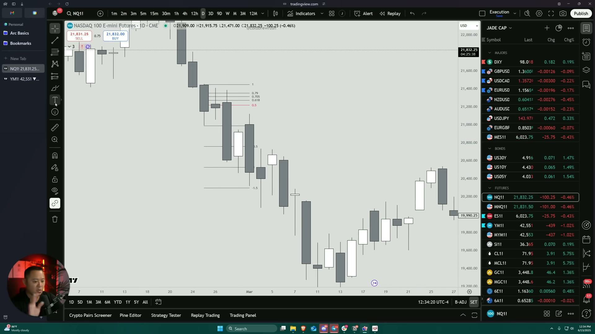

说到溢价折价，后面还有很多I C T的P D arrays，你们可能知道，也可能不知道。流动性扫荡F V G Breaker。

这些都要排在先搞清方向之后。

## [03:44](https://www.bilibili.com/video/BV1haaV66EFs/?t=224)

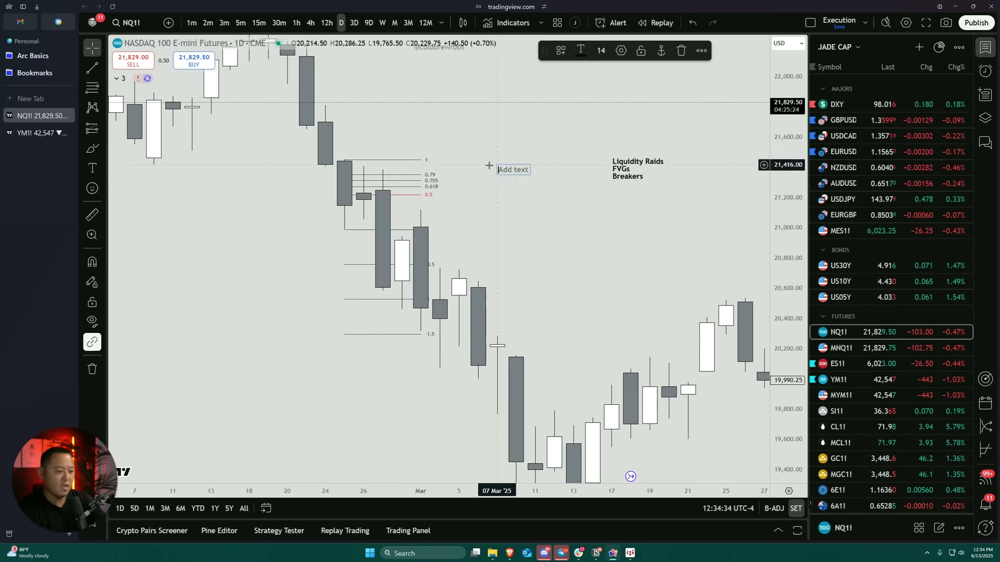

如果要画清楚我的流程图，说明我怎么判断市场会往哪走。

第一步，绝不是先找进场形态。很多交易者就败在这儿，丢掉了大周期方向。决定怎么做时，我们要先搞清大周期的溢价、对折价。

等我们对可能去向有了把握。啊啊啊！我画个箭头，这就形成我们的大周期偏向。啊啊！

如果我们在溢价区有预期，市场要往下偏向，一下子就有了。

## [04:32](https://www.bilibili.com/video/BV1haaV66EFs/?t=272)

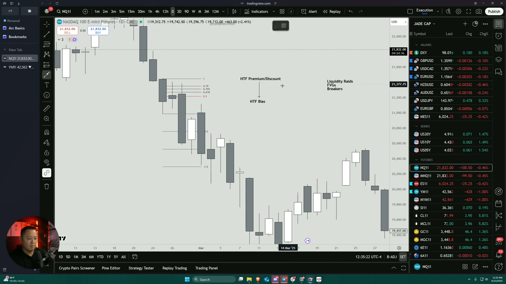

这一步清除之后，偏向才会落到小周期的进场形态上。

最关键的是，搞清楚昨天是创了更高高点，

## [04:44](https://www.bilibili.com/video/BV1haaV66EFs/?t=284)

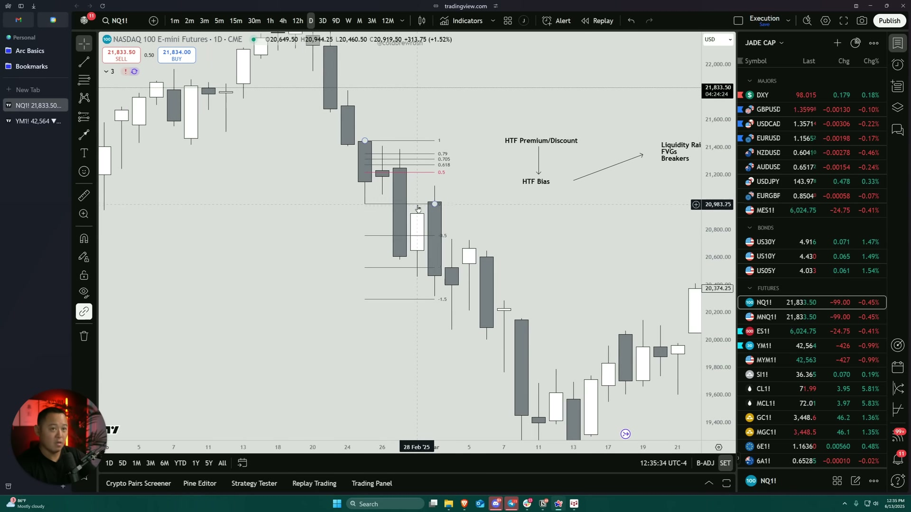

还是更高低点。有没有尊重前一日高点？有没有走到具体的 P D R

## [04:52](https://www.bilibili.com/video/BV1haaV66EFs/?t=292)

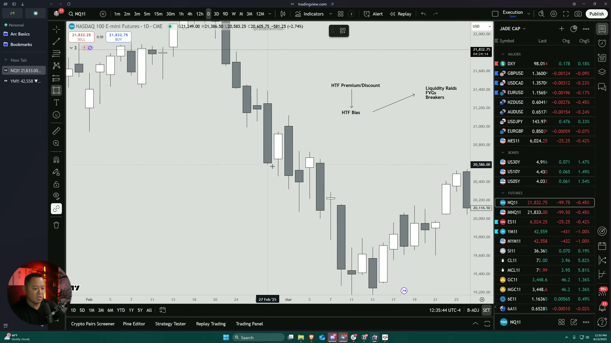

A I S E？比如这里，假设就这两天这根还是创了更低一点，对吧？

所以，这天既有更低低点，也有更低高点。我们仍处在看跌环境里，但扫过前一日高点，并不等于马上就要转涨。因为这里还有别的位在起作用，比如就压在前一日高点上方的日线FVG。

## [05:18](https://www.bilibili.com/video/BV1haaV66EFs/?t=318)

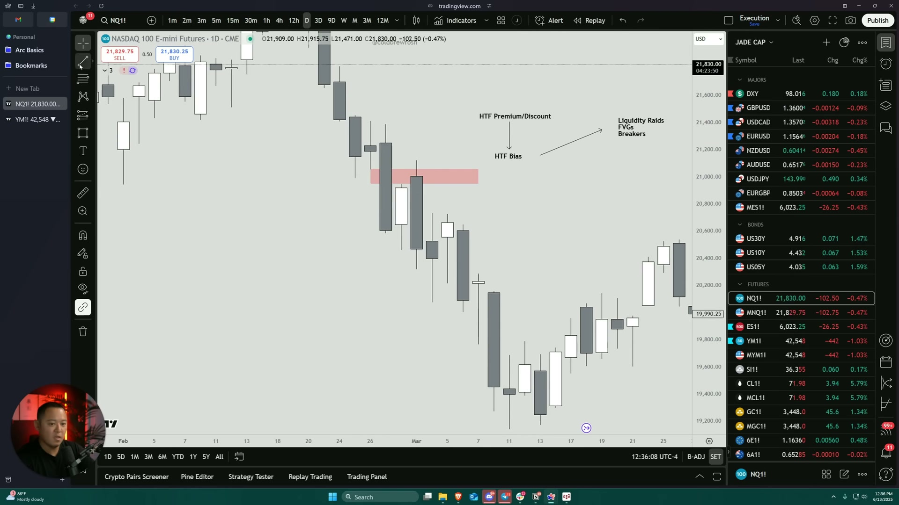

这时候，我们才去找流动性扫荡。在我看来，一切都从大周期溢价折价开始。

## [05:28](https://www.bilibili.com/video/BV1haaV66EFs/?t=328)

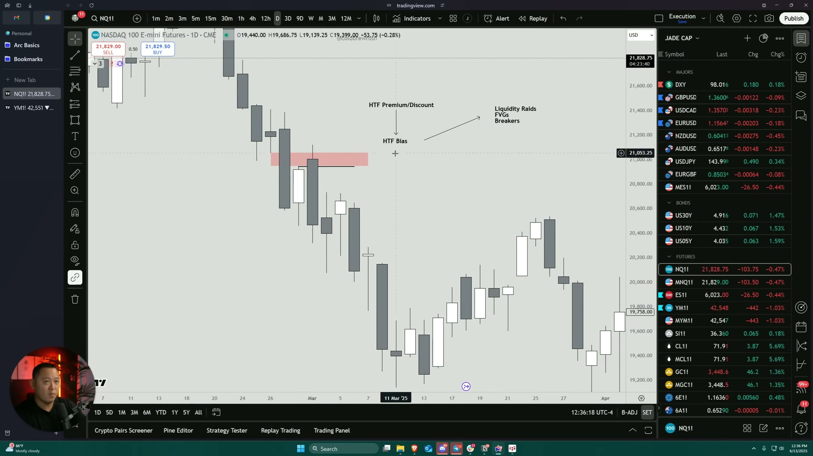

你可以找摆动点，比如在这里找。

## [05:36](https://www.bilibili.com/video/BV1haaV66EFs/?t=336)

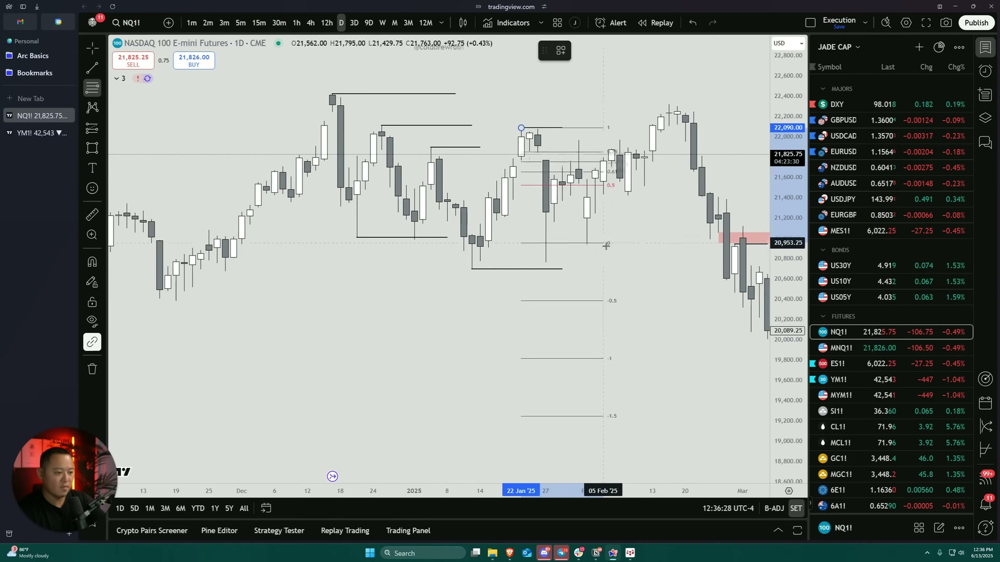

也许你把斐波那契从这高点画到这低点，中间就会出现摆动点。这里有个不错的回落，没打到就低。然后就横盘震荡。或者，你也可以直接用K线本身。某天想做多或做空，就直接画前一日高点到低点。

## [05:56](https://www.bilibili.com/video/BV1haaV66EFs/?t=356)

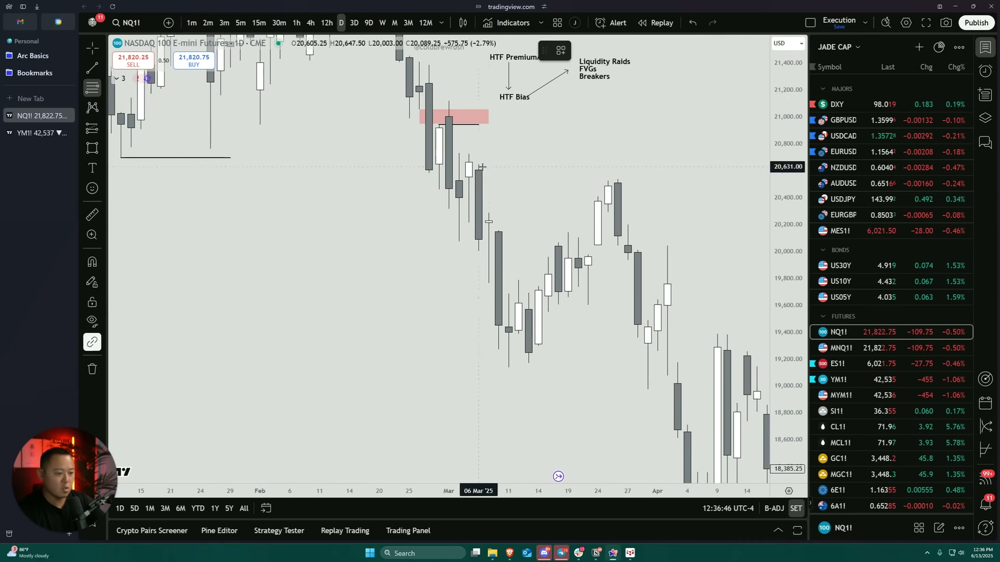

## [06:04](https://www.bilibili.com/video/BV1haaV66EFs/?t=364)

如果我们在溢价区交易，而市场要往下走，那上面这些位置做空远好过在下面追空。总之，

## [06:14](https://www.bilibili.com/video/BV1haaV66EFs/?t=374)

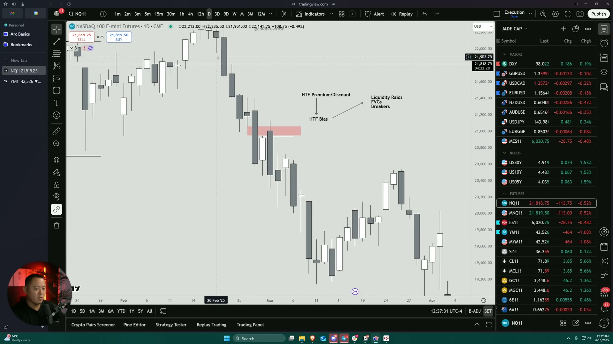

大周期方向能让你跟住大趋势，and七。

这样就不容易被一堆小周期进场骗出去。

## [06:26](https://www.bilibili.com/video/BV1haaV66EFs/?t=386)

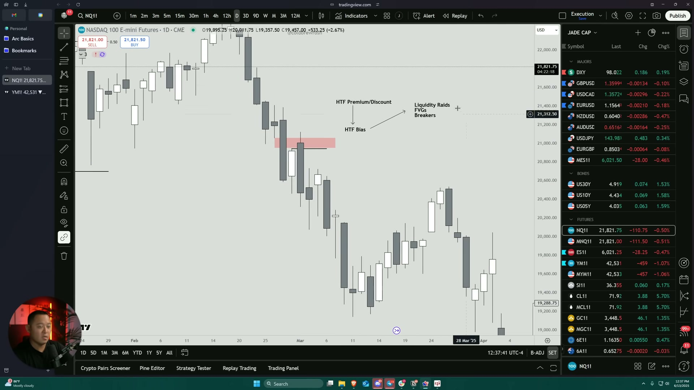

如果我在小周期看到形态，比如看涨F E G。但大周期偏向是向下，这些单我基本都会避开。

下一点要讲Power of Three。Power Three到底是什么？

## [06:44](https://www.bilibili.com/video/BV1haaV66EFs/?t=404)

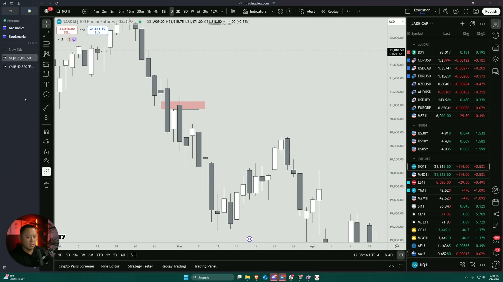

简单说，Power Three其实每根K线都会发生。

但这节课我们只谈日线，每根日线都有开盘、最高、最低、收盘。

每根儿里面都带着这个签名结构，我画出来，让你们直观看到。

看空时是开盘高点低点再收盘；如果看涨，则是开盘低点高点再收盘。市场本质上就是这样走的。

## [07:22](https://www.bilibili.com/video/BV1haaV66EFs/?t=442)

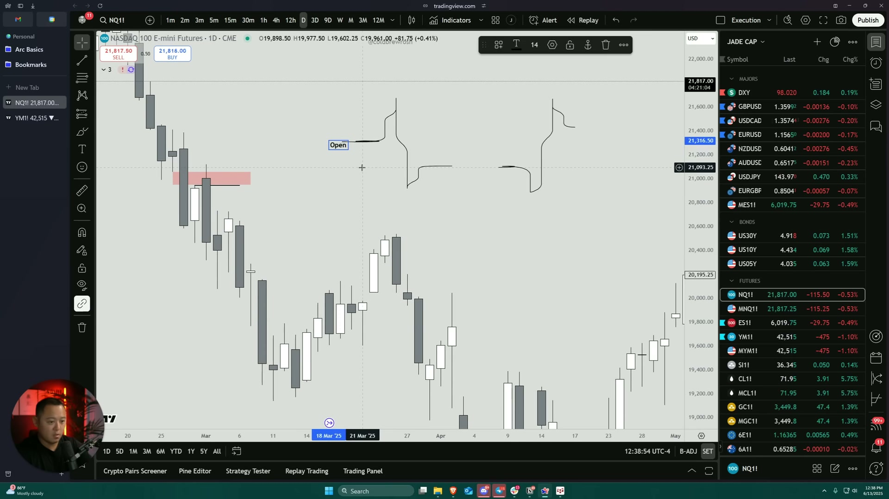

这里就是开盘高点、低点，然后收盘。

这些都是在告诉我们，该怎么在一根日线里给自己站位。

我们有大周期偏向，也有预期价格会去的目标位。

## [07:54](https://www.bilibili.com/video/BV1haaV66EFs/?t=474)

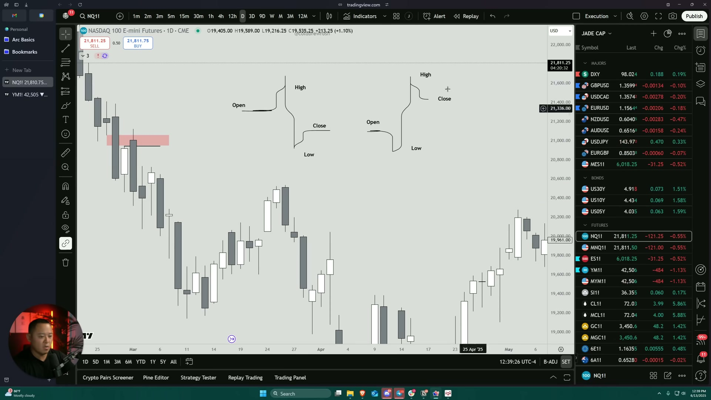

接下来就是执行，怎么在这根日线里真正下单？我们降到小周期，看看有了既定偏向时，我会盯什么。

核心就看一件事儿，无论我看空还是看多，我希望看到价格先打到开盘价下方或上方。

## [08:16](https://www.bilibili.com/video/BV1haaV66EFs/?t=496)

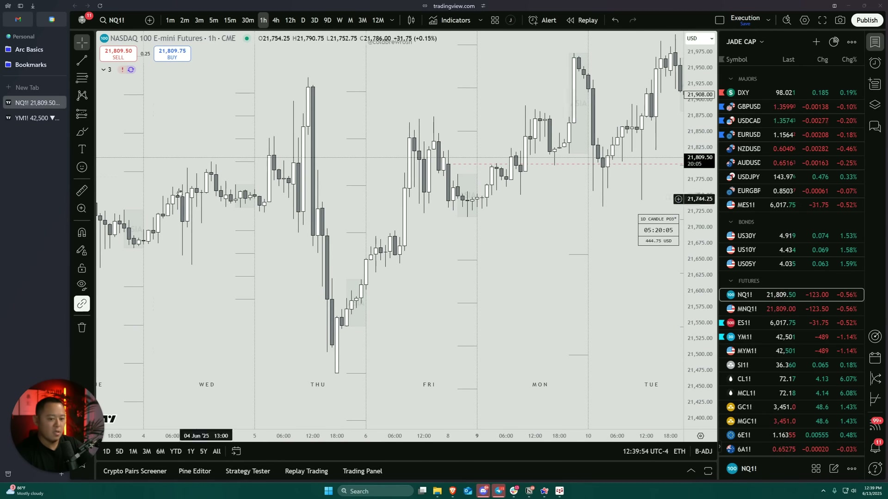

看这里的开盘价。我一直用午夜作为分界。这根收音了。

## [08:26](https://www.bilibili.com/video/BV1haaV66EFs/?t=506)

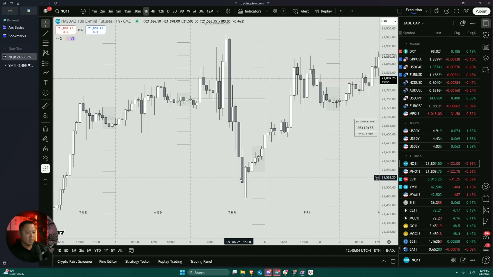

如果我想做空，我会找开盘价上方的价位去布局，因为能在开盘上方做空。

## [08:38](https://www.bilibili.com/video/BV1haaV66EFs/?t=518)

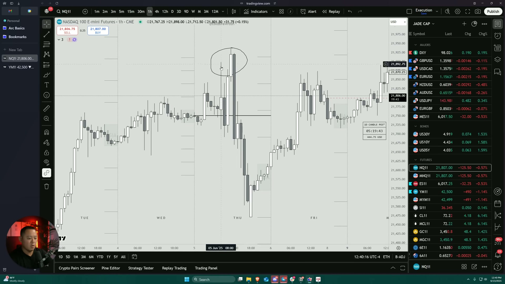

成交价更好，

## [08:42](https://www.bilibili.com/video/BV1haaV66EFs/?t=522)

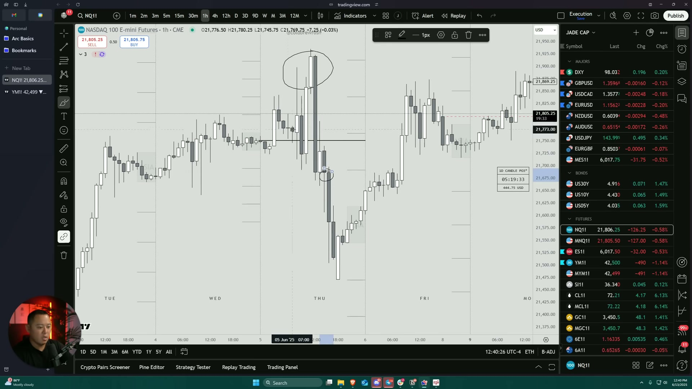

盈亏比也远好过在下面追空。

很多人栽，就栽在。跌的时候追空，涨的时候追多。你得把心态反过来。

市场往上走时，如果你看空，就要在上涨过程里找做空形态。

## [09:08](https://www.bilibili.com/video/BV1haaV66EFs/?t=548)

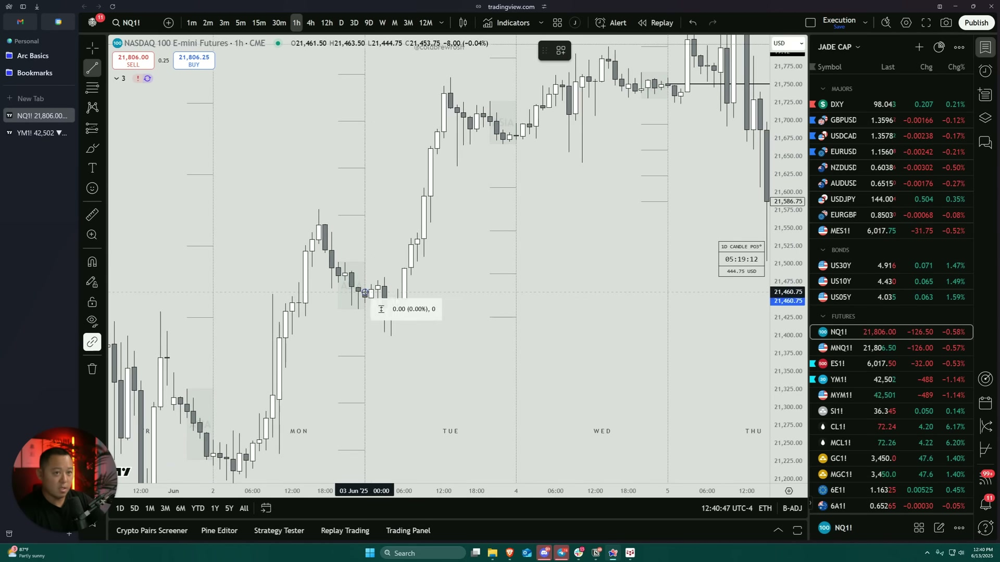

看涨的日子，则反过来，这是个很好的例子。开盘在这里。我要找的是那一波下冲，因为想布局做多的人在这里进场，会比开盘上方追多好得多。

风险更小，盈亏比更好，也不会追着已经跑远的价格。

## [09:32](https://www.bilibili.com/video/BV1haaV66EFs/?t=572)

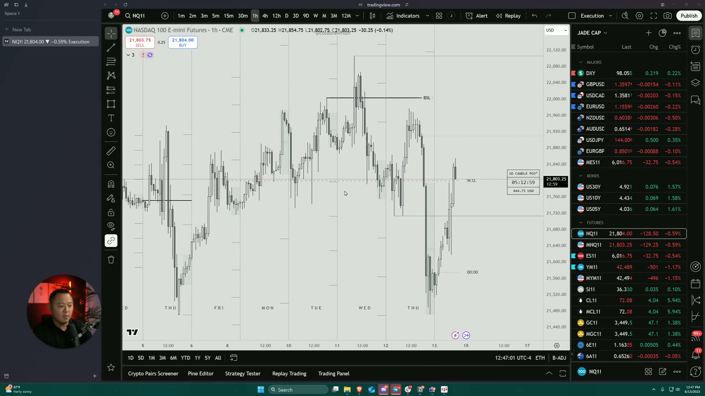

你们现在大致明白我怎么用溢价、折价来理解 daily bias。但如果不通时机，这两步其实都使不上力。

另外，如果你进场总不稳定，

## [09:46](https://www.bilibili.com/video/BV1haaV66EFs/?t=586)

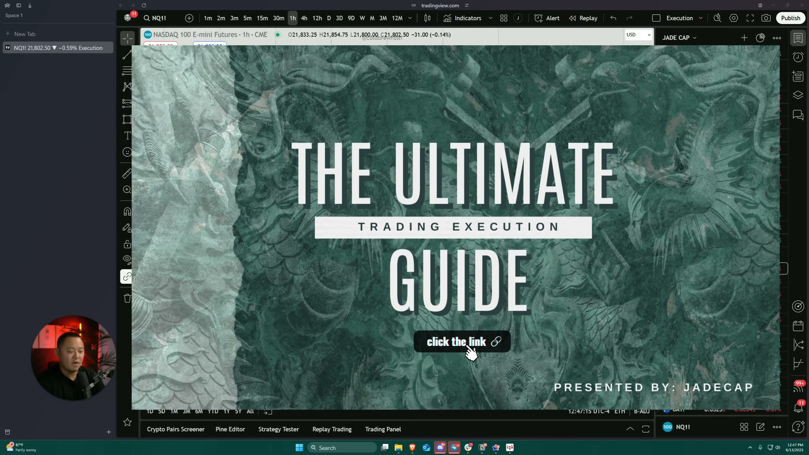

我做了一份简化指南，拆开讲，我怎么找最好的交易，链接在简介里。说到时机。很多人能判断偏向，

## [09:56](https://www.bilibili.com/video/BV1haaV66EFs/?t=596)

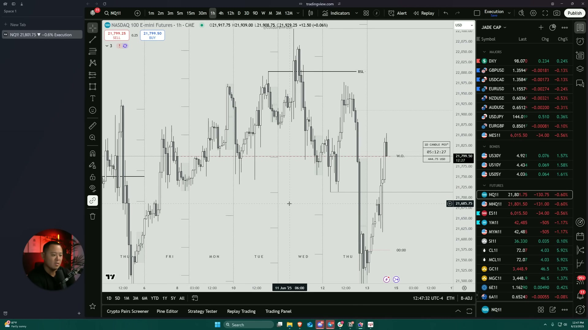

却不知道什么时候该做具体形态，环境对不上时，又该怎么避开？

举个例子。某天，我看涨。

## [10:06](https://www.bilibili.com/video/BV1haaV66EFs/?t=606)

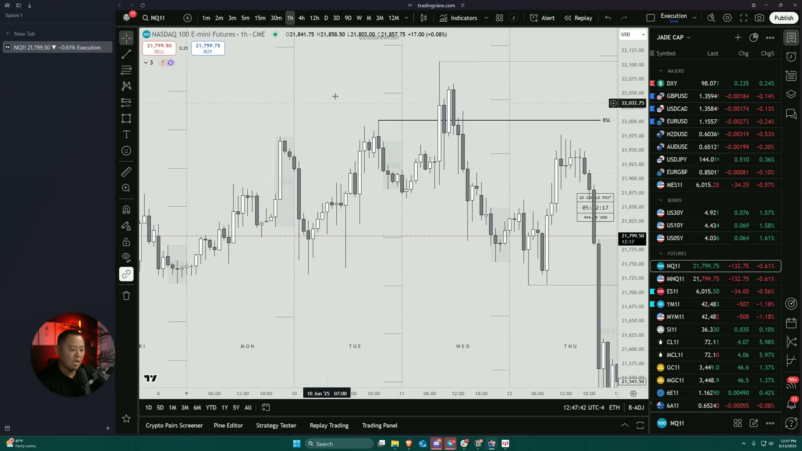

但我知道，明天有CPI。周三公布CPI的话，我通常要等消息出来之后再交易。很多交易者就亏在这儿，根本不懂环境，还以为光靠 daily

## [10:22](https://www.bilibili.com/video/BV1haaV66EFs/?t=622)

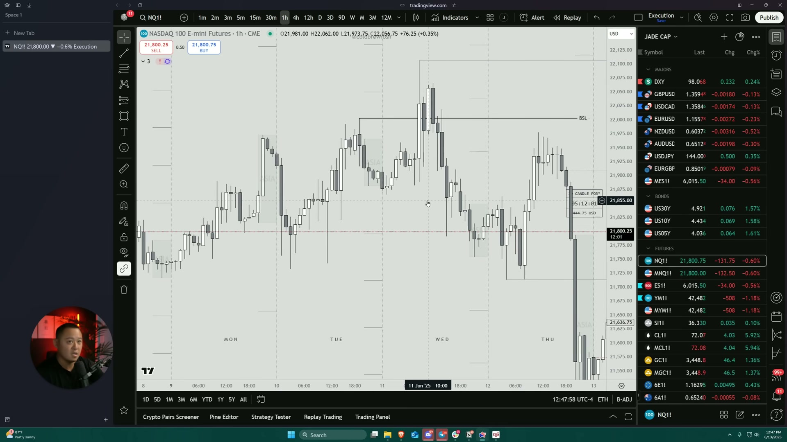

bias 就能一路带到稳定盈利的应许之地。

时机极其重要，所以看涨又碰上明天CPI，我会找消息之后的交易。

而且，这个看涨偏向本身要有框架，也要讲得通。

可CPI公布时，我们扫掉了买方流动性，也就是前一日高点。

从实际上看，这跟我看涨完全对不上。上涨时，我真正想看到的是向下的操控，甚至是消息瞬间砸低。这样，我才能布局做多，扫就低。再打向旧高。所以，

## [11:20](https://www.bilibili.com/video/BV1haaV66EFs/?t=680)

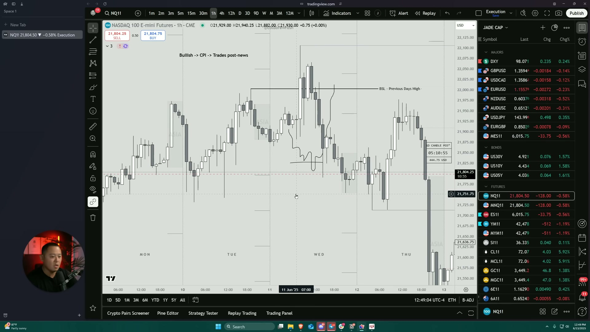

光有偏向并不足以让你赚钱。关键是知道何时正确使用这个偏向，并把时机卡准。因为我能举很多例子，比如价格并没有打到午夜开盘下方，

## [11:32](https://www.bilibili.com/video/BV1haaV66EFs/?t=692)

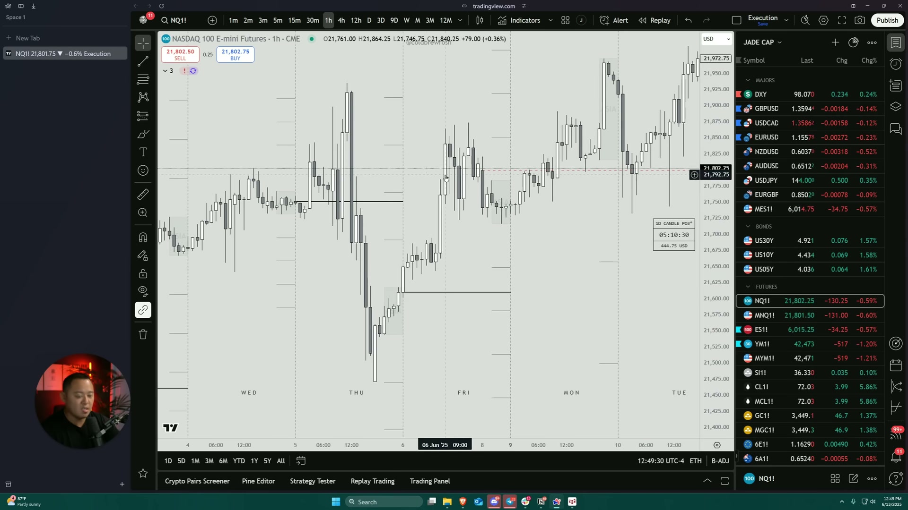

我坐下看盘时，却已经到了某个关键位。

## [11:36](https://www.bilibili.com/video/BV1haaV66EFs/?t=696)

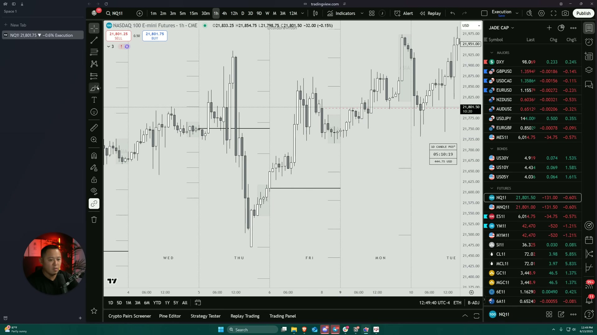

假设我确实看涨。但没有向下操控。价格却已经走到上方溢价区。那个溢价区可能是看跌订单块，看跌FVG前一日高点之类。那我就只能坐着不动，

## [11:54](https://www.bilibili.com/video/BV1haaV66EFs/?t=714)

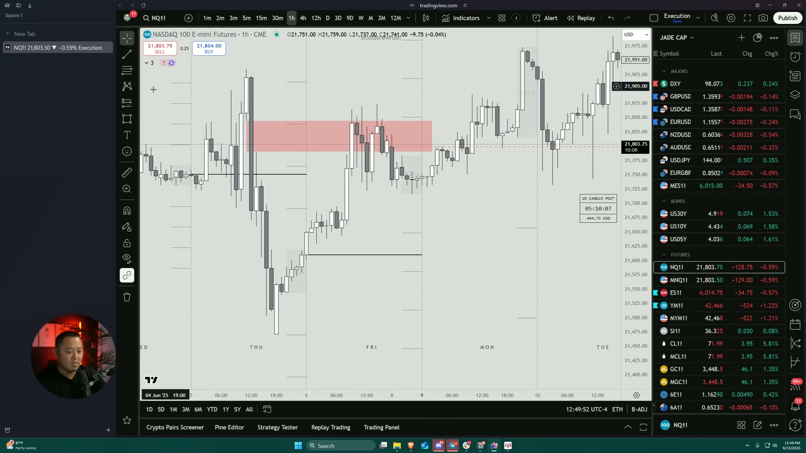

因为时间和结构对不上。所以我经常因此空仓观望，因为很多环境根本说不通。最近市场里很多环境也确实不太讲得通，比如一直震荡，价格在我不预期的时候动。日内高低点也出现在我不预期的时段，比如这里，

## [12:18](https://www.bilibili.com/video/BV1haaV66EFs/?t=738)

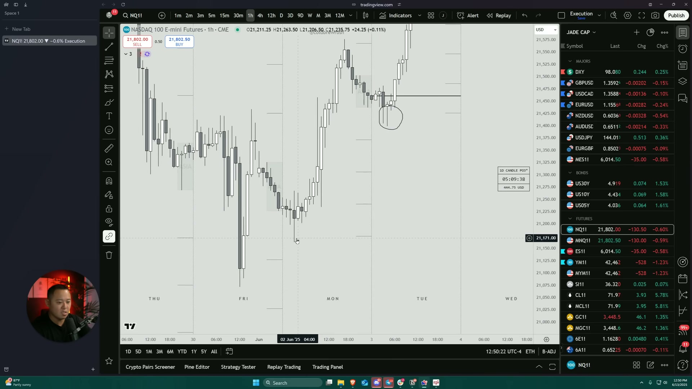

伦敦时段就打出日内低点，而我预期波动该在纽约。如果纽约时段已经在前一日高点附近交易，我风险就很大了，因为时机判断错了。

## [12:30](https://www.bilibili.com/video/BV1haaV66EFs/?t=750)

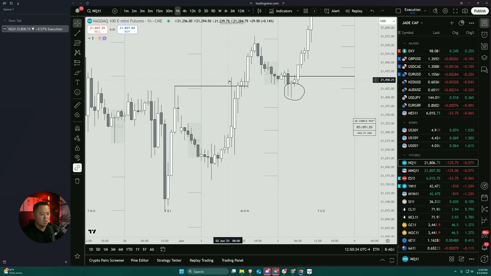

如果我们已经在前一日高点上方交易，

## [12:34](https://www.bilibili.com/video/BV1haaV66EFs/?t=754)

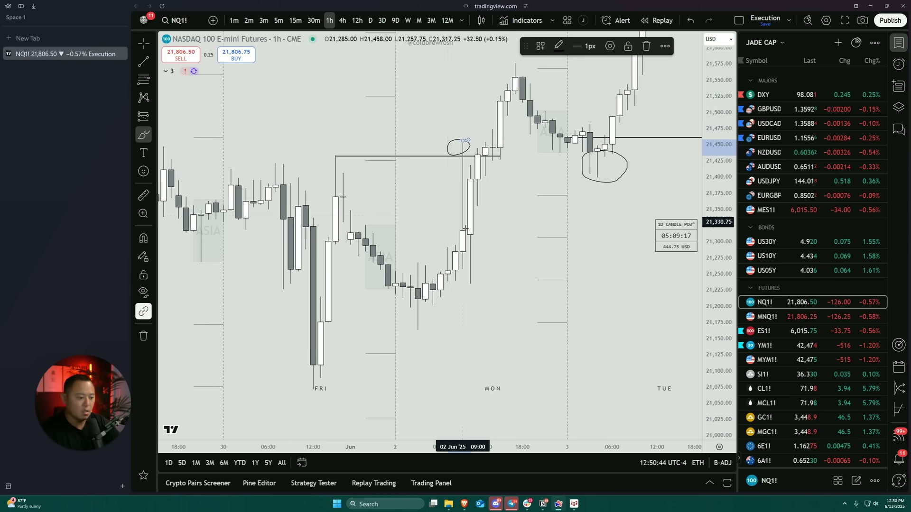

而这才早上九点。即便看涨。九点就已经在这么高的位置。对我来说，也不是适合追多的信号，所以时间必须和偏向对齐，这跟有偏向本身一样重要，甚至更重要。

## [12:52](https://www.bilibili.com/video/BV1haaV66EFs/?t=772)

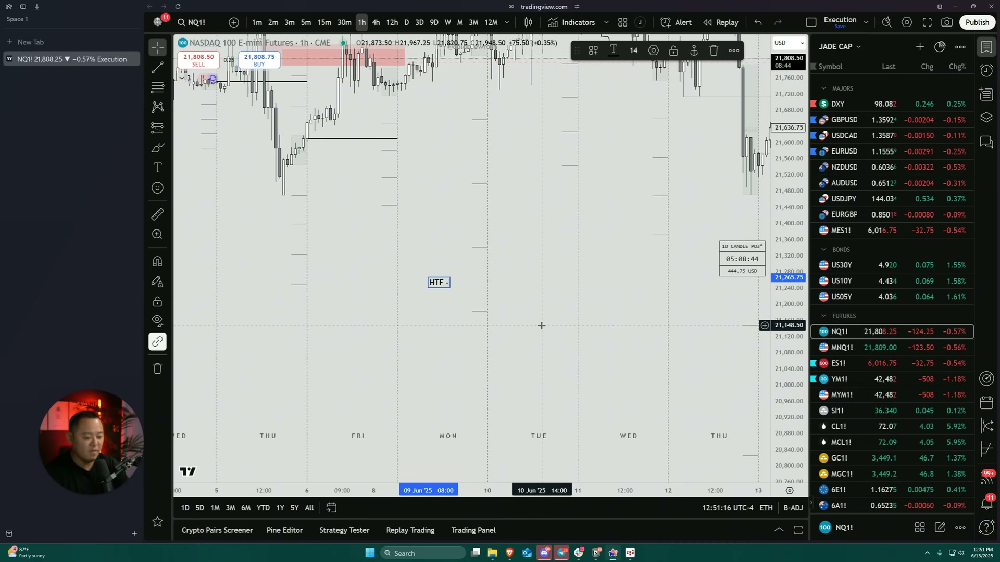

我们把学过的内容再拆一遍，大周期偏向来自对溢价折价的理解，然后再形成预期。

最后一块拼图是时机。我们分析大周期，搞清溢价、折价、日线可能去向。

## [13:18](https://www.bilibili.com/video/BV1haaV66EFs/?t=798)

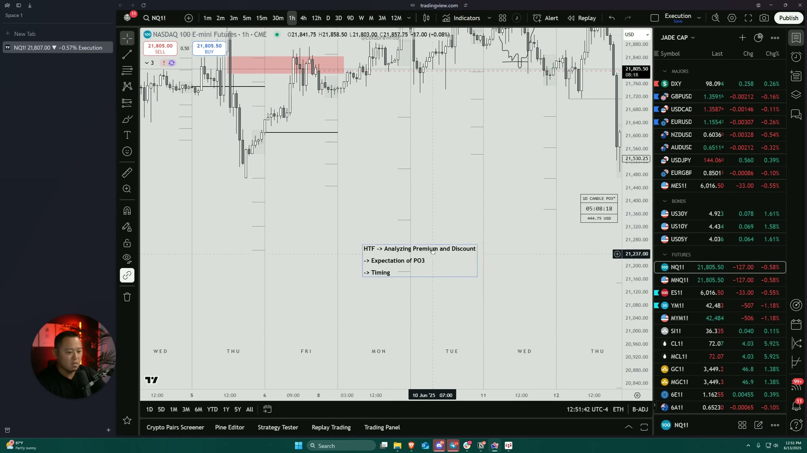

以及理解PO三。周末，我通常会这样看这些图。

## [13:28](https://www.bilibili.com/video/BV1haaV66EFs/?t=808)

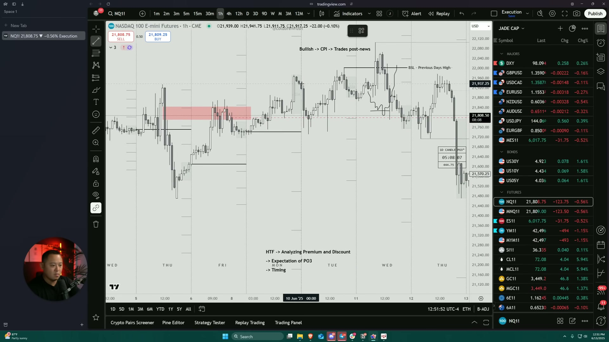

去想市场大概什么时候会往下走，什么时候才会形成适合我正确站位的结构，好吃到那一波行情。

## [13:42](https://www.bilibili.com/video/BV1haaV66EFs/?t=822)

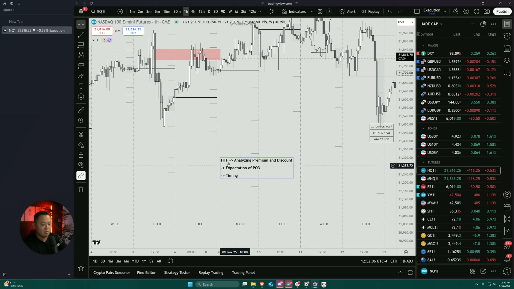

如果我坐下看盘时，对P O三的预期已经跟时间或价格对不上。

## [13:52](https://www.bilibili.com/video/BV1haaV66EFs/?t=832)

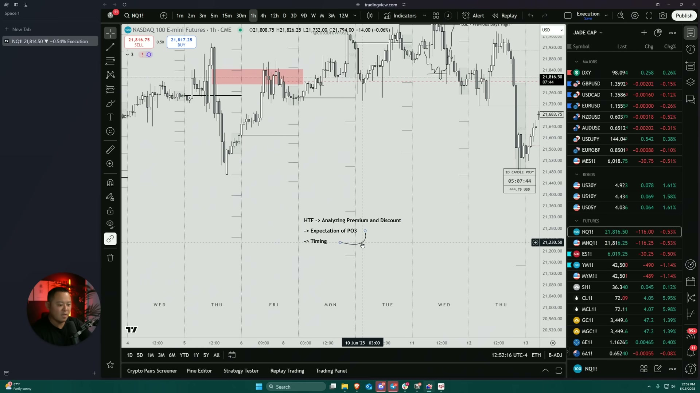

我就能避免明明有强偏向，却盲目冲进去。哪怕我强烈认为市场会走高，但时间周期对不齐，我也等于没有单可做，因为拿不到合理盈亏比。

我们已经在扫前一日高点了，而我的偏向还是看涨。时机对不及时，

## [14:12](https://www.bilibili.com/video/BV1haaV66EFs/?t=852)

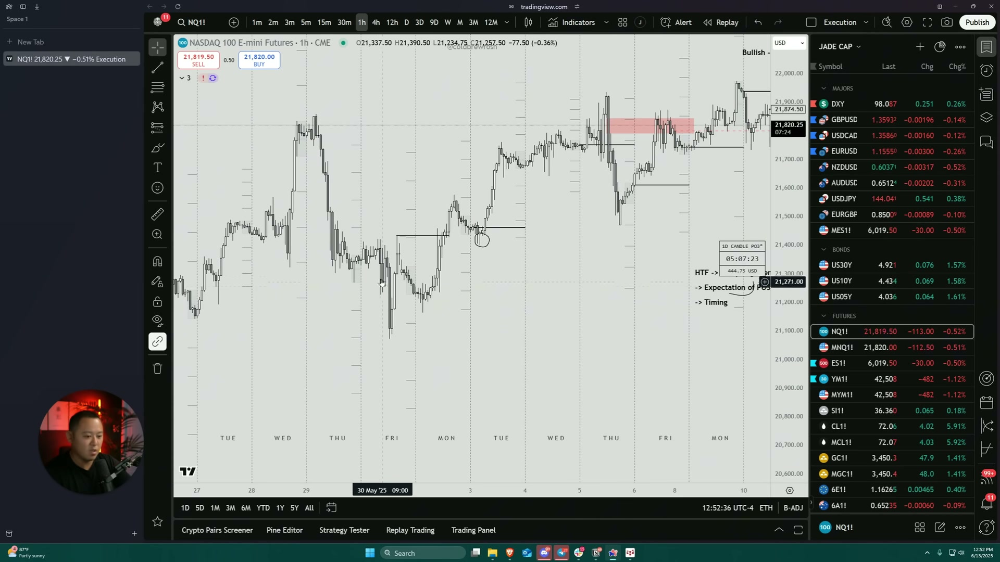

有很多办法可以避开那些单。

## [14:16](https://www.bilibili.com/video/BV1haaV66EFs/?t=856)

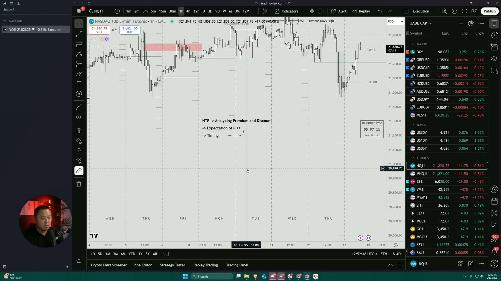

很多都来自看日历，提前计划每周、每天的预期。

一旦出现对不上的情况，比如你交易时段看空，却在扫前一日低点。

也许那天该走的行情已经走完了，你就该空仓。等下一天。我知道这期很快，但这堂课很重要。找偏向做偏向时，很多人最容易忽视的就是这一点。交易里的时机差别真的非常大。如果你坐下时市场已经走到你的目标了，也许明天再来就好。希望这期对你们有用。我们下期见。

