# 【中配】ICT进阶四：ICT 交易者最该搞懂流动性

- 作者 耳朵数字观察
- 时长 15:55
- 来源 [https://www.bilibili.com/video/BV1Z9an6BEV2/](https://www.bilibili.com/video/BV1Z9an6BEV2/)
- 由 course2md 生成 · 29 张截图 / 44 段文字

---

## [00:02](https://www.bilibili.com/video/BV1Z9an6BEV2/?t=2)

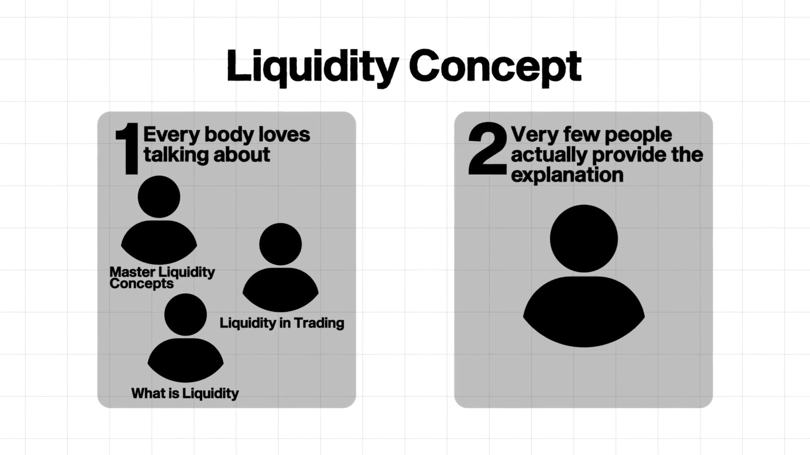

流动性这个概念，人人爱谈，但真正讲清它为什么起作用、怎么起作用的人很少。这期视频我会把流动性讲简单，让你明白市场为何会在特定价位反应，以及怎么利用它。不过，在正式开始前，先想一个问题：什么是市场？把市场想成一个大竞技场，

## [00:18](https://www.bilibili.com/video/BV1Z9an6BEV2/?t=18)

买卖双方在里面互相争夺。都想给自己的订单拿到最好价格。举个例子，如果我是汽车经销商，我想把车卖出尽可能高的价格；反过来，如果我是买车的人，我想花尽可能少的钱把车买下来。所以，请大家看一下这张订单簿的图。看视频的过程中，一直把它记在脑子里。另外，新朋友记得下载我的简易交易框架PDF链接，在简介里。好，不再耽误大家时间，拿好笔记本，我们开始。好，我们来聊流动性。

## [00:44](https://www.bilibili.com/video/BV1Z9an6BEV2/?t=44)

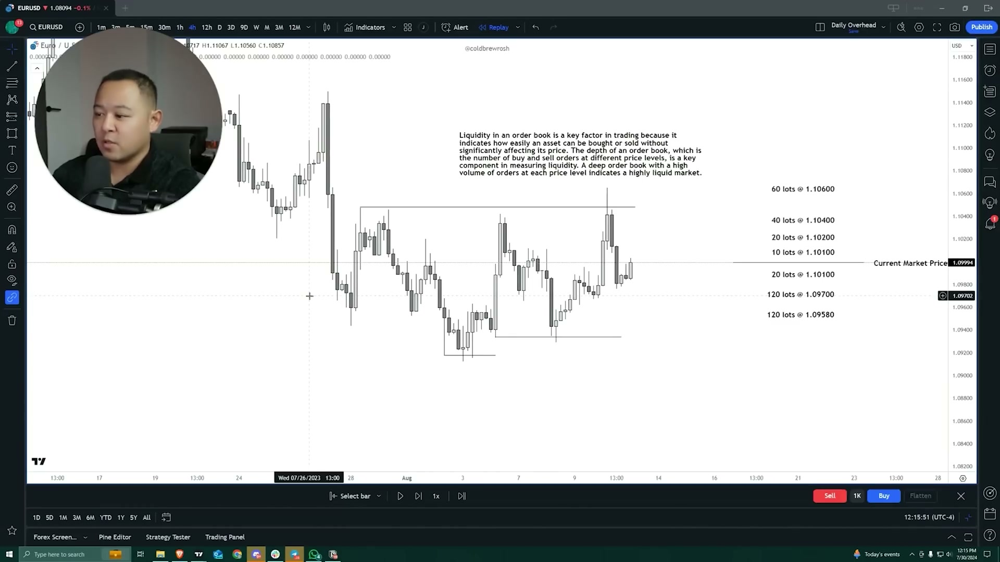

尽量把事情讲简单，这样看图时就能清楚知道发生了什么。也能更有把握地理解市场为什么会走到某个特定价位。如果你还没见过订单簿，或者带

## [00:56](https://www.bilibili.com/video/BV1Z9an6BEV2/?t=56)

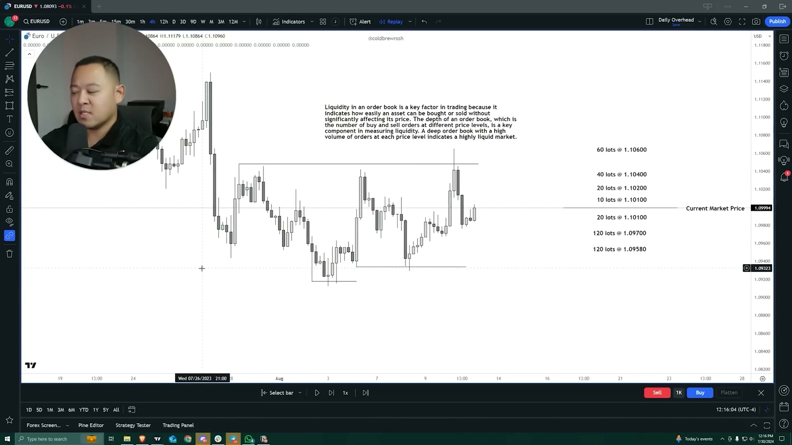

Level 二多档买卖报价的逐笔成交明细，长什么样？基本流程是这样：我进入市场下单，

## [01:04](https://www.bilibili.com/video/BV1Z9an6BEV2/?t=64)

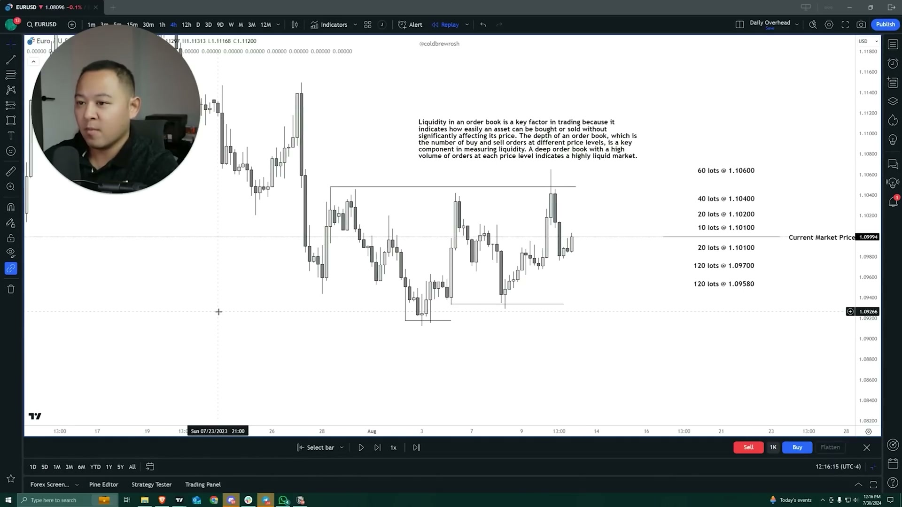

订单会以试驾单或现价单的形式进入订单部。

订单部里会有挂单，也就是其他所有参与者的订单。前提是这个市场有集中的行情数据。外汇没有集中的行情数据。所以，我们拿不到订单部。除非真能想办法从经纪商那里拿到，但经纪商不会分享这些信息。不过，在期货、股票等市场，你能在订单簿上看到所有订单。而我们看到的图表，只是所有已成交订单的一种呈现。所以，我们不光有订单簿，还有逐笔成交明细。每笔订单在当前市价撮合时，一个买价会对上一个卖价。

## [01:42](https://www.bilibili.com/video/BV1Z9an6BEV2/?t=102)

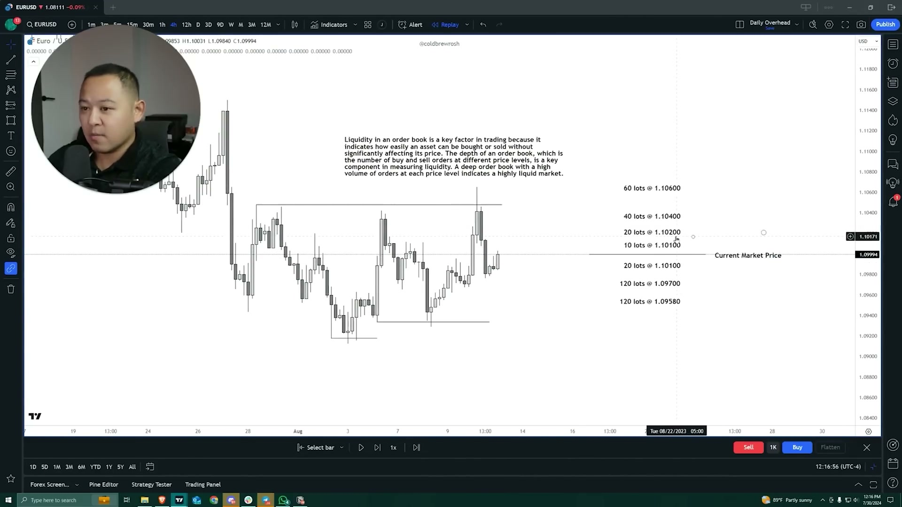

这笔成交就会列进主笔成交明细。

## [01:50](https://www.bilibili.com/video/BV1Z9an6BEV2/?t=110)

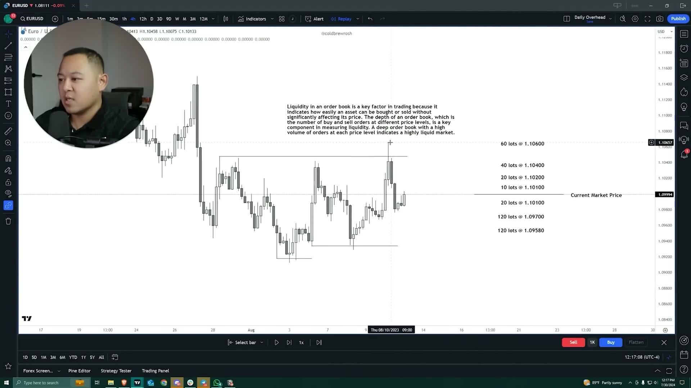

那流动性到底是什么？订单簿里的流动性是交易中的关键因素，因为它反映一项资产能多容易地买进或卖出，同时不明显影响价格。订单簿深度，也就是各个价位上买单和卖单的数量，是衡量流动性的关键指标。订单簿很深，每个价位都有大量订单。就说明这个市场流动性很高。像外汇这样的市场，

## [02:12](https://www.bilibili.com/video/BV1Z9an6BEV2/?t=132)

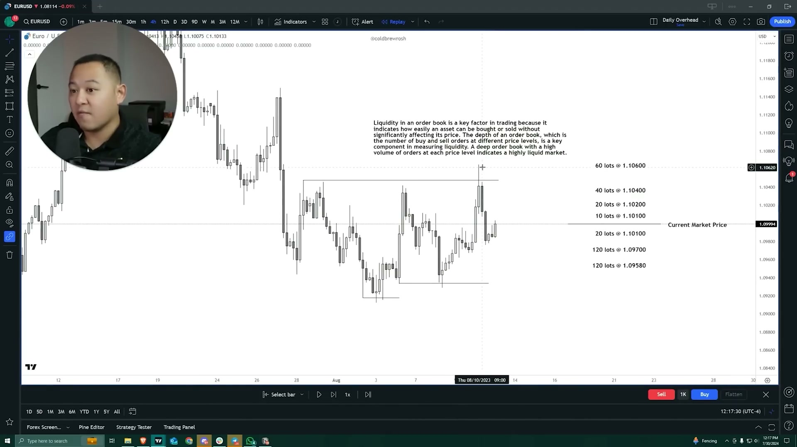

我们之所以常看到区间震荡，就是因为成交量很大，多空两边都有大量交易在发生。

## [02:24](https://www.bilibili.com/video/BV1Z9an6BEV2/?t=144)

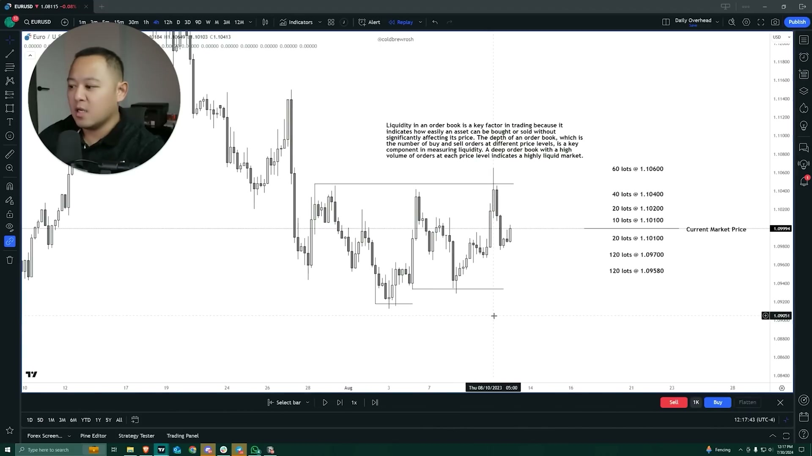

那么，价格卡在区间里到底意味着什么？这期视频的目的就是让大家看图时能在脑子里看见流动性。我觉得很多交易讲师和交易者就错在这里：

## [02:34](https://www.bilibili.com/video/BV1Z9an6BEV2/?t=154)

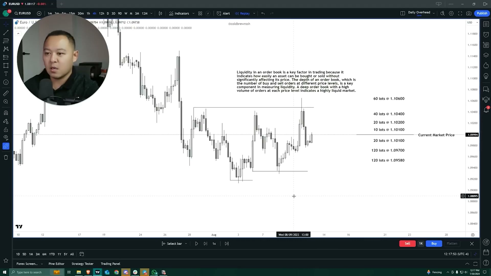

他们只把K线当K线看，却不去梳理背后正在发生的市场叙事。我在交易路上做的最多的就是听播客，看大量早年的视频。

想象自己就站在交易所的交易大厅里。比如，在互联网时代之前，你得人在交易大厅才能交易。所以说，到底你看到的图表，只是所有通过网络市场在线连接的交易者的一种呈现。但以前在交易大厅，我能看到交易池里的每一个人，也可能看到他们所有的订单。只要我知道他们想报什么卖价，出什么买价。他们可能会喊：“我要在这个价买一百手。”我能看到这笔订单，因为那个人就站在我面前。而现在，这些信息大多丢失了，因为我们只是盯着屏幕。有个很好的YouTube视频，我看了很多遍，叫《Floor》的是部纪录片，大家可以搜来看看。但一定要把自己代入场内交易员的角色。这些人里很多确实在猎杀止损，专挑弱者下手。但等到转向电子化市场，很多人撑不下去了，因为他们没法把交易池里感受到的情绪转化到图表上。这才是流动性的本质。流动性就是在市场里操作的人，也就是市场里各种不同的参与者。

## [03:56](https://www.bilibili.com/video/BV1Z9an6BEV2/?t=236)

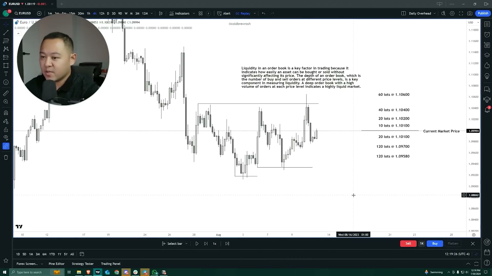

那我们来聊聊某个市场为什么会动，以及怎么把它具象化。

这里举个例子，

## [04:04](https://www.bilibili.com/video/BV1Z9an6BEV2/?t=244)

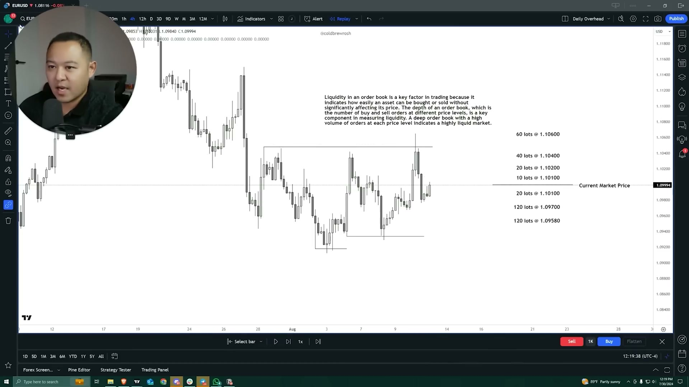

我们看的是欧元。不过看什么品种其实无所谓，想的话可以把代码隐藏起来。如果我们要识别流动性，把自己代入聪明钱交易者的角色。

我能从这些市场读出什么叙事？价格跌破旧低点，涨破旧高点时，又发生了什么？比如说，我们现在就在这个区间里。那根据这边订单簿上看到的情况，价格会怎么反应？就假设这是我们的订单部，这边是买单，我写出来。这边是买价，这边是买单，买单挂在市价下方，因为他们想尽量买到最便宜的价格。卖家愿意在某个价位卖，但他们能接受的价格只能低到一定程度。再把自己想成汽车经销商，假设我们卖的是兰博基尼。这条路上有十家经销店，其中一家卖八万，其他几家都卖十万，只是假设。只有一家卖八万，而且它的库存有限。假设它只有十台兰博基尼。他想按八万卖掉，这时来了个买家，想按八万买二十台。可这家经销商没有足够库存卖他二十台兰博基尼，买家只能去下一家，想办法把价格谈下来。好，再假设越来越多买家进场，都愿意按同样的价格买兰博基尼，但已经没有库存了。

局面要改变，只有两种办法：要么卖家愿意降价，要么买家愿意提高出价。

这就是市场最简单的运行机制，它就是一场拍卖。但有时候坐在图表前，我们就丢了这层叙事，完全忘了市场背后发生的正是这些。所以，当一个大买家进场，能一口气扫掉大量卖单时，价格就会迅速跳升。这就是理解流动性的关键。之所以会出现流动性空白、低效区以及旧高点和旧低点。是因为存在一定量的需求或供给。随你怎么叫。没错，ICD体系创始人听了可能会发火，但这时已经无所谓了。这就是我在脑中描绘市场，让自己和市场保持同步的方式。幕后到底发生了什么并不重要，我只是想对自己的进场形态更有信心。真正看清正在发生什么，因为说到底，市场就是一群人在互相较量。想象一下，有很多人在排队。我把这些复制一下，想象这些人都在排队等着买车。

## [06:46](https://www.bilibili.com/video/BV1Z9an6BEV2/?t=406)

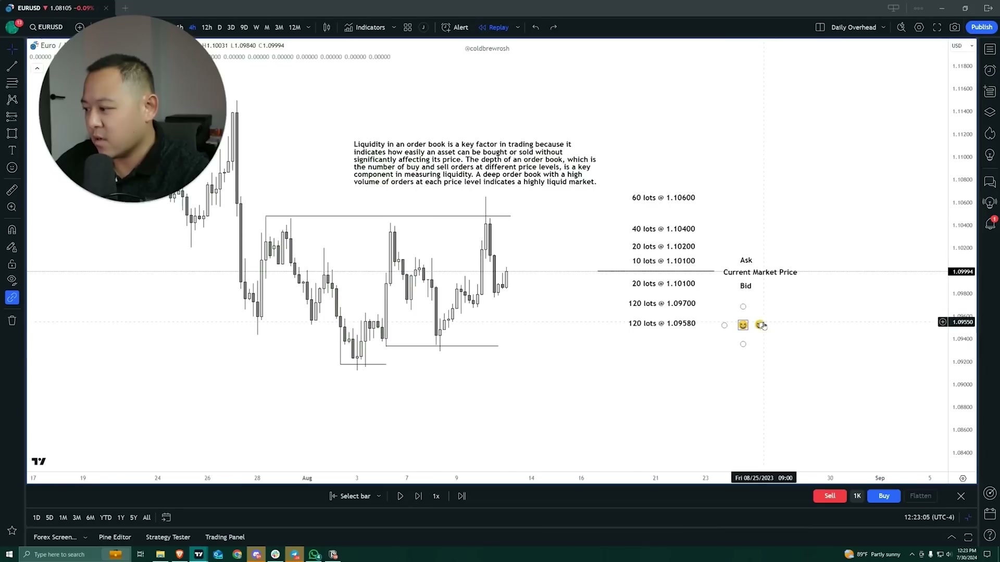

经销商在上面吆喝个不停。

当订单簿变薄时，

## [06:54](https://www.bilibili.com/video/BV1Z9an6BEV2/?t=414)

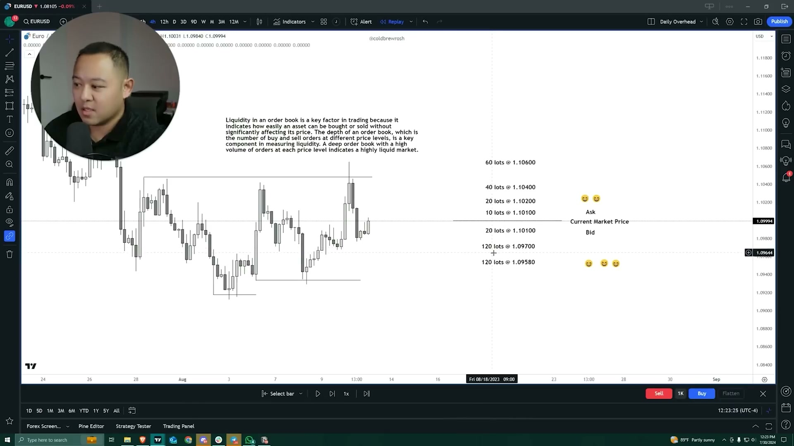

比如这笔二十手和这笔一百二十手，假设有一百四十个人愿意按八万买兰博基尼。他们会很快吃掉这三笔订单，除非有新的卖单进来，因为订单部一直在变。假设这三笔订单就这样没了。现在我们还剩。假设这笔成交了。假设这二十手成交了。因为有些经销商愿意降价，或者这笔二十手的买单愿意提高出价。八万买不到，也许就出九万，双方在讨价还价，这就是买卖价差。再假设还剩八十手愿意买的量，买家越来越多，卖家却跟不上。

## [07:40](https://www.bilibili.com/video/BV1Z9an6BEV2/?t=460)

没错，这跟你平常看的流动性视频有点不一样。但我觉得，深入讲，他为什么真的有效的交易者太少了。没错，我们能标出旧高点和旧低点，但怎么才能有把握的判断这里可能是在扫流动性？下一个流动性目标又在哪？

## [07:56](https://www.bilibili.com/video/BV1Z9an6BEV2/?t=476)

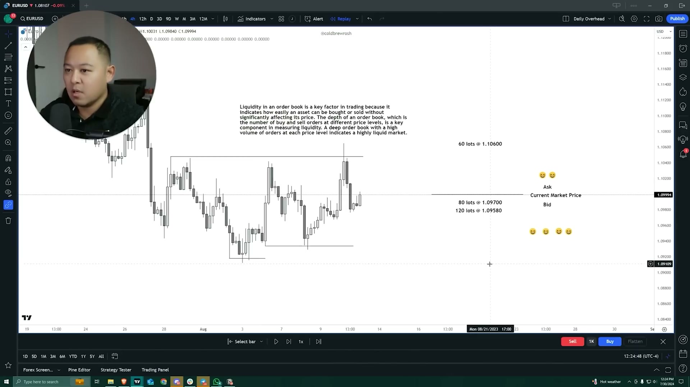

这期就是想把它简化，因为市场太复杂，你又在学各种各样的东西。我们试着简化，回到最基础的问题。首先，什么是市场？现在还有两百个人愿意买兰博基尼，他们可能得把价格往上加一点。不止这样，这些价格都得往上抬。

## [08:16](https://www.bilibili.com/video/BV1Z9an6BEV2/?t=496)

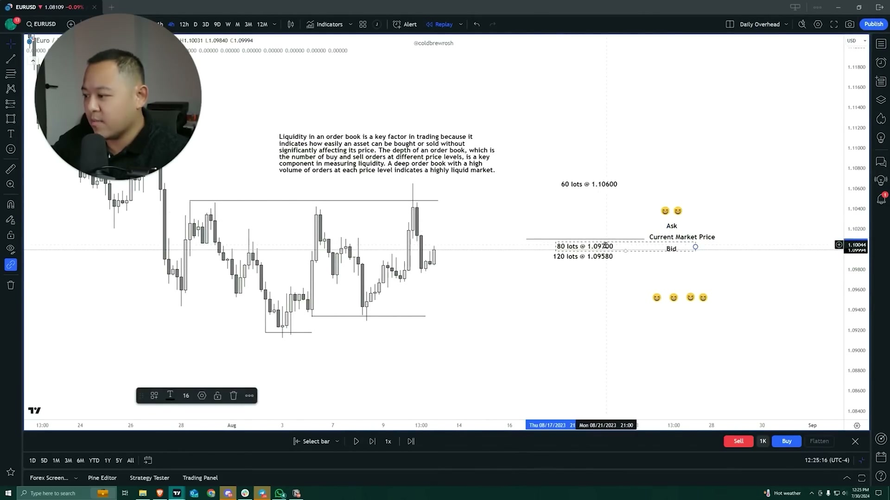

这个价可能涨到一点零九七九零，这个涨到一点零九八百。

但假设卖家不够，没人愿意在某个价位卖。

## [08:30](https://www.bilibili.com/video/BV1Z9an6BEV2/?t=510)

下一个有人愿意卖兰博基尼的价位，假设是十一点五万。再假设它对应一点一六。只是理论上。这时，如果兴趣够大，可能就会冒出一个大买家。

## [08:46](https://www.bilibili.com/video/BV1Z9an6BEV2/?t=526)

假设这个市场不动了，这里就会出现一些公允价值缺口。原因就是没有流动性。反过来，如果有流动性，比如越来越多人不断进场，一直按九万报价卖兰博基尼，他们就能一直把价格压住。

所以，市场卡在区间里时，买单和卖单数量相当。每成交一笔买单，就会有新的卖单补上。但订单不宜变薄，只要买盘够强，就会出现公允价值缺口这类快速成交，有人叫它单一印记。如果你真想深入研究Level Two和主笔成交，这个可以自己去研究，看看是不是有单一印记让市场跳动。可能会有个大买家进场，心想：你们都不肯按。比如说，十万买。假设这台兰博基尼这里标价十万，有人会直接插队，这就是单一印记的由来。因为总有人会想：行，我有钱，我直接按卖价买，反正这市场不会跌下来。但如果没人愿意买，市场就会开始下跌。因为卖家不会永远捂着库存。这就是简单的市场机制。思考流动性时，我们该关注的就是这个。所以看图时，别只把K线当K线看。

## [10:12](https://www.bilibili.com/video/BV1Z9an6BEV2/?t=612)

要试着看到K线背后。因为那才是流动性的真正体现。出现单一印记或非常快的走势，是因为买卖双方失衡了。好，这只是个很短的视频，但希望大家能有所收获，

## [10:30](https://www.bilibili.com/video/BV1Z9an6BEV2/?t=630)

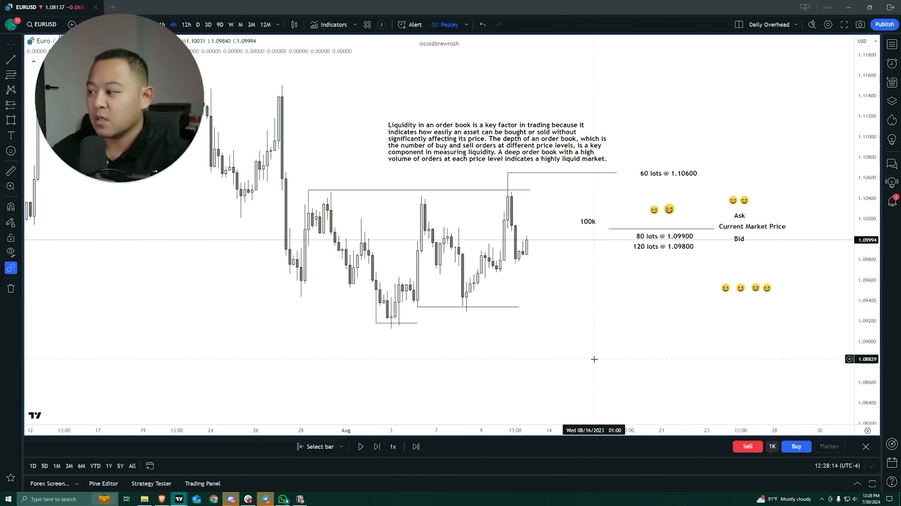

对市场怎么运作多一点了解，因为每个人都应该懂市场怎么运作。

其实很简单。如果我是买家，我想在某个价位买，而且不愿意超过某个价。而外面有个卖家。不愿意低于某个价卖。所以，当旧高点、旧低点层层堆起来时，就有很多卖家不到那个价位不肯卖。

## [10:54](https://www.bilibili.com/video/BV1Z9an6BEV2/?t=654)

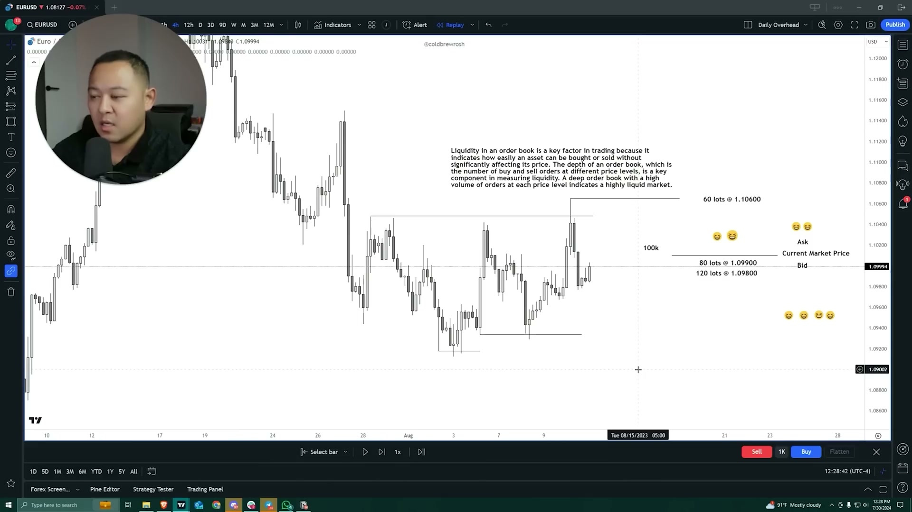

所以，坐在图表前时，

## [11:00](https://www.bilibili.com/video/BV1Z9an6BEV2/?t=660)

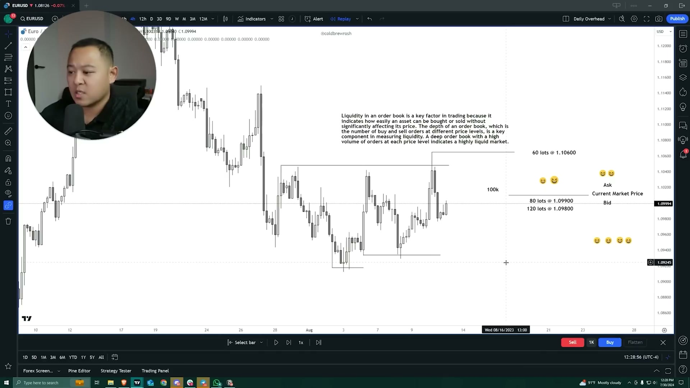

要真正去想象市场此刻在做什么。

因为价格卡在区间里时，很多时候就是买卖双方在交锋，基本就是个战场。想想买方和卖方，有人一直在买，有人一直在卖。可一旦卖的人不卖了，买家就太多了，东西的价格就会上涨。疫情期间，大家都见过，这就是简单的市场机制。卫生纸极度短缺时，价格直接跳涨，因为买的人太多，卖的人太少。未上市价格基本就是在走单一印记，所以这其实就是简化版的流动性。

## [11:38](https://www.bilibili.com/video/BV1Z9an6BEV2/?t=698)

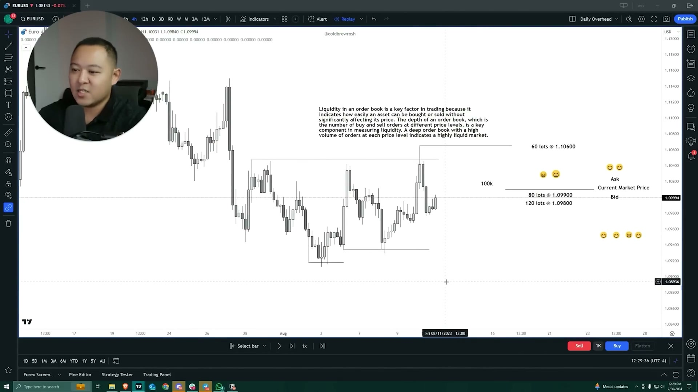

所以，当你看外面的视频，想理解流动性，却还是搞不明白时，就回到流动性的本源。流动性说到底就是人以及他们订单的规模。

## [11:50](https://www.bilibili.com/video/BV1Z9an6BEV2/?t=710)

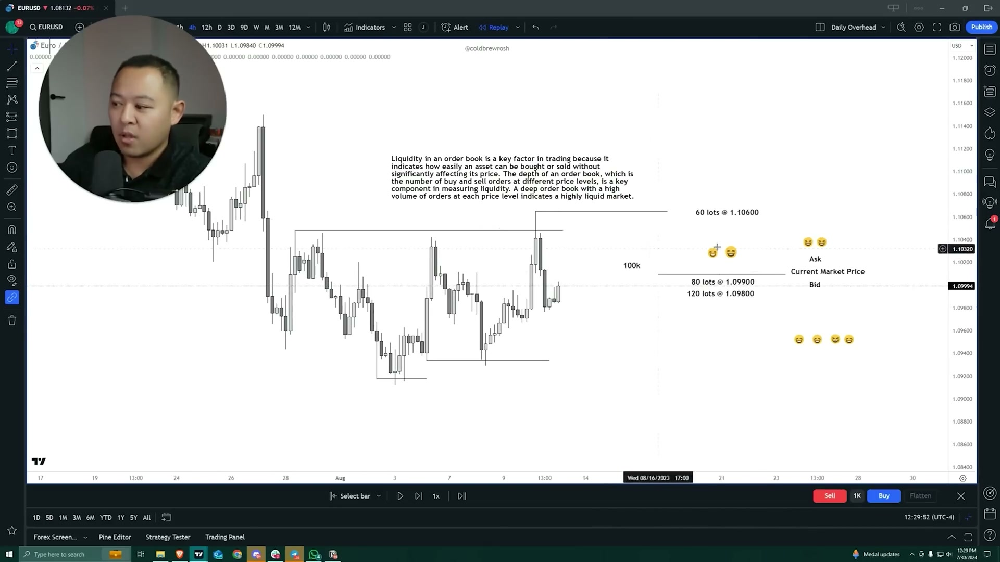

当市场某一边变薄，比如卖家太多，买家不够。那基本就是一场比谁更低的竞赛，卖家会不断压低卖价。比如说，市场上的人只肯花十万买房，而一大堆人要三十万才买。

谁都卖不掉房子，如果买价不动，最合理的结果是什么？买家一直不变，出价买的人也不够，也许会有一个冤大头上钩，把房子买下。但大多数时候，市场就是这样，买卖价差太大，总有一方得让步。价差太大时，就看谁先降价，或者谁先加价。如果更多人在加价，说明有需求；如果降价的人不够，就说明供给过多。这很好理解，但不知为什么，I C T交易者就是觉得这全是胡扯。你完全可以把ICD概念和真实的市场机制结合起来用，赚的多得多。因为你能理解市场怎么运作，而不是死守形态交易，或者只盯着屏幕。再说一次，如果你看过纪录片《Florida》，链接我放在简介里，看过就会知道，有些交易员没能从交易大厅转到电子交易屏幕前。因为他们感受不到真实市场的情绪，在网上买东西就很不一样，你得不到亲临现场的那种情绪感受。

疫情爆发时也是一样，你看到商店里人人都在抢卫生纸，那时你能读出情绪。但如果只是别人告诉你卫生纸快没了，或者你只在网上看到，就不会有同样的情绪冲击。因为流动性在市场里就是这样受影响的。现在全都电子化了，

## [13:46](https://www.bilibili.com/video/BV1Z9an6BEV2/?t=826)

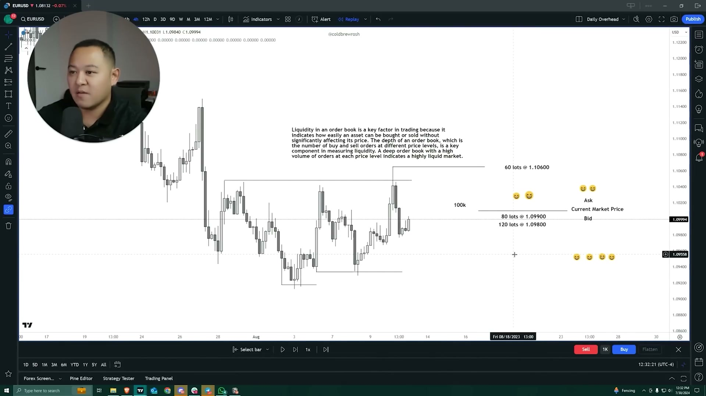

但试着把自己代入真正站在交易大厅里的人，会让你领先一大截。远胜过只看这些旧高点、旧低点，却不再往深处想。因为你想做的不只是一只乱点按钮的猴子。你想弄懂市场为什么动？想弄懂下一个关键价位会出现在哪里？

比如，我看空欧元，

## [14:10](https://www.bilibili.com/video/BV1Z9an6BEV2/?t=850)

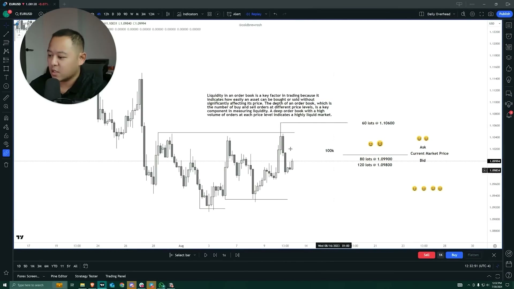

觉得它还会继续跌。顺便说一下，这是回放。

## [14:16](https://www.bilibili.com/video/BV1Z9an6BEV2/?t=856)

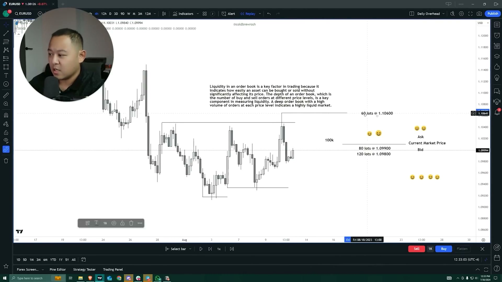

时间是二零二三年八月。如果我认为市场会继续跌，我就是假设，有足够多的卖家在这里进场。愿意在这个价位卖出。假设有六百个人愿意在那个价位卖掉兰博基尼。这，这是我的思路，因为我不在现场，看不到他们。我的思路是：好，价格一涨，破那个旧高点，成交了足够多的订单。但我手里还有满满一仓库的兰博基尼。这就是我想传达给大家的理解：流动性的核心，在某个价位上，愿意成交的参与者够不够，让市场反转，还是只是个假动作？你看这里，这就只是个假动作。但要明白，这里是在位移之后跌破旧低点，这里有一个单一印记，或者说几个单一印记，那里出现了严重失衡。买家进场，不停吃掉买单。我坐在屏幕前时，基本就只想这些。这远远超出ICT概念本身，关键是背后的叙事是什么？这个我会另出一期视频细讲。但这能帮我树立叙事，理解流动性，理解市场为什么该动。即便我不看订单簿，也要理解订单簿，理解它到底怎么运作。

因为我确实研究过一阵主笔成交和Level二，以后可能会用足迹图或者别的更好的工具重新研究。但外汇市场拿不到这些信息，所以我只能训练自己，在没有这些信息的情况下也能理解它。希望你喜欢这期视频，

## [15:44](https://www.bilibili.com/video/BV1Z9an6BEV2/?t=944)

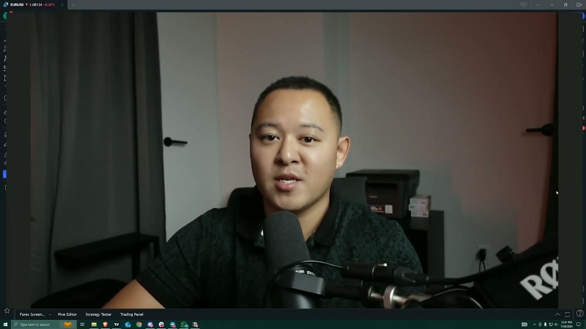

对流动性多了解一点儿。如果你有兴趣，每周跟我一起实时交易，一起学习。记得看看简介里的链接。也别忘了点赞、评论和订阅。我们下期视频见。

